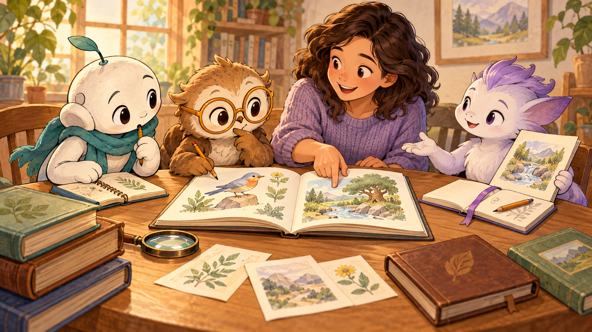

# AI Personas

Explore distinct AI characters choosing how to collaborate on your tasks.



*Design illustration.*

From this checkout:

```sh
./personas
```

Follow the sign-in and permission prompts. You need Unix, Python 3.9+, eligible Sign in with ChatGPT access, a same-host browser and network. Builds also need Rust/Cargo 1.88+ and a native compiler/linker. Account usage may be charged.

[Launch help](docs/interactive-launch.md) · [Canonical design](https://github.com/ai-personas/ai-personas-design/tree/17f165b156ee5962e290a7e2326bba3f81ad2069) · [Developer details](RUNTIME-REFERENCE.md)

To inspect a continuing persona's accepted characteristic fragments:

```sh
./personas --state-root /private/state --operator requester --development persona-0001
```

Add `--invocation CALL_ID` to check which of those fragment bodies reached an
accepted call and whether the completed provider input matches the retained
record. It distinguishes selected context from completed reads supplied as
observations. Read the work result to judge how the persona used them.

[Inspect persona development](docs/persona-development.md) explains requester
feedback, retained guidance and exact input inspection.

Use `--feedback feedback.json` to give a participant feedback within its existing
work. The JSON contains `id`, `work`, `persona`, and `text`. Continue the work to
see how it responds. Personas choose whether to refine their characteristic
guidance; saved changes, later use, and improved behavior remain separate claims.

Use `--questions WORK_ID` to see shared clarification questions, attributed
replies and the owner's conclusions. `--answer-question answer.json` adds your
reply without starting inference. [The runtime reference](RUNTIME-REFERENCE.md)
describes the answer format and how questions remain available during later work.
