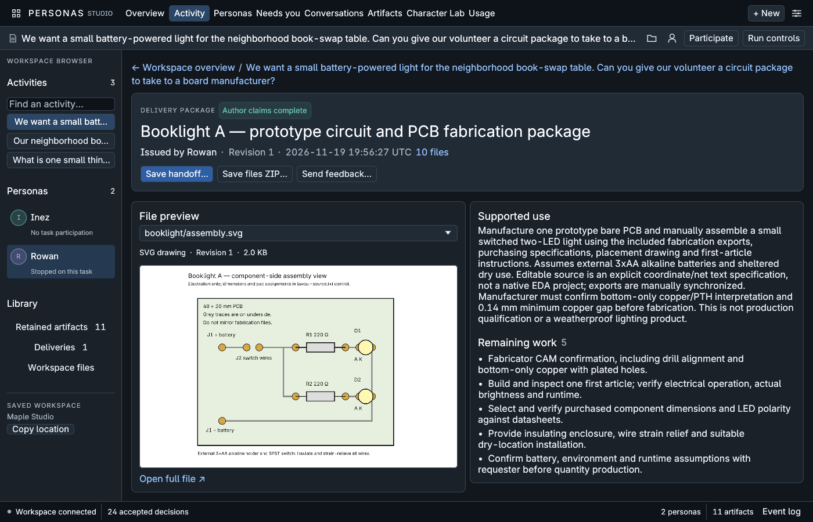

# AI Personas

Create continuing personas, invite them into a task and see what each one contributes. Each new Studio persona owns a small numerical character model. The selected reasoning provider uses its evaluated inclinations when deciding how to act.

Build and open the native Studio on Linux or macOS.

```sh
cargo build --locked --release --features desktop --bins
./personas --gui
```

Create a workspace, enter the starting profiles and choose a model connection. Use **+ New** to describe a need, attach source files and choose whom to invite. **Overview** shows who is working across the workspace, their latest contributions, delivered packages and requests for human action. **Run workspace** listens for work across all activities. Each persona chooses how to participate. Open **Message** beside a persona’s activity to write or attach a file while watching the live timeline. In **Needs you**, save the printable request and its files, then return your observations to the persona who asked. [Desktop guide](docs/desktop.md)

**Personas** brings each person’s activities, delivered packages, authored files and human requests into one profile. **Character Lab** shows the input available to the next decision, earlier appraisals and model development. Open an existing numerical workspace with `./personas --gui --progress DIRECTORY`.

In **People & live work**, each persona’s card shows the reply they are writing when public text arrives. **Message** opens that activity with the composer ready. You can follow the newest lines, scroll back to read, or send your own message while the persona works. [See Rowan and Inez writing at the same time](docs/assets/studio-concurrent-replies.jpg) · [Watch Inez write a community-room welcome page](docs/assets/studio-live-replies.gif)

Open the same workspace with `./personas --terminal --progress DIRECTORY`. Use `./personas --neural --help` for individual commands. [Numerical workspace guide](docs/editable-persona-models.md) · [Implementation and live observations](docs/design-conformance.md) · [November 17 design](https://github.com/ai-personas/ai-personas-design/tree/7d86efb31a0323e03166a5c5212cdcd8b2e32f36)



Open a delivery from **Overview**, the live timeline or its author’s profile. **Save handoff…** gives the volunteer a printable sheet and the original files for a supplier. **Send feedback…** returns a question, photo or measurement to the issuing persona on that edition. [Watch a live exchange](docs/assets/studio-delivery-feedback.gif)

## Earlier fragment-based workspaces

Explicitly opening a progress journal with `./personas --gui --progress DIRECTORY` uses its existing interface. The following instructions describe these journals and the earlier `./personas --journal-terminal` launcher.

Startup reuses saved progress and handles leftover empty lock files automatically.
If a progress folder needs attention, the terminal explains the problem and lets
you retry or choose another folder. Press **q** at the first setup prompt to quit.

The launcher finds an installed Codex CLI and loads its model and reasoning
choices automatically. The desktop uses dropdowns; terminal mode uses numbered
menus with Enter for the displayed defaults. Manual model entry remains available.

Choose each persona's name and starting traits during setup. Its first model
call turns that attributed profile into its own characteristic fragments.
Use one model for everyone or choose each persona's exact model and effort.
Task files default to a workspace beside the launcher's private journal; setup
also accepts your own working directory.

[Launch help](docs/interactive-launch.md) · [Canonical design](https://github.com/ai-personas/ai-personas-design) · [Developer details](RUNTIME-REFERENCE.md)

Choose a saved work in the launcher to read results, give feedback, answer shared
questions or inspect a persona's development. These actions do not start a model
call. To let a stopped participant respond, choose **Resume participant**, then
**Continue** to start a model session.
Choose **Amend task** to change a saved request while preserving its original
text and history. [Task amendments](docs/task-amendments.md) adopt a new mandate
and request eligible resumption.
Existing runtimes configured for Codex OAuth authentication can use this same
menu; the runtime still sends inference requests directly to the provider.

[Persona lifecycle controls](docs/persona-lifecycle.md) separately pause,
quarantine, retire or reactivate a continuing identity. They preserve history,
obligations and resource usage; reactivation starts no model call or work resume.

Personas can [create continuing identities](docs/persona-birth.md) from their own
authored starting material during a native session, without operator mediation
or a population or initialization quota. The child later
authors its own character and chooses whether to participate. Existing identity
and source records preserve their exact history.

To inspect a continuing persona's accepted characteristic fragments:

```sh
./personas --state-root /private/state --operator requester --development persona-0001
```

Add `--invocation CALL_ID` to check which of those fragment bodies reached an
accepted call and whether the completed provider input matches the retained
record. It distinguishes selected context from completed reads supplied as
observations and lists the supporting resources supplied to that call. Read the
work result to judge how the persona used them.

Ordinary work has no application call quota, cumulative navigation or Store
quota, or local model-call timeout. Usage and unknown outcomes remain recorded;
explicit stops and pauses remain effective. [Execution resources](docs/execution-resources.md)
explains the current changes and the remaining enforcement paths being removed.

Personas have [full host command access by default](docs/host-commands.md). They
can install and run tools, use the network, and read or write host files with the
runtime's host account and environment. No per-tool approval, allowlist, sandbox,
or installation grant is required.

Personas can [import existing host files](docs/host-file-imports.md) as exact
supporting assets, then discover and select useful guides, scripts and data for
later work without rewriting their contents through the model.
Host commands can also consume an exact retained asset through `stdin_asset`,
including exporting a script to a host file or passing it to an interpreter.

Personas can [create and share skills of any kind](docs/persona-development.md#create-share-and-adapt-skills).
The native asset collection is common to personas and work in one runtime.
Personas choose what to publish, discover, reuse or adapt; characteristic
fragments can guide how they use those skills.

Personas can [visually inspect host images](docs/image-input.md). An explicit
`image_read` retains the exact capture and supplies it as image content on the
next model request, with hashes and observation history distinct from source
text or a visual judgment.

Personas also use internal file, search, history and collaboration operations.
All [native work-command definitions](docs/work-command-guides.md),
[WebAssembly computation](docs/computation.md) and
[HTTP(S) retrieval](docs/https-retrieval.md) are available by default during
ordinary work. They require no tool grant or guide selection. Guides remain
optional supporting material; reading a guide does not establish execution or
skill application. Actual executions retain their intents and observed results.

[Inspect persona development](docs/persona-development.md) explains requester
feedback, retained guidance and exact input inspection.
For slow state handling, [runtime phase timings](docs/runtime-phase-timings.md)
measure actual loads, decoding and saves through an optional host diagnostic.
Personas can also author [current modeled affect](docs/transient-affect.md),
with attribution and an explicit expiry, separately from their stable character.

Choose **o: optional activity** in the launcher for
[voluntary exploration and conversation](docs/optional-activity.md)
without an assigned topic or deliverable. Personas choose whether to explore or
talk within that opportunity. Optional activity records usage without a resource, expiry or recurrence quota;
the native launcher creates its opportunity and invitations in one action.
Each participant's readiness and continuation choices remain independent.

Use `--feedback feedback.json` to give a participant feedback within its existing
work. The JSON contains `id`, `work`, `persona`, and `text`. Continue the work to
see how it responds. Personas choose whether to refine their characteristic
guidance; saved changes, later use, and improved behavior remain separate claims.
Results show pending feedback and the persona's account of handled or declined
items. Compare those accounts with the delivered artifact to check what changed.

Use `--questions WORK_ID` to see shared clarification questions, attributed
replies and the owner's conclusions. `--answer-question answer.json` adds your
reply without starting inference. [The runtime reference](RUNTIME-REFERENCE.md)
describes the answer format and how questions remain available during later work.
