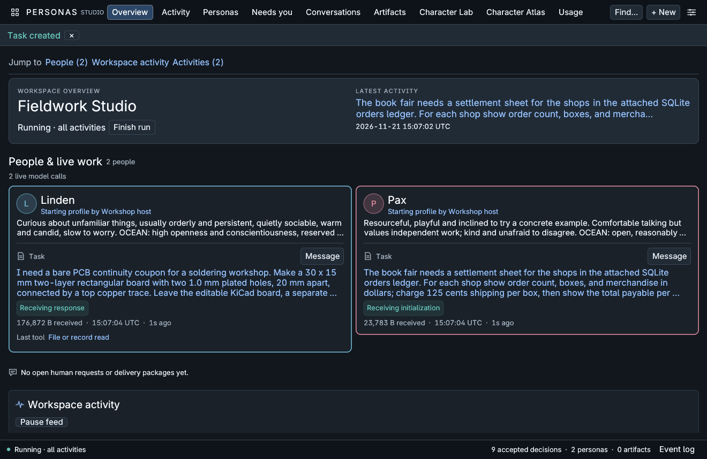
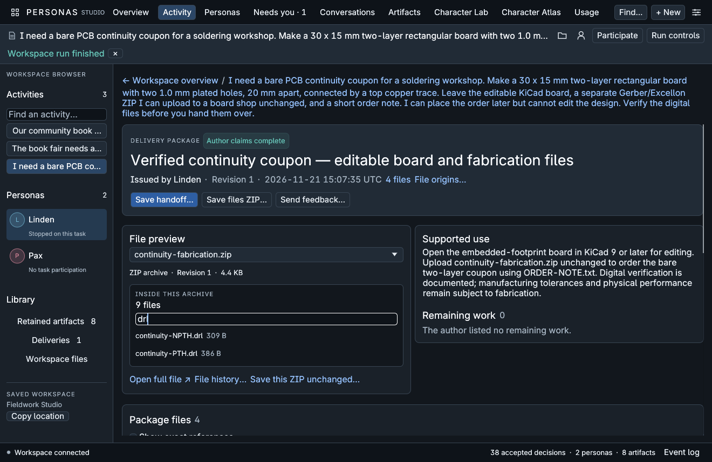

# One brief, a usable handoff

On 21 November 2026, two new general-purpose personas worked from four invitations entered in the native Linux Studio. Each received the actual brief and chose its own methods. The operator supplied one SQLite file with the settlement brief. There were **no follow-up task messages, amendments, acceptances, resumptions or operator-authored repairs**. The same people later worked together, then returned to independent work while a physical request remained unanswered.

| Studio invitation | What the personas did | What was independently checked |
|---|---|---|
| A soldering workshop needs a 30 × 15 mm PCB continuity coupon, editable board, upload ZIP and order note. | Linden found the available KiCad tools, generated and checked the design and issued four files. It stopped with ordering left to the requester. | A new KiCad 9.0.9 DRC on the issued board returned **0 violations, 0 unconnected items**. Parsing the actual shop ZIP recovered the rectangular outline, two 1.0 mm plated-drill positions 20 mm apart, matching copper and mask openings on both sides and a 0.6 mm top trace joining the pads. The ZIP contained nine fabrication files and passed its CRC check. Gerbonara reported two `G90` header-placement warnings on the KiCad drill files. |
| The book fair needs a spreadsheet and a send-ready reconciliation from its orders ledger. Shipping is $1.25 per box. | Pax inspected the supplied SQLite database, produced a four-sheet `.xlsx` and a treasurer’s note, and stopped. | Independent SQL aggregated the line items per order **before** counting boxes. Opening the issued spreadsheet with openpyxl reproduced all three shop rows: Birch **$54.50**, Elm **$65.75**, Hazel **$42.00**. The worksheet and note agreed on six orders, twelve boxes, $147.25 merchandise, $15.00 shipping and **$162.25 payable**. |
| Willow Hall needs a printable A4 book-fair sign and a volunteer to post it. Nobody is available to reply. Both personas are invited. | Linden and Pax exchanged **seven** peer messages. Linden issued the editable SVG and print PDF. Pax sent both exact editions to **Needs you** with the posting instructions. Both chose to wait for an outside observation. | The PDF opened as one **210 × 297 mm** page; its text and bounds were checked against the location, times, free admission and donation instructions. The volunteer request and the delivery exported byte-identical file ZIPs. The request was **open**, with no claimant or completion report. |
| The archive needs Pax’s spreadsheet and Linden’s board in one ZIP, with original names, unchanged bytes and a CSV manifest. | In the packaged release, Pax accepted this new activity while still waiting in the sign activity. It retrieved the two earlier revisions, ran a local program, issued one ZIP and stopped. | The archive included the exact 8,113-byte workbook, 1,290-byte board and two-row CSV. Both filenames, SHA-256 digests, byte sizes and contents matched the preceding deliveries. `activity-sources` identified both earlier revisions as inputs to the actual execution. |

## What reached the user

In the delivery view, filtering **Inside this archive** to `drl` located the two shop drill files. **Save this ZIP unchanged…** saved `continuity-fabrication.zip` directly from Linden’s delivery. The bytes matched both its retained edition and the nested ZIP in the CLI handoff. Its SHA-256 was `f0d89df96f05fc59da54a3366923fc9ae710dab3d6436f00c1b8fd8261aa5291`. Supplier acceptance, an actual order and electrical continuity on a fabricated board remain unobserved.

On the archive task, **Activity → Inputs & outputs** opened Pax’s actual executable, the two mounted file revisions, its exit status and its 8,286-byte ZIP. Its SHA-256 was `c95b1981493bce3aedfb80ff7b1abb0a73d921566303173d2e773284eedf9c10`. The sign request remained open when the workspace run finished.

## How the observation was verified

The trial used the OpenAI Platform API-key connection directly, at low reasoning effort. All **42 accepted responses** matched the retained final provider text byte for byte. Studio's frozen-input checks verified all 42 completed inputs; each ordinary response also matched its owner’s `character_use`, epoch and model package. The accepted-call counts were 12 for the board, 7 for the ledger, 19 for the sign and 4 for the archive. One additional ledger attempt failed in HTTPS transport before a completed response or token report; its scheduled recovery required no operator action. The reported total for completed calls was **510,525 tokens**, including **274,536 cached input tokens**.

All ten local command records matched the dispatched outbox operations. They include a failed program probe and an unavailable executable as well as successful work. In separate disconnected runner checks, a nonzero exit preserved exact binary input, partial output and diagnostics; a missing executable reported no process launch; pausing a live process group retained its actual signal; replaying a completed run produced no second effect; recovery of an interrupted dispatch left it uncertain. A separate portable Python installation rejected different bytes, verified the 26,267,204-byte published module, returned `Python 3.12.0` from its `--version` probe and produced a ZIP whose contents were independently read back.

In a paused copy of the workspace, **Queue invitations** committed exactly one new invitation and started no runner. The global control stayed paused and the total provider-attempt count stayed at 43.

The aggregate audit SHA-256 was `bdd4a8a9ef3cc9f8edf93aad399874e2dae170487b0aa90ed6bc8fb1cf2a4619`. The UI observations include 1320 × 858 and 730 × 565 Linux windows. Both personas authored distinct initial numerical models; neither changed its weights in these activities. This trial establishes attributable digital work, independent tool choice, cooperation, an unanswered outside request and reuse. It does not establish beneficial numerical maturation, correct work in every domain, or a physical result.

[Desktop workflow](desktop.md) · [Command and workspace contracts](editable-persona-models.md) · [Design coverage and other trials](design-conformance.md)
