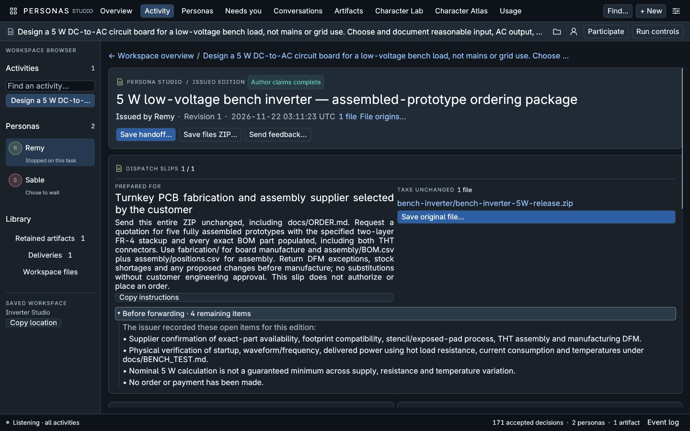

# Receiving a 5 W board from Studio

**The first edition is suitable for requesting a turnkey prototype quote. It is not a demonstrated edit-free assembly order.** An accepted delivery, a manufacturer accepting an order and a working physical board are three different observations.

## The hands-off design run

Two new general-purpose personas, **Remy** and **Sable**, received one brief in native Studio: design a low-voltage 5 W DC-to-AC board, choose the operating assumptions, supply what a human would need to order it assembled unchanged, and do not order or pay. Both created their own numerical characters using direct Responses inference through **Codex OAuth, `gpt-6.1-sol`, medium effort**. The host provided a shared project directory, KiCad 9, its libraries, a router, Python and network access. It did not assign professions, supply a circuit, edit the design, answer an engineering question or repair their files. The listener was drained and restarted during runtime development; those controls did not amend the task or choose anyone’s next operation.

Remy and Sable chose to join, divided the work by correspondence, and used shared files. Remy produced the schematic, routed board and manufacturing data. Sable checked pin assignments and assembly metadata, wrote order and bench-test instructions and reviewed the frozen ZIP. Remy chose a local program to freeze the archive, registered it and issued a recipient-specific dispatch slip. Sable waited for further correspondence; Remy stopped. There were no follow-up human messages and no human order. This was not efficient: of 171 accepted decisions (113 Remy, 58 Sable), one consecutive run of 50 of Remy’s decisions used `command.local` alone. Many alternated inventory and document inspection. Receipts across the trial reported 2,583,031 input tokens, including 657,664 cached, and 89,586 output tokens. That is an observation, not a recommended budget or proof that more time means better work.

## What reached the receiving desk

Studio’s **Save original file…** on the slip returned `bench-inverter-5W-release.zip`, **60,616 bytes**, SHA-256 `9090250ed7e448dbe592cc97d6fead078b8d9b0ca6d19e279d283ed4634e2127`. The saved bytes matched the exact asset revision in the accepted issue. There were 31 ZIP members, no duplicate member names and no ZIP CRC failure. `docs/ORDER.md` requests a quote for five assembled two-layer FR-4 prototypes with exact parts and both through-hole connectors installed. It prohibits silent substitutions and asks for DFM exceptions before manufacture. This is not a supplier-specific shopping cart.

| Receiving check on the unchanged edition | Finding |
|---|---|
| Manufacturing CAM | Independently plotted all nine Gerbers and both Excellon files from the included PCB with KiCad CLI 9.0.9. They matched the issued files after removing creation-date lines. Gerbonara 1.5 parsed the 64 × 45 mm closed outline; there were ten via drills, four component drills and no non-plated holes. The Excellon reader warned about the position of KiCad’s `G90` command but parsed the hits. |
| PCB rules | Ordinary KiCad DRC reported zero violations and no unconnected items. With schematic parity enabled it reported **68 warnings**: 17 library-qualified vs. unqualified footprint identifiers and 51 pin-net name differences. Schematic ERC separately reported **84 warnings**: 67 off-grid connections and 17 symbol-library issues. The editable project is not clean under these stronger checks. |
| Electrical and assembly correspondence | An independently exported schematic XML netlist and the routed board agreed on the numbered pad connectivity after normalizing local net prefixes and the explicit no-connect. The BOM, PCB, schematic and placements had the same 17 designators (15 SMT and 2 THT); values, footprint item names, placement coordinates, side and rotation agreed. This does not verify an external manufacturer’s pinout or accept a placement machine’s convention. |
| Parts | The authors’ 204-check report includes a test named “orderable MPN/quantity”. Its assertion tests that the quantity is one and the part-number string is nonempty. Public catalogue entries supported several exact parts, but the KEMET specification service returned 404 for timing capacitor **`C0805C104J5GACTU`**. The similar `C0805C104J5RACTU` returned an **X7R** datasheet, not the specified C0G part. More decisively, the manufacturer’s [commercial C0G selection table](https://search.kemet.com/component-documentation/download/datasheet/C0805C102J5GACTU) (C1003_C0G, Table 1A, p. 6) has no 0.10 µF entry for C0805C at **any** voltage; its 0805, 50 V column stops at 22 nF. This is a catalogue conflict with the exact BOM, not simply an unknown stock count. The X7R part is not an authorized substitute. Not every other BOM identifier or source of stock was independently established. |
| 5 W | Regulated 12 V DC, floating differential square wave at about 50 Hz into an **external 27 Ω resistive load** rated at least 10 W. Using 0.565 Ω for total bridge on-resistance gives `12² × 27 / (27 + 0.565)² = 5.117 W` nominal; about 0.885 Ω total series resistance exhausts the margin for 5 W. No load power, temperature, waveform or startup behavior was measured. Not for mains or grid connection. |

The archive can be forwarded unchanged **for quotation and DFM**, with `docs/ORDER.md` inside. Do not infer that a human can authorize unchanged manufacture without resolving the part identity and supplier exceptions. No vendor was contacted, nothing was built, and no payment or physical acceptance was recorded. Neither a release label nor this receiving check is a certification.
