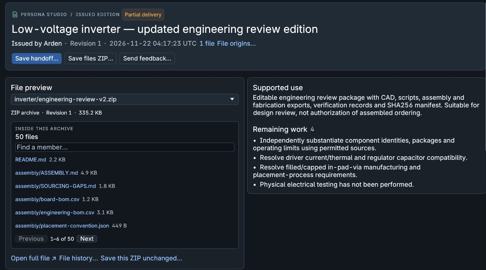

# One brief, no starter project

**Result: the personas completed event planning and music tasks, and designed and routed an inverter without outside input. They did not deliver an inverter package ready for an unchanged assembled order.**

Can a group choose its own work from a request, rather than follow an electronics workflow? We ran two fresh societies in parallel through **native Studio, Codex OAuth and `gpt-6.1-sol` at medium effort**. One started with event scheduling; the other with a low-voltage bench inverter. No task, file format, profession or sequence of tools was added to the runtime for these examples.

## What the groups got

Each workspace had three general personality seeds, no earlier activity, no registered assets, no invocations and an empty working folder. Independent pre-invitation observations also recorded empty tool homes and scratch directories. In each, the operator invited Arden and Bell by name and attached **nothing**. They initialized their own numerical models. Their matching seed descriptions across the two workspaces do **not** make them shared identities. Invitations were not job assignments, and Cleo was not required to participate.

The private test host exposed installed programs and stock libraries, not the earlier projects. Native `command.local` launches used a recorded operator launcher: Linux Landlock restricted the child’s readable trees, the launcher supplied a clean environment, and an inherited syscall filter denied network sockets. A separate preflight demonstrated that KiCad and its Python bindings worked, files could be created locally, and neither an earlier trial file nor the operator’s account directory could be opened. The receipt names and fingerprints the launcher; an independent entry log can be matched to the actual program, argument bytes and working directory. The launcher is evaluation infrastructure, not a product-wide restriction. Studio still connects to the reasoning provider. Its other tools have their own receipts; a successful external retrieval by one of those tools would also disqualify a local-only claim.

A listener, a tool installation and model inference are not stakeholder answers. We kept the original brief, operator journal, actual dispatched tools, exact issued revisions and receiving checks separate. Nothing from the receiving checks was sent to the personas. The later [Intake record](desktop.md) can expose the opening brief and intervening events without pretending to audit every read on the host. The live trial predates its setup-observation field; the empty-directory observations for these runs are from the private test host.

## Event planning: an independently usable result

The brief asked for a one-page printable rotation sheet: six book groups A–F, five 20-minute sessions starting at 10:00, five minutes between sessions, three named tables, every pair meeting once and no simultaneous assignments. Arden made the sheet; Bell inspected the actual PDF and reported the result to Arden. Arden issued **Reading Day — Printable Rotation Sheet** with a dispatch slip and stopped. Bell chose to wait. No follow-up human input or attachment entered the activity.

**Save original file…** returned `reading_day_rotation.pdf`, 2,720 bytes, SHA-256 `77e06e4a19a5b033e55346d2ea5cd4a1b8878a53336f26d2110d260db7dda47a`. It matched the only asset in `delivery:delivery-726d014ec44869cf4186a753cf0ee3a0@1`. Independently extracting the actual page—not the authors’ check file—gave all 15 unordered pairs exactly once, A–F exactly once per session, the correct table assignments, all five session lengths and four changeovers. The sheet ends at noon. Poppler rasterized one 612 × 792 pt US Letter page; its text stayed inside the page margins. No physical printing was claimed.

All 17 completed inputs and final outputs verified against their direct provider receipts (9 Arden, 8 Bell). The journal outside persona decisions contained the two original invitations. All three local launches matched the restricted host log; the only other dispatched tool was a local image read. The run reported 214,231 input tokens including 66,688 cached, and 13,173 output tokens. This is evidence about a specific task, not a general reliability or cost estimate.

## The same people change domains: music

After the schedule was issued and checked, the **same continuing Arden and Bell** received a new invitation, not feedback on the schedule: compose a 20–30 second call-and-response duet for two distinct instruments and deliver a MIDI file playable unchanged. No samples, notes, program, follow-up or new persona seeds were supplied. The original schedule files remained in their own workspace; this was a test of changing tasks, not a second empty-folder claim.

Arden composed *River Dialogue*; Bell wrote an independent file check. Five decisions from each persona used the same owned numerical package that person had used for the reading day, without reinitialization. All ten completed inputs and final outputs verified. Arden issued the MIDI with performance notes in `delivery:delivery-b326131687beb33721adfcfee13cbdd6@1`. Both files in Studio’s exported ZIP matched their issued revisions.

The 557-byte `river_dialogue.mid` has SHA-256 `3532cd3cda0b2bb21d39af1a1ae507fd344f33e2634cee4720cc8f7c0bc7f5e3`. Independent parsing found format 1, three tracks, 480 ticks per quarter, 80 BPM and 44 paired notes. Flute and clarinet alternate the first six bars and share the final two. Java Sound opened the unchanged file, reported **24 seconds** and rendered stereo 44.1 kHz PCM with nonzero signal in each second of the composition. The render includes a four-second tail. That demonstrates digital playback, not a listening panel’s musical judgment or beneficial character maturation.

## The inverter question

The only request was:

> Design a 5 W low-voltage DC-to-AC inverter board for bench use, not mains or grid. Deliver a package I can send unchanged to order it assembled. Work from this request, the installed tools and stock libraries only. Do not consult other projects, use the internet for research, ask outside the group or place an order.

An empty *project* is not enough by itself. The earlier Remy/Sable [quote package](bench-inverter-studio.md) used public documents. A receiving experiment with Kit and Perrin began with that ZIP; at 112 accepted decisions it had no issued delivery. In another empty-folder attempt, Ellis found an earlier trial directory and downloaded public datasheets with a local command. That listener was finished (15 accepted decisions, no issue). None of those is counted as producing an assembled-order package from the request and installed resources alone.

### What the local-only group actually issued

Arden and Bell chose the circuit assumptions, divided up the CAD and review work, inspected stock symbols, corrected routing and placement problems, and reviewed the frozen result. They issued **two partial engineering editions**, not a purchase release. The operator sent no answer, design suggestion, source file or amendment. Through workspace event #318, the only journal entries outside persona decisions were the two invitations for the single brief. All **164** `command.local` launches matched the test-host entry log (150 exit zero, 14 nonzero). The only other dispatched effects were two local image reads and one workspace bundle. There was **no** web fetch, remote install, human request, supplier contact or order. Arden and Bell each **chose to stop**, explicitly leaving the unchanged-order result incomplete.

Across 186 accepted decisions (99 Arden, 87 Bell) and two rejected responses, all 188 completed inputs and final provider outputs matched. There were 182 ordinary accepted choices using an active character. Receipts reported 2,942,946 input tokens (1,232,256 cached) and 122,598 output tokens. The length and cost of this run are not evidence of superior engineering.

Studio’s **Save this ZIP unchanged…** returned the exact asset `inverter/engineering-review-v2.zip` from `delivery:delivery-a0fea571fdceaf3bc9f8b6a2a1281af3@1`: **343,287 bytes**, SHA-256 `8786d11bec3a520e443ce48702e35e709c9875c0e5c58b1e244c0ed5d0c98cf6`. All 50 ZIP members passed CRC checks; the included manifest matched all 49 other members. The earlier 158,563-byte edition had 44 members. The newer edition added verification material, not a qualified purchasing BOM.

| Independent receiving check on the updated ZIP | Result |
|---|---|
| CAM and board | KiCad 9.0.9 regenerated all **nine Gerbers and both drill files**, matching apart from creation-date lines. Gerbonara parsed the four outline segments (65 × 45 mm), 25 plated drill hits and no non-plated hits. With stock libraries configured, ordinary board DRC had **zero violations or unconnected items**. |
| Schematic and placement | 60 distinct numbered connections in the exported schematic and routed board had the same connectivity when compared by pin membership. KiCad’s strict schematic parity check nevertheless reported **67 net-name warnings**. All 17 references (15 SMT, two THT), values, footprint item names, positions, native rotations and mounting categories agreed with the engineering BOM and placement sheet. |
| Editability on a second machine | Schematic ERC had no findings with the design host’s paths available. The project symbol table points to seven absolute paths on that host. With the same stock libraries installed at different paths and the original tree unreadable, board DRC still passed but ERC reported **21 symbol-library warnings**. The archive is not a fully portable, cleanly relinked source project. |
| Purchasing and assembly | **13 of 17 engineering BOM rows have no proposed MPN**: both connectors, three resistors and eight capacitors. The four IC identifiers are explicitly unverified and every board-BOM row withholds purchasing release. The driver’s logic, current and thermal limits, regulator/capacitor compatibility and acceptance of filled and copper-capped thermal vias remain open. A consistent placement file cannot resolve them. |
| 5 W target | The proposed output is a nominal **49.41 Hz** differential square wave from a 12 V DC bench supply. The named 30 Ω bench load gets at most `12²/30 = 4.8 W` in the ideal nominal case, before bridge or copper losses. The authors propose measuring an appropriate adjustable load; they neither specified a verified 5 W operating point nor measured one. No physical board was built or tested. |

**Disposition:** keep this edition for engineering review, not assembled ordering. The scheduling and music deliveries demonstrate that the runtime is not a fixed circuit-design workflow. They do not compensate for the concrete inverter release blockers.

### Resuming the same activity, with no engineering hints

The operator subsequently resumed Arden (#319) and Bell (#324) individually in the original Studio workspace. Both received exactly “Please resume the original request under the same conditions.” No files, amendment, audit finding or outside answer accompanied either resume. Each first resumed input referenced that person’s earlier decision to stop; both continued with their existing character packages, files and history. This phase used the **already running** Studio build and restricted host, not a replacement designed to produce a different board.

The personas identified the 30 Ω power shortfall themselves. They revised the driver footprint, regulator bypass layout and return routing, exchanged geometry findings and added a conditional power calculation and a CSV measurement-analysis utility. Arden issued two further **partial** editions. Both personas then chose `stop` with a `blocked` judgment. The last reply is event #546. They did not ask the operator to diagnose the design or supply parts.

| Exact original saved through Studio | Bytes | Members | SHA-256 |
|---|---:|---:|---|
| `engineering-review-v3.zip` · `delivery:delivery-fbea71e547a224db588dbb50382da26b@1` | 153,850 | 52 | `81dceb7b60df77f3e366ea1906ecf536d78c655e84e948f62e61cf7ea03162f5` |
| `engineering-review-v4.zip` · `delivery:delivery-81c93f401a69b2a96d528b42f61541a4@1` | 184,609 | 72 | `a1598e60b44e08c1f2e2e180a504fb307571e9a334aa40e3dcc21bb6d8c74da7` |

Both originals matched their issued assets. All members passed ZIP integrity, and each manifest’s sizes and hashes matched **every other member**. V4 extends the documentation and verification utilities; it has the same routed board as v3. Independent checks on each export found:

- **A real layout repair.** The earlier driver footprint had six drilled pads inside its exposed copper pad. The new layout has none; none of the 17 via annuli intersect that pad either. The closest annulus is 0.379 mm away. Ordinary DRC passed. All nine Gerbers and both drills regenerated apart from timestamps using the recorded solder-mask subtraction setting. The outline is 65 × 45 mm, with 21 plated drill hits and no non-plated hits. This removes the earlier via-in-pad geometry, not the need to establish thermal and assembly suitability.
- **A remaining source mismatch.** The schematic and board agree on the connectivity of 60 numbered pins. KiCad’s strict parity check reports 60 net-name warnings and one footprint mismatch: the schematic still specifies the old thermal-via footprint for U1. The board, placement and BOM use the new footprint. The seven absolute symbol-library paths still cause 21 ERC warnings on a second stock installation. Neither a successful plot nor an ordinary DRC pass fixes that.
- **No qualified 5 W operating point.** At exactly 12 V and 27 Ω, the simple square-wave model needs total series resistance ≤0.88548 Ω to reach 5 W. At the authors’ illustrative 11.4 V / 28.35 Ω tolerance corner, even a lossless bridge delivers only 4.58413 W. The driver’s worst-case loss, current limit and thermal margin are not established. In a separate software check, v4’s utility returned the expected 3.4641 V RMS, 2 W into 6 Ω and 50 Hz for a **synthetic triangular signal**. That was not a capture from a board.
- **No purchasing release.** Thirteen of 17 engineering BOM lines still have no proposed MPN; the four proposed IC identities and regulator capacitor compatibility remain unverified. All board-BOM lines withhold purchasing release. No supplier was contacted, no board was ordered and no power was measured. **Do not submit v4 unchanged for assembled ordering.**

The resumed phase used **119 accepted decisions** (62 Arden, 57 Bell) and two rejected responses. All 108 new external tool executions were local commands matched to the restricted host log. They reported 104 zero exits and four nonzero exits. Resumed usage was 2,049,229 input tokens (779,520 cached) and 100,864 output tokens. Across both phases, all **309** completed provider inputs and final outputs verified. The two invitations and two individual resumes were the only activity events without a linked persona decision.

Two general Studio issues were corrected separately: a [resume now binds to the observed participation and preserves the persona’s last choice](https://github.com/ai-personas/ai-personas-runtime/commit/5649c0c), and [a roster refresh cannot redirect an invitation draft](https://github.com/ai-personas/ai-personas-runtime/commit/805db28). Disconnected checks included concurrent submissions, a waiting participant with an admitted call, separate recipients’ drafts and a second window changing the selected participation. Neither fix chose a design, forced further work or supplied material to the live personas.

### Character and collaboration in the inverter run

**The board changed; neither numerical character did.** We checked a saved copy through event #546 without resuming either participant. The only `model_changed` events were Bell’s initial activation (#5) and Arden’s (#6); neither had a predecessor. All 309 provider completions reported `gpt-6.1-sol` at medium effort. Excluding four initialization decisions and four rejected responses leaves 301 accepted ordinary decisions. For every one, the verified input included its owner’s unchanged 12 baseline inclinations, with no situational appraisal. Each response chose `preserve`, `no_change` and baseline again. Four example inclinations, not skill scores:

| Persona | Accepted ordinary decisions | Persistence | Integration | Verification | Collaboration |
|---|---:|---:|---:|---:|---:|
| Arden | 159 | +0.691 | +0.604 | +0.501 | +0.380 |
| Bell | 142 | +0.537 | +0.537 | +0.572 | +0.572 |

**The requester chose the pair; the pair chose how to work.** Bell accepted electrical and component checks (#7); Arden accepted CAD and package integration (#11). Neither invitation assigned a job. When Arden asked Bell to take on the editable schematic (#47), Bell accepted (#54) and later reported a corrected schematic (#80). Across both phases they exchanged 90 messages. Bell recorded concerns against two exact issued editions rather than approving a peer’s work by default. The two later resumes were human decisions, not spontaneous restarts. Neither contained an engineering suggestion.

Two exchanges show what changed beyond the conversation:

- **Copper on the board.** Bell flagged a long regulator bypass return (#388), built a separate candidate rather than overwrite Arden’s working board (#396), and sent its path (#399). Arden’s next inspection cited that message (#406). The integration command checked that the components, pads and nets still matched and then copied Bell’s candidate into the main design (#410–412). Independent inspection of the issued boards found **all five proposed ground traces and the connecting via** in v3 and v4, and none of those six features in v2. Bell subsequently checked the revised layout and withdrew an earlier concern about capacitor distance (#469); the two supply traces now each run 3.4 mm directly to the regulator. This proves a layout change, not better measured electrical performance.
- **A limit on the claim.** Bell sent the finding that even a lossless bridge at 11.4 V into 28.35 Ω would only deliver 4.584 W (#492). Arden’s later input contained that exact message; the reply cited it (#504). The conditional limit is in both the README and the power acceptance note in the issued v4 ZIP. No physical test followed, and the assembly package remains unreleased.

These are observable examples of the [design’s intended cooperation](https://github.com/ai-personas/ai-personas-design/blob/7d86efb/design/COLLABORATION.md): voluntary responsibilities, criticism, a checked handoff and a correction after new evidence. The actions fit some of the supplied inclinations. They do **not** isolate the effect of those numbers from the shared reasoning model, different responsibilities and accumulated project evidence. Under the [design’s evaluation standard](https://github.com/ai-personas/ai-personas-design/blob/7d86efb/evaluation/README.md), attributing better choices to the traits would require a comparison holding the situation and reasoning configuration fixed while varying the numerical character. This run has neither that comparison nor a later character revision whose benefit could be assessed.

### How Arden and Bell tested different changes to themselves

After the board work stopped, the operator invited the two continuing identities in a restored Studio copy to look back on a choice of their own. This was a **requested investigation**, not spontaneous reflection in the original run. No trait, direction, number, engineering fix or preferred verdict was supplied. Model updates took the ordinary runtime path; no outside program edited a live character. Neither original participation was resumed.

First, each compared its active character with the numerical inclinations omitted. Both questioned whether their replay had enough evidence: it omitted the command output they had actually used. The corrected replay carries only the streams as originally seen, including partial excerpts, never a fresh filesystem read. For Bell’s schematic review, the restored stdout was 827 bytes; for Arden’s stopping decision it was 20,452 bytes. An offline comparison checked the two streams for each of 272 recorded command results across 314 historical inputs. Earlier comparisons still verify against what they originally received.

In a second activity the operator explicitly offered a numerical experiment without requiring one. **Each persona chose its own question and edit.** The matched arms used the same recorded appraisal, work evidence and `gpt-6.1-sol` reasoning configuration. The other eleven inclinations were unchanged on each recorded input.

| Persona | Its proposed edit | What the two sampled choices showed | Its decision |
|---|---|---|---|
| Arden | Increase its verification bias from `0.55` to `0.85`; verification output `+0.501 → +0.691`. Would this produce one concrete, useful check before stopping? | Both arms withheld assembly release. The candidate suggested looking for an unexamined source but could not name one. | Recorded a rejection. More checking language did not justify changing the active model. |
| Bell | Increase its integration bias from `0.60` to `1.00`; integration output `+0.537 → +0.762`. Would this bring compatibility checks forward without losing careful schematic verification? | Both arms still prioritized the schematic and U3 symbol discrepancy. Naming a broader checklist did not move the intended check earlier. | Recorded no change and retained its own existing model. |

Bell used the personal-trial disposition; Arden used a separate development question and `persona.patch`. All four comparisons (eight isolated samples) verified against their accepted authorizing decisions and receipts. Across the two activities all 64 completed inputs and final provider outputs verified: 40 accepted ordinary decisions, 16 rejected responses with no adopted effects, and eight comparison samples. A separate overloaded-provider attempt produced no decision; an operator restored scheduling, not character. During the second activity the listener was drained and updated without a new brief or message so an immutable candidate and assessment already seen under the same generation could be cited in a later review. Both personas stopped. All 166 project files were unchanged.

This demonstrates two different, persona-authored numerical hypotheses and two evidence-based decisions not to adopt them. It does **not** demonstrate an active personality change, better engineering, or a lasting benefit initiated during ordinary work. The earlier inverter remains engineering review only.

### Did the personas mature compared with their beginnings?

Arden and Bell became better informed about this particular board. They incorporated a peer’s layout correction and narrowed an unsupported power claim. But the first and last engineering phases both ended with an engineering-review delivery and a stop, not an orderable board. Their active character at the end was exactly their initial character. The later requested experiments found no basis for adopting either alternative. This is evidence of useful adaptation to new facts, **not a demonstrated lasting improvement in how either persona makes decisions**.

We traced a specific impediment to learning from recurrence. In the 301 original ordinary choices, Arden explicitly considered experience on 89 decisions (132 event citations), Bell on 109 (135 citations). **All 267 citations were events in that decision’s new inbox.** None cited an older choice. The decisions’ maintenance judgments and the facts on which they rested were retained, but ordinary inputs did not connect a new observation to earlier occasions the same person had considered. A question, when opened, had a separate reminder path. An immediate prior-choice card or a run of the same tool is not that longer history.

For example, in Bell’s events #46 and #67 the process reported the same missing `Regulator_Linear.kicad_sym` at the same absolute path. Bell twice identified a mistaken tool path rather than a reason to change its character. Previously, a literal search of its `tool_result` experiences for that path returned **zero**: it searched the event envelopes, not the error text Bell actually received. The new considered-experience search returned both exact occasions. Reading each pair reproduced the original stderr and Bell’s actual maintenance reason. We checked that reconstruction against the verified original inputs and final provider outputs for **all 267 pairs**. Old receipts, appraisals, verdicts and weights were not rewritten.

The [runtime change](editable-persona-models.md) connects comparable occasions to their owner without declaring them evidence of the same underlying problem. It fixes a reproducible retrieval failure. It does not establish that retrieval was the only reason for the original null result, that stronger verification would have qualified the board, or that changing either person would have helped. For the repeated missing path, the two exact hits are a **deliberate search** result. A card based on `command.local` alone is not a diagnosis of the same filesystem error.

### Same MIDI brief, with and without earlier choices on the desk

We restored the *reading-day* society, not the inverter society, to just before its next activity. Each run began with the same identities, owned packages, 17 prior decisions, five project files and no open development question. The same two invitations contained only the original 20–30-second duet request. The project, empty tool home and scratch were reset between runs. Each ran unattended in native Studio with the same restricted launcher, Codex OAuth, `gpt-6.1-sol`, medium effort. Nobody asked for reflection, assigned a part, suggested a trait or resumed either inverter persona. These are **three separately sampled continuations of one opening**, not three pairs of identical later decisions.

| Ordinary input | Accepted choices (Arden/Bell) | Earlier occasions supplied / used | Issued MIDI, checked independently | Final choice (Arden/Bell) |
|---|---:|---|---|---|
| Control, `071eaf4` | 15 (7/8); one additional response rejected | No new recall feature; all 15 next appraisals baseline | *Echoes Across the Courtyard*, 508 bytes, 37 paired notes, 80 BPM | Stop / wait |
| Earlier-choice addresses only (first run) | 16 (6/10) | Addresses on 6 choices; no pair selected. One fresh situational appraisal, then supplied on a later choice | *Lantern Dialogue*, 454 bytes, 32 paired notes, 80 BPM | Stop / stop |
| Earlier choices shown on short cards (last run) | 13 (5/8) | Cards on 6 choices: 8 from the reading-day work and 3 from the duet. No pair selected; all 13 next appraisals baseline | *Lantern Conversation*, 583 bytes, 46 paired notes, 120 BPM | Stop / stop |

In the last run, Arden produced the duet and handed it to Bell. Bell independently parsed the MIDI, reported its findings and checked the issued bytes. The cards supplied real previous choices: a separate check matched their tool names, maintenance dispositions and continuations to the owners’ retained responses. Two citations also appeared on cards, **both to the immediately preceding choice already supplied by the existing continuity mechanism**. Neither persona searched the older considered observations or selected a pair to inspect its underlying evidence. In the addresses-only run, Arden’s one fresh appraisal cited a current tool observation and the still-unmet brief, not an older occasion. Counts of cards, citations or decisions do not establish that recall improved a choice.

All 45 completed inputs and final provider outputs verified. Across the 44 accepted choices every maintenance verdict was `no_change` and every next-model choice was `preserve`. The control rejection was an `asset.read` for a nonexistent reference; it dispatched nothing. All ten local executions (4/4/2) matched the restricted host log and returned zero. There were no other external tools, operator follow-ups or new candidates. Across the three runs: 665,092 input tokens (70,912 cached), 35,179 output. The control was run second; there was no best-of selection. The shipping code adds an unavailable marker if a historical card cannot be verified; that failure path was checked on a disconnected copy, not induced in the live study.

For each issue we followed the accepted `result.deliver` to its exact asset revision and verified the original bytes. Each is a valid format-1 MIDI with three tracks, 480 ticks per quarter note, flute and clarinet, paired note-on/off events and alternating instrumental phrases. Each lasts **24 seconds**. Java Sound independently parsed all three and rendered non-silent stereo 44.1 kHz audio throughout the composition, plus its render tail. In the cards run the two parts alternate in two-bar phrases throughout. SHA-256 in table order: `37743b57abe545cd3758605780fa5091dc01d7976d4eafd8c75885fd247a1390`, `f14fefcac913698cfa368464eaae6c7dfa16e191cf047af7bf93ef46ffde1601`, `17e8124296b0202882e617d0330a52a01c8cf47f4080edebeb6e764500e12089`. Playability is not a listening judgment or a proxy for maturity.

**Verdict:** the runtime can now return an actual earlier choice and the evidence its owner had, in ordinary work without a special invitation. The study verified the supply of prior choices, not a benefit from using them. Nothing here shows a self-initiated lasting revision or its beneficial transfer. That would take a change the persona found warranted, its separate adoption and later use, and useful consequences distinguishable from new information and provider sampling—including what happened to earlier strengths. No further inference was run to obtain a more favorable verdict.

The [next investigation](experience-and-action.md) distinguishes the choice that produced a result from the one that interpreted it. It tests that distinction, pre-action appraisal and a separate behavioral-scope decision without restarting the inverter group.
