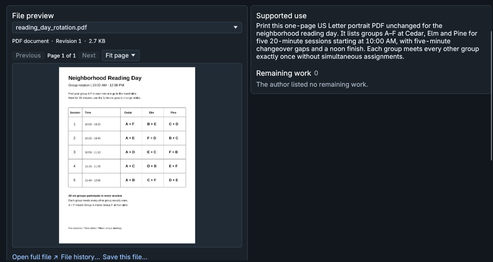

# One brief, no starter project

**Result: the personas completed event planning and music tasks, and designed and routed an inverter without outside input. They did not deliver an inverter package ready for an unchanged assembled order.**

Can a group choose its own work from a request, rather than follow an electronics workflow? We ran two fresh societies in parallel through **native Studio, Codex OAuth and `gpt-6.1-sol` at medium effort**. One started with event scheduling; the other with a low-voltage bench inverter. No task, file format, profession or sequence of tools was added to the runtime for these examples.

## What the groups got

Each workspace had three general personality seeds, no earlier activity, no registered assets, no invocations and an empty working folder. Independent pre-invitation observations also recorded empty tool homes and scratch directories. In each, the operator invited Arden and Bell by name and attached **nothing**. They initialized their own numerical models. Their matching seed descriptions across the two workspaces do **not** make them shared identities. Invitations were not job assignments, and Cleo was not required to participate.

The private test host exposed installed programs and stock libraries, not the earlier projects. Native `command.local` launches used a recorded operator launcher: Linux Landlock restricted the child’s readable trees, the launcher supplied a clean environment, and an inherited syscall filter denied network sockets. A separate preflight demonstrated that KiCad and its Python bindings worked, files could be created locally, and neither an earlier trial file nor the operator’s account directory could be opened. The receipt names and fingerprints the launcher; an independent entry log can be matched to the actual program, argument bytes and working directory. The launcher is evaluation infrastructure, not a product-wide restriction. Studio still connects to the reasoning provider. Its other tools have their own receipts; a successful external retrieval by one of those tools would also disqualify a local-only claim.

A listener, a tool installation and model inference are not stakeholder answers. We kept the original brief, operator journal, actual dispatched tools, exact issued revisions and receiving checks separate. Nothing from the receiving checks was sent to the personas. The later [Intake record](desktop.md) can expose the opening brief and intervening events without pretending to audit every read on the host. The live trial predates its setup-observation field; the empty-directory observations for these runs are from the private test host.

## Event planning: an independently usable result

The brief asked for a one-page printable rotation sheet: six book groups A–F, five 20-minute sessions starting at 10:00, five minutes between sessions, three named tables, every pair meeting once and no simultaneous assignments. Arden made the sheet; Bell inspected the actual PDF and reported the result to Arden. Arden issued **Reading Day — Printable Rotation Sheet** with a dispatch slip and stopped. Bell chose to wait. No follow-up human input or attachment entered the activity.

**Save original file…** returned `reading_day_rotation.pdf`, 2,720 bytes, SHA-256 `77e06e4a19a5b033e55346d2ea5cd4a1b8878a53336f26d2110d260db7dda47a`. It matched the only asset in `delivery:delivery-726d014ec44869cf4186a753cf0ee3a0@1`. Independently extracting the actual page—not the authors’ check file—gave all 15 unordered pairs exactly once, A–F exactly once per session, the correct table assignments, all five session lengths and four changeovers. The sheet ends at noon. Poppler rasterized one 612 × 792 pt US Letter page; its text stayed inside the page margins. No physical printing was claimed.

All 17 completed inputs and final outputs verified against their direct provider receipts (9 Arden, 8 Bell). The journal outside persona decisions contained the two original invitations. All three local launches matched the restricted host log; the only other dispatched tool was a local image read. The run reported 214,231 input tokens including 66,688 cached, and 13,173 output tokens. This is evidence about a specific task, not a general reliability or cost estimate.

## The same people change domains: music

After the schedule was issued and checked, the **same continuing Arden and Bell** received a new invitation, not feedback on the schedule: compose a 20–30 second call-and-response duet for two distinct instruments and deliver a MIDI file playable unchanged. No samples, notes, program, follow-up or new persona seeds were supplied. The original schedule files remained in their own workspace; this was a test of changing tasks, not a second empty-folder claim.

Arden composed *River Dialogue*; Bell wrote an independent file check. Five decisions from each persona used the same owned numerical package that person had used for the reading day, without reinitialization. All ten completed inputs and final outputs verified. Arden issued the MIDI with performance notes in `delivery:delivery-b326131687beb33721adfcfee13cbdd6@1`. Both files in Studio’s exported ZIP matched their issued revisions.

The 557-byte `river_dialogue.mid` has SHA-256 `3532cd3cda0b2bb21d39af1a1ae507fd344f33e2634cee4720cc8f7c0bc7f5e3`. Independent parsing found format 1, three tracks, 480 ticks per quarter, 80 BPM and 44 paired notes. Flute and clarinet alternate the first six bars and share the final two. Java Sound opened the unchanged file, reported **24 seconds** and rendered stereo 44.1 kHz PCM with nonzero signal in each second of the composition. The render includes a four-second tail. That demonstrates digital playback, not a listening panel’s musical judgment or beneficial character maturation.

## The inverter question

The only request was:

> Design a 5 W low-voltage DC-to-AC inverter board for bench use, not mains or grid. Deliver a package I can send unchanged to order it assembled. Work from this request, the installed tools and stock libraries only. Do not consult other projects, use the internet for research, ask outside the group or place an order.

An empty *project* is not enough by itself. The earlier Remy/Sable [quote package](bench-inverter-studio.md) used public documents. A receiving experiment with Kit and Perrin began with that ZIP; at 112 accepted decisions it had no issued delivery. In another empty-folder attempt, Ellis found an earlier trial directory and downloaded public datasheets with a local command. That listener was finished (15 accepted decisions, no issue). None of those is counted as producing an assembled-order package from the request and installed resources alone.

### What the local-only group actually issued

Arden and Bell chose the circuit assumptions, divided up the CAD and review work, inspected stock symbols, corrected routing and placement problems, and reviewed the frozen result. They issued **two partial engineering editions**, not a purchase release. The operator sent no answer, design suggestion, source file or amendment. The only journal entries outside persona decisions were the two invitations for the single brief. All **164** `command.local` launches matched the test-host entry log (150 exit zero, 14 nonzero). The only other dispatched effects were two local image reads and one workspace bundle. There was **no** web fetch, remote install, human request, supplier contact or order. Arden and Bell each **chose to stop**, explicitly leaving the unchanged-order result incomplete.

Across 186 accepted decisions (99 Arden, 87 Bell) and two rejected responses, all 188 completed inputs and final provider outputs matched. There were 182 ordinary accepted choices using an active character. Receipts reported 2,942,946 input tokens (1,232,256 cached) and 122,598 output tokens. The length and cost of this run are not evidence of superior engineering.

Studio’s **Save this ZIP unchanged…** returned the exact asset `inverter/engineering-review-v2.zip` from `delivery:delivery-a0fea571fdceaf3bc9f8b6a2a1281af3@1`: **343,287 bytes**, SHA-256 `8786d11bec3a520e443ce48702e35e709c9875c0e5c58b1e244c0ed5d0c98cf6`. All 50 ZIP members passed CRC checks; the included manifest matched all 49 other members. The earlier 158,563-byte edition had 44 members. The newer edition added verification material, not a qualified purchasing BOM.

| Independent receiving check on the updated ZIP | Result |
|---|---|
| CAM and board | KiCad 9.0.9 regenerated all **nine Gerbers and both drill files**, matching apart from creation-date lines. Gerbonara parsed the four outline segments (65 × 45 mm), 25 plated drill hits and no non-plated hits. With stock libraries configured, ordinary board DRC had **zero violations or unconnected items**. |
| Schematic and placement | 60 distinct numbered connections in the exported schematic and routed board had the same connectivity when compared by pin membership. KiCad’s strict schematic parity check nevertheless reported **67 net-name warnings**. All 17 references (15 SMT, two THT), values, footprint item names, positions, native rotations and mounting categories agreed with the engineering BOM and placement sheet. |
| Editability on a second machine | Schematic ERC had no findings with the design host’s paths available. The project symbol table points to seven absolute paths on that host. With the same stock libraries installed at different paths and the original tree unreadable, board DRC still passed but ERC reported **21 symbol-library warnings**. The archive is not a fully portable, cleanly relinked source project. |
| Purchasing and assembly | **13 of 17 engineering BOM rows have no proposed MPN**: both connectors, three resistors and eight capacitors. The four IC identifiers are explicitly unverified and every board-BOM row withholds purchasing release. The driver’s logic, current and thermal limits, regulator/capacitor compatibility and acceptance of filled and copper-capped thermal vias remain open. A consistent placement file cannot resolve them. |
| 5 W target | The proposed output is a nominal **49.41 Hz** differential square wave from a 12 V DC bench supply. The named 30 Ω bench load gets at most `12²/30 = 4.8 W` in the ideal nominal case, before bridge or copper losses. The authors propose measuring an appropriate adjustable load; they neither specified a verified 5 W operating point nor measured one. No physical board was built or tested. |

**Disposition:** keep this edition for engineering review, not assembled ordering. The scheduling and music deliveries demonstrate that the runtime is not a fixed circuit-design workflow. They do not compensate for the concrete inverter release blockers.
