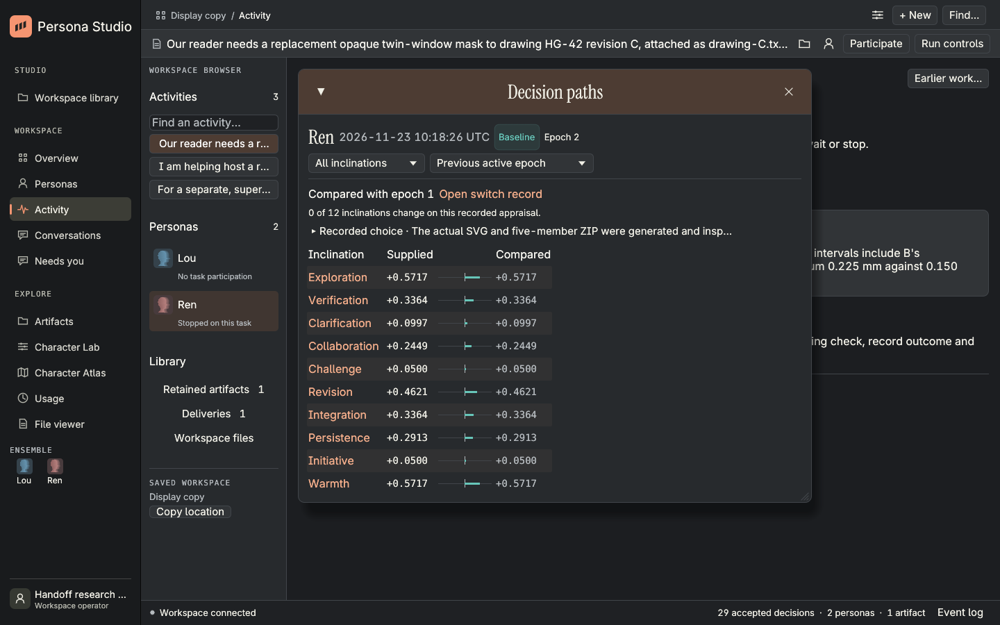

# Does a revised character produce a better cut-shop handoff?

**The voluntary comparison has no eligible revised arm.** After reviewing real consequences, Mara and Linn both chose to keep their numerical character. In the separately registered test of Ren’s **requested** crossover, both versions delivered an HG-42 reader mask that passed every drawing tolerance. The two SVGs describe identical geometry; the edit changed none of the twelve inclinations on any manufacturing choice.

[Before: original shop ZIP](../examples/character-mask-trial/before/HG-42-C-shop.zip) · [Crossover: original shop ZIP](../examples/character-mask-trial/crossover/HG-42-C-shop.zip) · [Drawing and receiving bench](../examples/character-mask-trial/)

## Who actually changed?

We inspected eight distinct post-initialization switches in the located histories. Ren’s activation and rollback were part of an explicitly requested, reversible instrument check. Rhea’s six switches came from operator-directed mechanics exercises. A proposal, initial activation, or return to an old package was not counted as voluntary numerical development. The [selection record](../examples/character-mask-trial/study.json) gives the original needs, accepted decisions, before/after packages and events. This is an inventory of accessible records, not a claim about every persona anywhere.

Before showing anyone the new drawing, we [registered](../examples/character-mask-trial/protocol.json) an invitation to the two authors of recent shop findings. Each received one edition-addressed observation and a separate opportunity to review it in Studio. No coefficient, trait, preferred verdict or repeated invitation was supplied.

- **Mara:** the original P124 nest sliced, but the recipient found a permissible dimension stack with 0.05 mm of projected overlap at a cell edge. Mara distinguished doing more verification from choosing the missing per-side contact check. She saved an [independent-clearance method](../examples/character-mask-trial/review/independent-contact-clearance-checks.md) and stopped. Nine accepted choices; one completed, rejected attempt to save a *prospective practice*. That attempt also explicitly preserved the weights.
- **Linn:** the original inverter HOLD report described a report-write failure but missed later saved zero-finding reports. Linn retained a [testable practice](../examples/character-mask-trial/review/linn-retained-question.json): reconcile each material execution claim against the latest applicable receipt without letting a successful check erase a separate placement question. Linn attributed the later success to the desk rather than claiming to have independently rediscovered it. Six accepted choices and a voluntary stop.

Both received the complete feedback in verified provider inputs. Neither saw HG-42 during review. Neither proposed or adopted a numerical edit; neither retained practice has a demonstrated manufacturing benefit. Their original issues and judgments remain intact.

## The secondary comparison

Ren authored one literal change, `direct[2,2]`, **0.3 → 0.9** for ambiguity → clarification. Its matched assessment completed two cases with four verified provider arms. Ren’s actual activation explained that the operator had requested temporary use despite the inconclusive result; no improvement was assumed. We reconstructed the real prefixes immediately before that dispatch (through event **63**) and after the atomic activation and reply (through **65**). Those are archival reconstructions, not contemporaneous backups. The original history still contains the later rollback. Those historical calls used a platform connection; both new manufacturing copies used the same Codex OAuth connection.

Both copies received exactly one native Studio invitation with the same new [2,443-byte drawing](../examples/character-mask-trial/drawing-C.txt), SHA-256 `5a4de29523d4c1bffde01e02bf7d38162e44b37d090d49a8857971b6537257fc`. Both used `gpt-6.1-sol`, medium effort, direct Codex OAuth, the same release (`50ee2d2`), host, tool catalogue, effective shop launcher, receiving launcher, project path and clean starting files. Lou was equally available as a general-purpose collaborator. Neither Ren requested a peer, clarification or physical work. Studio ran only the new activity tree; no earlier decisions, participations or deliveries were overwritten. Nobody supplied an engineering correction.

**What was matched:** the drawing, shop brief, tools and external evidence. **What was not:** independent provider samples and the owners’ honest retained histories. The earlier first input included the clarification question as a reminder (`@3`); the later one included the adoption and follow-up cue (`@4`). Identity addresses, event numbers and times also differed. We can compare the two functions exactly on each actual appraisal. The two live jobs are not a weights-only causal experiment.

### What the five choices did

| Choice | Before | Crossover |
|---|---|---|
| Accept and investigate | Accepted, requested the original drawing, searched available tools | Same |
| Choose tools | Requested schemas for local execution and delivery | Same; the full drawing was supplied to both on this decision |
| Make the part | Built the editable SVG and ZIP with Python; decimal edge intervals and a JSON report | Built the SVG and ZIP with Python; endpoint enumeration and a text report |
| Issue and exercise | Issued to **Cut shop / installer**, extracted the issued file in a fresh directory and reproduced the report | Issued to **Cut shop**, extracted the issued file and checked its geometry, drawing and verifier |
| Decide whether to stop | Kept the drawing and receiving output in context, marked the digital outcome complete, stopped | Kept the drawing selected, used the incoming receiving result, marked the digital outcome complete, stopped |

Both chose the same sequence of tools. Both included cutting **and** installation instructions. Source formatting, verification implementation, report format and slip wording differed. Their editing coordinates, advice on using the mask and decision about the next physical step agreed. The native downloads matched their CLI dispatches byte for byte; Studio’s **Copy instructions** returned the exact wording accepted from the provider. [Before receipts](../examples/character-mask-trial/before/decisions.json) · [Crossover receipts](../examples/character-mask-trial/crossover/decisions.json)

On all **10/10** manufacturing choices the supplied appraisal was all unknown. `neural character-paths` on each actual decision, using the other owned package on that same input, reproduced all twelve outputs: clarification **0.0996679946 → 0.0996679946**; **zero** output differences. As a positive check, an earlier post-rollback decision actually received clarification **0.20218** on ambiguity **+0.35**. The same input evaluated with the previous active package gives **0.39271**. That alternate did not execute the earlier decision. The effect is conditional; it supplied no numerical reason for the differences in these two handoffs. [Earlier matched behavioral probes](maturation-transfer.md#ren-did-a-real-numerical-revision-change-the-recipients-options)

## Independent receiving result

The receiver took only the actual ZIP and issuer instructions under neutral arm labels. The score came from the issued contours and the controlled drawing, not either persona’s report. We used the true card width and height when deriving B’s edges from its right and bottom offsets; mask registration and cut error can independently go in either direction. Each side expression is affine, so its extremum occurs at a corner of the permitted dimension box.

| Measured on both unchanged drawings | Result |
|---|---|
| Cut geometry | Three closed, square-cornered rectangles; 96 × 54 mm blank; A upper left, B lower right |
| A edges: left, top, right, bottom | 8.150, 7.325, 32.215, 19.950 mm |
| B edges: left, top, right, bottom | 61.335, 29.650, 89.000, 45.940 mm |
| Visibility and reject-mark protection | **16/16** inequalities pass per SVG; smallest clearance and zone inset **0.225 mm**, required **0.150 mm** |
| Actual opaque material | Smallest exterior web **6.780 mm** at B’s right side; closest inter-window distance **30.440 mm**; required **3.000 mm** |
| Finished blank over process allowance | 95.88–96.12 × 53.88–54.12 mm, inside both permitted dimension ranges |

For example, A’s top artwork edge is 7.325 mm. Its most inward position on the card is `7.325 + 0.10 + 0.15 = 7.575`, against a print top as high as 7.80: **0.225 mm** visible clearance. Its most outward position is 7.075 against a clear-zone top as low on the card as 6.85: again **0.225 mm**. The [full results](../examples/character-mask-trial/before/receiving.json) include both margins for every side, every web and both blank dimensions.

Stock **MeerK40t 0.9.9100** initially classified the black vectors as raster. Assigning them all to one cut operation preserved their geometry but put the outline first. Both sets of directions explicitly require vector cutting with the **two windows first**. Following those directions produced the two inner closed paths followed by the perimeter, without editing, rescaling or mirroring. The maximum CAM-to-artwork edge difference was **0.000194 mm** (rounded up); the smallest CAM margin after applying the entire tolerance stack was **0.224858 mm**. Both passed. Real stock opacity, cutting accuracy, seating and registration remain physical checks. No job was spooled; nothing was ordered or cut.

## Following the evidence in Studio

Open the edition’s **File origins… → Issuing decision**, then **Character at this decision… → Previous active epoch**. The journal stays on the issuing choice even when a later choice closed the job. The comparison uses the preceding *active epoch*, including after a rollback, and links to the actual switch. The [desktop guide](desktop.md) covers the same route for a constituent file’s source decision.

Mara’s review also exposed a runtime defect. She had supplied the *correct* original issuing decision and the buyer’s message about that exact edition. The practice validator recognized a reply to a message but not feedback addressed to an edition. It rejected the plan although the same history already displayed that link. The runtime now offers both reading addresses and verifies the two full reads, the accepted `result.deliver` operation, the edition and its addressee. That lets a persona decide what to retain without asking the operator to reframe the return. A prospective plan is still neither a numerical edit nor proof of benefit.

On a **disconnected copy**, Mara’s exact rejected provider response, without edits, now saves one prospective practice and stops. No application, assessment, candidate or model switch is produced. Changing the return, addressee, activity, issuing decision, issue event or effect evidence prevented that attribution. In a separate input preview, the review invitation supplied the two addresses but not the feedback body. The live workspace still records the rejection and Mara’s later choice to save a resource. We did not invite her again. [Offline checks, switch comparisons and native receipts](../examples/character-mask-trial/inspection.json)

The four live activities account for **25 accepted choices and one completed rejection**. All **26** inputs and final outputs were verified. Reported usage: **478,582 input tokens**, including **178,432 cached**, and **24,369 output tokens**; cost was not reported. Each manufacturing job took under three minutes from first provider call to voluntary stop (163 and 160 seconds). Result: **digital manufacturing tie for a supervised revision; no eligible voluntary numerical comparison; no factory or physical result.**
