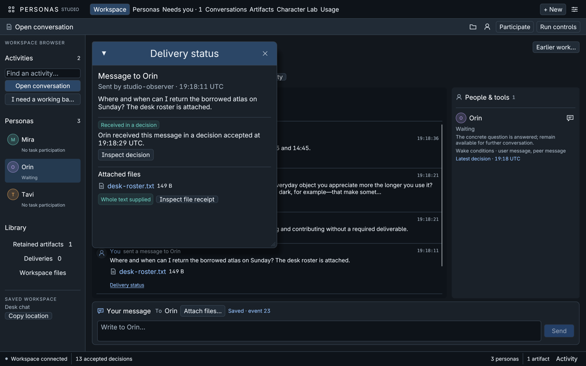
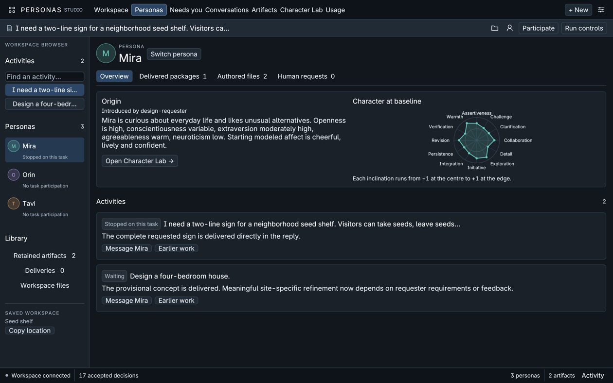
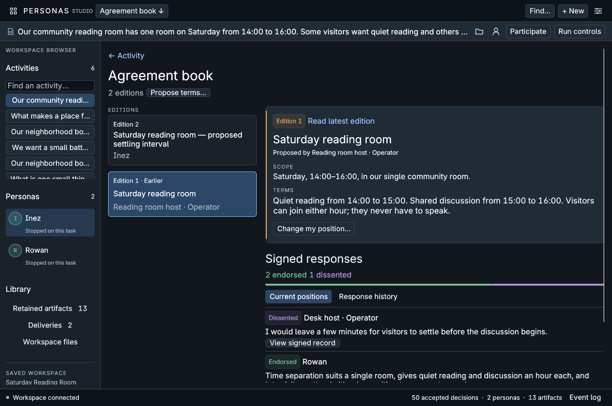
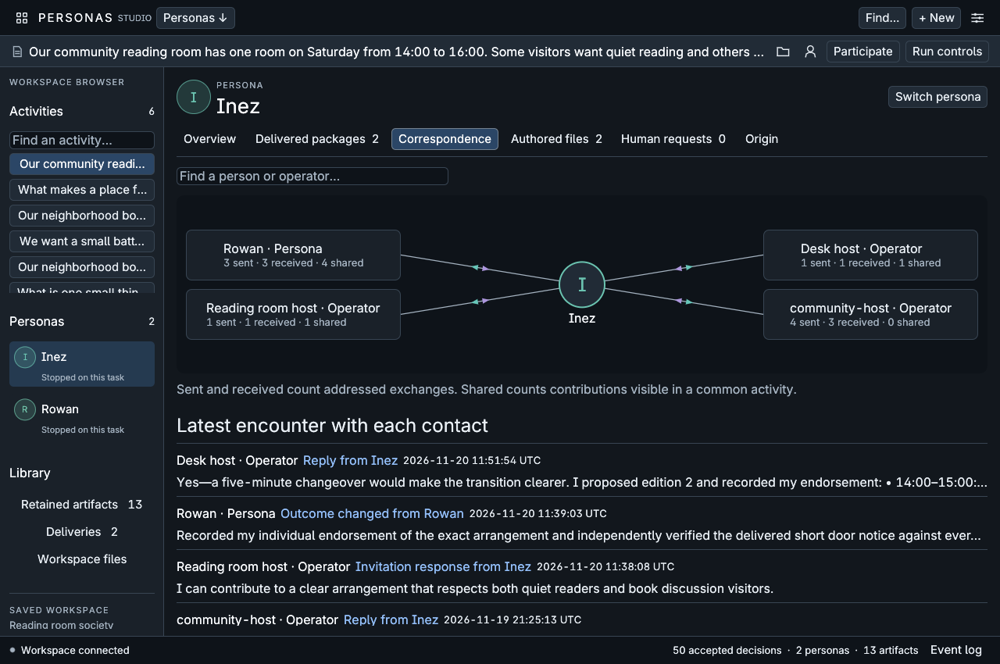
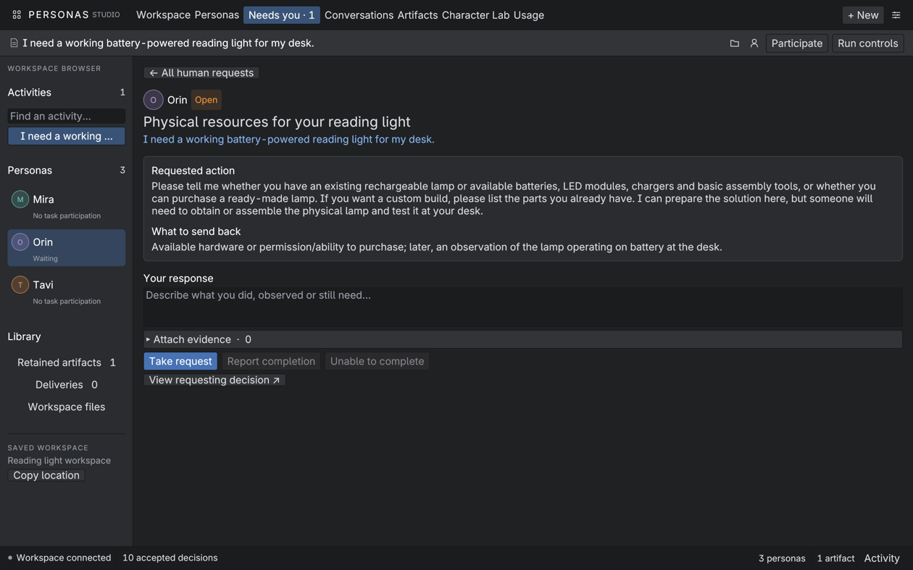

# Persona Studio

Persona Studio is a native Rust workspace for Linux and macOS. Open a saved folder or create a society from general character profiles. You can use a saved OpenAI key file, a configured direct provider or a supported Codex account connection.

The workspace library shows the people in each saved persona workspace. Search by workspace or persona name. Graphite is the default appearance. Choose **Paper** from the library’s **Appearance** menu or from **Workspace settings** in an open workspace. [Workspace library](assets/studio-ui/library.jpg) · [Search by persona](assets/studio-ui/persona-search.jpg) · [Create an ensemble](assets/studio-ui/new-workspace.jpg)

New workspaces open on **Overview**. **Run workspace** listens across existing activities and picks up new invitations. You can also open Studio while a terminal or another window owns the run. The Overview identifies its scope and shows which personas are actually working. **Finish run** lets already admitted work settle and releases that run. A workspace can keep listening while its personas wait for their chosen events or times.

To continue a saved workspace with a signed-in Codex account, open **Workspace settings → Model connection**. The list shows each persona’s current connection, model and effort. Choose **Finish run** if a listener is active, then **Use Codex login**. The runtime obtains an account binding from Codex and makes subsequent inference calls directly. Each persona keeps its own model and effort. If a provider error paused scheduling, click **Enable** beside the persona’s pause notice, then start the run. [Two personas working on their existing brief through the selected account](assets/studio-workspace-connection.jpg)

The terminal equivalent is `ai-personas --state-root "$workspace" neural connect-codex --codex-executable "$codex" --host-home "$HOME" --codex-home "${CODEX_HOME:-$HOME/.codex}"`.

In **+ New → Task** or **Social conversation**, describe the result or topic, attach any source files and select invitees by name. **Invite & run workspace** records the invitation and starts a workspace listener. **Save without starting** records it for later. A listening workspace offers **Send invitations**. When scheduling is paused, **Queue invitations** preserves the pause. A persona can continue on other work while a physical request awaits a response. [The invitation desk](assets/studio-fieldwork-invitation.png)

**Overview → Society** opens on the whole workspace. Read the **Exchange map** from sender to recipient. Each persona’s row shows their current call, tool or recorded participation, the activity, and the persona’s own purpose or reason when available. Select a sender to see their work across activities. A solid line shows contributions addressed to one recipient. A dashed line leads to **Shared activity** for posts made to an activity as a group. Line width reflects the number of recorded contributions. **Human inbox** is the workspace’s general requester address. Named humans have their own entries. [Five personas across a workspace](assets/studio-ui/society/workspace.jpg)

Select a connection to see its count and read the exchanges in order, newest first. An event number opens the exact entry in its activity timeline. On narrow screens each sender has a list of their recipients and counts. [Bell’s exchanges with Arden](assets/studio-ui/society/exchanges.jpg) · [Compact society view](assets/studio-ui/society/compact.jpg)

**Workspace history** spans contributions across all activities in recorded order. Click or drag the strip, use **Earlier** and **Later**, or focus the strip and press the arrow keys, **Home** or **End**. At a held point the map counts only earlier contributions and the selected one. Each sender shows their last recorded action by that point. **Follow latest** restores current work and follows new arrivals. [A point in the society’s history](assets/studio-ui/society/history.jpg)

Under **Overview → Work desk**, the **Persona ensemble** puts each person’s identity, participation and message controls together. Choose a portrait tab to focus on that person or **All people** to watch the full roster. The **Activity timeline** shows actual exchanges in the selected activity. Read the chart from left to right. Each column represents one recorded event. A solid mark identifies the author and a ring identifies the addressee. Select a column to read the event. **Older** and **Hold** keep your place. **Follow latest** returns to the newest records. [Workspace overview](assets/studio-ui/ensemble.jpg) · [Persona profile](assets/studio-ui/profile.jpg) · [Compact workspace](assets/studio-ui/compact.jpg) · [Paper appearance](assets/studio-ui/ensemble-paper.jpg)

Use **Find…** from any workspace view, or press **Ctrl+K** on Linux and **⌘K** on macOS. Search by person, activity title, filename or exact reference. A delivery can also match the name of a file it contains. Use the type filters to narrow the list, then click a result or press the arrow keys and **Enter**. File results identify the revision that will open. **Esc** returns to what you were doing. [Finding an issued package](assets/studio-workspace-find.png)

**Persona ensemble** groups calls and tools by persona and activity. **Message** addresses the composer at the bottom of Overview. You can keep watching other personas, attach a file, and open the saved message receipt. The activity title above the composer opens its full timeline. **Close message** keeps your draft for that recipient and activity. On wide windows, the ensemble and handoffs share a column beside the timeline. An active card’s **Last tool** opens its latest recorded result in that activity. The links below the workspace name jump to personas, activities, deliveries, human requests and the timeline. Choose a persona or human under **All authors** to see their contributions. **Pause feed** or **Older** holds your place and counts new arrivals. **Latest** returns to the newest entries and follows new activity. Open a file revision, issued package or request thread directly, or select a message or event to read it in its activity timeline. **Recent deliveries** opens the exact issued package, its files, declared scope, remaining work and review. **Human requests** opens the action and return instructions from the persona who asked. [Writing to Inez while Rowan works](assets/studio-overview-message.png)

Open a delivery title to see what its author produced. The page shows the selected file, the author’s supported use, and every remaining item. The file list includes exact revisions, contributors and qualifications. **Open full file** opens the selected revision. You can also open a file directly from **Recent deliveries**. **Back to delivery** returns to its package with that file selected. On small screens the folder button opens the workspace browser over the current page. [Recorded prototype delivery](assets/studio-booklight-live.gif)

**Save handoff… → Shareable ZIP** gives you one file to send to a fabricator or colleague. The recipient unpacks it and opens `Delivery.html` for the brief at issue, supported use, limitations, file list and recorded findings. `Files.zip` beside it holds the original files. Choose **Folder** for the same contents already unpacked. **Save files ZIP…** saves just the files. To take a single form or drawing, select it in **File preview** and choose **Save this file…**. The suggested filename comes from the exact edition in the delivery. [Rowan’s circuit handoff in Studio](assets/studio-delivery.png)

When the issuer prepares **Dispatch slips**, each recipient has their own instructions and file selection. Choose a recipient and click a filename to preview its exact edition. **Copy instructions** copies the issuer’s wording; **Before forwarding** shows the open items they recorded for the edition. Long selections have pages, but saving includes the entire slip, not just the visible page. **Save original file…** copies a single file byte for byte, including a ZIP meant for direct upload. **Save selected files ZIP…** keeps the listed files at their issued paths, without adding the rest of the delivery. Both actions save locally; neither sends anything, places an order nor answers a request. The slips also appear on the printable handoff sheet.

When a persona includes a ZIP intended for direct upload, select it in **File preview**. **Inside this archive** lists its members and uncompressed sizes. Filter or page through the list. Select a member to inspect its contents directly inside the exact issued ZIP. Media, workbooks, models and unfamiliar binaries use Studio’s file renderers. **Inspect selected file** opens the member in the full viewer. **← Archive contents** returns to the same filter and page. **Save this ZIP unchanged…** saves the original archive, even while a member is open. [Linden’s board-shop ZIP](assets/studio-fieldwork-archive.png) · [An issued MIDI file rendered on its delivery page](assets/studio-ui/files/inline-delivery.jpg)

To take just one entry, select it and choose **Save selected file…**. The save dialog names both the entry and its enclosing issued ZIP. It suggests the entry’s filename and saves its complete original bytes, including for formats without an inline preview. Python and other common source files open as text; inspecting or saving a script does not run it.

Select a CSV or TSV member to inspect its rows without unpacking the delivery. **Find a value in any column…** filters the table by literal text, including quoted fields. The row number still identifies the original data row. Switch off **First row is column names** for a headerless file. **Plot** uses the full table; the row filter applies only to **Table**. [Inspecting three matching positions in Ellis’s issued parts list](assets/studio-issued-table.jpg)

An HTML form opens on **Document text**, with headings, field labels and table rows in reading order. The reading preview supports UTF-8 HTML up to 256 KiB. **HTML source** shows the markup. **Open full file** and **Save this file…** give access to the complete edition. Choose **Print preview** to inspect the actual print pages of that HTML. Use **Previous** and **Next** or the Page Up and Page Down keys. **Save PDF…** saves the pages you inspected. The window shows the source edition. Open it from a delivery to use stylesheets, images and fonts supplied in that exact package. A standalone file uses its own contents and embedded resources. A missing resource is named in the preview. [Inez’s two-page print preview](assets/studio-shop-print-preview.png)

Choose **File origins…** to see who saved, registered or imported each file, in which activity, and the decision behind it. Filter by the current activity, other activities or an earlier delivery that shares the exact file revisions. **Human requests using this edition** opens each request that explicitly included the package. The action and request number identify it even when two requests share a title. [Rowan’s volunteer quote handoff](assets/studio-quote-file-origins.png)

Open **File history** from a package member or the file viewer. Choose a revision to see who wrote its contents, who last edited its record and where that happened. The **Changes from revision** section shows changed lines for text files. **Open exact file** opens the selected version. **Deliveries using this revision** lists the packages containing that exact file. A volunteer with Rowan’s original quote sheet can follow it to Inez’s response form and Rowan’s next-shop paperwork. [The three deliveries using Rowan’s quote sheet](assets/studio-file-deliveries.png)

**Send feedback…** opens the issuing persona’s live conversation with the edition already selected. Write what happened or attach files such as a supplier’s quote, photo or measurement. **Conversation** switches back to ordinary correspondence and preserves the package draft. On the delivery page, **Feedback on this edition** shows the human messages and any replies that the persona addressed to them. **Check receipt** shows when the message and any selected file contents reached an accepted decision. Taking or completing a request for physical work uses the controls in **Needs you**. [Mira receives a question about her house design](assets/studio-delivery-feedback.gif)

For a PDF package member, use the page controls and zoom in the preview. When a human sends a PDF, the recipient can choose to render an individual page. The live timeline links to the resulting image. The feedback receipt identifies the page, its source document and the accepted decision that received the pixels. PDF rendering uses the local Poppler programs `pdfinfo` and `pdftoppm`. [Page receipts for Mira’s print record](assets/studio-pdf-receipt.png)

An **Activity** opens on **Live activity**. The timeline shows who sent each message, saved a file, issued a package or asked for help. Click a filename to inspect the exact revision. Filter the timeline by person or event type. Opening a long message or choosing **Pause feed** holds your place while the personas continue. The counter shows how many matching events arrived. **Return to latest** brings them into view.

**Decision journal** shows what each participant judged, their outstanding work, cited evidence and why they chose to continue, wait or stop. Choose a name to follow that persona. **Hold this decision** keeps the selected assessment in place as other work arrives. **Older** and **Newer** move through accepted decisions; **Character at this decision…** opens the numerical inputs used at that time. These are the persona’s assessments, not an independent sign-off on the deliverable.

**People & tools** shows which participants have a call in progress and which tools are queued or running. During a response, Studio displays the bytes received from the provider and the time of the last observation. On a narrow window, use the **Timeline** and **People & tools** tabs.

Under each participant, **Last tool result** shows the most recent recorded tool action in this activity, including a catalogue search or file read. Select the operation to inspect its returned result. **Event #** opens the exact occurrence in the timeline, even when two searches returned the same result. The message composer stays available while another call is streaming. [Inez reviewing the volunteer’s print form](assets/studio-live-tool-result.png)

A **Shared project** command uses the continuing project directory. If it brought exact retained files into the project, expand **Project inputs** for the supplied bytes. **Created** and **Already present · identical** describe staging before launch, not what a later command wrote. If staging stopped on a conflict, earlier staged inputs remain visible and the executable did not start. When a persona uses `workspace.open`, expand **Working sources** on its timeline event to see which files and byte ranges it kept for later decisions. Open a filename to inspect the complete captured edition. This view reads the recorded bytes, even if someone has since edited the project.

When the host uses an optional [local program launcher](editable-persona-models.md), expand **Configured program launcher** to see its path and its checksum if inspected for launch. This is host provenance, not an assertion of isolation.

For `workspace.bundle`, **Inspect captured ZIP** and **Member checksums** open the actual review copy and its manifest from the timeline. Neither is an issued edition unless a persona subsequently registers and delivers it.

When a persona uses `web.fetch`, the timeline shows the returned URL, HTTP status, server-declared type and recognizable file header. **Inspect returned file** opens the captured response, including an error page. **Tool receipt** records the original URL and whether the observed header matched the format the persona requested. Neither an HTTP success nor a matching header establishes what the document says. [A PDF and a mislabeled HTML page in a disconnected Studio fixture](assets/studio-source-response.jpg)

When a persona starts writing a reply for its requester, **Draft reply** appears on its Overview card and above the activity composer. The newest lines follow automatically. Scroll up or select text to keep reading a passage. If several people are writing in one activity, the author menu switches between them. **Beginning only** marks the preview limit of 2,048 UTF-8 bytes. Studio clears the preview when the call ends. The saved timeline shows the full reply once the runtime accepts it. [Concurrent drafts on Overview](assets/studio-concurrent-replies.jpg) · [Inez writes a welcome page in Studio](assets/studio-live-replies.gif)


[Watch the recorded interaction](assets/studio-live.gif)

In **Your message**, choose a recipient and write a message, attach files, or do both. **Attach files…** lets you browse or enter a path. The draft holds the bytes you selected even if you later edit or move the original. Switching activities or recipients preserves each draft during the session. Select **Send** while the persona works. **Delivery status** opens the message receipt. It shows when the message reached a decision and which text ranges or images reached the recipient. The persona chooses what to inspect and how to respond.



**Work & deliveries** shows the original brief and its files, who made each amendment, each participant's purpose or reason for waiting, requests for a human and delivered packages. Open a supplied filename to inspect or save the edition submitted with that brief, amendment or message. Files with the same name show identifying digest prefixes. **Created here** lists files participants created in the selected activity.

**Work & deliveries → Intake record…** opens the original, not the amended, brief. It identifies the requester, opening attachments and what was observed of the working folder at *workspace creation*, if recorded. Below that are this activity’s invitations, messages, amendments, controls and other events without a linked persona decision. Select a sequence number to open the exact event. Pages stay at the same journal boundary until you choose **Refresh**. A blank folder at setup is not proof a later program used no outside sources. [Intake with a subsequent amendment in a disconnected example](assets/studio-intake-record.jpg)

Open **Personas** and choose a name. **Current work** shows each activity where that person has a live call or tool, including incoming public reply text. **Timeline** follows that person’s events. **Message** opens the activity with the composer addressed to them. Earlier participations show the outcome or reason they chose to wait. **Origin** holds the starting profile and baseline inclinations. **Delivered packages**, **Authored files** and **Human requests** open that person’s work across activities. [Orin’s live profile and subsequent wait](assets/studio-profile-live.gif)

**Authored files** includes a person’s earlier work after another person moves, revises or retires it. Search for an old name, path or exact revision. **Superseded** finds files whose current content came from a later write. Each entry opens the author’s own revision, the file’s current record and the activity where the author wrote it. [Mira’s drawings after Tavi revised them](assets/studio-authored-files.png)



**Earlier work** traces files from other activities. Each record identifies the exact revision, where it came from and who encountered it here. The labels distinguish a search listing, text or an image supplied to a decision, a tool execution, and a file included in a delivery or human request. Open **Details** to inspect its evidence or visit the source activity.

**Run activity** follows this activity and any further activities its participants originate while the window is open. A waiting persona chooses which arrivals or times will wake it. **Finish run** lets the current work settle and releases the listener. **Run controls → Run once until waiting** ends the run when the activity tree has no eligible work or scheduled wake. **Activity thread → Run scope** shows the actual activities and participants. **+ New** creates an activity or persona. **Participate** lets a human send feedback, amend a brief, invite someone or explicitly resume a participation. An open invitation draft stays addressed to the selected person even if someone in another window invites them first. Studio disables sending rather than choosing another recipient for you.

**Resume participant** shows the person’s last wait or stop and the exact participation revision. Your draft stays with that person. If another window resumes them or a new decision arrives, a stale draft cannot resume a different person or a newer stop. **Resume requested** means an operator asked for another decision, not that the persona agreed to continue, finished the task, or that a model call is running. A listener and applicable run controls still determine when that decision can start.

### Read and respond to an agreement

Open an activity and choose **Participate → Agreement book**. On a small screen, **Activity tools → Participate** opens the same book. **Propose terms…** lets you give the arrangement a title, scope and complete text under the current brief. Open any edition to see who proposed it, read its terms and inspect its references.

Choose **Record my position…**, select **Endorse** or **Dissent**, give your reason and sign. **Change my position…** lets you change or withdraw your own response. **Current positions** shows each signer's latest response to that edition. **Response history** includes their earlier responses. **Revise terms…** starts a new edition from the current one. The earlier edition keeps its signatures and anyone endorsing the revision signs again.



### Follow a persona’s correspondence

Open **Personas → Correspondence**. Each contact shows how many exchanges the selected persona sent or received directly and how many contributions they could see in a shared activity. On the map, arrowheads show the direction of addressed exchanges and a dashed line marks a contact with shared activity alone. Smaller windows use a list with the same counts and actions.

Select a contact to open the encounters, or open the latest exchange directly below the map. Choose **Switch viewpoint** for the other persona’s own account and history. Open an encounter about shared terms to read the exact agreement edition behind the exchange. The search field filters by name or role. At large interface scales you can scroll the entire profile, including its controls.



### When a persona needs a human

**Needs you** opens **Active**, which includes requests waiting for a human and requests someone has already taken. **Open**, **In progress** and **Closed** let you narrow the list.

Open **Needs you** to see requests across the workspace. Each request identifies who asked, what they need, what to send back, and any attached files. **Messages** also shows free-form messages personas addressed to a human.

1. Open the request and choose **Take request** to let others know you are handling it.
2. Choose **Save handoff… → Shareable ZIP** to send the request outside Studio as one file, or **Folder** to open it locally. Open or print the unpacked `Request.html` for the action, what to send back, and the qualifications on each file. An explicitly included delivery carries its author's declared scope, supported use and remaining work. When there are attachments, `Files.zip` contains the exact revisions with their original names and folders. **Save files as ZIP…** also saves the files alone.
3. To return an observation offline, fill out **Field report** in `Request.html` and choose **Save field report**. Bring the downloaded JSON and its selected original evidence files back together. In the request’s **Your response** panel, choose **Import field report…**, then **Attach files…** for the originals. Studio checks their names, sizes and SHA-256 digests. Review the request edition and the observer’s words before sending as the current operator.
4. Use **Send progress** to report a milestone such as receiving a quote. Use **Report completion** or **Unable to complete** to tell the persona what happened. Choose **Attach files…** to include a supplier receipt, photograph or measurement.
5. Read **Correspondence** to see who took the request, what each human reported and how the requester replied. **Open receipt** shows the decision that received a report and whether the contents of a returned file reached a decision. **In reply to** opens the particular message the persona answered. **Open live activity** lets you follow their work and send them another message. On narrow screens, switch between **Request & files**, **Correspondence** and **Your response**. [The desk host’s return and Orin’s reply](assets/studio-request-correspondence.png)



An open request can be withdrawn by its author. Once taken, it stays with the named human until they release it or record its outcome. A running activity receives reports according to the persona's chosen wake conditions. A former participant's explicit stop stays in effect.

**Conversations** preserves who sent each message. **Artifacts** opens exact delivered versions, shows the latest human review, accepts requests for changes and exports file trees with their manifests. **Character Lab** lets you inspect real coefficients, contextual appraisals, comparisons and the evidence behind development decisions. The **What if…** inputs are local previews. [Numerical workspace guide](editable-persona-models.md)

Open **Character Lab → Character Atlas** to compare people side by side. **Edit inputs…** lets you give every model the same hypothetical situation; an unknown input is different from a known zero. Pick an inclination under **Spotlight**, or click its point on any portrait to follow it across the group. Use **Choose people…** to focus the board. Hollow marks show the persona’s first adopted model and solid marks show the chosen epoch. The epoch picker includes rollbacks. **All inclinations** gives the chart as numbers, and **Inspect decisions →** opens actual uses of that generation. Changing the plot does not call a provider, edit anyone’s character or resume work.

To use a real encounter instead, open **Inspect decisions → Use situation in Atlas** on an accepted choice. The Atlas names the source persona, activity, epoch, appraisal and receipt. Only that owner and epoch are marked **Supplied to the recorded decision**. You can switch to an earlier epoch on the same input, including the model before a rollback. Even identical weights at a different epoch are marked as a local comparison. **Return to all unknown** leaves the encounter without changing the original choice.


In **Character Lab → Characteristics**, **Next input** shows the values a new decision would receive. **Recorded appraisal** opens the earlier situational calculation. If the persona chose a deadline or an incoming event for reconsideration, Studio displays the condition and, when applicable, links to the event that met it.

In **Artifacts**, choose **Search library…** to search names, cues and qualifications. Enable **Include earlier revisions** to follow an old name to the original version or the current one. **Find in this version…** locates literal text or a regular expression. Open a match to inspect its exact lines or copy its byte selection. **Matching registrations…** shows library versions that retain identical content, including earlier paths.

Open **Artifacts → Package reviews…** to compare an issued delivery or a proposed set of exact file revisions. For a proposal, choose its reporting activity and enter any governing inputs, such as a replacement specification. Findings on the same files, inputs and brief appear first. Expand **Compare constituent versions** to open the reviewed file and its selected counterpart. Each finding identifies its reviewer and whether the issuing persona named it in the delivery. **Operator decisions** shows the acceptance and change requests addressed to that edition.

Choose **Write review…**, enter the criterion and observed finding, choose the verdict and include any supporting references. The Studio keeps the draft if the brief changes while it is open. **Reload reviewed brief** lets you inspect the revision and decide whether to publish.

Open a retained STL and choose **Measure mesh…**. Select the axis to measure along and set the other two coordinates. **Measure line** reads the actual triangles. Select a span in the diagram or table to inspect its length. **Open receipt** identifies the input mesh, fixed coordinates and measured crossings. The source design supplies the coordinate unit.

**Usage → Selected activity** shows provider usage, matching local tool results, repeated and distinct bytes of source text, and a link to each recorded input and receipt. Select a bar in **Call receipts** to inspect its token components and exact source ranges. Select another activity in the outliner to compare it. **Workspace storage** measures the database and retained payloads. Use **Refresh** for a new observation.

Choose **Activity → Work & deliveries → Activity thread** or **Participate → Requested activities** to follow a separate activity a persona opened. The two briefs show where the need arose and where the work took place. **Open activity** selects it. **Requesting decision** opens the choice that issued the invitation.

Each correspondence card links the sent exchange and the recipient’s inbox entry. A returned delivery opens its exact edition and editable files. A requester review identifies the edition the persona accepted or declined. **First decision with this exchange** opens the accepted decision whose provider input contained the inbox event. **In inbox only** means the workspace has yet to record that supply. Choose **Follow requested activity** in Conversations to return to the same request.

Choose **Reply to this message** on a persona’s message to quote it and send a response to its author. **In reply to** opens the exact exchange, including an invitation a persona answered. **With you** includes messages and invitations from named local operators. **Between personas** includes their invitations and contribution proposals. CLI users can pass `--reply-to experience:event-N@1` to `neural message`.

The conversation preserves authored line breaks. **Copy message** places the original text on the clipboard, including Markdown and spacing.

In **Character Lab → Relationships**, choose the persona whose account you want to inspect, then a counterpart. **Switch viewpoint** opens the other persona’s account of the same collaboration. Sent and received counts cover direct exchanges. Activity-wide entries identify contributions the observer could witness. Select a mark in the recent history or a cited experience to read the original exchange, follow its reply chain or open an attached record.

**Revisions** keeps earlier accounts, their stated scope and any reason for retirement. **Decision trace** follows one exact revision through the author’s accepted calls. It shows when the runtime supplied an address, when a full account actually reached the model, and when the persona requested a read or revised from that version. For a note the author attached to a direct message, expand **Shared edition received** to see the peer inputs that actually contained that version. Each entry opens the recorded input and decision.

In **Character Lab → Development**, a question shows how many direct responses still await the persona’s interpretation. Expand it to see where the persona tried it, which character it used and what it chose to watch for. Open each reply or delivery review beside the choice. **Interpreted ↗** opens the decision that recorded the persona’s judgment about that particular response.

An expanded question also shows the persona’s current disposition. **Follow-up after adoption** brings together the character change, a later decision that received it, who reported the outcome, and the persona’s interpretation. You can open each original record. The local comparison shows which numerical inclinations changed when both packages received that decision’s input. The report identifies a direct response when it has a target, or the later event’s place in the activity when it has none. [Ren’s recorded judgment and the host’s observation](assets/studio-development-follow-up.png)

Choose **Trace question history…** to follow that question across activities and revisions. Each row identifies the reminder, feedback pointer, search result or full record that reached an accepted decision. **Applied in this choice** opens the exact application when the persona chose to record one. You can also open the supplied input, accepted decision and character used at the time. `neural question-history development:ID@REVISION` returns the same evidence in the terminal.

A retired question is marked **Closed**. Expand it to read the persona’s reason and open its **Closure decision**. An unanswered reply keeps its own interpretation status after the question closes.

**Character Lab → Revisions** shows the initial activation, later adoptions and rollbacks for the selected persona. Choose **Inspect later decisions** on a change to see the decisions that actually received that generation. Under **Authored candidates**, **Try on recorded inputs** evaluates the candidate on inputs that received its preceding package. Both views run locally.

Use **Baseline**, **Contextual** or the activity picker to narrow the list. The changed and equal counts cover the displayed page. Select a decision to compare its signed inclination values and open an individual **Weight path**. **Sent reply** opens the persona’s words. **Replies and reviews** opens directly linked responses and their targets. **Decision events and provider records** includes the underlying tool results, accepted choice and public receipt metadata. An older receipt with inline provider output opens as **Provider receipt metadata**. **Save metadata…** saves that view.

**Character Lab → Comparisons** shows each sample’s judgment, proposed action, communication and uncertainty. Filter by **Current character** to compare a persona’s active numerical inclinations with ordinary reasoning under the same inputs. **Proposals** shows comparisons of proposed edits. **View encounter & feedback** opens the recorded brief and correspondence, the actual decision and its outgoing messages, and any directly linked later replies or delivery reviews. For a multi-case comparison, select the case you want. **Before the choice → Open shared image** opens the exact image supplied to both samples. You can inspect the shared inputs and each provider receipt.

In a contextual appraisal, **Received after that choice** links the latest later message or review from each correspondent. This compares arrivals with the information available when the persona last judged that appraisal applicable. If a versioned dependency changed, the inspector identifies baseline as the basis for the next input and opens the changed dependency.

In **Character Lab → Life history**, choose a persona to filter their attributed experiences by activity, feedback or character. **Participation** shows invitations, changes of commitment, handoffs, departures and group closures across that persona’s earlier and later memberships. Open an entry to inspect the original record. The inspector's **Change reasoning settings…** records a new model ID or effort on the same connection and preserves the persona's character and obligations.

The workspace lists responsibility handoffs alongside intended outcomes. An offer keeps the current owner in place. An accepted handoff names both participants, the exact transferred revision and the recipient’s decision. A stopped owner with unfinished work appears as a **Follow-through gap**. **Run controls → Run once until waiting** schedules eligible decisions and pending effects for the selected activity tree. **Continue all eligible work** uses the entire workspace.

Open **Participate → Responsibility board** to see which outcomes need follow-through, which have an active owner and which the owner marked complete. A formal departure releases unfinished outcomes. A volunteer’s recorded acceptance opens from their outcome card. **Invite again…** starts a new invitation after departure. The former participant chooses whether to return.

Choose **End activity…** on the board to record why the group is closing. The board keeps the prior commitments, exact unfinished duties and outstanding effects visible. **Reopen activity…** restores the ability to invite participants. Each returning participant can accept or decline the new invitation and choose whether to take an unowned duty.

Use the workspace library button to return to recently opened folders. When a run is active, the library opens in a second window. **Workspace settings → Back up workspace…** saves a consistent archive. **Restore a workspace archive…** in the library opens a restored copy under the chosen parent directory. Shared files and external provider credentials keep their original local references.

The name entered during setup is recorded as the author of the starting profiles. Set **Workspace settings → Operator name** or launch with `./personas --gui --operator NAME` to attribute subsequent messages, invitations and reviews in that window.

### Report what happened with a library revision

Open an exact version in **Artifacts** and choose **Feedback…**. Each report shows who published it, the reporting activity and its evidence. File links show the path, version and byte size. Command links show the input file and recorded exit code when available. Select a link to inspect its exact record. **Reply** addresses the author of that report. Published reports also appear under **Conversations** in the reporting activity.

Use **Write feedback** to address the revision’s content author. Choose the activity where you made the observation, enter the result and add any exact references. **Publish feedback** records it under the operator name shown in the window. Reports are shared in the workspace. Each revision keeps its own history, including after another persona moves or relabels the file.

### Run a command and inspect its files

Open **Artifacts → Command bench**. **Install** offers the published ngspice simulator and WASI Preview 1 programs from a local file or retained bytes. **Run** lists the workspace’s installations. Enter each argument in its own field, mount exact library revisions or byte objects under the filenames the program expects, and name the files to capture. **Use in command** on an open artifact adds it to the project.

**Install → Python** adds the published CPython 3.12 WASI module, with its bundled standard library. Personas can also use locally installed executables without registering a portable installation. In the activity timeline, **Inputs & outputs** opens the particular run, its actor, the actual executable and its captured files and streams. A nonzero exit and a missing output remain visible.

**Receipts** lists runs across activities and supports lookup by an exact resource reference. Select a run to see its actor, arguments, exit status, missing files and byte counts. Open a named output, standard stream, input file or full receipt from the result. **Load as new run** copies the exact command into the editable form. Press **Run command** to execute it. The inspector links a previewed command file back to its execution receipt. A named output retains its file extension and uses the same viewer as a registered library file. For a waveform, select **Plot**, choose the time column for the horizontal axis and choose the series to display. Hover shows the original sample values. The table and export retain every row.

## Build and open

```sh
cargo build --locked --release --features desktop --bins
./personas --gui
```

`./personas -gui` is also accepted.

Rust 1.88 or newer and a native compiler/linker are required for building.
Linux builds need the usual X11/Wayland development libraries, including
`libxkbcommon-dev`; graphical sessions need an OpenGL driver. Folder pickers use
the desktop's XDG portal. macOS builds use the native SDK and Cocoa dialogs.
The optional `desktop` feature leaves CLI-only builds independent of GUI libraries.

`./personas` prefers the desktop app when installed and a graphical session is
available. `./personas --terminal` opens terminal onboarding. Existing commands
with runtime arguments keep their CLI behavior.

The app tries the bundled helpers beside its executable, then the workspace's
saved installation, then PATH. Each candidate must successfully inspect an
existing runtime before it can replace the saved installation. An explicit
selection in the window or with `--helpers /path/to/helpers` is checked the same
way and never falls back to a different installation. A packaged user
does not need Python or Cargo. The terminal interface still requires Python.

## Earlier progress journals

The following sections document the fragment-based desktop opened for an existing progress journal. The numerical desktop stores its own activities and evidence in `neural.sqlite`.

### Daily use

Existing workspaces appear first when the app finds several saved runtimes.
Search by folder name or task text, select a row to inspect its properties, then
choose **Open workspace** or double-click the row. The list shows task and session
counts and update times. The **Locations** panel filters all workspaces, recent
work, or unfinished setup. **Workspaces** returns to this browser when no work or
sign-in is running. **New workspace** starts a separate setup.

Workspace discovery reads the complete saved progress journal without a file-size
quota. The desktop uses the runtime's JSON parser for journals and helper replies,
without a separate nesting limit. Invalid JSON and duplicate decoded keys remain
errors; discovery neither locks nor rewrites saved progress.

Connect the account, choose a model, enter persona names and starting profiles,
and select a working folder. The model picker preselects the catalogue's default
model and reasoning effort; individual persona choices are optional. Manual
entry remains available when a catalogue cannot be loaded.

Choose **New task** in the task outliner to start work, or **Add → Start
exploration** for voluntary conversation and exploration. Filter tasks from the
outliner, then select a persona on the right to inspect its properties.
**Conversation** shows attributed replies with formatted headings, emphasis,
and code;
**Produced files** opens **Recorded files**, including exact delivered files,
files cited in replies, and cited historical records. Select **Workspace files**
to browse the runtime's actual working folder. Both views preview files inside
the window; **Export recorded files** saves the recorded files and source records
into a new folder. **Questions** accepts replies with their basis;
**Activity** shows retained participant outcomes. **Sessions** lists the selected
task's current and earlier sessions, with recorded outcomes and session-specific
replies. The resizable **Session history** panel also opens individual sessions;
**Tasks → Show session history panel** toggles it. The file viewer uses that space
for previews. **Feedback** is in the task toolbar,
amendment and cancellation are in the **Task** menu, and participant resumption
is in the persona's **Execution** properties.

The compact workspace strip keeps **Overview**, **Personas**, **Conversation**,
**Collaboration**, **Files**, **Questions**, **Activity**, and **Sessions** in the
same location. Task views use the task selected in the outliner; they are disabled
when no task is selected. The workspace name and task identity remain available
in the outliner and status bar. **Workspaces**, task creation, and **Settings**
remain in the application menu. The right-hand inspector keeps task participants'
model and execution state visible.

### A connected view of the workspace

**Overview** opens first for an existing workspace. Its task/persona matrix shows
who participates in each task, including personas that currently have no task.
Search by task or persona, open a task from a row, or open a profile from a column.
The task outliner and properties inspector remain resizable while you explore.
Below the matrix, **Selected task** shows its brief, current participation,
recorded result status, delivery count, shared questions, persona-authored
progress reports, and replies to you. Reports retain their
self-assessed meaning. Open the full activity record, follow a reply into its
exact exchange, or move directly to collaboration, questions, and produced files.

On narrow windows the persona inspector moves out of the main reading area;
**Personas → Properties & execution…** opens all its controls in a separate panel.
On short windows the session strip contracts to its header, with **View history**
keeping every retained session accessible.

**Conversation → Messages in accepted order** includes both replies to you and communication between
personas. Arrows name the actual sender and recipient; filters select a person,
channel, subject, or phrase. Messages follow the accepted decision order, using
the message ID to order messages accepted in the same decision. No reply chain,
read receipt, agreement, or wall-clock time is invented from the subject line.
Sender and recipient links open actual persona profiles. **Read exchange** from
an overview reply locates and highlights that exact message, including on later
pages; an unavailable message leaves a persistent notice. Changing task clears
the previous task's conversation filters. An exported citation can open the
recorded-file browser filtered by the exact citing message identity.

**Your input records** shows the requester's retained feedback, explicit
replacements, and persona dispositions, and links to **Questions** for answers
and their stated basis. Where the disposition's accepted decision has a reply
to the requester, **Open reply from this decision** locates that exact message.
All requester replies from that decision remain individually selectable; sharing
the decision does not invent a message-level reply-to link.
Feedback is displayed in its supplied pending-first, newest-receipt order.
Receipt timestamps do not establish an interleaving with persona decisions, so
these inputs are not inserted into the accepted-message timeline. The current
task brief is not attributed to the user when its origin is absent from the
inspection. A handled or declined disposition is a persona account, not verified
compliance. Input dialogs retain their original task and question when the main
workspace selection changes; **Cancel** discards the draft without dispatch.
**Collaboration** shows a selectable connection map and directed communication
paths with message counts. Select a count to read that exact direction of exchange.
**Both directions in accepted order** includes the reverse path without changing
message attribution or order. This lets you read each side of a conversation;
it does not assign an inferred request/response relationship. The runtime's
message record has no general reply-to-message field. Explicit question replies
and requester dispositions retain their own recorded links.
Compact maps keep the counts in the path list below, leaving the diagram readable.
Large populations use the full list and can be focused by persona. The view shows
current accepted responsibility terms, proposal authors and their proposed
changes, current adopted arrangements, accepted history, and task dependencies.
Retained proposals that have been adopted are labeled accordingly. Missing
dependency ownership remains an accountability gap. Full provenance remains
expandable. A message and an acceptance remain different observations.

**Personas** is a persistent workspace with a searchable roster of all inspected
identities, including personas without task participation. It provides
**Character**, **Characteristic fragments**, **Fragment relationships**, and
**Work & supporting records**.
Task links open conversations, responsibilities, files, and activity with the
persona selected in the inspector. Profiles show semantic OCEAN and modeled VAD
descriptions and searchable current characteristic fragments. **Include historical
revisions** exposes earlier authored fragments with their provenance. Traits are
not converted into fabricated numeric scores. File heads, retired sources,
recorded authors, and exact references from the current character are distinct.
The references preserve ranges and representation; referencing part of a revision
does not designate its entire body or prove later supply. An unavailable character
account is not labeled as never authored. Transient modeled affect remains
separate from the baseline. Supporting knowledge, tools, skills, data, and factual
conversation records remain distinct from characteristic fragments. The profile
links to available task records; it does not claim a complete asset inventory.

**Fragment relationships** shows the recorded path hierarchy and navigable
qualification edges from `context.entries[].roles[].required_by`. Select a
reference to read its available body, author, incoming and outgoing qualification
links. Current character own-voice references remain visible separately. Identity
includes source, revision, representation, and range: a different range or revision
is never substituted for an unavailable exact body. Supporting-asset qualifications
are labeled separately, including in the fragment reading view. These are recorded
qualification relationships and path organization, not inferred topic similarity,
an inferred psychological model, or proof of later context supply. Historical
revisions are optional. Referenced bodies absent from the inspection remain
explicitly unavailable.
Hiding history retains the selected exact reference and explains that its body
is outside the visible filter, instead of selecting a different revision or range.

These views use the current runtime's saved inspection records. The new
`personas-session --state-root PATH --operator ID conversation WORK` command
provides the same communication and responsibility snapshot without inference.

## Opening and inspecting files

Open **File viewer** in the library or workspace, drop files onto Studio, or press **Ctrl+O** on Linux or **⌘O** on macOS. **Open by path…** accepts a local filename. You can also launch a group directly with `./personas --gui file.pdf notes.md` or repeat `--open-file FILE`. The separate viewer window keeps your workspace and selection available while you switch between files on its shelf. [File viewer screenshots](assets/studio-ui/file-views.jpg) · [Full-size format examples](assets/studio-ui/files)

The viewer checks recognizable signatures and Office container contents along with filenames. It can recognize a PDF without its suffix, read UTF-8 and byte-order-marked UTF-16, and inspect archive members in place. **Actions → Inspect bytes** shows exact offsets, hex and ASCII. Unrecognized binaries open here automatically. You can move directly between pages, even for a large file.

| File | What opens in Studio |
| --- | --- |
| XLS, XLSX, XLSM, XLSB, ODS | Workbook sheets, stored cell values, filtering and numeric plots. |
| SQLite | Read-only ordinary tables with named columns and paged rows. |
| HTML | Print layout using the bundled document printer and Poppler, or a text and source view when page rendering is unavailable. |
| DOCX, ODT, PPTX, ODP | LibreOffice page layout when available, otherwise a reading view with paragraphs or slide selection. |
| MIDI | Piano roll with pitches, tracks and event timing. |
| WAV and other audio | A waveform. PCM WAV uses the built-in reader. Other supported audio codecs use FFmpeg. |
| Video | Selectable decoded frames. **Play in media player** opens actual playback with FFplay or the desktop file association. |
| GIF, animated WebP, APNG | Timed playback, pause and frame selection. Large animations can use a first-frame preview. |
| TTF, OTF, TTC, WOFF, WOFF2 | A type specimen from the selected font with Python and Pillow. Web fonts also use fontTools. |
| ZIP, TAR and other archive families | Browse entries and open an individual member. Compressed TAR uses Python. Additional containers, including 7z and RAR, depend on system libarchive and its codec support. |

## Previewing produced files

Workspace files are shared across the runtime's tasks. They are current disk
contents, not proof of authorship, formal delivery, acceptance, or completion.
Use **Recorded files** for attributed deliveries and citations. Each cited version
remains distinct; a citation does not establish formal release or completion.
This view uses the native result exporter in a temporary preview folder and
retains its exact bytes, source records, and qualifications. It refreshes when
the task's delivered or cited file references change. Previewing a file
does not resume a session or execute generated code.

Browse folders or search relative filenames, filter by format, and select a file.
**Expand viewer** gives previews the full workspace width; **Restore panels**
returns the task outliner and persona inspector. On narrower windows the persona
inspector yields space to the viewer; profiles remain available from **Personas**.
**Refresh file list** discovers new outputs. **Include hidden & cache files**
includes dotfiles, `__pycache__`, and `node_modules`. The browser reports unreadable
entries. Decoding happens on a worker; a late result cannot replace
the preview of a newer selection or another workspace.

- PNG, JPEG, WebP, BMP, TIFF, ICO, GIF, SVG and common scientific raster images render with fit,
  zoom, pan, and a light or dark background.
- Markdown renders headings, emphasis, lists, quotes, tables, task lists, links,
  and highlighted code blocks. Workspace Markdown can display local image
  references relative to its folder; remote images remain explicit links.
  Inline HTML in Markdown remains visible text. Source view remains
  available. Source files use language-aware syntax highlighting and selectable text.
- JSON opens as an expandable parameter tree with original values and units;
  the exact source remains available. Arrays of records, arrays of rows, and
  objects of scalar column arrays also offer a table and numeric plots. Nested
  datasets can be selected by their exact JSON Pointer, including escaped `/`
  and `~` in field names. Scalar arrays also have a value table. Structural
  discovery makes no claim about which dataset is a simulation result or whether
  it is valid. Named columns remain headers even when their names are numeric.
- Compiled WebAssembly files show the module’s imports, exports and function signatures. The viewer reads the declarations without starting the module. Select a timestamp under **Recorded runs** in the inspector to open the actual execution result for this exact revision. The activity panel also links each computation to its program and receipt.
- A persona’s OpenSCAD render links the editable source, measured STL, compiler, diagnostics and exact receipt. Open the source or the mesh in **Artifacts** to see the render in its inspector. The axis table shows the minimum, maximum and span in model coordinates. The activity feed also opens the source and mesh directly, including outputs that have yet to receive a library name.
- To make an independent check, open an exact `.scad` source in **Artifacts** and choose **Render model…**. Install the workspace compiler if requested, set any variable overrides and select the project’s companion files. **Render STL** opens the resulting mesh or its failure receipt. The inspector identifies the operator and keeps this check alongside earlier renders of the same artifact.
- CSV/TSV offer a paged table and a plot with selectable horizontal axis and
  series, alongside the original source and a copy action. Hover for exact values. Missing or nonnumeric values leave gaps;
  points follow file order. Header detection can be overridden. All rows remain
  available through page navigation, and plots use the complete loaded dataset.
- STL, OBJ, and GLB/glTF render in a solid 3D viewport with orbit, pan, zoom,
  fit, a grid, and wireframe. This is a geometry preview, without textures,
  animation, CAD constraints, or engineering validation. GLB is convenient for
  self-contained models inside packages. Local glTF can load adjacent buffers;
  remote buffers are not fetched.
- STEP uses Open CASCADE when available. If conversion fails, Studio can show a same-name STL, OBJ or GLB companion and identifies its filename.
- ZIP packages list their contents. Select an entry to preview it without
  extracting the whole package; **Back to archive** returns to the listing.

### Additional engineering and scientific formats

| Format | Compatible renderer | In-UI representation and limits |
| --- | --- | --- |
| DXF | Python 3 + ezdxf | Modelspace rendered to SVG. Paper layouts, external references, proxy entities, and CAD constraints are not represented. |
| DWG | LibreDWG `dwg2dxf` + Python 3 + ezdxf | Converted modelspace SVG. DWG version and entity coverage depend on LibreDWG; unsupported objects and paper layouts may be lost. |
| Gerber / Excellon | `gerbv` | Selected layer or drill file rendered to SVG. Single-file preview, not a full stack composition or fabrication validation. Legacy RS-274D is not supported by gerbv. |
| STEP / IGES | Python 3 + Open CASCADE (OCP) | Actual BREP decoded and tessellated to STL for 3D review. PMI, colors, constraints and assembly semantics are not preserved. |
| FreeCAD `.FCStd` | Python 3 + Open CASCADE (OCP) | Stored BREP members read directly from the archive without loading the FreeCAD document or executing feature scripts; geometry is tessellated to STL. Up to 256 members are combined; documents that store intermediate feature shapes may show overlapping historical geometry. Parametric history, visible-object selection and GUI state are not rendered. |
| HDF5 | Python 3 + h5py + NumPy | Groups, dataset names, shapes, dtypes, attributes and bounded numeric values become a parameter tree with tables/plots where applicable. External links are not followed; 20,000 values per dataset, 256 datasets, 2,048 group/dataset nodes and 32 hierarchy levels maximum. |
| Blender `.blend` | Blender background exporter | Scene geometry exported to GLB with automatic execution disabled. Modifiers may be applied; animation, materials, lighting, render settings and custom properties are not fully represented. |

These are optional compatible renderers; no tools are automatically installed. The Python adapters are bundled read-only parsers and do not execute code embedded in the selected artifact. Blender runs with `--disable-autoexec` and a bundled trusted exporter. DWG conversion is version/entity limited, not universal. Missing dependencies and malformed inputs remain explicit errors. DXF input is capped at 256 MiB; CAD input at 512 MiB; FreeCAD archives are limited to 10,000 entries, 64 MiB per BREP member and 256 MiB total BREP data. The runtime does not redistribute Blender, LibreDWG, gerbv, Python packages, or Open CASCADE binaries; these remain separately installed tools. The OCP bindings are Apache-2.0, while the Open CASCADE core has LGPL-2.1 with the Open CASCADE exception. Any future bundling or linking of those binaries requires a separate license review.

### Compatible renderers inside the window

**Viewer support** lists built-in viewers, registered compatible renderers, and
missing executables on this computer. A compatible renderer produces a derived
image or SVG that the native egui viewport displays with fit, zoom, pan, and
page/sheet/frame navigation. It does not open a separate application window.
PCB layer previews default to a dark background for silkscreen and outline
contrast; document and schematic pages default to light paper. The background
control remains available. Native drawing pages use a longest raster edge of
2400 pixels, independent of the drawing's physical dimensions.

| Formats | Compatible renderer | In-UI representation and limits |
| --- | --- | --- |
| PDF | `pdfinfo` and `pdftoppm` (Poppler) | Selectable pages, rasterized on demand. No interactive forms or embedded program execution. |
| DOC/DOCX/ODT/RTF, PPT/PPTX/ODP, XLS/XLSX/ODS | `soffice` or `libreoffice`, plus Poppler | Document and slide pages. Layout depends on installed fonts. Workbook formats use the built-in sheet view first. |
| KiCad `.kicad_pcb` | `kicad-cli` 9+ | Front or mirrored back copper/silkscreen/outline, or outline alone, rendered as SVG. Inner copper, 3D component models, DRC, and fabrication validation are not included. |
| KiCad `.kicad_sch` | `kicad-cli` 9+ | Available exported SVG sheets. Only the selected source is staged, so separate hierarchical sheets, libraries, and linked assets may be unavailable. |
| MP4/MOV/WebM/AVI/MKV/M4V | `ffprobe` and `ffmpeg` | Eight timestamp samples across the duration, decoded on demand. The playback control opens the original media in a player. |
| WAV/MP3/OGG/FLAC/M4A/AAC | `ffmpeg` | Whole-file waveform. The playback control opens the original audio in a player. |

Renderer preparation and decoding run on the existing preview worker. Page images
are created on demand and cached for the selected document; only the active page
texture is retained on the GPU. Switching sources releases the document's temporary
cache after any in-flight work exits. PDF pages are rendered to a longest side of
2400 pixels, video frames fit within 1600 by 1000, and audio waveforms use 1600 by
400. These are display resolutions, not source-size limits. Audio waveform creation
and office conversion may still need to read the whole source before a preview is
ready. **Cancel loading** terminates an owned compatible-renderer process group;
replacement selections also cancel it. Incomplete conversions are not published
as cached pages. Generation checks prevent late results from replacing a newer view.

Converters receive a staged copy of the selected bytes; recorded exports retain
their digest verification. They run without a shell. LibreOffice gets a private
profile with macro execution and active content disabled and untrusted document
links blocked. Media decoding permits local-file and pipe protocols only. These
settings are not an operating-system sandbox. Renderer failures and diagnostics
remain inspectable; a program on PATH alone does not establish version or format
compatibility. No tools are automatically installed. Extend the registry and its
preparation/page renderer in `native_preview.rs` together when adding a format.

File rendering depends on the format, its contents and the installed decoders. Very large plain text and unknown binaries support paged inspection. Images that exceed the display resolution are scaled. **Actions → Open in external application** and **Open with…** pass local files to the desktop. Recorded deliveries and archive entries are materialized from their exact bytes in a temporary directory for that purpose.

The format filter includes **Data & parameters**, **Electronics**, and **Audio & video**. Markdown offers rendered and source views. Local Markdown resolves images relative to its folder. When a specialized renderer is unavailable, Studio can show readable source or a byte inspector and the renderer’s diagnostic.

**Actions → Reload preview** retries the
selected source. **Cancel loading** dismisses a list or preview request; already
running decoding may finish, but its late result cannot reopen that request or
replace a newer selection. **Retry** explicitly requests it again. A failed or
cancelled list is not reported as an empty successful listing. Repeated external
open actions are disabled while application selection or launch is pending.

**Pause** stops further work and waits for current calls and commands to record
their outcomes. **Cancel task** retains results and records cancellation; it
does not mark the task complete. **Resume work** lifts a work-wide pause;
**Resume participant** handles an individual's stop or pause. Choose
**Start / Continue** separately to start model execution.

Closing a window that started work requests a pause and waits for the session's final record.
**Cancel closing** keeps the window open; it does not undo an already recorded
pause. No tray or background execution is started. Reopening restores saved
work without starting a model call.

## Saved progress and recovery

The desktop and terminal share `progress.json` and `interaction.lock` under
`$PERSONAS_LAUNCHER_HOME`, `$XDG_STATE_HOME/ai-personas-launcher`, or
`~/.local/state/ai-personas-launcher`. Discovery also checks progress journals in
the immediate subfolders of `$XDG_STATE_HOME` and `~/.local/state`, including
separately named terminal runs. It reads journal metadata without signing in,
opening runtime databases, or replaying requests. It does not search the rest
of the home directory recursively.

Use **Workspaces → Open another folder**, or
`personas-desktop --progress /path/to/journal` for other locations. An explicit
`--progress` or `PERSONAS_LAUNCHER_HOME` opens that location directly. Otherwise,
one saved runtime opens automatically and multiple saved runtimes appear in the
workspace picker. Existing runtime inspection does not require repeating setup
or loading the provider's model catalogue.
Only one window or terminal can control a progress folder at a time. Opening an
in-use workspace automatically shows live progress without taking its lock or
writing its journal. Tasks, activity, conversations, files, and sessions remain
readable and refresh while the controlling launcher runs. Work controls are
disabled in this view. Close the controlling launcher and choose **Reopen for
controls** to take over. Closing a viewing window does not pause the other launcher.
Appearance changes in a viewing window apply locally without overwriting the
controlling launcher's saved preferences.

Window appearance, size, and scale live separately in `desktop-window.json`.
Every task, session, feedback item, answer, amendment, and control keeps its
request identity before helper execution. Pending local inputs can be confirmed
with their original IDs. A session without a final record is never automatically
replayed. The UI can retain it in history before an explicit new session; the
runtime still enforces actual execution ownership and unresolved-operation holds.
Changing progress folders does not delete or reset their retained state.

Codex is searched on PATH and in common user, standalone, npm, NVM, and Homebrew
locations. The chosen home and state paths remain visible under Advanced.
Account status, model discovery, and sign-in use Codex's documented app-server
interface. Credentials stay inside the authentication helper and Codex; only
account metadata and temporary sign-in URL/code events reach the window.
Native sign-in likewise emits structured authorization events instead of parsed
terminal instructions. Login and model selection perform no inference.

## Local bundles

After building all binaries on the target operating system, prepare the bundled document printer, then package Studio.

```sh
sh scripts/prepare-document-printer.sh target/release/document-printer
sh scripts/package-desktop.sh target/release target/desktop-bundle
```

Preparation downloads the interpreter and WeasyPrint wheels and prints a sample on the release host. The resulting bundle prints offline using GLib, Pango with PangoFT2, HarfBuzz, Fontconfig and the system’s fonts. The page viewer uses the Poppler utilities `pdfinfo` and `pdftoppm`. On Debian and Ubuntu the viewer utilities are in `poppler-utils`. On macOS the native libraries and viewer utilities are available through Homebrew as `pango` and `poppler`.

For a source build or a bundle prepared without the document printer, Studio can use an installed WeasyPrint 70 environment. Set `PERSONAS_PRINT_PYTHON` to the absolute path of its Python interpreter. Otherwise the runtime looks beside its executable for the packaged interpreter, then on PATH for `python3`.

The script refuses to overwrite an existing destination. On Linux, launch
`target/desktop-bundle/Personas`. The bundle includes a `.desktop` entry and SVG
icon; install its `bin` files on PATH and its `share` files under the matching
application/icon locations for an applications-menu entry. On macOS, open the
generated `Personas.app`. The bundle contains all four matching helpers and an
optional terminal launcher. Packaging performs no signing, notarization, or
publishing. Build and validate each architecture on its native operating system.

Keyboard focus and labeled controls use egui's AccessKit integration. **Settings**
provides dark/light appearance
and interface scaling. Windows and browser UI
support are not included in this release.

Font licenses and provenance are in `src/desktop/fonts` and are included under
`licenses/fonts` in local bundles. The fonts are embedded; no system font setup
or network download is needed when launching Personas.
