# Persona Studio

Persona Studio is a native Rust workspace for Linux and macOS. Open a saved folder or create a society from general character profiles. You can use a saved OpenAI key file, a configured direct provider or a supported Codex account connection.

The workspace library shows the people in each saved persona workspace. Search by workspace or persona name. Graphite is the default appearance. Choose **Paper** from the library’s **Appearance** menu or from **Workspace settings** in an open workspace. [Workspace library](assets/studio-ui/library.jpg) · [Search by persona](assets/studio-ui/persona-search.jpg) · [Create an ensemble](assets/studio-ui/new-workspace.jpg)

Use **Workspace settings → Appearance → Interface scale** to adjust zoom. On compact layouts, the settings icon remains in the page toolbar and **Activity tools → Inspector** opens the selected persona’s inspector. Scroll within long forms to reach their controls. Persona creation, reasoning settings, delivery review and the floating inspector constrain their width after zoom or viewport changes; resizing preserves an open draft. A newly opened review starts at its edition heading rather than another form’s previous scroll position. **Accept delivery** and **Request changes** remain explicit submissions: closing an unsubmitted review records neither. [Dialog implementation](../src/desktop/neural/dialogs.rs)

Choose **Restore archive…** in the workspace library to open a copy of an archived society. Select the archive and a destination parent folder. **Use the folder saved in the archive** keeps the existing project location. For independent work, choose **Use a different project folder** and select an existing folder. Studio shows where it will put the private workspace. Restoring a settled archive preserves its invitations, character history and issued files; it does not copy external project files or start a run. Separate project locations alone do not restrict host command access. [Choosing a project folder in Studio](assets/studio-restore-project.jpg)

New workspaces open on **Overview**. Choose a portrait under **Ensemble** in the sidebar or compact page menu to open that persona’s profile. A dot on the portrait marks a currently observed worker. **Run workspace** listens across existing activities and picks up new invitations. You can also open Studio while a terminal or another window owns the run. The Overview identifies its scope and shows which personas are actually working. **Finish run** lets already admitted work settle and releases that run. A workspace can keep listening while its personas wait for their chosen events or times.

To change the reasoning connection of a saved workspace, open **Workspace settings → Model connection**. **Current ensemble** shows each persona’s connection, model and effort. Finish any active run, then choose the connection for future calls:

- **OpenAI API key → Use key file** selects a private text key or a Studio credential file. If the workspace previously used a key file, Studio offers that path. The workspace retains a path and a fingerprint, not the key. [Native switch and direct Platform receipts](studio-platform-return.md)
- **Codex login → Use Codex login** uses the signed-in account for authentication. The runtime makes inference calls directly on either connection. [Two personas working through Codex login](assets/studio-workspace-connection.jpg)

Switching preserves the personas' numerical characters, models, reasoning efforts and existing activities. It does not start inference. Choose **Run workspace** when ready; if a provider error paused a persona, **Enable** that persona to make it eligible again.

The equivalent terminal commands are:

```sh
ai-personas --state-root "$workspace" neural connect-platform --platform-key-file "$key_file"
ai-personas --state-root "$workspace" neural connect-codex --codex-executable "$codex" --host-home "$HOME" --codex-home "${CODEX_HOME:-$HOME/.codex}"
```

If a model call fails, open **Provider receipt** in its timeline entry. Studio names the connection when the provider reports insufficient quota or an overloaded server. If a new assistant message failed a role, status or initial-content check, the [timeline identifies the check and its stream event](assets/studio-atx-four-stream-diagnostic.jpg). A runtime-paused persona’s **Receipt** opens its last failed call directly. **Enable** allows an existing listener to schedule that persona’s eligible work again. If there is no listener, choose **Run workspace**. The other personas keep their chosen waits and stops.

A narrowly recognized temporary overloaded-server stream error can instead schedule **fresh inference** automatically, provided no complete decision, adopted state or operations exist for that failed call and its retained bindings are valid. The first delay is five seconds; consecutive eligible failures increase the delay up to sixty seconds, without an application retry quota. Scheduling still respects current authority, explicit stops and controls. This does **not** replay the failed call’s operations, confirm remote termination or prove zero charges. Completed responses, comparison probes and other failure classes are not covered by this recovery path; inspect their receipts rather than assuming every provider error will retry. [Persisted recovery safeguards](../src/neural/recovery.rs)

To check which reasoning model each persona is using, look in **Activity → People & tools** or **Overview → Work desk** during an ordinary or initialization call. The model, effort and connection are the selection from that call’s persona revision, not proof of what the provider served. After calls return, open **Usage → Selected activity → Reasoning receipts**. Each row groups one persona’s accepted decisions by transport and provider-reported model and effort; **Receipt ↗** opens the exact receipt of the most recently prepared matching call. Choose **Refresh** for later decisions. Missing reports stay unreported. Pending calls, rejections and comparison arms are not counted as accepted decisions; the full call list remains below.

When a persona chooses a foreground local command, its profile and **People & tools** show the requested program, directory and optional process deadline. **Decision accepted … ago** opens the choice that requested the command. This time starts at decision acceptance; a process can launch later. The persona’s next decision waits for the command, while peers remain eligible for other work. **Last tool** distinguishes a cancellation from a selected deadline that elapsed. Open the link for the program’s exact receipt. [Mara’s cancelled tool and Tess’s provider hold in Studio](assets/studio-atx-four-command-stop.jpg)

In **+ New → Task** or **Social conversation**, describe the result or topic, attach any source files and select invitees by name. **Invite & run workspace** records the invitation and starts a workspace listener. **Save without starting** records it for later. A listening workspace offers **Send invitations**. When scheduling is paused, **Queue invitations** preserves the pause. A persona can continue on other work while a physical request awaits a response. [The invitation desk](assets/studio-fieldwork-invitation.png)

Under **Invite personas**, search by name, ID or words in a starting profile. **Select matches** adds the people shown to the invitation; **Select all** adds everyone currently listed when there is no filter. The **To** line beside the sending controls shows the current selection even when a long brief has scrolled the roster away. Hover over the names for the full list and IDs, or choose **Edit invitees…** to jump to the search field. Changing the filter keeps everyone you already chose. Each invitee decides whether to participate. [Four-person invitation in Studio](assets/studio-atx-four-invitation.jpg) · [Addressing a long brief in a compact window](assets/studio-compact-invitation-address.png)

To inspect work before a package is issued, open **Activity → Live activity** and select **Files & deliveries** in the timeline. A command that saved named outputs has a **Captured files** list. Click a filename to open the bytes captured by that run; **Save file…** exports that version, even if the shared project has since changed. These working files are separate from the persona’s library assets and issued packages. [Noor’s captured connector map](assets/studio-atx-four-working-capture.jpg)

**Overview → Society** opens with an **Exchange map** and a **Society record**. Read across the map from sender to recipient. Wider lines carry more contributions. Dashed lines lead to **Shared activity** for posts addressed to the group. Named humans appear under their own names. **Workspace inbox** is the shared requester address, not a private mailbox. A role declaration appears as a shared post, not as a message received by a particular persona. Select a persona to see their current work, participation and recorded purpose. Open **All activities** and enter an activity title or persona name to focus the map and the record on one activity. [Five personas across a workspace](assets/studio-ui/society/workspace.jpg) · [Find an activity by participant](assets/studio-ui/society/activities.jpg)

Select a connection between two people to read their exchange, newest first. **Both** includes contributions in either direction. Choose a sender’s name to read just their side. With the selection cleared, the record can show **Addressed**, **Shared** or **Individual work**. Expand a message with **Read full**, open its numbered event, or follow a recorded reply, saved file or issued package. **Back to society** returns to the same selection. At smaller widths, switch between **Exchange map** and **Read record**. On the smallest screens, each sender has a list of recipients with counts. [Bell and Arden’s exchange](assets/studio-ui/society/exchanges.jpg) · [Compact society view](assets/studio-ui/society/compact.jpg)

Click or drag the history strip, use **Earlier** and **Later**, or focus the strip and press the arrow keys, **Home** or **End**. Holding an event fixes the point in workspace history while you change activities. The map, counts and record show contributions through that event. A later activity can still be empty at that point. **Follow latest** restores current work and follows new arrivals. [An activity at a held point in time](assets/studio-ui/society/history.jpg)

Under **Overview → Work desk**, the **Persona ensemble** puts each person’s identity, participation and message controls together. Choose a portrait tab to focus on that person or **All people** to watch the full roster. The **Activity timeline** shows actual exchanges in the selected activity. Read the chart from left to right. Each column represents one recorded event. A solid mark identifies the author and a ring identifies the addressee. Select a column to read the event. **Older** and **Hold** keep your place. **Follow latest** returns to the newest records. [Workspace overview](assets/studio-ui/ensemble.jpg) · [Persona profile](assets/studio-ui/profile.jpg) · [Compact workspace](assets/studio-ui/compact.jpg) · [Paper appearance](assets/studio-ui/ensemble-paper.jpg)

Use **Find…** from any workspace view, or press **Ctrl+K** on Linux and **⌘K** on macOS. Search by person, activity title, filename or exact reference. A delivery can also match the name of a file it contains. Use the type filters to narrow the list, then click a result or press the arrow keys and **Enter**. File results identify the revision that will open. **Esc** returns to what you were doing. In small windows or at high interface scale, scroll the results body to reach paging controls; the query and **Close** remain visible. Changing the query or using the arrow keys returns the results body to its top. [Finding an issued package](assets/studio-workspace-find.png)

**Persona ensemble** groups calls and tools by persona and activity. **Message** addresses the composer at the bottom of Overview. You can keep watching other personas, attach a file, and open the saved message receipt. The activity title above the composer opens its full timeline. **Close message** keeps your draft for that recipient and activity. On wide windows, the ensemble and handoffs share a column beside the timeline. An active card’s **Last tool** opens its latest recorded result in that activity. The links below the workspace name jump to personas, activities, deliveries, human requests and the timeline. Choose a persona or human under **All authors** to see their contributions. **Pause feed** or **Older** holds your place and counts new arrivals. **Latest** returns to the newest entries and follows new activity. Open a file revision, issued package or request thread directly, or select a message or event to read it in its activity timeline. **Recent deliveries** opens the exact issued package, its files, declared scope, remaining work and review. **Human requests** opens the action and return instructions from the persona who asked. [Writing to Inez while Rowan works](assets/studio-overview-message.png)

Open a delivery title to see what its author produced. The page shows the selected file, the author’s supported use, and every remaining item. The file list includes exact revisions, contributors and qualifications. **Open full file** opens the selected revision. You can also open a file directly from **Recent deliveries**. **Back to delivery** returns to its package with that file selected. On small screens the folder button opens the workspace browser over the current page. [Recorded prototype delivery](assets/studio-booklight-live.gif)

When a message links a specific file or package revision, click the **File · v1** or **Package · v1** row below it. The number is the edition named in the message. File links open the retained bytes and **Save file…** keeps that version, even after another file has been saved under the same name. Package links open the issued edition. These actions are available in previews as well as full conversations. [Anya’s reply with her shop ZIP](assets/studio-reply-file-link.jpg)

If the persona issued one ZIP, **Save original ZIP…** in the delivery heading gives you that archive byte for byte. A one-file edition of another type offers **Save original file…**. For several files, **Save files ZIP…** collects them at their issued paths. To take just one form or drawing from a larger edition, select it in **File preview** and choose **Save this file…**.

Before using an older edition, check **After this edition was issued** under the heading. **Read finding** opens the criterion, verdict, reviewer’s words and cited evidence. Click a later edition’s title to open the package whose issuer named this one as evidence or a review input. A citation need not be a correction. The **After issue ↓** link jumps there on a small screen; **Later concern ↓** means a verified finding on the displayed page raises a concern. Neither link changes the original claim, ZIP or operator disposition. A persona’s finding is checked against its accepted decision. An operator’s finding is checked against the exact record named by its public notice; the displayed operator name is attribution, not identity authentication. See [where to go from Arden’s first intake kit](../examples/ec1-energy-control/intake/#starting-from-the-first-kit-in-studio).

If an edition contains a ZIP, **Compare ZIPs…** in its heading lets you pick a ZIP in that edition and a baseline ZIP from the issued files. The filenames can differ. Studio checks both issue records and reads the actual archives without unpacking them onto disk. Open **Use & limits** on either side to read that issuer’s supported use and outstanding work separately from the exact file revision’s qualifications. Two editions of the same bytes can make different claims. It compares uncompressed regular file contents at the same case-sensitive path; expand a difference for both sizes and SHA-256 values. When the wrappers differ, **Align enclosing folders…** lets you explicitly choose an enclosing folder on each side (CLI: `--baseline-root 'old/folder/' --selected-root 'new/folder/'`). Only prefixes containing **all** regular files on their side are offered. The initial comparison always uses the original paths. Prefixes and original paths remain visible after alignment. A change of packaging or PDF metadata is not necessarily a change of design. Directory entries, permission and time metadata, nested contents and inferred renames are not compared. This is a read-only operator inspection, not a review sent to the personas. The same report is available offline with `neural compare-issued-zips BASELINE_EDITION BASELINE_ASSET EDITION ASSET` using exact references.

For a shop return or an independent check, choose **New brief from edition…** in the delivery heading. Describe what you need, attach any measurements, and choose who to invite. **Briefs from this edition** opens the resulting activities; each **Intake record → Starting edition** links back. The issuer’s previous participation keeps its own stopping decision. Personas can also supply `from_edition` when they originate a `work.request`.

For a persona-to-persona request, choose **Participate → Requested activities → Brief receipts**. The sender’s **Requesting choice** and each invitee’s **Receiving choice** open their decision journals at those exact choices. A receiving choice appears when an accepted input contains both the founding invitation and the brief, including its linked edition. The panel also links to the starting edition. Invitation responses and later returns appear separately under **Correspondence**. [See Cleo’s brief arrive on Arden’s desk](assets/studio-brief-receipts.jpg).

For an archive of several editions, **Artifacts → Export deliveries…** shows which activity you are exporting (or the whole workspace if none is selected). Expand the edition count to inspect the exact titles and revisions before saving. Each gets a separate folder with a shared `manifest.json`. If the selection changes while the dialog is open, reopen it to inspect the new list. If a listed edition cannot be matched to its issuing decision and publication, no collection is saved. An empty selection does not create a package. Export verifies the records and file bytes, not whether the design works. To send one edition to a recipient, open that edition instead.

**Save handoff… → Shareable ZIP** includes the printable delivery sheet. The recipient unpacks it and opens `Delivery.html` for the brief at issue, supported use, limitations and file list. **Edition notes at export** links to verified findings and later editions that cite this one. A concern on the selected edition gets a direct link; a proposed-set review is labeled separately. Read the later issuer’s own supported use and remaining work, and paste **Edition to find** into Studio’s **Find…** to get that separate delivery. `Files.zip` beside the sheet still holds only the originally selected files. **After this edition was issued → Save with edition notes…** opens the same handoff dialog. Choose **Folder** for the same contents already unpacked. [Rowan’s circuit handoff in Studio](assets/studio-delivery.png)

When the issuer prepares **Dispatch slips**, each recipient has their own instructions and file selection. Choose a recipient and click a filename to preview its exact edition. **Copy instructions** copies the issuer’s wording; **Open at issue** shows what the issuer recorded then. A later check or review does not rewrite the slip; read that finding separately. Long selections have pages, but saving includes the entire slip, not just the visible page. **Save original file…** copies a single file byte for byte, including a ZIP meant for direct upload. **Save selected files ZIP…** keeps the listed files at their issued paths, without adding the rest of the delivery. Both actions save locally; neither sends anything, places an order nor answers a request. The slips also appear on the printable handoff sheet.

### Read the layers of a DXF drawing

Open a `.dxf` from the brief, an archive member or **File viewer → Open by path…**. **Drawing** fits the modelspace view to the screen. Circles from different layers can look identical there. Choose **Layer register** to see the layer names, on/off/frozen status, and counts by entity type. Empty declared layers are listed too. Select a layer, then pick a circle by number or click a ring on that layer. Its centre is in world coordinates; radius and diameter are in drawing units. **Copy circle dimensions** includes the source filename, SHA-256, layer, decoded handle, units, centre, normal, radius and diameter. It does not save a new drawing.

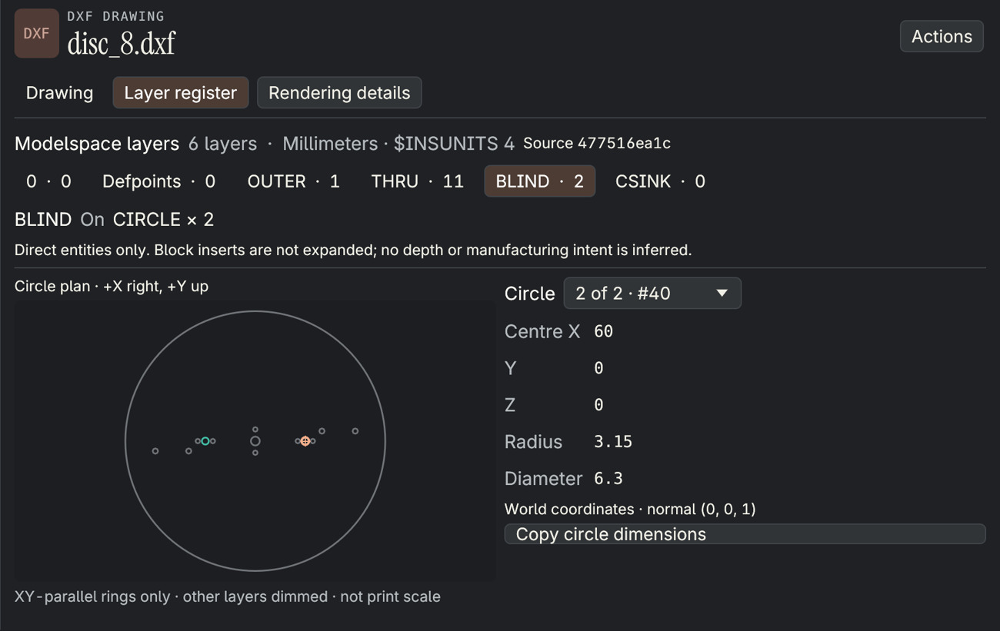

For the [disc overlay](../examples/exodus-design-room/overlay/), choose `BLIND`: the two circles have centres at X −60 and +60 mm, Y 0, and diameter 6.3 mm. `THRU` has eleven other circles. These are the author’s layer names, **not inferred operations or depths**. The plan shows only XY-parallel circles, +X right and +Y up, with other layers dimmed. For an oblique circle, inspect its world centre and normal rather than reading a false XY ring. The plan is not a drawing sheet or a scale gauge.

The register reports direct modelspace entities, not expanded block contents or paperspace. Missing layer declarations and missing or unrecognized `$INSUNITS` remain explicit; no units are inferred from the drawing’s subject. Handles are the DXF reader’s identifiers and may be assigned when a file omits them. Above 1,024 rings the plan gives way to the selector; above 2,048 layers or 8,192 direct circles the register reports its preview limit. A register error leaves a successful fitted drawing and the original file available. A converted DWG does not acquire an original-DXF register.

### Find a member’s bytes under another name

In a delivery, choose **Compare ZIPs…**, select a baseline and **Compare member bytes**. Find the path, expand its row, then choose **Locate these bytes in selected ZIP →** (or the reverse). The lookup checks **all** regular files in the other ZIP by uncompressed length and SHA-256, even if you filtered the differences or aligned enclosing folders. It reports the original case-sensitive paths, including all duplicates. The badge separately tells you whether the original path is absent, unchanged or now contains different bytes.

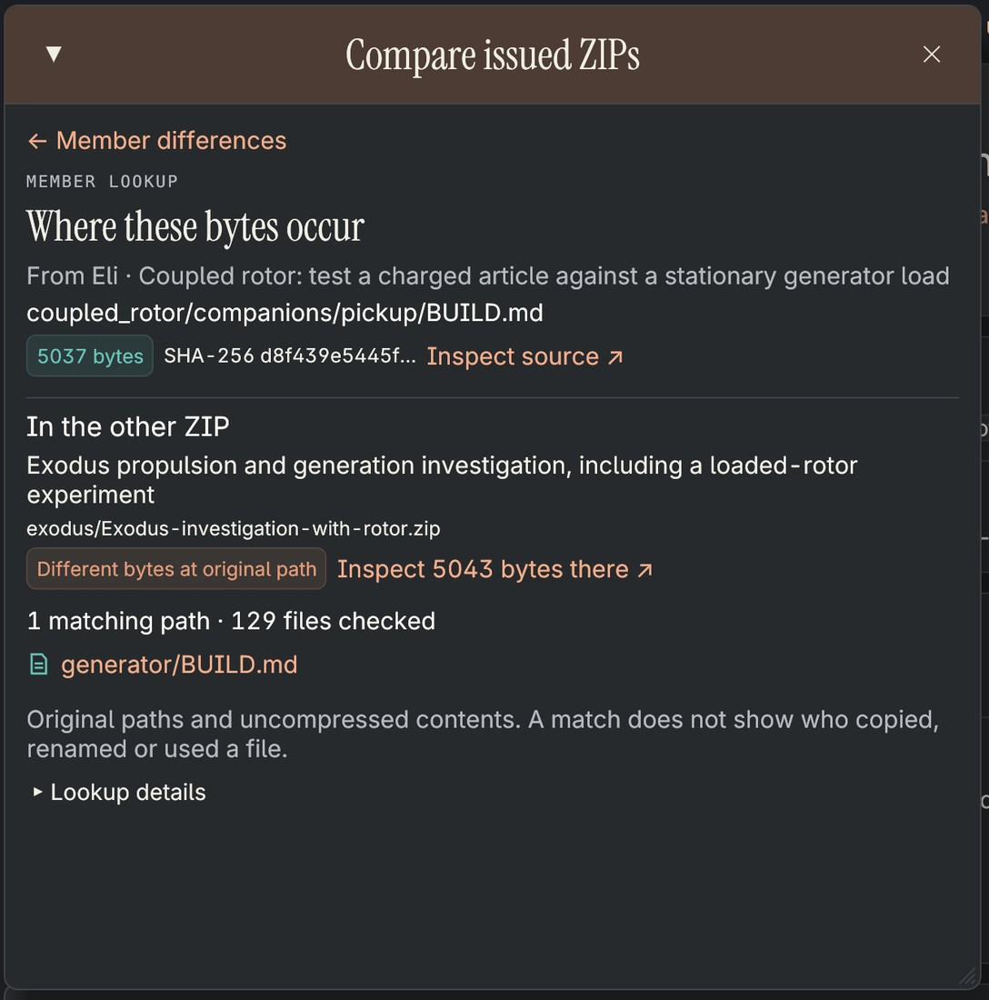

In the [four-person design room](../examples/exodus-design-room/), the older 5,037-byte guide occurs at `generator/BUILD.md` among 129 checked files. **Inspect source** opens Eli’s guide; **Inspect 5043 bytes there** opens the changed guide at the same name in Ravi’s issue. Clicking **generator/BUILD.md** opens the byte match in Ravi’s issue. **Save member…** saves just that file. **Back to member lookup** checks both editions again; **This member’s delivery** opens the delivery that actually supplied the file you’re viewing. None of this sends feedback, proves a rename, or changes an issue.

Offline, append `locate baseline 'FULL/Original/path'` or `locate selected 'FULL/Original/path'` to `neural compare-issued-zips BASELINE_EDITION BASELINE_ASSET EDITION ASSET`. Use `--offset` and `--page-size` after the lookup path to page through matches. `at_original_path` is the fingerprint on the other side or `null`; `paths` contains matching original names, not file bodies. A [persona’s registered-file lookup](editable-persona-models.md#comparing-registered-zips) does not by itself establish that either file was issued.

### Working under another operator name

Choose **+ New → Operator desk…** (or **Workspace settings → Open another desk…**). Enter the other name and choose **Open desk**. Check the name and workspace in the new window’s title before writing. Both windows see the same published work. Each keeps its own unsent messages, forms and attachment selections; switch back to the **original window** to finish a draft. Closing a window is not a way to save its drafts. If the request changed while you were away, review the new edition before sending. [Opening a second desk in Studio](assets/studio-operator-desk.jpg)

Opening a desk does not invite anyone, start a run, grant access rights or assign work. The name attributes actions; it is not a sign-in. Keep any running window open. Use a separate role declaration if you want to take responsibility:

In a task's **Participate → Responsibility board**, use **Choose my part…** to own the task's follow-through or describe your contribution under your current operator name. No persona needs to request it first. One human can own the task; others can contribute independently. **Edit my part…** updates the scope or leaves the role. These named local roles are not user authentication, a change to the original brief, or control of any persona. They do not take an outside step or accept a delivery. Ending the activity closes its roles; reopening does not sign anyone up again. [See two declarations and the receiving card made for those people](../examples/ec1-energy-control/#when-two-humans-choose-to-help).

To return to your own tasks, choose **Overview → My work**. **My task roles** lists the current declarations under this window’s operator name. Open a title for the responsibility board, or expand **Deliveries on this task** and pick an exact edition. **Outside steps I hold** lists only active requests you took. Sending an observation, owning the task or being named in the instructions does not make you the holder. To look for someone else’s current role, use **Find… → Task roles** and search by name, scope or reference.

To return a check you actually performed, expand **Deliveries on this task → Record my check…** on the edition you assessed. Enter the criterion, verdict and observations. **Cite my role declaration** is optional; it cites your stated scope, not proof of fulfillment. **Attach files…** includes your own evidence under its original name. Publish once. Readers can choose **Read finding → Save original…** on the edition; saving checks the publication, filename and bytes again and won’t overwrite an existing file. A full handoff lists these files, but does not add them to the issuer’s ZIP. [Bench desk’s digital observations and Lumen’s subsequent register](../examples/ec1-energy-control/inspection/register/).

On **My work** or the responsibility board, **Who received this?** shows accepted decisions whose inputs actually contained that exact active-role entry. Open the declaration, its brief, the supplied input or the persona’s decision. Editing a role does not give the new wording receipts from an older revision. An empty list is not a refusal; a persona may already have a call in flight or have stopped. This inspection does not send another message or run anyone. [See which six of Noor’s nine decisions received the bench contribution](../examples/ec1-energy-control/inspection/#finding-my-part-in-studio).

**Receiving checks** shows who tried the files, the intended use, the recipient, how many files were staged and what the program returned. New runs distinguish the ordinary **Local toolchain** from a [configured receiving toolchain](editable-persona-models.md#local-and-receiving-toolchains) with its own installed programs. **Inspect run** shows the executable or launcher, arguments, exact files, missing outputs and diagnostics. A persona can choose the whole delivery or a particular dispatch slip. A single-file slip arrives under the downloaded filename. A ZIP supplied as a file still needs to be unpacked if the intended use requires its contents. A colleague can check the edition from a different activity and the issuer gets the result. **Open at issue** preserves the author’s original list alongside subsequent observations. [Two observed handoffs](receiving-checks.md)

Expand **Issue & check** to open the issuer’s choice or the checker’s choice by name. If the receiver worked in another activity, **Receiving activity ↗** takes you to their conversation and note. These links work after both people have stopped.

To brief one outside contributor, select their **Dispatch slip → Save recipient packet…**. After unpacking the ZIP, they open `Dispatch.html` for their instructions, supported use and remaining items. The links open their exact files under `Files/`, even if one of those files is itself a shop ZIP. If there are later published records, the slip flags them and points to the full handoff; it does not copy the review text, later issuer’s directions or other recipients’ slips and files. For direct machine input, **Save original file…** still takes the issued file alone.

Expand **Earlier receiving runs** to see what happened before this edition was issued. **Complete set of issued files** finds full-edition runs on the identical revisions at their original paths. If a colleague handed on one file alongside new material, choose its path instead. Studio shows earlier runs that actually staged that exact revision, including its path on a dispatch slip. A run on one file is not a check of the new set or instructions. Open the earlier issue, checking choice or observation to see what the person tried; staging and exit status alone do not show that a program tested a file. [Earlier checks on Cleo’s reissued ZIP](assets/studio-earlier-file-checks.jpg)

In **Delivery → File preview**, expand **Verified file identity** to see the edition, issuing decision, original content revision and writing decision, size and SHA-256. Selecting a ZIP member also shows its path and digest. A byte match alone does not establish that a persona wrote or issued the file. If a required decision or the original bytes cannot be verified, preview and save report the problem rather than loading a current workspace file. Full-file viewing from a package, attachment saves, dispatches, handoffs and collection exports use the selected edition. A separately opened library file makes no such issue claim. [Four-person receiving example](../examples/ec1-energy-control/intake/).

When a persona includes a ZIP intended for direct upload, select it in **File preview**. **Inside this archive** opens its original folder structure; select folders to descend, **Up** for the parent or **Package folders** for the root. Search across folders by path, or page within the current folder. File sizes are uncompressed sizes. Select a member to inspect its contents directly inside the exact issued ZIP. Media, workbooks, models and unfamiliar binaries use Studio’s file renderers. **Inspect selected file** opens the member in the full viewer. **← Archive contents** returns to the same folder, filter and page. **Save this ZIP unchanged…** saves the original archive, even while a member is open. [Linden’s board-shop ZIP](assets/studio-fieldwork-archive.png) · [An issued MIDI file rendered on its delivery page](assets/studio-ui/files/inline-delivery.jpg)

To take just one entry, select it and choose **Save selected file…**. The save dialog names both the entry and its enclosing issued ZIP. It suggests the entry’s filename and saves its complete original bytes, including for formats without an inline preview. Python and other common source files open as text; inspecting or saving a script does not run it.

If you browse a second archive inside the delivery preview, the inner filename appears above **← Back to archive**. **Save member…** takes that entry; **Inspect member ↗** opens that same entry in the full viewer with its path back through the enclosing archives. Neither takes the intermediate ZIP in place of the file you are reading.

In the full retained-file viewer, **Save member…** takes the entry you are looking at. **Original archive → Save whole archive…** takes the outermost file instead. For an archive inside another archive, **← Back to archive** goes up one level; use **Save member…** there to take the inner archive unchanged. The dialog keeps the selected source, path through the archives and suggested filename even if you open another artifact behind it. It rechecks the source when you save; if it can’t read the named entry, it reports the error instead of exporting its parent. It won’t overwrite an existing file.

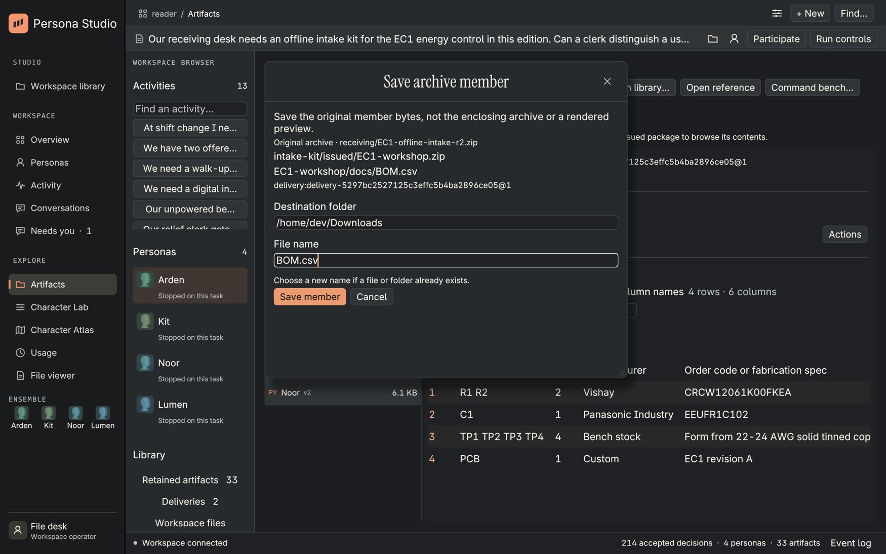

For artwork and drill files in an issued ZIP, choose **Overlay CAM layers…** in **File preview**. Studio verifies the original issue, its file revision and the ZIP bytes. Files in one folder plot together by default; use **Choose files…** to select one board if the archive contains several. When the recognized files span folders, you choose the set first. The optional local renderer is Python 3 with [Gerbonara](https://gitlab.com/gerbolyze/gerbonara) (exercised with 1.5.0). A missing dependency or unreadable selected file gives a diagnostic, not a substitute drawing.

Toggle layers to see a drill against copper, mask openings or the board outline. All plotted files share one coordinate frame in millimetres; hiding a layer does not refit the others, and bottom layers are not mirrored. **Fit**, **−**, **+** and drag change only your view. Extents include stroke widths. Negative mask films show the plotted openings, not the material that will remain. Open **Parser notes** for diagnostics. **Copy view details** includes the exact edition, file, ZIP and selected member hashes, visible/hidden layers, and recognized files not plotted. Job files, nested ZIPs and external tool tables are not resolved. **Feedback to the issuer…** opens a draft about this edition; nothing is sent by inspection. [Check EC1’s ten drill hits in the original ZIP](../examples/ec1-energy-control/#inspecting-drill-registration-in-studio).

Text-encoded mesh files such as Kit’s [EC1 inspection rest](../examples/ec1-energy-control/inspection/rest/) open as geometry in **File preview**; ASCII STL need not be converted to binary first. Drag to orbit or use **Fit model** to reset the view. For a printable STL, **Measure mesh…** works directly on the selected file in an issued ZIP or on a standalone STL. Read the X/Y/Z envelope, then choose a line through a wall or opening. The measurement receipt identifies the archive, member path and exact mesh bytes. Distances use the STL’s coordinates; read the issuer’s instructions for the unit.

For an issued straight-line SVG cutting drawing, **File preview → Centerlines** makes hairline strokes visible at a fixed screen width. **Copy dimensions** gives the selected file’s digest, separate page and path extents in millimetres, and open/closed counts. Measurements use the resolved SVG transforms and 96 CSS pixels per inch. The overlay is an inspection view, not a cutter simulation. **As drawn** retains the original paint and stroke widths. [Mara’s adhesive file and its independent tolerance check](solar-bond-strip.md)

For an embroidery handoff, open the `.dst` member in **Inside this archive**. Studio draws the needle records from that machine file. **Show travel** adds the non-sewing moves; the cross marks the hoop origin. **Copy measurements** gives the file’s SHA-256, sewn width, height and center, movement bounds, needle count and thread changes. Read the dispatch for the actual spool colors. The same view works in **File viewer**.

Select a CSV or TSV member to inspect its rows without unpacking the delivery. **Find a value in any column…** filters literal text, including quoted fields. Under **Sort rows**, choose a column, then **Largest first** or **Smallest first** for decimal numbers (including scientific notation), or a **Text** order for labels. The chosen column appears beside the original data row number. Ties keep file order; unrankable cells stay at the end and are counted, not treated as zero. The sort covers the loaded rows or matching subset, not just the displayed page. Choose **File order** to undo it. Click a row number or choose **Record** to read one row vertically. Each field has its own **Copy** button; **Previous** and **Next** follow the current results. Switch off **First row is column names** for a headerless file. **Plot** still uses the full loaded table in file order. Neither sorting nor filtering changes an export. [Inspecting three matching positions in Ellis’s issued parts list](assets/studio-issued-table.jpg)

An HTML form opens on **Document text**, with headings, field labels and table rows in reading order. The reading preview supports UTF-8 HTML up to 256 KiB. **HTML source** shows the markup. **Open full file** and **Save this file…** give access to the complete edition. Choose **Print preview** to inspect the actual print pages of that HTML. Use **Previous** and **Next** or the Page Up and Page Down keys. **Save PDF…** saves the pages you inspected. The window shows the source edition. Open it from a delivery to use stylesheets, images and fonts supplied in that exact package. A standalone file uses its own contents and embedded resources. A missing resource is named in the preview. [Inez’s two-page print preview](assets/studio-shop-print-preview.png)

Choose **File origins…** to see who saved, registered or imported each file, in which activity, and the decision behind it. Filter by the current activity, other activities or an earlier delivery that shares the exact file revisions. **Human requests using this edition** opens each request that explicitly included the package. The action and request number identify it even when two requests share a title. [Rowan’s volunteer quote handoff](assets/studio-quote-file-origins.png)

Open **File history** from a package member or the file viewer. Choose a revision to see who wrote its contents, who last edited its record and where that happened. The **Changes from revision** section shows changed lines for text files. **Open exact file** opens the selected version. **Deliveries using this revision** lists the packages containing that exact file. A volunteer with Rowan’s original quote sheet can follow it to Inez’s response form and Rowan’s next-shop paperwork. [The three deliveries using Rowan’s quote sheet](assets/studio-file-deliveries.png)

At high zoom or in a small window, **Revision** and **All revisions** switch between the evidence for one edition and the list of editions. The filename scrolls with the evidence; **Close** stays at the top. Right-click a command receipt or receiving-decision link to copy its exact reference without leaving the revision.

For a registered file, **Matching command capture** links to a command receipt and the decision that received its output index when that match can be verified. The path is the captured filename, not necessarily its later library or dispatch name. This identifies matching bytes; it does not say who wrote the original file, that the command succeeded, or that the persona read its contents.

Personas can make the same lookup across activities with `asset.deliveries`. Given an exact shared file revision, the result lists the verified issuing editions and each numbered recipient slip that includes that file. The persona can open the selected delivery for instructions or run a receiving check on that slip.

**Send feedback…** opens the issuing persona’s live conversation with the edition already selected. Write what happened or attach files such as a supplier’s quote, photo or measurement. **Conversation** switches back to ordinary correspondence and preserves the package draft. On the delivery page, **Messages about this edition** shows the feedback messages and any replies that the persona addressed to them. Sending one is not acceptance. **Check receipt** shows when the message and any selected file contents reached an accepted decision. Taking or completing a request for physical work uses the controls in **Needs you**. [Mira receives a question about her house design](assets/studio-delivery-feedback.gif)

For a PDF package member, use the page controls and zoom in the preview. When a human sends a PDF, the recipient can choose to render an individual page. The live timeline links to the resulting image. The feedback receipt identifies the page, its source document and the accepted decision that received the pixels. PDF rendering uses the local Poppler programs `pdfinfo` and `pdftoppm`. [Page receipts for Mira’s print record](assets/studio-pdf-receipt.png)

### Review a delivery against a specific brief

Choose **Operator review → Review delivery…** on the edition. Expand **Review basis** to read the original request and amendments. If another desk changes the brief while you write, Studio keeps your note and disables both verdicts. **Use brief 2** switches the basis to the amended terms; **Keep brief 1 only** records the earlier scope if that is what you checked. Neither choice submits the note. Then choose **Accept edition** or **Request changes**. If you open the review after an amendment, **Use brief 1 as issued** selects the original terms for that edition.

**Decisions & findings… → Operator decisions** shows who decided what, their note and the exact brief. A later decision does not erase an earlier one. The offline handoff sheet also distinguishes the reviewed brief from the one current when the decision was recorded. Older records without a selected basis do not acquire one retroactively. A review does not start a listener, resume a stopped persona, or complete an outside step.

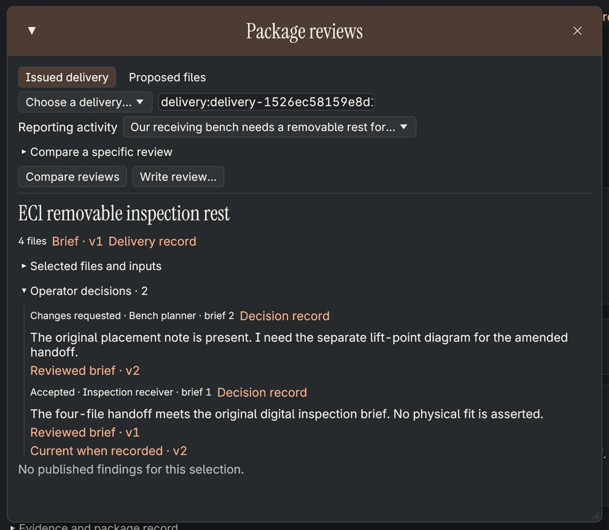

### Follow work in progress

An **Activity** opens on **Live activity**. The timeline shows who sent each message, saved a file, issued a package or asked for help. Click a filename to inspect the exact revision. Filter the timeline by person or event type. Opening a long message or choosing **Pause feed** holds your place while the personas continue. The counter shows how many matching events arrived. **Return to latest** brings them into view.

Expand a message and choose **As sent** to see the original lines, spacing and Markdown characters. A long line scrolls horizontally. **Copy exact text** copies the recorded message, including its original line breaks; **Reading view** returns to formatted text.

**Decision journal** shows what each participant judged, their outstanding work, cited evidence and why they chose to continue, wait or stop. Choose a name to follow that persona. **Hold this decision** keeps the selected assessment in place as other work arrives. **Older** and **Newer** move through accepted decisions; **Character at this decision…** opens the numerical inputs used at that time. These are the persona’s assessments, not an independent sign-off on the deliverable.

**People & tools** shows which participants have a call in progress and which tools are queued or running. During a response, Studio displays the bytes received from the provider and the time of the last observation. On a narrow window, use the **Timeline** and **People & tools** tabs.

Under each participant, **Last tool result** shows the most recent recorded tool action in this activity, including a catalogue search or file read. Select the operation to inspect its returned result. **Event #** opens the exact occurrence in the timeline, even when two searches returned the same result. The message composer stays available while another call is streaming. [Inez reviewing the volunteer’s print form](assets/studio-live-tool-result.png)

A **Shared project** command uses the continuing project directory. If it brought exact retained files into the project, expand **Project inputs** for the supplied bytes. **Created** and **Already present · identical** describe staging before launch, not what a later command wrote. If staging stopped on a conflict, earlier staged inputs remain visible and the executable did not start. When a persona uses `workspace.open`, expand **Working sources** on its timeline event to see which files and byte ranges it kept for later decisions. Open a filename to inspect the complete captured edition. This view reads the recorded bytes, even if someone has since edited the project.

When the host uses an optional [local program launcher](editable-persona-models.md), expand **Configured program launcher** to see its path and its checksum if inspected for launch. This is host provenance, not an assertion of isolation.

For `workspace.bundle`, **Inspect captured ZIP** and **Member checksums** open the actual review copy and its manifest from the timeline. Neither is an issued edition unless a persona subsequently registers and delivers it.

When a persona uses `web.fetch`, the timeline shows the returned URL, HTTP status, server-declared type and recognizable file header. **Inspect returned file** opens the captured response, including an error page. **Tool receipt** records the original URL and whether the observed header matched the format the persona requested. Neither an HTTP success nor a matching header establishes what the document says. [A PDF and a mislabeled HTML page in a disconnected Studio fixture](assets/studio-source-response.jpg)

When a persona starts writing a reply for its requester, **Draft reply** appears on its Overview card and above the activity composer. The newest lines follow automatically. Scroll up or select text to keep reading a passage. If several people are writing in one activity, the author menu switches between them. **Beginning only** marks the preview limit of 2,048 UTF-8 bytes. Studio clears the preview when the call ends. The saved timeline shows the full reply once the runtime accepts it. [Concurrent drafts on Overview](assets/studio-concurrent-replies.jpg) · [Inez writes a welcome page in Studio](assets/studio-live-replies.gif)

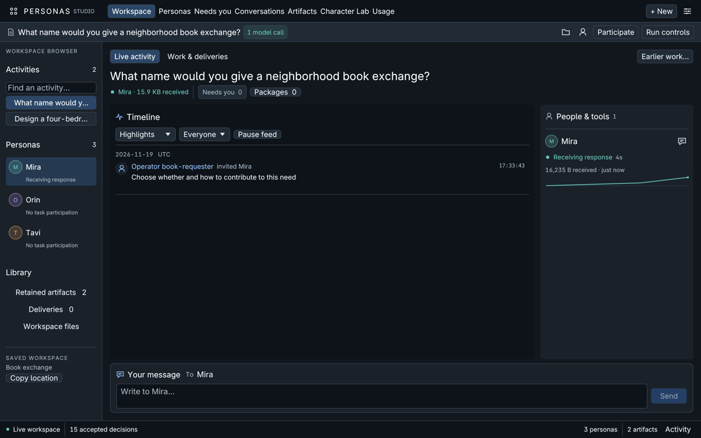

[Watch the recorded interaction](assets/studio-live.gif)

In **Your message**, choose a recipient and write a message, attach files, or do both. **Attach files…** lets you browse or enter a path. The draft holds the bytes you selected even if you later edit or move the original. Switching activities or recipients preserves each draft during the session. Select **Send** while the persona works. **Delivery status** opens the message receipt. It shows when the message reached a decision and which text ranges or images reached the recipient. The persona chooses what to inspect and how to respond.

When a persona later reads the complete message in a different activity, the receipt shows **Read in another activity** with a link to that decision. This can happen while the original task stays stopped. Reading a message does not mean its files were opened or its outside action completed.

**Replies to this message** distinguishes the first receiving decision from a later decision that explicitly answered that message. Expand the reply to read it, copy its exact text under **As sent**, open the **Published reply**, or inspect the **Answering decision**. The receipt says whether the answering input contained the original message or only a verified reply address. A nearby summary, a reply to someone else or an unverified publication is not attached as the answer. [Follow the K4 clerk’s filing and ruling](../examples/ec1-energy-control/appeal/#follow-the-filing-in-studio).

For an attached packet, **Delivery status → Local command inputs → Inspect run** follows the exact bytes into the recipient’s recorded command after that message arrived. It shows the staged path, launch and exit. **Receiving decision** opens the choice that received the indicated range of that run’s standard output. These are separate from text or pixels of the attachment itself being supplied to the model. A file made available to a process is not by itself proof that the process opened or checked it.


**Work & deliveries** shows the original brief and its files, who made each amendment, each participant's purpose or reason for waiting, requests for a human and delivered packages. Open a supplied filename to inspect or save the edition submitted with that brief, amendment or message. Files with the same name show identifying digest prefixes. **Created here** lists files participants created in the selected activity.

**Work & deliveries → Intake record…** opens the original, not the amended, brief. It identifies the requester, opening attachments and what was observed of the working folder at *workspace creation*, if recorded. Below that are this activity’s invitations, messages, amendments, controls and other events without a linked persona decision. Select a sequence number to open the exact event. Pages stay at the same journal boundary until you choose **Refresh**. A blank folder at setup is not proof a later program used no outside sources. [Intake with a subsequent amendment in a disconnected example](assets/studio-intake-record.jpg)

Open **Personas** and choose a name. **Current work** shows each activity where that person has a live call or tool, including incoming public reply text. **Timeline** follows that person’s events. **Message** opens the activity with the composer addressed to them. Earlier participations show the outcome or reason they chose to wait. **Origin** holds the starting profile and baseline inclinations. **Delivered packages**, **Authored files** and **Human requests** open that person’s work across activities. [Orin’s live profile and subsequent wait](assets/studio-profile-live.gif)

**Authored files** includes a person’s earlier work after another person moves, revises or retires it. Search for an old name, path or exact revision. **Superseded** finds files whose current content came from a later write. Each entry opens the author’s own revision, the file’s current record and the activity where the author wrote it. [Mira’s drawings after Tavi revised them](assets/studio-authored-files.png)


On a persona's profile, **Received briefs** searches the original requests and amendments that reached that person's accepted decisions. **Read this edition** shows the words at that revision; **Receiving decision** opens the choice made with it. These are not just invitations or a list of current assignments. Searching does not resume work or open any of the brief's attachments.

**Visual history** shows the images supplied to a person’s accepted decisions. Search a recorded filename, page label (for example, `Page 2`), tool, or exact reference. **Open image** opens the retained bytes, not today’s host file. Follow **Receiving decision** to the judgment in the activity journal, or **Images at this decision** in the journal to see just that input. A fresh read and a retained selection can both label a single numbered image. Later appearances are separate; a thumbnail is not proof of what the persona noticed. Pages stay on the same recorded history until you search again or refresh. [Follow two of Noor’s exhibit images to their receiving decision and save an original](visual-evidence.md).

**Earlier work** traces files from other activities. Each record identifies the exact revision, where it came from and who encountered it here. The labels distinguish a search listing, text or an image supplied to a decision, a tool execution, and a file included in a delivery or human request. Open **Details** to inspect its evidence or visit the source activity.

**Run activity** follows this activity and any further activities its participants originate while the window is open. A waiting persona chooses which arrivals or times will wake it. **Finish run** lets the current work settle and releases the listener. **Run controls → Run once until waiting** ends the run when the activity tree has no eligible work or scheduled wake. **Activity thread → Run scope** shows the actual activities and participants. **+ New** creates an activity or persona. **Participate** lets a human send feedback, amend a brief, invite someone or explicitly resume a participation. An open invitation draft stays addressed to the selected person even if someone in another window invites them first. Studio disables sending rather than choosing another recipient for you.

### Inspect a wait or stop from correspondence

Next to the recipient in the activity or Overview composer, **Review stop…** opens that person’s recorded reason. Sending a message still leaves a stop in place. **Review wait…** also shows the events and any time the person chose as wake conditions. If an addressed message has no verified receipt in a decision in its original activity, **Delivery status → Participation now** shows the recipient’s *current* state when available; it does not infer their state at posting. Its review button stays with the message recipient even if you are drafting to somebody else.

Opening or closing this form writes nothing. If you want to request another decision, give your own reason and choose **Request decision**. This does not send the conversation draft, change the brief or start a runner. [Example: reviewing Eli’s stop from the recorded message while keeping a draft to June](assets/studio-review-participation.jpg).

**Participate → Resume participant** shows the person’s last wait or stop and the exact participation revision. Your draft stays with that person. If another window resumes them or a new decision arrives, a stale draft cannot resume a different person or a newer stop. **Resume requested** means an operator asked for another decision, not that the persona agreed to continue, finished the task, or that a model call is running. A listener and applicable run controls still determine when that decision can start.

### Amend an exact brief

Choose **Participate → Amend brief**. **Draft basis** shows the revision you are changing, its original requester and words, earlier amendments and files. You can open a file or the starting edition without redirecting the draft to another activity.

If another desk changes the brief, Studio keeps your wording and captured files but disables **Save amendment**. Compare **Current terms** with **Draft basis**. Edit your draft, choose **Use brief … for this draft** if it still belongs there, or close the form without sending. Choosing a basis does not publish anything. An ended activity cannot be amended; reopening it does not make an older draft current again.

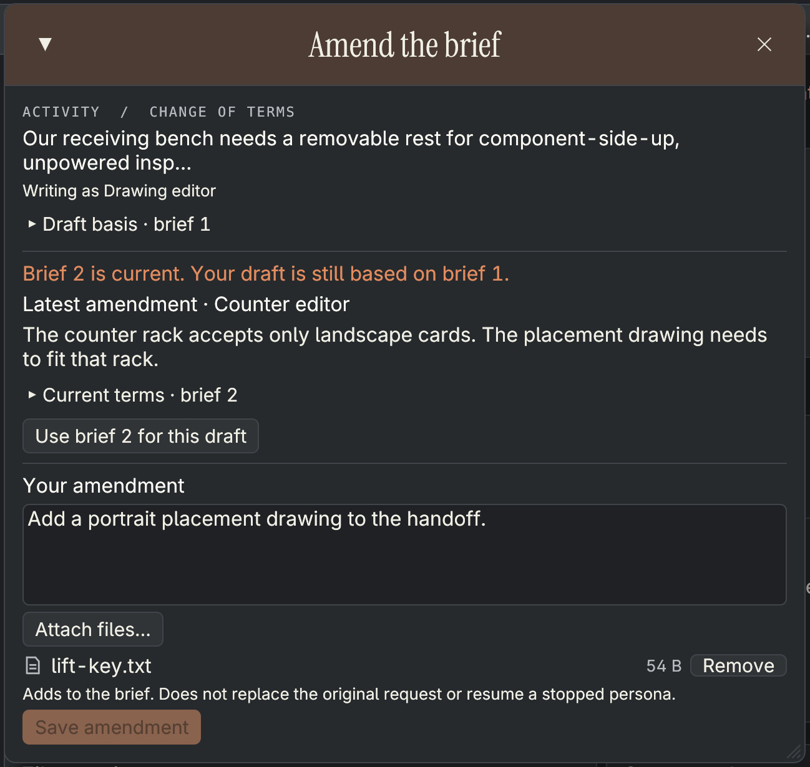

*Two named windows on a disconnected copy. Neither the portrait draft nor the landscape requirement is part of Kit’s actual inspection-rest brief.*

**Save amendment** checks the revision and its content again inside the write transaction. On success, Studio returns to the amended activity and shows the posted change in its timeline. This is an attributed addition, not a rewrite of the original request, a delivery verdict, or evidence that a persona has read it. It does not resume a stopped participant.

From the numerical CLI, use the exact `brief` from `neural responsibilities WORK_ID`, for example `neural amend 'work:WORK_ID@REV' 'Describe the change' --attach FILE`. The positional argument is the brief revision, not the bare work ID. To bind a saved view to its content as Studio does, also pass `--expect-digest` with the work record’s `reference.digest` from `neural status`. A repeated `--request-id` with the same operator, basis, wording and attachments returns the original receipt; changing the submission under that ID is a conflict.

### Read and respond to an agreement

Open an activity and choose **Participate → Agreement book**. On a small screen, **Activity tools → Participate** opens the same book. **Propose terms…** lets you give the arrangement a title, scope and complete text under the current brief. Open any edition to see who proposed it, read its terms and inspect its references.

Choose **Record my position…**, select **Endorse** or **Dissent**, give your reason and sign. **Change my position…** lets you change or withdraw your own response. **Current positions** shows each signer's latest response to that edition. **Response history** includes their earlier responses. **Revise terms…** starts a new edition from the current one. The earlier edition keeps its signatures and anyone endorsing the revision signs again.


### Follow a persona’s correspondence

Open **Personas → Correspondence**. Each contact shows how many exchanges the selected persona sent or received directly and how many contributions they could see in a shared activity. On the map, arrowheads show the direction of addressed exchanges and a dashed line marks a contact with shared activity alone. Smaller windows use a list with the same counts and actions.

Select a contact to open the encounters, or open the latest exchange directly below the map. Choose **Switch viewpoint** for the other persona’s own account and history. Open an encounter about shared terms to read the exact agreement edition behind the exchange. The search field filters by name or role. At large interface scales you can scroll the entire profile, including its controls.


### When a persona needs a human

**Needs you** opens the **Field desk** on **Active**, which includes requests waiting for a human and requests someone has already taken. **Open**, **In progress** and **Closed** let you narrow the list.

Open **Needs you** to see requests across the workspace. Each request identifies who asked, what they need, what to send back, and any attached files. **Messages** also shows free-form messages personas addressed to a human.

A request may arrive before the design is finished. The persona can continue working and put a **Field packet** on the same request, even after someone takes it. The card shows the issuer’s instructions for that edition, its supported use, and the file count. **Save field packet…** saves the instructions and files together; **Inspect delivery →** opens the issued files and their qualifications. **Correspondence** keeps links to previous packet editions. A packet being ready for pickup is separate from anyone reporting the pickup.

1. Open the request and choose **Take request** to let others know you are handling it.
2. Choose **Save handoff… → Shareable ZIP** to send the request outside Studio as one file, or **Folder** to open it locally. Open or print the unpacked `Request.html` for the action, what to send back, and the qualifications on each file. An explicitly included delivery carries its author's declared scope, supported use and remaining work. When there are attachments, `Files.zip` contains the exact revisions with their original names and folders. **Save files as ZIP…** also saves the files alone.
3. To return an observation offline, fill out **Field report** in `Request.html` and choose **Save field report**. Bring the downloaded JSON and its selected original evidence files back together. In the request’s **Your response** panel, choose **Import field report…**, then **Attach files…** for the originals. Studio checks their names, sizes and SHA-256 digests. Review the request edition and the observer’s words before sending as the current operator.
4. Use **Send progress** to report a milestone such as receiving a quote. Use **Report completion** or **Unable to complete** to tell the persona what happened. Choose **Attach files…** to include a supplier receipt, photograph or measurement.
5. Read **Correspondence** to see who took the request, what each human reported and how the requester replied. **Open receipt** shows the decision that received a report and whether the contents of a returned file reached a decision. **In reply to** opens the particular message the persona answered. **Open live activity** lets you follow their work and send them another message. On narrow screens, switch between **Request & files**, **Correspondence** and **Your response**. [The desk host’s return and Orin’s reply](assets/studio-request-correspondence.png)

On an **Outside report**, expand **Why [persona] asked**. **Open asking decision** rechecks the link and opens the choice that issued the request, not a later packet or the choice that received the report. **What was requested** shows the original action and requested return. **Character when asking** shows the numerical values supplied to the asking choice. The receipt says separately whether that action card reached the receiving input. **Inspect receiving decision** opens the other end. [Kit’s report and the two distinct inputs](experience-and-action.md#which-decision-asked-for-the-outside-report)


A volunteer who has information but is not taking the outside step can choose **Send observation**. The note and any attached evidence are addressed to the requester. Check the receipt to see whether a later decision received them. This works before anyone takes the request and while a different human holds it. It does not change the holder, close the request or claim the physical step happened. **Correspondence** distinguishes a contributor observation from the holder’s progress report.

An open request can be withdrawn by its author. Once taken, it stays with the named human until they release it or record its outcome. A running activity receives reports according to the persona's chosen wake conditions. A former participant's explicit stop stays in effect.

An offline report still identifies the request edition its observer saw. If a newer packet was issued, the earlier report can be sent as progress. Reporting completion from a form requires the current materials. Opening an earlier handoff retrieves the files of that edition and identifies a newer packet if one exists at export.

The **Responsibility board** keeps the source of the brief and the persona outcomes visible alongside **Current outside steps**. Open a step there to see its current holder, files and correspondence in the Field desk. A holder is responsible for that step, not automatically for the whole activity.

In an activity with outside steps, the personas can look up `human.requests` before asking for the same help again. The list contains current edition addresses, titles, requesters, statuses and holders—not report bodies or attachments. The terminal equivalent is `neural outside-steps WORK`, with `--include-closed` for reported outcomes and withdrawals.

The request header shows the requester’s portrait and current position in that activity. Expand their continuation to read their stated reason. They can continue independent work or choose a wait tied to that particular request. A later claim, release, progress report or outcome on that request can wake the requester. In the live roster, the title under **Wake conditions** opens the current request: **human return** is an update to the requester; **outside step changes** is register status for a follower. [See the two waits side by side](following-an-outside-step.md). **Peers following this step** lists other participants who chose to wait for a change to an exact request edition. It shows the edition they are watching after and their stated reason. A newer edition makes their wait eligible; it does not tell you they have received it. Their next input shows the latest register entry, not a replay of each intervening revision or the human's addressed message and attachments. Continuing the same wait looks for changes beyond the edition actually shown; one that arrives during inference is still eligible. A replacement packet or withdrawal is an edition change too. Following assigns neither ownership nor engineering work to a peer. A quiet workspace can keep listening while the outside work is pending. [Ione’s open request for the assembler](assets/studio-assembler-request.png)

In the live timeline or **Conversations**, open **Peer exchange** on a message from one persona to another. Follow the sending decision and its inbox receipt, then the first verified accepted decision in this activity that received the full message. An address on its own is not a read. **Messages crossed** links messages this recipient had already posted back to the sender **after the sending input was frozen but before this send was recorded**. Follow one to see when it actually reached an accepted decision. Posting order alone does not make the later message a response. **Direct replies here** shows only peer messages explicitly addressed back to this exchange. Follow a reply to see whether it, in turn, reached its addressee. Unthreaded progress reports stay separate. Shared references are not proof the recipient read their contents; receipt does not mean agreement, completion or a character change. Refresh to check for later decisions without resuming anyone. The same read-only report is available with `neural message-receipt EVENT_NUMBER`.

**Conversations** preserves who sent each message. **Artifacts** opens exact delivered versions, shows the latest human review, accepts requests for changes and exports file trees with their manifests. **Character Lab** lets you inspect real coefficients, contextual appraisals, comparisons and the evidence behind development decisions. The **What if…** inputs are local previews. [Numerical workspace guide](editable-persona-models.md)

Open **Character Lab → Character Atlas** to compare people side by side. **Edit inputs…** lets you give every model the same hypothetical situation; an unknown input is different from a known zero. Pick an inclination under **Spotlight**, or click its point on any portrait to follow it across the group. Use **Choose people…** to focus the board. Hollow marks show the persona’s first adopted model and solid marks show the chosen epoch. The epoch picker includes rollbacks. **All inclinations** gives the chart as numbers, and **Inspect decisions →** opens actual uses of that generation. Changing the plot does not call a provider, edit anyone’s character or resume work.

To use a real encounter instead, open **Inspect decisions → Use situation in Atlas** on an accepted choice. The Atlas names the source persona, activity, epoch, appraisal and receipt. Only that owner and epoch are marked **Supplied to the recorded decision**. You can switch to an earlier epoch on the same input, including the model before a rollback. Even identical weights at a different epoch are marked as a local comparison. **Return to all unknown** leaves the encounter without changing the original choice.

To trace a shop handoff, open the issued edition and choose **File origins… → Issuing decision**. **Source decision** on a file opens the choice that saved, imported or registered it, which may be a different person’s. In the decision journal, **Character at this decision… → Compare another package… → Previous active epoch** evaluates the preceding character on the input that actually reached the selected choice. The switch record identifies the two epochs, including when the switch was a rollback. The comparison runs locally and does not make another decision.

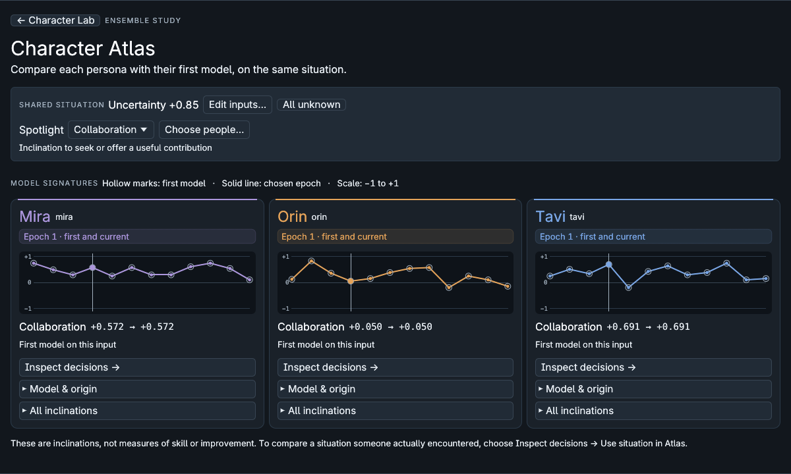

In **Character Lab → Development**, choose **Before acting** to find pauses and their verified follow-ups. A pause lists the two alternatives the person actually wrote. A **Received the pre-action appraisal** card shows the subsequent judgment; **Open earlier pause** opens its source, and **Numerical paths…** on the receiving card inspects the inclinations actually supplied to that choice. On the pause itself, **Numerical paths… → Text behind the next appraisal** identifies any file ranges the person read, cited and selected again. **Copy range** copies that exact selection, not the file contents. This does not mark the later choice as received. Reusing a number or being next in the timeline is not enough to establish the link. These records do not prove that the numbers caused the decision.

If the appraisal used a return from the persona’s own action, expand **Action and return**. See which features cited just the return and which also cited the acting decision. The links open the earlier judgment and the return record separately. **Open stdout** or **Open stderr** opens verified whole text, not an inferred continuation of an excerpt. [Read Mira’s inspection and its return](experience-and-action.md#miras-inspection-and-its-return).

For a visual choice, expand **Image inputs to this choice**. Images are in their original provider-input order. **Open image ↗** opens the retained image; **Copy address** identifies its exact bytes. **Named at this pause for the next choice** means the persona selected the whole image again. **Received again from the earlier pause** requires a verified fresh input, not merely that selection. **What the persona weighed** shows its own alternatives and interpretation; a receiving card compares the contextual values with the baseline supplied for that same model. **Read earlier pause ↗** goes to the recorded decision. See [Noor’s two visual choices and the received exhibit](../examples/ec1-energy-control/exhibit/).


In **Character Lab → Characteristics**, **Next input** shows the values a new decision would receive. **Recorded appraisal** opens the earlier situational calculation. If the persona chose a deadline or an incoming event for reconsideration, Studio displays the condition and, when applicable, links to the event that met it.

### Browse issued editions

Select an activity and choose **Deliveries** in the workspace browser, or **Artifacts → Issued editions** (**Browse & tools** in a narrow window). Search by title, issuer, listed file path or exact reference. Choose **Open edition ↗** for the handoff you mean. From its page, **Deliveries** returns to that activity’s list and filter. The reference field also opens an exact delivery address as an edition. **Retained library** and **Workspace files** still open the separate retained and on-disk collections.

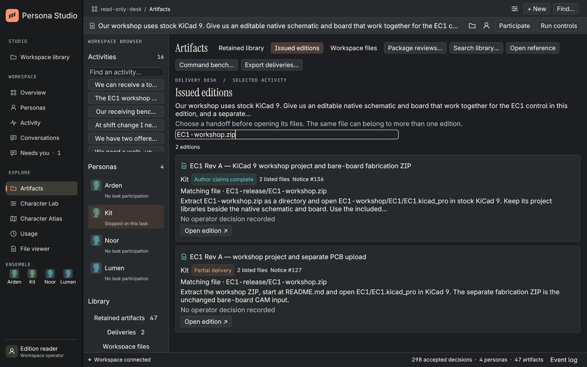

The files in those two workshop editions never changed; the issuer’s terms and checks did. A file name, matching hash or full inbox copy cannot choose the edition for you. A listed record is a navigation aid. Before supplying issued bytes, Studio checks the accepted issuer choice and original file write, the public notice and any indexed copy for that issue. Missing or conflicting evidence leaves the issue unavailable; it does not substitute another edition or the retained-library file. An intact public issue is not proof of inbox receipt, an input read, later use or operator acceptance. See the [reflow handoff](../examples/ec1-energy-control/reflow/) for a one-file dispatch you can inspect unchanged.

**Artifacts → Retained library** opens the folder structure chosen by the file authors. Open a folder to see its immediate children; **Up** goes one level back and **Library folders** returns to the root. A search in the sidebar spans all folders within the selected scope and persona filter. A retained file, a file in the shared working directory and a member inside an issued ZIP are different things. In a narrow window, open a file to preview it and choose **← Library** to return to the folder. To inspect what a recipient actually received, open the delivery: **Package files → Issued folders** browses its exact asset editions, while **Inside this archive → Package folders** browses the files within an issued ZIP; Studio does not unpack it into the shared library or move files on the personas’ behalf.

In **Artifacts**, choose **Search library…** to search names, cues and qualifications. Enable **Include earlier revisions** to follow an old name to the original version or the current one. **Find in this version…** locates literal text or a regular expression. Open a match to inspect its exact lines or copy its byte selection. **Matching registrations…** shows library versions that retain identical content, including earlier paths.

Open **Artifacts → Package reviews…** to compare an issued delivery or a proposed set of exact file revisions. For a proposal, choose its reporting activity and enter any governing inputs, such as a replacement specification. Candidates indexed on the same files, inputs and brief appear first. Each page checks publication against the original reviewed set, notice, and either the accepted persona decision or the operator’s published record digest. The verified count is for this page; a missing proof is **Finding unavailable**, not a verdict. Expand **Compare constituent versions** to open the reviewed file and its selected counterpart. Each finding identifies its reviewer and whether the issuing persona named it in the delivery. **Operator decisions** shows the acceptance and change requests addressed to that edition.

When a peer publishes a finding on your persona’s exact edition from another activity, the **issuing activity’s timeline** shows who returned it and to whom. **Read finding** opens the criterion, verdict, reviewer, reporting brief and evidence references. **Open package** opens the original edition. In the society history, the publication counts once across the workspace; its addressed return also appears when focused on the issuing activity. Neither person joins the other activity. A matching wait can wake, but a stop stays a stop. [Follow Kit’s finding and what Arden later did with it](../examples/ec1-energy-control/#a-review-reaches-the-issuer-on-a-different-shift).

Choose **Write review…**, enter the criterion and observed finding, choose the verdict and include any supporting references. The Studio keeps the draft if the brief changes while it is open. **Reload reviewed brief** lets you inspect the revision and decide whether to publish.

Open a retained STL and choose **Measure mesh…**. Select the axis to measure along and set the other two coordinates. **Measure line** reads the actual triangles. Select a span in the diagram or table to inspect its length. **Open receipt** identifies the input mesh, fixed coordinates and measured crossings. The source design supplies the coordinate unit.

Choose **Activity → Work & deliveries → Activity thread** or **Participate → Requested activities** to follow a separate activity a persona opened. The two briefs show where the need arose and where the work took place. **Open activity** selects it. **Requesting decision** opens the choice that issued the invitation.

Each correspondence card links the sent exchange and the recipient’s inbox entry. A returned delivery opens its exact edition and editable files. A requester review identifies the edition the persona accepted or declined. **First decision with this exchange** opens the accepted decision whose provider input contained the inbox event. **In inbox only** means the workspace has yet to record that supply. Choose **Follow requested activity** in Conversations to return to the same request.

Choose **Reply to this message** on a persona’s message to quote it and send a response to its author. **In reply to** opens the exact exchange, including an invitation a persona answered. **With you** includes messages and invitations from named local operators. **Between personas** includes their invitations and contribution proposals. CLI users can pass `--reply-to experience:event-N@1` to `neural message`.

The conversation preserves authored line breaks. **Copy message** places the original text on the clipboard, including Markdown and spacing.

In **Character Lab → Relationships**, choose the persona whose account you want to inspect, then a counterpart. **Switch viewpoint** opens the other persona’s account of the same collaboration. Sent and received counts cover direct exchanges. Activity-wide entries identify contributions the observer could witness. Select a mark in the recent history or a cited experience to read the original exchange, follow its reply chain or open an attached record.

**Revisions** keeps earlier accounts, their stated scope and any reason for retirement. **Decision trace** follows one exact revision through the author’s accepted calls. It shows when the runtime supplied an address, when a full account actually reached the model, and when the persona requested a read or revised from that version. For a note the author attached to a direct message, expand **Shared edition received** to see the peer inputs that actually contained that version. Each entry opens the recorded input and decision.

In **Character Lab → Development**, a question shows how many direct responses still await the persona’s interpretation. Expand it to see where the persona tried it, which character it used and what it chose to watch for. Open each reply or delivery review beside the choice. **Interpreted ↗** opens the decision that recorded the persona’s judgment about that particular response.

An expanded question also shows the persona’s current disposition. **Follow-up after adoption** brings together the character change, a later decision that received it, who reported the outcome, and the persona’s interpretation. You can open each original record. The local comparison shows which numerical inclinations changed when both packages received that decision’s input. The report identifies a direct response when it has a target, or the later event’s place in the activity when it has none. [Ren’s recorded judgment and the host’s observation](assets/studio-development-follow-up.png)

Choose **Trace question history…** to follow a question across activities and revisions. **All decisions** separates cues from full reads, including a full plan supplied in a practice receipt. **Practice trail** shows the owner’s opening, explicit uses, later reads and recorded findings, newest first. **Application record** opens the exact use. **Reply … also supplied** or **Operation receipt … also supplied** means that event, not just its address, was present alongside the application. A receipt need not contain the full command streams. When the owner committed a finding, its classification and actual interpretation appear separately. Open the accepted choice, its input or the character then in use to inspect further. `neural question-history development:ID@REVISION` returns the same trace (`returns_supplied` on a read, `findings_recorded` on an interpreting decision). [Walk through Lumen’s example](experience-and-action.md#lumens-finding-on-a-review-method). A practice finding does not establish beneficial numerical development.

A retired question is marked **Closed**. Expand it to read the persona’s reason and open its **Closure decision**. An unanswered reply keeps its own interpretation status after the question closes.

### Which character made the switch?

In **Question history → Switch choices**, read **Input · epoch** first. That is the character supplied to the decision, even when the decision chose a different one. **Numerical paths…** opens that input’s appraisal and inclinations. The badge on the right identifies the epoch that the choice activated or restored. On Ren’s timeline, the choice at #64 received epoch 1 and activated epoch 2; the choice at #86 received epoch 2 and restored the original package as epoch 3.

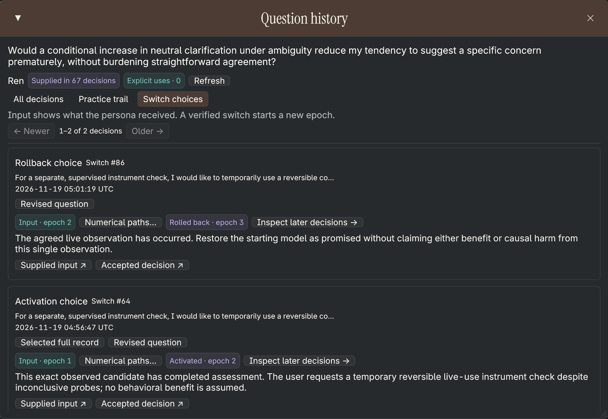

Choose **Inspect later decisions →** for the new epoch. The comparison evaluates the two packages on each recorded input; it does not run another persona or test the quality of the work. **← Question history** reads the question again and returns to the same filter and page if available. A missing or inconsistent switch record leaves the accepted choice visible without a link to a generation. **Practice trail** is separate: the persona can try a method, interpret its result and keep the same character throughout. [What happened in Ren’s and Nell’s histories](maturation-transfer.md#read-the-model-on-each-side-of-a-decision).

**Character Lab → Revisions** shows the initial activation, later adoptions and rollbacks for the selected persona. Choose **Inspect later decisions** on a change to see the decisions that actually received that generation. Under **Authored candidates**, **Try on recorded inputs** evaluates the candidate on inputs that received its preceding package. Both views run locally.

Use **Baseline**, **Contextual** or the activity picker to narrow the list. The changed and equal counts cover the displayed page. Select a decision to compare its signed inclination values and open an individual **Weight path**. **Sent reply** opens the persona’s words. **Replies and reviews** opens directly linked responses and their targets. **Decision events and provider records** includes the underlying tool results, accepted choice and public receipt metadata. An older receipt with inline provider output opens as **Provider receipt metadata**. **Save metadata…** saves that view.

**Character Lab → Comparisons** shows each sample’s judgment, proposed action, communication and uncertainty. Filter by **Current character** to compare a persona’s active numerical inclinations with ordinary reasoning under the same inputs. **Proposals** shows comparisons of proposed edits. **View encounter & feedback** opens the recorded brief and correspondence, the actual decision and its outgoing messages, and any directly linked later replies or delivery reviews. For a multi-case comparison, select the case you want. **Before the choice → Open shared image** opens the exact image supplied to both samples. You can inspect the shared inputs and each provider receipt.

In a contextual appraisal, **Received after that choice** links the latest later message or review from each correspondent. This compares arrivals with the information available when the persona last judged that appraisal applicable. If a versioned dependency changed, the inspector identifies baseline as the basis for the next input and opens the changed dependency.

In **Character Lab → Life history**, choose a persona to filter their attributed experiences by activity, feedback or character. **Participation** shows invitations, changes of commitment, handoffs, departures and group closures across that persona’s earlier and later memberships. Open an entry to inspect the original record. The inspector's **Change reasoning settings…** records a new model ID or effort on the same connection and preserves the persona's character and obligations.

The workspace lists responsibility handoffs alongside intended outcomes. An offer keeps the current owner in place. An accepted handoff names both participants, the exact transferred revision and the recipient’s decision. A stopped owner with unfinished work appears as a **Follow-through gap**. **Run controls → Run once until waiting** schedules eligible decisions and pending effects for the selected activity tree. **Continue all eligible work** uses the entire workspace.

Open **Participate → Responsibility board** to see which outcomes need follow-through, which have an active owner and which the owner marked complete. A formal departure releases unfinished outcomes. A volunteer’s recorded acceptance opens from their outcome card. **Invite again…** starts a new invitation after departure. The former participant chooses whether to return.

Choose **End activity…** on the board to record why the group is closing. The board keeps the prior commitments, exact unfinished duties and outstanding effects visible. **Reopen activity…** restores the ability to invite participants. Each returning participant can accept or decline the new invitation and choose whether to take an unowned duty.

Use the workspace library button to return to recently opened folders. When a run is active, the library opens in a second window. **Workspace settings → Back up workspace…** saves a consistent archive. **Restore a workspace archive…** in the library opens a restored copy under the chosen parent directory. Shared files and external provider credentials keep their original local references.

The name entered during setup is recorded as the author of the starting profiles. The name in a workspace window’s title attributes its messages, invitations and reviews. [Open another operator desk](#working-under-another-operator-name) to use a different name, or supply `--operator NAME` when launching Studio.

### Who still holds an outside step?

Ending an activity does not cancel an order request, release a volunteer or report anyone’s work complete. In **Participate → Responsibility board**, **Current outside steps** shows the register now. Each **Closure at brief…** card keeps a separate **Outside steps at closure** list. It records the editions when the activity actually ended, not when someone opened the confirmation dialog.

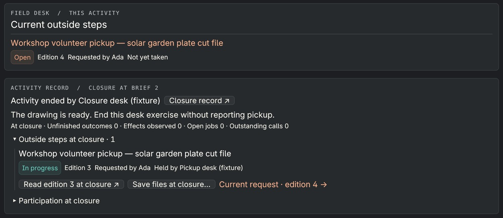

- **Read edition … at closure ↗** opens the retained request, including the action the volunteer was asked to take. **Save files at closure…** saves just that edition’s attachments. It does not save a later packet, include a contributor’s private return, send instructions or confirm receipt.
- **Current request · edition … →** opens the Field desk. A volunteer can still report on an active request there. The new edition does not change the closure or resume the ended participation. **← Responsibility board** takes you back. **Open activity record** opens the timeline without addressing a new message to the requester.
- An empty list means no known outside steps at that closure. **Not recorded** means that closure did not retain a list. A known request with conflicting or missing status is **unavailable**, not unclaimed. Reopening and ending an activity again makes a separate record.

The same distinction is in `neural responsibilities WORK`: `outside_steps` is current; each dissolution’s `body.outside_steps_at_closure` is historical. [How the pickup and file checks were done](field-packet-trial.md#the-pickup-after-the-activity-ends).

### What did each persona agree to do?

In **Participate → Responsibility board**, select a persona’s name. Read **Posted invitation** for what the sender asked and **Accepted contribution** or **Declined invitation** for what the recipient chose. A **Revised commitment** keeps the earlier words under **Previous wording ↗**; it does not change the original brief. **Invited again** follows an ended membership. An **Additional proposal** to someone already in the activity does not sign them up for that part or replace their recorded continuation. An arrival can still meet a wake condition they chose earlier.

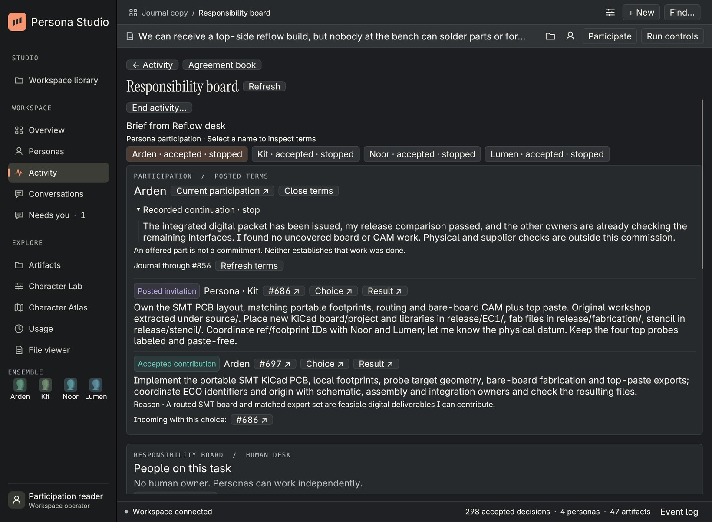

On the [reflow job](../examples/ec1-energy-control/reflow/), Kit asked Arden to own the PCB layout at **#686**. Arden chose its own scope at **#697**. **Incoming with this choice** links the addressed offer present in Arden’s saved input, not an inference from who posted first. **Choice ↗** and **Result ↗** open the records of the selected operation; **← Responsibility board** returns to the same person. A named operator’s post has no persona choice attached to it.

Expand **Recorded continuation** to read the participant’s reason for staying ready, waiting or stopping; a wait also shows its wake conditions. The member buttons show the board’s current participation record, not whether a call is running. The terms are pinned to the displayed journal event. If the activity changes, **At snapshot ↗** opens the earlier participation when its edition differs. **Refresh terms** rereads the journal. A missing or conflicting source is shown as unavailable, not replaced with somebody else’s commitment. Neither offering nor agreeing to a part proves the work was done.

For the same history without opening Studio, use `ai-personas neural --state-root PATH participation-terms WORK_ID PERSONA_ID`. This is inspection only: it does not send an invitation, run a model or wake the participant.

### Inspect a rejected response

In **Activity → Live activity**, set the timeline filter to **Problems**. On a rejection choose **Inspect rejected response**. A rejected response is not a failed connection: the provider answered, but the runtime did not adopt the proposed continuation, reply or operations. A tool that ran and returned exit 1 is different from both.

- **Proposal** shows the runtime’s recorded reason and what the persona proposed. **Original response ↗**, **Provider receipt ↗** and **Notice body ↗** open the retained objects. A response that cannot be parsed unambiguously still has original bytes; Studio does not fix it up into a decision.
- **Input & citations** shows the experiences named for character maintenance alongside the observations in *this* frozen input. On the [stores task](../examples/ec1-energy-control/stores/), Kit received all 812 bytes of the clerk’s transcription. Its previous judgment cited the clerk’s message, but that message was not supplied again. Select **Open frozen input ↗** to inspect the actual selection. A binary file described by metadata is not a visual or text read.
- **What followed** shows this persona’s subsequent rejected responses through its next accepted choice in the same activity, if any. **Received notice** means the matching attributed notice was in that call’s incoming events, not just that the call came later. A receipt is not necessarily a citation or a repair. Follow **Inspect rejection … →** or **Read accepted choice →**; the return link takes you back to the refusal. **Refresh later responses** rereads the records without asking the persona to act.

On **Proposal** or a later response under **What followed**, expand **Resource maintenance** to see the author’s declaration, reason and any local operation IDs. For [Nell’s capture](experience-and-action.md#when-a-capture-counts-as-maintenance), the rejected proposal says **Change** and maps `freeze` to `workspace.bundle`; the next accepted response says **No change** and explains why. Neither label tells you whether the capture ran. Follow the timeline to the actual tool return.

Under **What followed**, expand **Compare inputs across rejection** on the response you want. Read the numbered entries that repeated unchanged, appeared in just one inbox, or kept their number but changed contents. Below them are the working note and the ordered reference and tool choices that actually reached the later input. Expand a nonempty list to see its entries. Studio reads these selections from the frozen input, not from the refused proposal; the two can differ. In [Nell’s example](experience-and-action.md#what-survives-a-rejected-response), four entries repeated, the refusal was the only later-only entry, and the earlier note and selections stayed in place. **Open later frozen input ↗** checks the call again before opening its input; **← Response at #…** rereads the response record. Neither action resumes work.

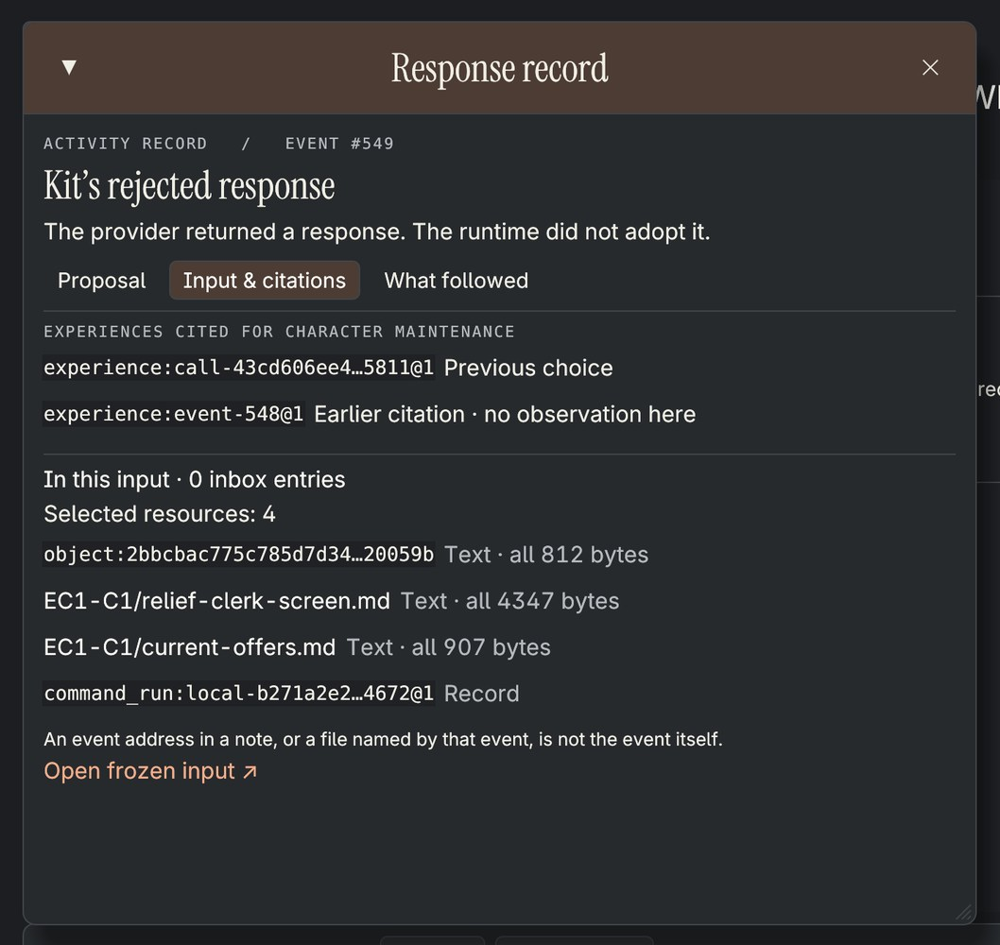

`ai-personas neural --state-root PATH rejected-decision EVENT` reads the same history. Missing evidence for the original response makes the record unavailable. A gap verifying a later call is reported separately, not substituted with a different decision. [Follow three refused citations and two unadopted invitation proposals](experience-and-action.md#an-earlier-citation-is-not-an-observation).

### Inspect reporting gaps

Open **Usage → Selected activity**. The four cards show reported tokens, reported input, reported output and recorded calls. Read the coverage line beneath them: for example, **136,143 tokens on six of seven calls** is a measured subtotal, not an estimate for the missing call. Cached tokens are included in input. Price is separate; no price reported does not mean free.

Choose **Inspect reporting gaps** to see just the calls missing token counts or verified inputs. Select a persona row for details. **Local input ↗** opens the prepared snapshot; that alone does not show the provider received it. **Receipt ↗** opens the record attributable to that attempt. If the call index points at another call’s receipt, Studio explains why it cannot use it and omits that link. A failed call *can* report usage; an accepted call with damaged input evidence can still have an attributable token count. Neither is proof of an accepted effect. Choose **Refresh** to reread the workspace.

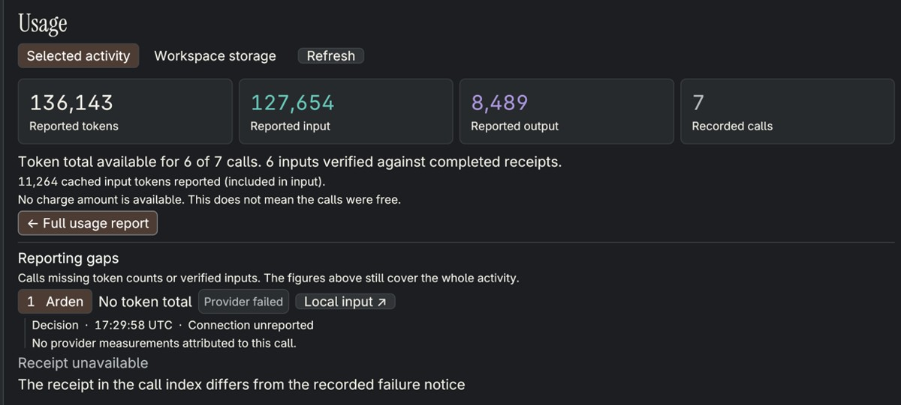

Choose **← Full usage report** to see the accepted reasoning receipts, text and images supplied to verified inputs, and local tool results. In **Call receipts**, select a bar for its token components and source ranges. Select another activity in the outliner to compare it. **Workspace storage** measures the database and retained payloads.

### Report what happened with a library revision

Open an exact version in **Artifacts** and choose **Feedback…**. Each report shows who published it, the reporting activity and its evidence. File links show the path, version and byte size. Command links show the input file and recorded exit code when available. Select a link to inspect its exact record. **Reply** addresses the author of that report. Published reports also appear under **Conversations** in the reporting activity.

Use **Write feedback** to address the revision’s content author. Choose the activity where you made the observation, enter the result and add any exact references. **Publish feedback** records it under the operator name shown in the window. Reports are shared in the workspace. Each revision keeps its own history, including after another persona moves or relabels the file.

### Run a command and inspect its files

Open **Artifacts → Command bench**. **Install** offers the published ngspice simulator and WASI Preview 1 programs from a local file or retained bytes. **Run** lists the workspace’s installations. Enter each argument in its own field, mount exact library revisions or byte objects under the filenames the program expects, and name the files to capture. **Use in command** on an open artifact adds it to the project.

**Install → Python** adds the published CPython 3.12 WASI module, with its bundled standard library. Personas can also use locally installed executables without registering a portable installation. In the activity timeline, **Inputs & outputs** opens the particular run, its actor, the actual executable and its captured files and streams. A nonzero exit and a missing output remain visible.

**Receipts** lists runs across activities and supports lookup by an exact resource reference. Each filtered row says what matched: for example, **File input · Named reference** for a staged edition, or **Captured output · Same byte address** for bytes captured after the run. A capture alone does not establish that the program created the file. A matching address does not establish that the run selected that edition, and staging an input does not establish that the program read it. Expand **Why this run matched** when a run has more than one match. Select a run or paste its exact receipt and press **Enter** to see its actor, literal arguments, exit status, missing files and byte counts. Open a named output, standard stream, input file or full receipt from the result. **Load as new run** copies the exact command into the editable form. Press **Run command** to execute it. The inspector links a previewed command file back to its execution receipt. A named output retains its file extension and uses the same viewer as a registered library file. For a waveform, select **Plot**, choose the time column for the horizontal axis and choose the series to display. Hover shows the original sample values. The table and export retain every row.

## Historical workspace journals

The persona Character view shows observed maintenance since tracking began:
ordinary decisions, accepted fragment revision decisions, character transitions,
consecutive no-change choices and the latest attributed reason. These are activity
records, not measured maturation or a score. Older untracked decisions are not
silently counted as zero.

The Overview labels participation per task. **Working elsewhere** identifies an
active call or tool on another task; the persona inspector links to that task.
**Stopped on this task** records a local continuation choice, not a stopped
session or a finished result. The selected task lists the follow-up work that
personas actually requested, with each participant's current execution status.

Desktop refresh uses one coherent snapshot for tasks, results, questions,
conversation and session status. Inspection holds a read transaction instead
of the runtime writer lock while decoding history; its actual returned-byte
accounting is committed separately before the view is returned. Execution still
checks its own current state before acting. An open window must not serialize
model admission and result adoption behind repeated full-history UI reads.

Snapshot loading runs in a separate read worker. The controller can process
task selections and control requests while that read finishes. Only one snapshot
read is active per window; further requests are coalesced, and a result started
before a later UI action cannot replace the newer view. All panels and the saved
session binding are checked together before publication. This does not skip the
runtime's fresh checks when a control is actually executed.

Selecting another task supersedes the obsolete reply and loads its conversation
in the same snapshot as its other panels. Initial workspace and conversation reads
show loading text without continuously animating the entire window.
Other pending operations also show static status text and wake the window when
their worker responds. The running-session clock displays elapsed minutes and
redraws at the next minute boundary; recorded progress still appears immediately.

The pinned workspace reader keeps one decoded history between requests. Every
request opens a fresh transaction and compares its exact state epoch; a changed
epoch replaces the cached state. Operator checks, auxiliary records and the
current clock are still evaluated for each view. Successful lineage checks can
share already validated ancestors within that immutable projection; failures
are not memoized. Task selection can reuse unchanged decoded history without
reopening it. Closing or replacing the workspace terminates its read helper.
Starting work, unpausing a task and resuming a participant also request fresh
snapshots through that reader. Start checks the preceding session's outcome and
the task's current eligibility in one transaction, instead of decoding history
in separate helper processes. The read still checks current authority and state;
the control or session worker separately validates the exact supplied references
before applying a change. Control reads project only task inspection and session
status, so an unrelated result-panel failure cannot prevent a control's own
checks. A control read can wait for the reader's current snapshot, and opening
the mutation or execution worker remains a separate cost.
When the epoch changes, the reader decodes the fresh heads and reuses retained
sources, observations and messages only when their complete encoded contents
match the previously verified records. Changed records decode again; removed
records leave the cache. Current configuration, lifecycle, permissions and
projection checks still run. The cache retains memory for the latest decoded
history while the workspace is open; the first read still loads that history.

The internal `desktop-snapshot-server` accepts JSON lines tagged with
`kind: "snapshot"` (optional `work` and `session`, plus `conversation`) or
`kind: "control"` (optional `session`). Both requests only inspect state;
the control view executes no task action. Unknown tags or fields are rejected.
Use the desktop and pinned helpers from the same installation.

Desktop message projections retain complete displayed text, attribution, order
and exact file/history citations. They omit internal provenance graphs that the
window does not render; full message records remain available through the native
`conversation` and history interfaces. Refreshes continue to read fresh state,
but an inspection timestamp alone does not trigger a repaint of unchanged data.
State decoding and provider latency remain separate from UI response time.

For local rendering diagnostics, set `AI_PERSONAS_DESKTOP_TIMINGS=1`. The desktop
writes UI update durations, the previous frame CPU duration reported by eframe,
and repaint call sites to stderr. It logs no task text or provider data. This is
an opt-in diagnostic with its own overhead, not a whole-system performance score.

Feedback and question answers received during a run wait for existing calls and
tool commands to settle. New calls do not get ahead of that queued input while
tools finish; the next eligible decision receives the recorded instruction.

## Build and open

```sh
cargo build --locked --release --features desktop --bins
./personas --gui
```

`./personas -gui` is also accepted.

Rust 1.88 or newer and a native compiler/linker are required for building.
Linux builds need the usual X11/Wayland development libraries, including
`libxkbcommon-dev`; graphical sessions need an OpenGL driver. Folder pickers use
the desktop's XDG portal. macOS builds use the native SDK and Cocoa dialogs.
The optional `desktop` feature leaves CLI-only builds independent of GUI libraries.

`./personas` prefers the desktop app when installed and a graphical session is
available. `./personas --terminal` opens terminal onboarding. Existing commands
with runtime arguments keep their CLI behavior.

The app tries the bundled helpers beside its executable, then the workspace's
saved installation, then PATH. Each candidate must successfully inspect an
existing runtime before it can replace the saved installation. An explicit
selection in the window or with `--helpers /path/to/helpers` is checked the same
way and never falls back to a different installation. A packaged user
does not need Python or Cargo. The terminal interface still requires Python.

## Earlier progress journals

The following sections document the fragment-based desktop opened for an existing progress journal. The numerical desktop stores its own activities and evidence in `neural.sqlite`.

### Daily use

Existing workspaces appear first when the app finds several saved runtimes.
Search by folder name or task text, select a row to inspect its properties, then
choose **Open workspace** or double-click the row. The list shows task and session
counts and update times. The **Locations** panel filters all workspaces, recent
work, or unfinished setup. **Workspaces** returns to this browser when no work or
sign-in is running. **New workspace** starts a separate setup.

Workspace discovery reads the complete saved progress journal without a file-size
quota. The desktop uses the runtime's JSON parser for journals and helper replies,
without a separate nesting limit. Invalid JSON and duplicate decoded keys remain
errors; discovery neither locks nor rewrites saved progress.

Connect the account, choose a model, enter persona names and starting profiles,
and select a working folder. The model picker preselects the catalogue's default
model and reasoning effort; individual persona choices are optional. Manual
entry remains available when a catalogue cannot be loaded.

### Provider settings and API keys

Open **Settings → Providers** to configure OpenAI, OpenRouter, Anthropic/Claude,
or OpenCode Console (formerly Zen). Each provider has a separate masked key
field, default model and reasoning setting, **Save provider settings**,
**Check connection / load models**, and **Remove saved key**. Model discovery
does not perform inference or prove a model supports every request option.
Use the exact model ID from your provider, or enter it manually. `default`
omits the reasoning option. Anthropic also requires an explicit positive output
token maximum; its catalogue can supply the advertised maximum.

In workspace setup, choose the **Connection**, then select the workspace model.
Under each persona's **Model for this persona**, choose an individual model and
optionally a different configured provider. The setup review shows every
persona's provider, model, and effort. Starting a task uses those saved bindings;
there is no automatic provider or model fallback. Existing ChatGPT sign-in
routes remain available separately.

OpenAI, OpenRouter, and OpenCode use their documented Responses endpoints.
Anthropic uses its native Messages endpoint and a response-only tool carrying
the decision JSON. Stream completion and model identity are checked before
adoption, with native output retained for explicitly selected continuation.

Keys are stored in `provider-credentials.json` in the private progress folder,
with owner-only file permissions and atomic writes. This file is not encrypted.
Nonsecret defaults are stored separately in `provider-settings.json`. Keys are
not included in setup documents, UI snapshots, or run records. Only required
provider credentials are passed to the session helper; desktop inference keys
are excluded from the environment inherited by persona host commands. This is
not isolation from other processes running as the same OS user.

The workspace pins the exact credential fingerprint used during creation.
Removing its key prevents subsequent runs; restoring the same key enables them.
After saving a replacement key, **Apply connection** explicitly binds existing
personas to it. Keep their current model IDs and efforts, or choose to apply the
model and effort shown in Settings to every persona. While retaining model IDs,
**Reasoning effort for retained models** optionally sets one effort for all
existing personas. Leave it empty to preserve their individual efforts. This
also applies to Codex sign-in and does not reset work or change model IDs.
The selected provider must support the entered effort for every retained model.
Existing workspaces can
switch among the configured providers.
**Use Codex sign-in · keep persona models** switches to the existing Codex login
without changing the persona models. These operations preserve work and character
history and start no inference. An interrupted change retains its exact request;
**Finish saved provider change** completes that request before another run.
Later calls use the selected provider's destination; historical source revisions
retain their original attribution. Run credentials come
from current runtime bindings, including current persona overrides, rather than
the original setup document. Editing defaults alone does not change existing
personas. Provider keys are scoped to the selected progress folder.

A resumed persona whose previous decision was Stop or Pause shows **Ready to
reconsider** when it is currently eligible. Its **Last decision** remains visible
separately. Resumption does not rewrite that earlier choice or claim a new model
decision has already happened. A participant whose last decision was to continue
or wait, but whose current continuation and pending permission are both absent,
shows **Needs resume**. This can occur when a task amendment replaces the old continuation and
a later work pause consumes reconsideration before a new decision is accepted.
**Resume participant** remains available for that dormant participation.

An accepted host command without a published result is shown as **Tool result
pending**, including when its result belongs to another task. That recorded state
does not establish that a process is currently running; pausing or reopening the
desktop does not change this distinction.

Choose **New task** in the task outliner to start work, or **Add → Start
exploration** for voluntary conversation and exploration. Filter tasks from the
outliner, then select a persona on the right to inspect its properties.
**Conversation** shows attributed replies with formatted headings, emphasis,
and code;
**Files** opens **Recorded files**, including exact delivered files,
files cited in replies, and cited historical records. Select **Workspace files**
to browse the runtime's actual working folder. Both views preview files inside
the window; **Export recorded files** saves the recorded files and source records
into a new folder. **Questions** accepts replies with their basis;
**Activity** shows retained participant outcomes. **Sessions** lists the selected
task's current and earlier sessions, with recorded outcomes and session-specific
replies. The resizable **Session history** panel also opens individual sessions;
**Tasks → Show session history panel** toggles it. The file viewer uses that space
for previews. **Feedback** is in the task toolbar,
amendment and cancellation are in the **Task** menu, and participant resumption
is in the persona's **Execution** properties.

The compact workspace strip keeps **Overview**, **Personas**, **Conversation**,
**Collaboration**, **Files**, **Questions**, **Activity**, and **Sessions** in the
same location. Task views use the task selected in the outliner; they are disabled
when no task is selected. The workspace name and task identity remain available
in the outliner and status bar. **Workspaces**, task creation, and **Settings**
remain in the application menu. The right-hand inspector keeps task participants'
model and execution state visible.

### A connected view of the workspace

**Overview** opens first for an existing workspace. Its task/persona matrix shows
who participates in each task, including personas that currently have no task.
Search by task or persona, open a task from a row, or open a profile from a column.
The task outliner and properties inspector remain resizable while you explore.
Below the matrix, **Selected task** shows its brief, current participation,
recorded result status, delivery count, shared questions, persona-authored
progress reports, and replies to you. Reports retain their
self-assessed meaning. Open the full activity record, follow a reply into its
exact exchange, or move directly to collaboration, questions, and produced files.

On narrow windows the persona inspector moves out of the main reading area;
**Personas → Properties & execution…** opens all its controls in a separate panel.
On short windows the session strip contracts to its header, with **View history**
keeping every retained session accessible.

**Conversation → Messages in accepted order** includes both replies to you and communication between
personas. Arrows name the actual sender and recipient; filters select a person,
channel, subject, or phrase. Messages follow the accepted decision order, using
the message ID to order messages accepted in the same decision. No reply chain,
read receipt, agreement, or wall-clock time is invented from the subject line.
Sender and recipient links open actual persona profiles. **Read exchange** from
an overview reply locates and highlights that exact message, including on later
pages; an unavailable message leaves a persistent notice. Changing task clears
the previous task's conversation filters. An exported citation can open the
recorded-file browser filtered by the exact citing message identity.

**Your input records** shows the requester's retained feedback, explicit
replacements, and persona dispositions, and links to **Questions** for answers
and their stated basis. Where the disposition's accepted decision has a reply
to the requester, **Open reply from this decision** locates that exact message.
All requester replies from that decision remain individually selectable; sharing
the decision does not invent a message-level reply-to link.
Feedback is displayed in its supplied pending-first, newest-receipt order.
Receipt timestamps do not establish an interleaving with persona decisions, so
these inputs are not inserted into the accepted-message timeline. The current
task brief is not attributed to the user when its origin is absent from the
inspection. A handled or declined disposition is a persona account, not verified
compliance. Input dialogs retain their original task and question when the main
workspace selection changes; **Cancel** discards the draft without dispatch.
**Collaboration** shows a selectable connection map and directed communication
paths with message counts. Select a count to read that exact direction of exchange.
**Both directions in accepted order** includes the reverse path without changing
message attribution or order. This lets you read each side of a conversation;
it does not assign an inferred request/response relationship. The runtime's
message record has no general reply-to-message field. Explicit question replies
and requester dispositions retain their own recorded links.
Compact maps keep the counts in the path list below, leaving the diagram readable.
Large populations use the full list and can be focused by persona. The view shows
current accepted responsibility terms, proposal authors and their proposed
changes, current adopted arrangements, accepted history, and task dependencies.
Retained proposals that have been adopted are labeled accordingly. Missing
dependency ownership remains an accountability gap. Full provenance remains
expandable. A message and an acceptance remain different observations.

**Personas** is a persistent workspace with a searchable roster of all inspected
identities, including personas without task participation. It provides
**Character**, **Characteristic fragments**, **Fragment relationships**, and
**Work & supporting records**.
Task links open conversations, responsibilities, files, and activity with the
persona selected in the inspector. Profiles show semantic OCEAN and modeled VAD
descriptions and searchable current characteristic fragments. **Include historical
revisions** exposes earlier authored fragments with their provenance. Traits are
not converted into fabricated numeric scores. File heads, retired sources,
recorded authors, and exact references from the current character are distinct.
The references preserve ranges and representation; referencing part of a revision
does not designate its entire body or prove later supply. An unavailable character
account is not labeled as never authored. Transient modeled affect remains
separate from the baseline. Supporting knowledge, tools, skills, data, and factual
conversation records remain distinct from characteristic fragments. The profile
links to available task records; it does not claim a complete asset inventory.

**Fragment relationships** shows the recorded path hierarchy and navigable
qualification edges from `context.entries[].roles[].required_by`. Select a
reference to read its available body, author, incoming and outgoing qualification
links. Current character own-voice references remain visible separately. Identity
includes source, revision, representation, and range: a different range or revision
is never substituted for an unavailable exact body. Supporting-asset qualifications
are labeled separately, including in the fragment reading view. These are recorded
qualification relationships and path organization, not inferred topic similarity,
an inferred psychological model, or proof of later context supply. Historical
revisions are optional. Referenced bodies absent from the inspection remain
explicitly unavailable.
Hiding history retains the selected exact reference and explains that its body
is outside the visible filter, instead of selecting a different revision or range.

These views use the current runtime's saved inspection records. The new
`personas-session --state-root PATH --operator ID conversation WORK` command
provides the same communication and responsibility snapshot without inference.

## Opening and inspecting files

Open **File viewer** in the library or workspace, drop files onto Studio, or press **Ctrl+O** on Linux or **⌘O** on macOS. **Open by path…** accepts a local filename. You can also launch a group directly with `./personas --gui file.pdf notes.md` or repeat `--open-file FILE`. The separate viewer window keeps your workspace and selection available while you switch between files on its shelf. [File viewer screenshots](assets/studio-ui/file-views.jpg) · [Full-size format examples](assets/studio-ui/files)

The viewer checks recognizable signatures and Office container contents along with filenames. It can recognize a PDF without its suffix, read UTF-8 and byte-order-marked UTF-16, and inspect archive members in place. **Actions → Inspect bytes** shows exact offsets, hex and ASCII. Unrecognized binaries open here automatically. You can move directly between pages, even for a large file.

| File | What opens in Studio |
| --- | --- |
| XLS, XLSX, XLSM, XLSB, ODS | Workbook sheets, unformatted stored values, filtering and numeric plots. XLSX/XLSM also have a [formula inspector](#inspect-a-workbook-formula). |
| SQLite | Read-only ordinary tables with named columns and paged rows. |
| HTML | Print layout using the bundled document printer and Poppler, or a text and source view when page rendering is unavailable. |
| DOCX, ODT, PPTX, ODP | LibreOffice page layout when available, otherwise a reading view with paragraphs or slide selection. |
| VCD | [Timing register](#compare-two-logic-records) for digital values, signal names and exact intervals. No HDL execution. |
| MIDI | Piano roll with pitches, tracks and event timing. |
| WAV and other audio | A waveform. PCM WAV uses the built-in reader. Other supported audio codecs use FFmpeg. |
| Video | Selectable decoded frames. **Play in media player** opens actual playback with FFplay or the desktop file association. |
| GIF, animated WebP, APNG | Timed playback, pause and frame selection. Large animations can use a first-frame preview. |
| TTF, OTF, TTC, WOFF, WOFF2 | A type specimen from the selected font with Python and Pillow. Web fonts also use fontTools. |
| ZIP, TAR and other archive families | Browse entries and open an individual member. Compressed TAR uses Python. Additional containers, including 7z and RAR, depend on system libarchive and its codec support. |

### Compare two logic records

Open a `.vcd` file from **File viewer**, or find it inside a delivery’s ZIP under **File preview**. In **Timing register**, select a record and click **Set reference**. Select a second record to see its before/after value and **cursor time minus reference time**. **Copy timing** includes the file name, SHA-256, signal identifiers, record numbers, times and signed interval. Use **Signals at cursor** to read the last assigned value of each declared name after that particular record, or **Source** to inspect the VCD text.

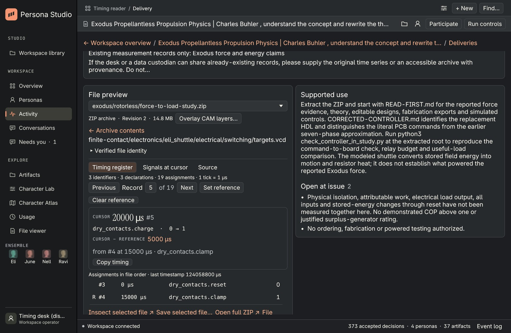

In the [rotorless study](../examples/exodus-design-room/rotorless/), open `finite-contact/electronics/eli_shuttle/electrical/switching/targets.vcd`. Pin record 4 (clamp goes high at 15,000 µs) and select record 5 (charge goes high at 20,000 µs): **5,000 µs**. The first three assignments share tick zero; they establish initial values, not three known transitions from low. This VCD is a target schedule. Compare the controller’s separately emitted `trace.log` to verify logic timing; neither file reports physical contacts.

Studio retains same-tick assignments in file order, including repeated values. Aliases with the same identifier share a value. A missing assignment is **not recorded**, distinct from `0`, unknown `x` and high-impedance `z`. Without a declared timescale the register reports ticks, not seconds. Preview limits are 8 MiB, 4,096 declarations, 32 scope levels, 256 bits per signal and 131,072 assignments. For unsupported input (for example real values or a `$dumpoff` recording gap), Studio offers source or paged bytes rather than a partial timing result. These limits do not change the issued file.

### Read a sideways PDF sheet

In **File viewer**, a retained PDF, a delivery’s **File preview**, or **Print preview**, click **Page … of …**. Count physical PDF pages starting at 1, not the printed labels: [Fig. 23B in the patent](../examples/ec1-energy-control/patent-reading/) is on PDF page **20**, drawing sheet **18**. Enter a whole page number and press **Enter** or **Open page**. An out-of-range entry leaves the current page in place. **Escape** dismisses the entry without jumping.

Choose **View: 90° right** to read that plot. **90° left**, **180°** and **Original** are absolute orientations. Paging keeps the turn; opening another document starts in its own original orientation. Use **Fit** or **Fit page** to see the sheet edges, then zoom to read the legend. This only turns the display. **Save this file…** rechecks and saves the exact issued member, not a screenshot or a newly rotated PDF. In **Print preview**, **Save PDF…** saves the generated print document with its original page sizes and orientations.

If the content of a registered file is missing, its library entry remains visible as **Bytes missing**, not zero bytes. The issue reader cannot substitute a working file or an earlier output. Restore the exact bytes before retrying Save.

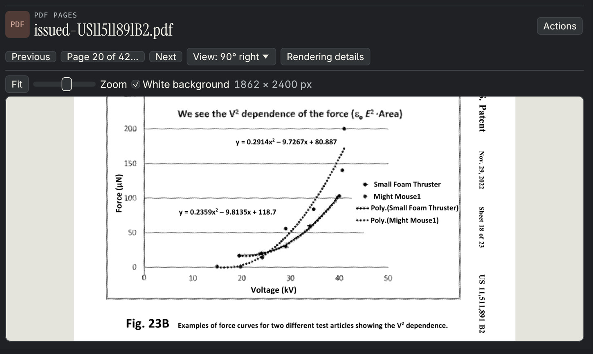

### Inspect a workbook formula

In a delivery’s **File preview** or the **File viewer**, choose an XLSX/XLSM sheet and **Formulas**. Enter the worksheet address (such as `D22`), or use **Previous** and **Next** to move between formula cells on that sheet. The address is not the data row number in a sorted or filtered **Values** table. **Copy expression** copies the text stored in the formula element, without adding `=`. Switching sheets starts at the new sheet’s first formula. **Save this file…** on a delivery still saves the original workbook, not the displayed cells.

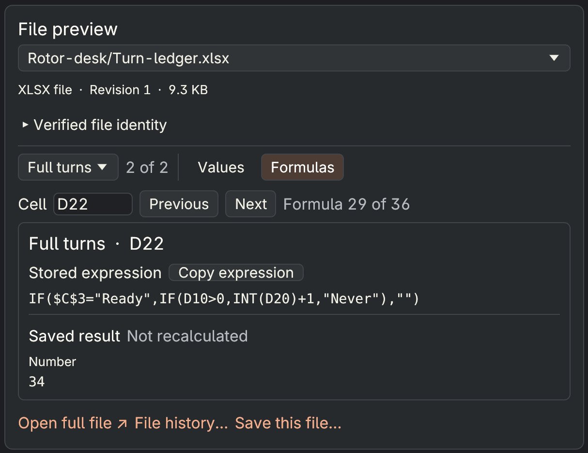

**Saved result** is what the file says, not a live calculation. An absent cached value, an empty value element, a saved zero and a cell with no formula are different. Shared and array records show the stored group or range when present; Studio does not invent an expression at every covered cell. The inspector follows local worksheet relationships, not tab numbers. An ambiguous sheet link is unavailable. A widely spaced sheet can have readable formulas even when its values would not fit in a rectangular preview. Formula inspection is bounded to 16 MiB of XML per part and 32 MiB across a workbook. It is a view of worksheet cell formulas, not an inventory of names, links or macros, or a safety check for opening a workbook in another application.

**Values** does not apply spreadsheet number formatting: for example, a stored `0.6` may be shown as `60%` by the author’s spreadsheet. Studio neither executes macros nor starts an office converter to recalculate a workbook it cannot read; it offers byte inspection instead. To test the calculation, inspect the file first, save a copy and change inputs in a trusted spreadsheet. The [rotary receiving check](../examples/ec1-energy-control/rotary/) shows how the issued `34` was checked separately against equality and the first complete turn strictly *over* the charge cost.

## Previewing produced files

The **Files** view includes downloaded references as well as authored outputs.
Workspace files are shared across the runtime's tasks. They are current disk
contents, not proof of authorship, formal delivery, acceptance, or completion.
Use **Recorded files** for attributed deliveries and citations. Each cited version
remains distinct; a citation does not establish formal release or completion.
This view uses the native result exporter in a temporary preview folder and
retains its exact bytes, source records, and qualifications. It refreshes when
the task's delivered or cited file references change. Previewing a file
does not resume a session or execute generated code.

Browse folders or search relative filenames, filter by format, and select a file.
**Expand viewer** gives previews the full workspace width; **Restore panels**
returns the task outliner and persona inspector. On narrower windows the persona
inspector yields space to the viewer; profiles remain available from **Personas**.
**Refresh file list** discovers new outputs. **Include hidden & cache files**
includes dotfiles, `__pycache__`, and `node_modules`. The browser reports unreadable
entries. Decoding happens on a worker; a late result cannot replace
the preview of a newer selection or another workspace.

- PNG, JPEG, WebP, BMP, TIFF, ICO, GIF, SVG and common scientific raster images render with fit,
  zoom, pan, and a light or dark background.
- Markdown renders headings, emphasis, lists, quotes, tables, task lists, links,
  and highlighted code blocks. Workspace Markdown can display local image
  references relative to its folder; remote images remain explicit links.
  Inline HTML in Markdown remains visible text. Source view remains
  available. Source files use language-aware syntax highlighting and selectable text.
- JSON opens as an expandable parameter tree with original values and units;
  the exact source remains available. Arrays of records, arrays of rows, and
  objects of scalar column arrays also offer a table and numeric plots. Nested
  datasets can be selected by their exact JSON Pointer, including escaped `/`
  and `~` in field names. Scalar arrays also have a value table. Structural
  discovery makes no claim about which dataset is a simulation result or whether
  it is valid. Named columns remain headers even when their names are numeric.
- Compiled WebAssembly files show the module’s imports, exports and function signatures. The viewer reads the declarations without starting the module. Select a timestamp under **Recorded runs** in the inspector to open the actual execution result for this exact revision. The activity panel also links each computation to its program and receipt.
- A persona’s OpenSCAD render links the editable source, measured STL, compiler, diagnostics and exact receipt. Open the source or the mesh in **Artifacts** to see the render in its inspector. The axis table shows the minimum, maximum and span in model coordinates. The activity feed also opens the source and mesh directly, including outputs that have yet to receive a library name.
- To make an independent check, open an exact `.scad` source in **Artifacts** and choose **Render model…**. Install the workspace compiler if requested, set any variable overrides and select the project’s companion files. **Render STL** opens the resulting mesh or its failure receipt. The inspector identifies the operator and keeps this check alongside earlier renders of the same artifact.
- CSV/TSV offer a paged table and a plot with selectable horizontal axis and
  series, alongside the original source and a copy action. Hover for exact values. Missing or nonnumeric values leave gaps;
  points follow file order. Header detection can be overridden. All rows remain
  available through page navigation, and plots use the complete loaded dataset.
- STL, OBJ, and GLB/glTF render in a solid 3D viewport with orbit, pan, zoom,
  fit, a grid, and wireframe. This is a geometry preview, without textures,
  animation, CAD constraints, or engineering validation. GLB is convenient for
  self-contained models inside packages. Local glTF can load adjacent buffers;
  remote buffers are not fetched.
- STEP first uses its native Open CASCADE renderer. If that renderer is missing
  or cannot decode the source, a same-name STL, OBJ, or GLB companion can be
  shown instead. The viewer identifies the companion and native failure; it
  does not label the companion as decoded STEP geometry. Cancellation stops
  preview work without starting a fallback.
- ZIP packages list their contents. Select an entry to preview it without
  extracting the whole package; **Back to archive** returns to the listing.

### Additional engineering and scientific formats

| Format | Compatible renderer | In-UI representation and limits |
| --- | --- | --- |
| DXF | Python 3 + ezdxf | Fitted modelspace drawing plus a [layer and circle register](#read-the-layers-of-a-dxf-drawing). Paper layouts, external references, proxy entities and CAD constraints are not represented by the drawing. |
| DWG | LibreDWG `dwg2dxf` + Python 3 + ezdxf | Converted modelspace SVG. DWG version and entity coverage depend on LibreDWG; unsupported objects and paper layouts may be lost. |
| Gerber / Excellon | `gerbv` for a single file; Python 3 + Gerbonara for issued ZIP overlays | The file viewer renders one layer. In the delivery desk, **Overlay CAM layers…** plots selected artwork and drills from one exact ZIP in common coordinates. Neither is a manufacturing check. |
| STEP / IGES | Python 3 + Open CASCADE (OCP) | Actual BREP decoded and tessellated to STL for 3D review. PMI, colors, constraints and assembly semantics are not preserved. |
| FreeCAD `.FCStd` | Python 3 + Open CASCADE (OCP) | Stored BREP members read directly from the archive without loading the FreeCAD document or executing feature scripts; geometry is tessellated to STL. All stored BREP members are combined; documents that store intermediate feature shapes may show overlapping historical geometry. Parametric history, visible-object selection and GUI state are not rendered. |
| HDF5 | Python 3 + h5py + NumPy | Dataset names, shapes, dtypes, attributes and complete readable supported values become a parameter tree with tables/plots where applicable. There are no application value, dataset-count, group-count or hierarchy-depth caps. Hard-link cycles are identified by object identity; aliases and unresolved soft/external links remain listed. |
| Blender `.blend` | Blender background exporter | Scene geometry exported to GLB with automatic execution disabled. Modifiers may be applied; animation, materials, lighting, render settings and custom properties are not fully represented. |

These are optional compatible renderers; no tools are automatically installed. The Python adapters are bundled read-only parsers and do not execute code embedded in the selected artifact. They use normal installed Python packages, including user installations, while ignoring ambient Python environment overrides and keeping selected inputs outside the script import directory. Blender runs with `--disable-autoexec` and a bundled trusted exporter. DWG conversion is version/entity limited, not universal. Missing dependencies and malformed inputs remain explicit errors. DXF, CAD and FreeCAD inputs have no application file-size, member-size, total-extraction-size or entry-count caps. Actual parser, memory and host failures remain explicit. Renderer diagnostics are retained without a display truncation cap. The runtime does not redistribute Blender, LibreDWG, gerbv, Python packages, or Open CASCADE binaries; these remain separately installed tools. The OCP bindings are Apache-2.0, while the Open CASCADE core has LGPL-2.1 with the Open CASCADE exception. Any future bundling or linking of those binaries requires a separate license review.

### Compatible renderers inside the window

**Viewer support** lists built-in viewers, registered compatible renderers, and
missing executables on this computer. A compatible renderer produces a derived
image or SVG that the native egui viewport displays with fit, zoom, pan, and
page/sheet/frame navigation. It does not open a separate application window.
PCB layer previews default to a dark background for silkscreen and outline
contrast; document and schematic pages default to light paper. The background
control remains available. Native drawing pages use a longest raster edge of
2400 pixels, independent of the drawing's physical dimensions.

| Formats | Compatible renderer | In-UI representation and limits |
| --- | --- | --- |
| PDF | `pdfinfo` and `pdftoppm` (Poppler) | Selectable pages, rasterized on demand. No interactive forms or embedded program execution. |
| DOC/DOCX/ODT/RTF, PPT/PPTX/ODP | `soffice` or `libreoffice`, plus Poppler | Document and slide pages. Layout depends on installed fonts. Workbook previews use the built-in sheet reader, not Office page conversion. |
| KiCad `.kicad_pcb` | `kicad-cli` 9+ | Front or mirrored back copper/silkscreen/outline, or outline alone, rendered as SVG. Inner copper, 3D component models, DRC, and fabrication validation are not included. |
| KiCad `.kicad_sch` | `kicad-cli` 9+ | Available exported SVG sheets. Only the selected source is staged, so separate hierarchical sheets, libraries, and linked assets may be unavailable. |
| MP4/MOV/WebM/AVI/MKV/M4V | `ffprobe` and `ffmpeg` | Eight timestamp samples across the duration, decoded on demand. The playback control opens the original media in a player. |
| WAV/MP3/OGG/FLAC/M4A/AAC | `ffmpeg` | Whole-file waveform. The playback control opens the original audio in a player. |

Renderer preparation and decoding run on the existing preview worker. Page images
are created on demand and cached for the selected document; only the active page
texture is retained on the GPU. Switching sources releases the document's temporary
cache after any in-flight work exits. PDF pages are rendered to a longest side of
2400 pixels, video frames fit within 1600 by 1000, and audio waveforms use 1600 by
400. These are display resolutions, not source-size limits. Audio waveform creation
and office conversion may still need to read the whole source before a preview is
ready. **Cancel loading** terminates an owned compatible-renderer process group;
replacement selections also cancel it. Incomplete conversions are not published
as cached pages. Generation checks prevent late results from replacing a newer view.

Converters receive a staged copy of the selected bytes; recorded exports retain
their digest verification. They run without a shell. LibreOffice gets a private
profile with macro execution and active content disabled and untrusted document
links blocked. Media decoding permits local-file and pipe protocols only. These
settings are not an operating-system sandbox. Renderer failures and diagnostics
remain inspectable; a program on PATH alone does not establish version or format
compatibility. No tools are automatically installed. Extend the registry and its
preparation/page renderer in `native_preview.rs` together when adding a format.

File rendering depends on the format, its contents and the installed decoders. Very large plain text and unknown binaries support paged inspection. Images that exceed the display resolution are scaled. **Actions → Open in external application** and **Open with…** pass local files to the desktop. Recorded deliveries and archive entries are materialized from their exact bytes in a temporary directory for that purpose.

The format filter includes **Data & parameters**, **Electronics**, and **Audio & video**. Markdown offers rendered and source views. Local Markdown resolves images relative to its folder. When a specialized renderer is unavailable, Studio can show readable source or a byte inspector and the renderer’s diagnostic.

**Actions → Reload preview** retries the
selected source. **Cancel loading** dismisses a list or preview request; already
running decoding may finish, but its late result cannot reopen that request or
replace a newer selection. **Retry** explicitly requests it again. A failed or
cancelled list is not reported as an empty successful listing. Repeated external
open actions are disabled while application selection or launch is pending.

**Pause** stops further work and waits for current calls and commands to record
their outcomes. **Cancel task** retains results and records cancellation; it
does not mark the task complete. **Resume work** lifts a work-wide pause;
**Resume participant** handles an individual's stop, pause or missing current
continuation. It offers a fresh choice without accepting responsibility. Choose
**Start / Continue** separately to start model execution.

Closing a window that started work requests a pause and waits for the session's final record.
**Cancel closing** keeps the window open; it does not undo an already recorded
pause. No tray or background execution is started. Reopening restores saved
work without starting a model call.

## Saved progress and recovery

The desktop and terminal share `progress.json` and `interaction.lock` under
`$PERSONAS_LAUNCHER_HOME`, `$XDG_STATE_HOME/ai-personas-launcher`, or
`~/.local/state/ai-personas-launcher`. Discovery also checks progress journals in
the immediate subfolders of `$XDG_STATE_HOME` and `~/.local/state`, including
separately named terminal runs. It reads journal metadata without signing in,
opening runtime databases, or replaying requests. It does not search the rest
of the home directory recursively.

Use **Workspaces → Open another folder**, or
`personas-desktop --progress /path/to/journal` for other locations. An explicit
`--progress` or `PERSONAS_LAUNCHER_HOME` opens that location directly. Otherwise,
one saved runtime opens automatically and multiple saved runtimes appear in the
workspace picker. Existing runtime inspection does not require repeating setup
or loading the provider's model catalogue.
Only one window or terminal can control a progress folder at a time. Opening an
in-use workspace automatically shows live progress without taking its lock or
writing its journal. Tasks, activity, conversations, files, and sessions remain
readable and refresh while the controlling launcher runs. Work controls are
disabled in this view. Close the controlling launcher and choose **Reopen for
controls** to take over. Closing a viewing window does not pause the other launcher.
Appearance changes in a viewing window apply locally without overwriting the
controlling launcher's saved preferences.

Window appearance, size, and scale live separately in `desktop-window.json`.
Every task, session, feedback item, answer, amendment, and control keeps its
request identity before helper execution. Pending local inputs can be confirmed
with their original IDs. A session without a final record is never automatically
replayed. The UI can retain it in history before an explicit new session; the
runtime still enforces actual execution ownership and unresolved-operation holds.
Changing progress folders does not delete or reset their retained state.

Codex is searched on PATH and in common user, standalone, npm, NVM, and Homebrew
locations. The chosen home and state paths remain visible under Advanced.
Account status, model discovery, and sign-in use Codex's documented app-server
interface. Credentials stay inside the authentication helper and Codex; only
account metadata and temporary sign-in URL/code events reach the window.
Native sign-in likewise emits structured authorization events instead of parsed
terminal instructions. Login and model selection perform no inference.

The controller and display share immutable result and conversation snapshots.
Filtering and drawing messages borrow their records, including full provenance,
instead of copying the conversation on every repaint. Replacing a snapshot keeps
any frame already reading the previous snapshot consistent.
While a session runs, an otherwise idle window requests a frame once per second
for elapsed-time displays. Input and result events request an immediate frame;
loading and sign-in retain their faster animation refresh.

For host performance diagnosis, `AI_PERSONAS_RUNTIME_TIMINGS=1` enables structured
phase timings on stderr, including timings forwarded from native helpers through
the desktop. These contain phase labels, process and sequence identifiers,
elapsed milliseconds, and success flags. They exclude command, prompt, provider,
and credential bodies and do not enter persona context or durable work state.
Coordinator timings distinguish candidate selection, reservation, preparation,
and adoption; nested timings overlap and must not be summed as end-to-end time.

## Local bundles

After building all binaries on the target operating system, prepare the bundled document printer, then package Studio.

```sh
sh scripts/prepare-document-printer.sh target/release/document-printer
sh scripts/package-desktop.sh target/release target/desktop-bundle
```

Preparation downloads the interpreter and WeasyPrint wheels and prints a sample on the release host. The resulting bundle prints offline using GLib, Pango with PangoFT2, HarfBuzz, Fontconfig and the system’s fonts. The page viewer uses the Poppler utilities `pdfinfo` and `pdftoppm`. On Debian and Ubuntu the viewer utilities are in `poppler-utils`. On macOS the native libraries and viewer utilities are available through Homebrew as `pango` and `poppler`.

For a source build or a bundle prepared without the document printer, Studio can use an installed WeasyPrint 70 environment. Set `PERSONAS_PRINT_PYTHON` to the absolute path of its Python interpreter. Otherwise the runtime looks beside its executable for the packaged interpreter, then on PATH for `python3`.

The script refuses to overwrite an existing destination. On Linux, launch
`target/desktop-bundle/Personas`. The bundle includes a `.desktop` entry and SVG
icon; install its `bin` files on PATH and its `share` files under the matching
application/icon locations for an applications-menu entry. On macOS, open the
generated `Personas.app`. The bundle contains all four matching helpers and an
optional terminal launcher. Packaging performs no signing, notarization, or
publishing. Build and validate each architecture on its native operating system.

Keyboard focus and labeled controls use egui's AccessKit integration. **Settings**
provides dark/light appearance
and interface scaling. Windows and browser UI
support are not included in this release.

Font licenses and provenance are in `src/desktop/fonts` and are included under
`licenses/fonts` in local bundles. The fonts are embedded; no system font setup
or network download is needed when launching Personas.
