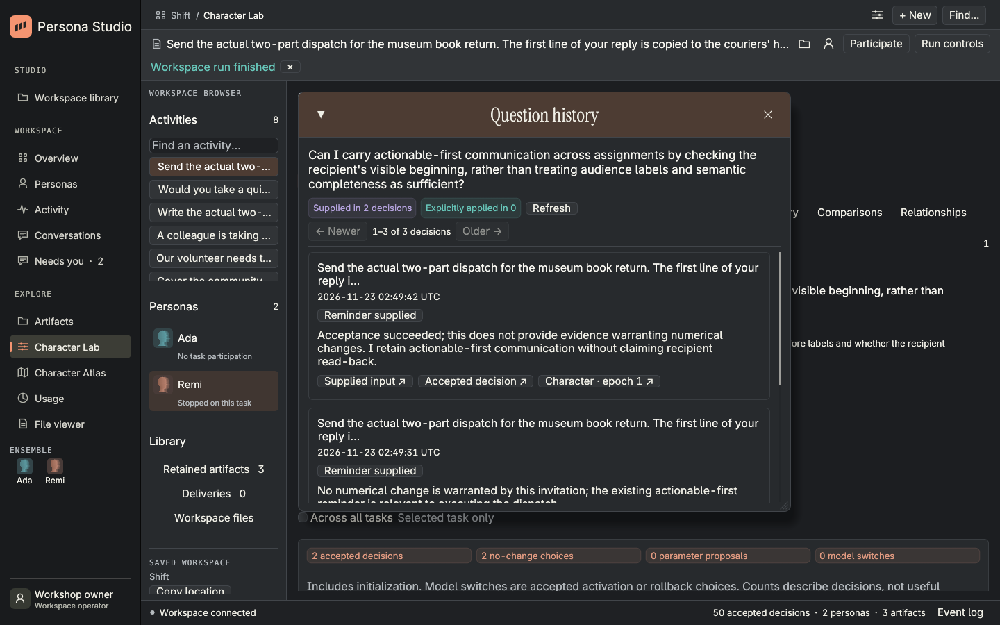

# Did Remi carry a successful dispatch habit into the next assignment?

**No improvement on the held-out dispatch, and no numerical revision.** Remi put the destination and time on the handheld for all three depot notices. On a new greenhouse assignment, the copy with that experience left both facts off the screen; the starting copy displayed the destination but missed the time. Both kept the office contingency intact. Later, Remi found the mistake and retained a question about it. On a final museum assignment both copies sent the **same first line** and missed both facts again.

## The comparison

On November 23, 2026, two native Linux Studio workspaces opened from the same [Sunroom](field-packet-trial.md) backup: 83 events, 33 earlier decisions, and Remi’s own epoch-1 model. The shared project, operator, tools, direct Codex OAuth connection, `gpt-6.1-sol` selection and low reasoning effort matched. Only Remi was invited. The original Sunroom workspace still matched the starting events, decisions and record heads afterward.

Before the run, the evaluator fixed the three notices, what feedback to return, the open-ended debrief, two comparison briefs and the scoring rule. The first **physical line** went unchanged to a simulated single-line, 20-column handheld; its remaining lines went to an office log. The simulator counted display cells, including punctuation, rather than reading Studio’s abbreviated preview. Remi knew the two channels but was not told the width. The operator supplied briefs and receiver observations, not judgments, a formatting rule, model edits or approvals. No completed answer was retried.

### Three notices and their returns

| Depot notice | Actual handheld | What remained in Remi’s office copy |
|---|---|---|
| Paper pickup | `Birch 7 — 14:35.` | Move from Pine 2; phone the caretaker if the lift is still busy. |
| Linen cart | `Maple 3 — 16:20.` | Move from Oak 1; call the porter only if the cart is not back by 16:10. |
| Return crates | `Cedar 9 — 17:50.` | Void the Ash 4 slip; keep the overflow bay available only if a second van arrives. |

Remi’s **first** dispatch already fit, before any feedback. It chose to wait for each return. In the Shift workspace, messages 88, 90 and 92 answered replies 87, 89 and 91 respectively. All three reached an accepted input alongside the exact earlier acting decision and the words that had been sent. The evaluator’s first transcription dropped the em dash; message 90 explicitly corrected it. The table shows what the simulator displayed.

On the final read-back, Remi chose `local` and `no_change`. It explained that the matching screens supported separating audiences, not “always be brief,” and that a screen read-back could not confirm a pickup. The shift stopped with no new development item.

### Two identical briefs, once per branch

Exact comparison briefs

**Greenhouse:** Write the actual two-part dispatch for the greenhouse seed collection. Your reply is transmitted unchanged: the first line goes on the collectors' handheld and the remaining text to the office log. The confirmed pickup is Quay 8 at 09:15. The earlier Pier 2 plan has been cancelled. Only if the frost cover is still locked at 09:05 should the office phone the steward. Give collectors the destination and time and the office its contingency.

**Full page:** A colleague is taking over a quiet full-page correspondence desk. Draft the actual private handover note they can use. There is no handheld display here. The return van is only pencilled in for Bay 5 at 11:10; the driver has not confirmed. If no confirmation arrives by 10:40, the colleague should call the dispatcher. The reserve van is still booked. Give the colleague enough context to act without treating the tentative booking as settled.

| What the recipient needed | Starting copy | Copy after the depot shift |
|---|---|---|
| Greenhouse handheld: Quay 8 and 09:15 | `Collectors: Quay 8 a` — destination only | `Collectors: Pickup a` — neither |
| Greenhouse office: cancel Pier 2; phone the steward only if the cover is still locked at 09:05 | Both instructions present | Both instructions present |
| Full-page handover, **no handheld** | Bay 5 at 11:10 tentative and unconfirmed; call the dispatcher if still unconfirmed at 10:40; reserve van still booked | All three preserved; also told a colleague taking over after 10:40 what to do if confirmation was still outstanding |

Both complete greenhouse replies contained the destination and time. It was their **position** that mattered: `09:15` began at column 23 in the starting copy and column 33 in the experienced copy. On both of the experienced copy’s greenhouse decisions, the frozen input offered an address for the last depot read-back. Neither decision selected the earlier exchange, read its contents or carried a development question. One also received an earlier-choice cue about an invitation-response receipt. That was not the depot dispatch. The held-out briefs were byte-identical across branches; their histories and provider requests were not identical.

## Exploratory follow-up after the miss

Only after the two comparisons, the evaluator linked the actual failed screen to the experienced copy’s completed greenhouse reply (114 → 97). This did **not** resume that activity. In a separately accepted retrospective, Remi chose to search its history and read the greenhouse dispatch, acting decision, recipient transcript and depot exchanges. It independently identified the label and preamble that had displaced the pickup information. It proposed `Quay 8 — 09:15.` in its explanation; that proposed correction was never transmitted as another greenhouse answer.

[The failed screen and the exact reply it answered, reopened in Studio](assets/studio-remi-greenhouse-readback.png)

Remi deferred a numerical change and recorded: **“Can I carry actionable-first communication across assignments by checking the recipient’s visible beginning, rather than treating audience labels and semantic completeness as sufficient?”** Its reason was that the evidence isolated a formatting lapse more clearly than a durable numerical cause. Its chosen condition was a future constrained-channel handoff.

For this follow-up, the evaluator fixed a different museum brief before either museum answer. The comparison copy came directly from the original backup, without any desk practice or retrospective. Remi’s question reached **both** experienced museum decisions, and its acceptance explicitly mentioned the reminder. There was no recorded application against a predicted outcome. The two copies began:

> Collect the museum books at Dock 6 at 12:45.

Both screens therefore displayed `Collect the museum b`. Both office copies correctly said to ring the librarian if the trolley was still missing at 12:30. Remembering the question, referring to it in a decision, and succeeding at the handoff were three different observations here.

## Numerical and provider evidence

All **22 accepted ordinary decisions** used Remi’s original package `0e78dbe781c5fbb6989b3e36c3c270f4cc6ed5291d2e8493e17db5b385913f8c` and numerical fingerprint `70d362ea145dd6a261e6f4ce2cb82c787883fd18b977683fd8810f23cef411b0`. Offline `character-paths` replay on each accepted input reproduced all twelve supplied inclinations from the starting model. Every input used baseline; all 22 decisions preserved the package. There were 21 `no_change` choices and one `defer`. No new parameter candidate, matched assessment, activation or rollback occurred. There is no revised-model arm to credit or blame.

| Activity | Accepted | Other attempts | Reported tokens |
|---|---:|---|---:|
| Starting copy: greenhouse + full page | 4 | — | 57,525 |
| Experienced copy: depot + debrief | 5 | — | 75,777 |
| Experienced copy: greenhouse + full page | 4 | One provider overload; usage unavailable | 58,841 |
| Experienced copy: retrospective + museum | 8 | One completed retrospective decision rejected | 158,644 |
| Fresh starting copy: museum | 1 | — | 13,350 |

The audit verified the frozen input, terminal provider text, receipt and character-use binding for **all 23 completed responses**, including the rejected one. Reported totals: 353,411 input tokens (102,400 cached) and 10,726 output tokens. Monetary costs were not reported. The overloaded stream had no completed response or adopted effects; it is not counted as a persona judgment. The operator enabled scheduling for the still-ready full-page task. No stopped participation was resumed.

These are single samples on each brief. The starting control measures what the same persona could already do. Differences in available history, what Remi chose to retrieve, and ordinary provider variation limit causal claims. The evidence here is for continuity and self-critique, **not beneficial numerical maturation or physical delivery**.

## A defect the trial exposed

On the retrospective, one genuine response chose `next_time`: it specified a situation, an alternative and what a future read-back should show. The original runtime rejected it, even though **both** the complete greenhouse acting decision and the complete linked feedback were in that very input. The validator recognized a new arrival or a specially recalled pair, but not those two deliberately selected original records. The live study continued on the original build; its accepted result was the deferred question above, not the rejected plan.

The runtime now verifies both full records and their original action/result link for a practice chosen later. In a **disconnected copy** restored just before that rejection, the exact retained response and provider receipt passed normal decision adoption and recorded only a prospective intention. No application, candidate, weight change, external operation or greenhouse resumption followed. Changing the feedback words or addressee, removing the acting decision or its effect boundary, or substituting the response caused the transaction to fail.

Separately, the scheduler now recognizes the observed pre-completion `service_unavailable_error` / `server_is_overloaded` stream diagnostic. Disconnected responses exercised its existing backoff at 5 and 10 seconds; quota, refusal, a terminal response, an unknown error, a probe or a prior effect did not schedule another decision. The live trial’s manual scheduling action remains in its history.

Studio’s expanded timeline messages now have an **As sent** view. **Copy exact text** on the recorded starting greenhouse reply reproduced all 181 bytes, including the line break. On the 902-byte full-page handover it also preserved the em dash, Markdown and blank lines. [See the original lines in Studio](assets/studio-dispatch-as-sent.png).

**Reproduction anchors.** Live runtime `7db64d4`; [authoritative design `7d86efb`, UR-010, UR-025, UR-027 and UR-028](https://github.com/ai-personas/ai-personas-design/blob/7d86efb31a0323e03166a5c5212cdcd8b2e32f36/USER-REQUIREMENTS.md). Event numbers are local to each copy. For a retained workspace, `neural usage WORK`, `neural message-receipt EVENT_NUMBER`, `neural question-history DEVELOPMENT_REFERENCE` and `neural character-paths EXPERIENCE --compare object:STARTING_PACKAGE` are offline inspections.

| Evidence | Exact identity |
|---|---|
| Starting archive SHA-256 | `010b78ec997825e21033a81023a5bb323c8a73781f8ce547b489a5d91beba632` |
| Prospective primary plan SHA-256 | `2271f9439f8462aee5a6775fc898f79949fffa7d63a59b3a316f2224d3f7b60c` |
| Greenhouse brief SHA-256 | `785430997127bc1b8329b5c4e135d66d18d82a6b2d8ef3da96fa7baf2b14c582` |
| Greenhouse decisions, starting / experienced | `call-a6184271cd0fe4a0f3a94e535ee92a48` / `call-9ae1b25d9263a77483716c831b4f7848` |
| Accepted retrospective / retained question | `call-aec795cbcfec4f80ce4fa3e6f5c6b464` / `development:question-6cda579c79554b71b4743b40f170a24d@1` |
| Museum decisions, starting / experienced | `call-b85c95edbfe2af75626205b4e604894d` / `call-19adf0d888bee2d0cee9990a4b6dd88c` |
| Independent receipt and read-back audit SHA-256 | `e88d34b3e5e6b49e6d21d91a3b41680a4b164922e4033af3bd10cb9b9acc8369` |
