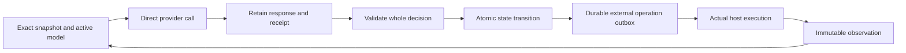

# Editable persona models

This implements the user's clarification to `AI_Personas_Final_Design.pdf` (8 November 2026): **the LLM supplies numerical parameter changes directly**. The PDF's fine-tuning service, LoRA recipe, optimizer, gradients and training jobs are replaced by literal edits and forward evaluation. The general reasoning model remains the selected provider model. Each continuing persona owns a separate small characteristic network, whose computed outputs enter that reasoning model's context. This is a concrete interface between a characteristic model and a reasoning model; behavioral benefit still needs live evidence.

The implementation is part of the existing Rust application. It reuses the direct provider transport, Codex authentication adapter, host-command executor and process cancellation. New state uses `neural.sqlite`; existing fragment-based state and deliverables are left intact. Use the explicit `neural` entry points below. The existing onboarding interface still creates the earlier fragment runtime; the desktop detects and opens an editable-model state folder passed with `--progress`.

## Character and direct editing

A versioned shared contract defines 18 contextual inputs and 12 characteristic outputs. The inputs cover uncertainty, disagreement, consequences, opportunity, obligations, progress and modeled affect. Outputs express exploration, verification, clarification, cooperation, challenge, revision, integration, persistence, initiative, warmth, assertiveness and detail. These are dispositions, not expertise or task roles.

For each input, the vector contains `[value, known]`. An unknown input is `[0,0]`; a known neutral value is `[0,1]`. A persona supplies its appraisal, interpretation and exact evidence references. The arithmetic is:

```text
h = ReLU(U v + c)
y = tanh(b + W v + V h)
```

The LLM chooses sparse literal values for `U`, `c`, `b`, `W` and `V`. Unspecified entries are zero. Initialization has no random initializer. The package records owner, contract digest, predecessor, hidden width, parameters, intent and evidence. Coordinates, finite values, duplicate edits and expected old values are checked. Evaluation reports bias, direct and hidden contributions for every output. The runtime performs no fitting or automatic weight adjustment.

An initial seed is attributed and supplied while the identity is pending. Actual work, peer contributions and ordinary inbox contents are withheld during initialization. The first call authors a candidate; a later call observes and activates it. Activation clears bootstrap context selection, and preparation records remain available by exact reference without automatically carrying seed prose into work. The first active call receives the real invitation and decides its contribution under its computed character. Creation, initialization and task acceptance are separate facts.

Development uses the same ordinary decision interface:

1. `persona.evaluate` records an evidence-linked appraisal and computes the current network's response.
2. `persona.patch` requires the exact active digest and old values, and returns an inactive candidate with forward before/after probes.
3. `persona.assess` obtains real provider responses for old and candidate outputs under matching hypothetical situations and resources. Neither arm executes operations, receives an identity seed, or obtains live decision authority. Results remain labeled synthetic.
4. After observing the assessment, the persona can activate the exact candidate in an operation-free response. Activation increments its decision epoch atomically. The next fresh call uses the new model.
5. An explicit rollback can select a retained ancestor. Obligations, observations, relationships and stopping decisions remain intact.

An edit is evidence of a changed parameter, not evidence of improvement. Matched synthetic responses can expose a difference or regression; they do not establish lasting benefit in actual work. Choosing no change remains valid.

## Decisions, context and work

`DecisionV3` contains work judgment, persona maintenance, asset maintenance, next model, next context, continuation, optional user reply and typed operations. Its `next_context` always contains the complete `references` and `tools` lists and a reason. Empty lists clear the selection; there is no ambiguous preserve shortcut. Newly observed results are supplied once. A persona must explicitly retain their exact references or a selected working note when the facts are still needed. Same-response asset-save aliases can select a newly written note immediately. The previous work judgment and operation names are supplied with exact request/response references, without replaying old tool bodies or initialization prose. Counts describe activity, never quotas or quality.

The parser rejects duplicate JSON keys and validates the complete decision before adoption. No-change and defer choices require reasons. Maintenance can include contextual evaluation without claiming that weights changed. A change names its actual applicable operations; related work-record updates may accompany them, and freezing an exact delivery may count as resource maintenance. This avoids rejecting a valid save merely because its accompanying outcome update is listed too. Incomplete candidate artifacts are valid intermediate work to inspect and revise; their existence does not meet the final completion requirement.

The next request includes the original need and attributed amendments, the persona's own accepted participation and outcomes, compact peer/outcome information, new addressed events, baseline and last contextual character evaluation, and explicitly selected resources/tool schemas. It does not reconstruct the complete conversation. `tools.search`/`tools.describe` and asset search/read provide literal and regex discovery. Selected schemas are contextual help, not tool permission: correctly shaped registered operations remain usable without reselecting a previously learned schema. Every operation is still validated before adoption. Search pages are navigation choices, not cumulative allowances. Exact reads and persistent context selections may select UTF-8 byte ranges. Each request reports serialized bytes by component/resource and the previous accepted call’s actual provider usage. The persona chooses what to retain; the runtime does not truncate by quota or silently select relevant evidence. `history.search` exposes literal/regex discovery over authored or addressed events in the current work, with exact request, response, receipt and tool-result references. It recovers pointers that a persona dropped from context without automatically replaying history or rerunning operations. Saved skill documents, code and knowledge remain supporting assets.

The persona chooses contributions, tools, peer communication, assumptions, critique and sufficiency. There are no assigned professions, central task-solving manager, mandatory voting stages, quality scores or application quotas. The user may explicitly invite several personas; an invitation remains voluntary. One decision authority per persona and fair rotation across eligible participations prevent simultaneous decisions under the same identity.

The original requested result also governs continuation. Finishing an initially chosen contribution does not narrow that request. `work.commitment` lets a persona revise its own accepted contribution, preserving the prior attributed record and accounting for unfinished obligations. Current peer commitments remain visible. Each participant's latest user-facing communication is also supplied with its exact attribution; this preserves conversational position without replaying history or pretending a question was answered. The general interaction contract asks personas to deliver usable results, select suitable authoring and validation tools, and distinguish actual external impediments from unfinished feasible work. It supplies no task-specific artifact list or domain workflow. Stops remain explicit choices; these instructions do not prove that a persona will achieve the requested result.

`work.outcome` separates intended results, exact artifacts, evidence, prerequisites, assumptions and remaining work. A prerequisite statement does not assign another persona responsibility. `result.deliver` freezes exact asset versions and states supported use, partial/claimed-complete scope and remaining gaps. User acceptance is a distinct attributed record. The original need remains available even when a persona considers its own contribution sufficient.

`ready`, `wait` and `stop` are different states. New messages or a chosen wake time can wake a wait. A message, model update, tool receipt or runner restart cannot resume a stop. The user explicitly resumes that participation. New needs can originate from a human or a persona, including social or self-directed work.

## Persistence and execution



SQLite WAL transactions separate current heads, immutable versions/objects, targeted events, invocations, controls and external effects. Current state no longer serializes a growing conversation/history blob. Reads verify content digests. The host-authored instruction prefix is retained separately from changing request data, so an old request can be reconstructed after a binary update.

Adoption compares persona revision, participation revision, model digest/epoch, work revision and relevant control revisions. Unrelated peer messages arrive as later observations. A user amendment or pause/resume cycle invalidates an older in-flight decision. Complete validation, internal mutations and outbox insertion share a transaction: a later invalid operation rolls back earlier tentative saves/messages too.

External effects dispatch only after commit, in declared order. They cannot consume an unobserved earlier external result in the same response. `$operation_id` can resolve an earlier internal asset save where a reference is expected; arbitrary code/text is not interpolated. Host commands inherit ordinary host access, network and installation capability; timeouts are chosen explicitly by personas. Actual command status, output and exact raw logs are retained. Image capture supplies exact captured PNG/JPEG/GIF/WebP bytes to the next provider call.

A process lock owns dispatch/recovery while independent connections support inspection, user input and controls. A crash before dispatch can abandon preparation safely. A crash after dispatch leaves an uncertain outcome and pauses admission for that persona; external operations are never automatically replayed. A complete retained response can be adopted only against its original authority. Explicit global/work/persona pauses cancel local calls and host execution; remote stop or absence of charges is never inferred. The separate `admission` control drains already admitted work without starting new decisions, supporting upgrades between calls.

## Running it

Build without adding or running unit tests:

```sh
cargo build --locked --bins
cargo build --locked --features desktop --bins
```

Create an attributed seeds file outside the repository:

```json
{"personas":[{"id":"mira","label":"Mira","seed":"A general-purpose starting character profile, including initial OCEAN and modeled VAD tendencies."}]}
```

Create an empty host work directory. Initialize with the explicitly selected Codex authentication helper and account directories. The helper supplies authentication only; the runtime sends direct provider inference requests and requires the reported model to match the requested model.

```sh
./personas --neural --state-root /private/personas/state init \
  --seeds /private/personas/seeds.json \
  --working-directory /private/personas/work \
  --codex-executable /absolute/path/to/codex \
  --host-home /absolute/home --codex-home /absolute/home/.codex \
  --model gpt-6.1-sol --effort max

./personas --neural --state-root /private/personas/state request \
  'design smps for pc' --invite mira,oren,sana,ivo,lena
./personas --neural --state-root /private/personas/state run
./personas --gui --progress /private/personas/state
```

The invite list must name personas actually included in the seeds file. An alternative `--provider-config` accepts the existing secret-reference `DirectSettings` format. Initialization itself performs no inference.

`status`, `audit`, and `read REFERENCE` inspect exact state and evidence. `message`, `amend`, `resume`, and `accept` retain separately attributed human decisions. `export NEW_DIRECTORY` exports exact delivered versions with a provenance manifest, preventing two versions at the same logical path from overwriting each other. Export is not a quality check.

For an upgrade, set `control admission paused REASON`, let the runner return, install the checked binary, then set `control admission running REASON` and run again. In particular, finish version-2 decisions before upgrading to DecisionV3. Historical snapshots retain their original contract and schema; the state format and numerical-model package have separate versions. To cancel local execution immediately, use `control global paused REASON`. Enabling controls does not resume stopped participations.

## Live acceptance evidence

Validation uses real provider calls, actual tool execution and independently inspected artifacts. The first live run revealed overly strict bootstrap, maintenance and prerequisite handling; those failures led to interface corrections. The initial SMPS cohorts also saw the need during bootstrap, which could influence parameters and carry a seed-authored plan into their first work decision. This confounds attributing their behavior solely to numerical character. A later fresh live initialization confirmed that task content was withheld across all three bootstrap calls and appeared only after activation, with the seed then absent. Keep failed attempts and cancellation costs in the evidence rather than counting only accepted decisions.

For the five-persona PC SMPS case, assess these separately: exact model bindings and recoverability; actual influence of distinct character; parameter revisions and evidence of benefit/regression; useful voluntary collaboration; context size and all reported usage; and the substance, integration and reproducibility of the delivered electrical design. The [live validation report](live-validation-2026-11-09.md) records the observed outcomes. No architecture description, successfully parsed JSON, completed command or authored completion label is a substitute for that assessment.

The user's subsequent acceptance requirement is manufacturing-ready artifacts produced autonomously from the same short request. The reported preliminary package does not meet that requirement. The active validation effort must inspect actual source and fabrication artifacts, their consistency and evidence for the intended use, while keeping manufacturing requirements out of the general runtime's task-independent instructions. Runtime mechanism validation is not completion of this stronger end-to-end objective.
