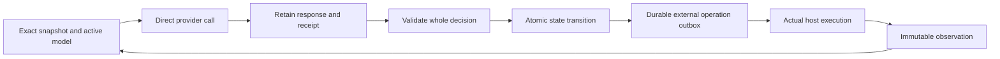

# Editable persona models

This implements the user's clarification to `AI_Personas_Final_Design.pdf` (8 November 2026): **the LLM supplies numerical parameter changes directly**. The PDF's fine-tuning service, LoRA recipe, optimizer, gradients and training jobs are replaced by literal edits and forward evaluation. The general reasoning model remains the selected provider model. Each continuing persona owns a separate small characteristic network, whose computed outputs enter that reasoning model's context. This is a concrete interface between a characteristic model and a reasoning model; behavioral benefit still needs live evidence.

The implementation is part of the existing Rust application. It reuses the direct provider transport, Codex authentication adapter, host-command executor and process cancellation. New state uses `neural.sqlite`; existing fragment-based state and deliverables are left intact. New desktop workspaces use this runtime, with character-profile entry, Codex account/model discovery and the same initialization function as the CLI. The [desktop studio](desktop.md#editable-model-studio) exposes retained artifacts, direct peer conversations, numerical characteristics, network connections, parameters and model history in linked resizable panels. The explicit `neural` terminal entry points are documented below. An explicitly opened historical desktop journal retains its existing viewer.

## Governing product intent

The [consolidated user requirements](https://github.com/ai-personas/ai-personas-design/blob/main/USER-REQUIREMENTS.md), the PDF and subsequent user clarifications define a population of continuing, general-purpose personas. A sparse request should lead to work that the personas themselves interpret, organize, perform, critique, correct, integrate and deliver. Those responsibilities include choosing and carrying out task-specific validation. UR-050 and PDF sections 2, 6 and 13 place the substantive reasoning with the personas. The runtime provides the environment that makes their choices executable and persistent.

The core obligations are connected:

- Each persona's own characteristic model must influence its choices across work, tools, communication, cooperation and self-directed activity. A numerical model, profile or different name alone does not establish distinct behavior (UR-003–UR-010).
- Ordinary interactions combine current work, character maintenance, supporting-asset maintenance and deliberate next-context selection. Experience may motivate direct parameter edits; justified no-change remains valid. The later clarification replaces the PDF's training-service and fine-tuning recipe with LLM-authored numerical edits and forward evaluation (UR-015–UR-018, UR-025–UR-027).
- Facts, history, tools and reusable skills remain supporting resources. Personas choose what to find, retain, share, adapt and supply next; the host faithfully executes that selection without a hidden semantic selector or a compulsory bulk catalogue (UR-011–UR-024, UR-053).
- Cooperation is voluntary and can change. Personas may ask for help, disagree, review one another, revise commitments, work independently or create further activity. The five-persona live run is an explicit user selection, not a general fixed team or profession assignment (UR-047–UR-050).
- Continuing identity, obligations, actual observations and explicit stops survive context and model changes. Personas judge useful continuation and sufficiency against the original need, with feasible progress under revisable assumptions when a sparse request permits it (UR-044–UR-047).
- The product uses direct provider inference, exposes actual state and resource use, and avoids application quotas or imposed task approval gates. Efficiency and behavioral improvement need observations; elapsed time, saved files and accepted decisions are insufficient (UR-022, UR-027, UR-049–UR-052).

Runtime development must preserve this ownership. During a live task, observe the personas' decisions, selected and supplied context, actual operations, peer exchanges, character changes, own verification and delivered results. Diagnose general runtime or interface obstacles from those observations. A continuing external engineering review, task-defect diagnosis or artifact repair is not part of the ordinary persona workflow and must not become a dependency for progress. Earlier external audits remain attributed historical evidence; they do not establish that the personas performed those checks. This boundary preserves the full usable-result requirement while keeping the implementation general-purpose.

## Character and direct editing

A versioned shared contract defines 18 contextual inputs and 12 characteristic outputs. The inputs cover uncertainty, disagreement, consequences, opportunity, obligations, progress and modeled affect. Outputs express exploration, verification, clarification, cooperation, challenge, revision, integration, persistence, initiative, warmth, assertiveness and detail. These are dispositions, not expertise or task roles.

For each input, the vector contains `[value, known]`. An unknown input is `[0,0]`; a known neutral value is `[0,1]`. A persona supplies its appraisal, interpretation and exact evidence references. The arithmetic is:

```text
h = ReLU(U v + c)
y = tanh(b + W v + V h)
```

The LLM chooses sparse literal values for `U`, `c`, `b`, `W` and `V`. Unspecified entries are zero. Initialization has no random initializer. The package records owner, contract digest, predecessor, hidden width, parameters, intent and evidence. Coordinates, finite values, duplicate edits and expected old values are checked. Evaluation reports bias, direct and hidden contributions for every output. JSON parsing enables `float_roundtrip` for retained binary64 parameters and evaluations, preserving those floating-point values when serialized and reloaded. This does not add arbitrary decimal precision. The runtime performs no fitting or automatic weight adjustment.

An initial seed is attributed and supplied while the identity is pending. Actual work, peer contributions and ordinary inbox contents are withheld during initialization. The first call authors a candidate; a later call observes and activates it. The persona may retain its own initialization tool receipts; ownership is established by the recorded bootstrap event, not by arbitrary fields in a payload. Activation clears bootstrap context selection, and preparation records remain available by exact reference without automatically carrying seed prose into work. The first active call receives the real invitation and decides its contribution under its computed character. Creation, initialization and task acceptance are separate facts.

Development uses the same ordinary decision interface:

1. `persona.evaluate` records an evidence-linked appraisal and computes the current network's response.
2. `persona.patch` requires the exact active digest and old values, and returns an inactive candidate with forward before/after probes.
3. `persona.assess` obtains real provider responses for old and candidate outputs under matching hypothetical situations and resources. Both ordinary decisions and assessment calls receive the same projection of final numerical inclinations; bias, direct and hidden contributions remain in the retained arithmetic trace. Neither arm executes operations, receives an identity seed, or obtains live decision authority. Results remain labeled synthetic.
4. After observing the assessment, the persona can activate the exact candidate in an operation-free response. Activation increments its decision epoch atomically. The next fresh call uses the new model.
5. An explicit rollback can select a retained ancestor. Obligations, observations, relationships and stopping decisions remain intact.

Activation and rollback clear the cached contextual evaluation across all of that identity's tasks in the same transaction, because those outputs came from the previous weights. The exact evaluations remain in immutable history. Other tasks retain their commitments, chosen resources and continuation, including an explicit stop; a new contextual appraisal remains the persona's choice.

A retained contextual evaluation describes the situation the persona appraised when it authored that evaluation. New observations do not refresh those inputs automatically. Its supplied context now includes the exact originating decision and event, recording time and number of subsequent accepted decisions in that participation. The same provenance appears in the Character Lab. It is resolved from accepted records for the particular persona and work, even when identical arithmetic reuses an evaluation digest. The persona decides whether the appraisal still applies or whether to call `persona.evaluate` again. Updating a situational appraisal does not edit character parameters; neither elapsed time nor decision count imposes an expiry, compulsory reflection or weight change. This addresses observed appraisals that remained in context hundreds of decisions after their initial situation had changed.

An operation-free activation or rollback may truthfully declare persona maintenance as `change` with an empty operation-id list: `next_model` is the actual change in that response. Ordinary maintenance changes still need their applicable operation ids, and every activation/rollback retains its full authority and evidence checks.

An edit is evidence of a changed parameter, not evidence of improvement. Matched synthetic responses can expose a difference or regression; they do not establish lasting benefit in actual work. Choosing no change remains valid.

## Decisions, context and work

`DecisionV4` contains work judgment, persona maintenance, asset maintenance, next model, next context, continuation, optional user reply and typed operations. Its `next_context` always contains the complete `references` and `tools` lists and a `working_note`. A separate `reason` explaining the selection is optional; omission does not fabricate a rationale or preserve an earlier selection. Empty lists clear the selection; there is no ambiguous preserve shortcut. The persona writes the working note directly as a concise factual handoff, retaining useful discoveries, working tool invocations, failed approaches, current decisions and evidence pointers. The next decision receives that exact chosen text, attributed to its accepted response; no separate asset-save operation or runtime-written summary is needed. An empty string clears the note. Longer documents and reusable skills remain assets. Bootstrap notes can support initialization but are withheld at initial activation; ordinary notes survive later character revisions.

Newly observed results are supplied once. A persona must explicitly retain their exact references or useful findings when still needed. Same-response asset-save aliases can select a newly written supporting resource immediately. The previous work judgment, operation names and context-choice reason accompany the working note with exact request/response references, without replaying old tool bodies. Counts describe activity, never quotas or quality. This interface addresses an observed live failure in which a persona repeatedly alternated between inspections while selecting the same stale asset note; it does not establish that a new note will be accurate or that the persona will make progress.

The context instructions distinguish a handoff note from literal material still needed to complete an action. When an edit or comparison depends on separate observations, the persona should retain the earlier source/result or exact excerpt while obtaining the next one. A reference cited inside prose is only a pointer; its bytes are supplied only when selected or read. The persona chooses what to retain and when to clear it. No automatic history window, semantic summary or reference quota is introduced. This clarification follows a later live recurrence in which repeated source inspections all cleared the retained-reference list while notes preserved intentions but omitted needed code.

The parser rejects duplicate JSON keys and validates the complete decision before adoption. Structural errors identify their field path, and maintenance-validation errors identify the persona or asset field. Live adoption and recovery use the same parser. Work judgments, no-change and defer choices still require reasons. The separate context-choice explanation became optional after repeated live rejections of responses that already named their exact selections and working notes: UR-015, UR-018 and PDF section 4 require explicit choices, not an additional explanation field. Historical rejections remain attributed to their original contract and are never retroactively adopted. Maintenance can include contextual evaluation without claiming that weights changed. A change names its actual applicable operations; related work-record updates may accompany them. Capturing a host image with `image.read`, recording an outcome or freezing an exact delivery may itself count as resource maintenance, including when underlying assets were retained earlier. Image capture creates an immutable observation; reading an already retained resource with `asset.read` does not itself change that resource. Explicit asset mutations must still be acknowledged, and each operation retains its normal validation and authority checks. Incomplete candidate artifacts are valid intermediate work to inspect and revise; their existence does not meet the final completion requirement.

The next request includes the original need and attributed amendments, the persona's own accepted participation and outcomes, compact peer/outcome information, new addressed events, baseline and last contextual character evaluation, and explicitly selected resources/tool schemas. It does not reconstruct the complete conversation. `tools.search`/`tools.describe` and asset search/read provide literal and regex discovery. Selected schemas are contextual help, not tool permission: correctly shaped registered operations remain usable without reselecting a previously learned schema. Every operation is still validated before adoption. Search pages are navigation choices, not cumulative allowances. Exact reads and persistent context selections may select UTF-8 byte ranges. Each request reports serialized bytes by component/resource and the previous accepted call’s actual provider usage. The persona chooses what to retain; the runtime does not truncate by quota or silently select relevant evidence. `history.search` exposes literal/regex discovery over authored or addressed events in the current work, with exact request, response, receipt and tool-result references. It recovers pointers that a persona dropped from context without automatically replaying history or rerunning operations. Saved skill documents, code and knowledge remain supporting assets.

The persona chooses contributions, tools, peer communication, assumptions, critique and sufficiency. There are no assigned professions, central task-solving manager, mandatory voting stages, quality scores or application quotas. The user may explicitly invite several personas; an invitation remains voluntary. One decision authority per persona and fair rotation across eligible participations prevent simultaneous decisions under the same identity.

Historical deliveries enter ordinary context as a complete discovery index of exact versions, preserving each owner's title, scope, user-acceptance state and full remaining-work list. Artifact/evidence counts accompany the references. Supported-use prose, artifact membership and evidence enter when the persona reads or selects that exact delivery record. This avoids automatically replaying every historical package description on every decision. It neither truncates a selected record nor removes current commitments, outcomes or unfinished-work qualifications. The UI and exports continue to use the full retained records.

The original requested result also governs continuation. Finishing an initially chosen contribution does not narrow that request. `work.commitment` lets a persona revise its own accepted contribution, preserving the prior attributed record and accounting for unfinished obligations. Current peer commitments remain visible. Each participant's latest user-facing communication is also supplied with its exact attribution; this preserves conversational position without replaying history or pretending a question was answered. The general interaction contract asks personas to deliver usable results, select suitable authoring and validation tools, and distinguish actual external impediments from unfinished feasible work. It supplies no task-specific artifact list or domain workflow. Stops remain explicit choices; these instructions do not prove that a persona will achieve the requested result.

`work.outcome` separates intended results, exact artifacts, evidence, prerequisites, assumptions and remaining work. Its compact peer view preserves the author's complete assumptions and dependency statements alongside scope, status, artifacts and remaining work. These qualifications are copied exactly from the referenced version; omitting them could make a conditional contribution appear less restricted to another participant. The complete outcome and its supporting evidence remain available through deliberate reads or context selection. A prerequisite statement does not assign another persona responsibility. `result.deliver` freezes exact asset versions and states supported use, partial/claimed-complete scope and remaining gaps. User acceptance is a distinct attributed record. The original need remains available even when a persona considers its own contribution sufficient.

`ready`, `wait` and `stop` are different states. New messages or a chosen wake time can wake a wait. A message, model update, tool receipt or runner restart cannot resume a stop. The user explicitly resumes that participation. New needs can originate from a human or a persona, including social or self-directed work.

## Persistence and execution



SQLite WAL transactions separate current heads, immutable versions/objects, targeted events, invocations, controls and external effects. Current state no longer serializes a growing conversation/history blob. Reads verify content digests. The host-authored instruction prefix includes the fixed decision schema and feature contract, before changing persona state, context accounting and observations. Those definitions are supplied once, with their exact prefix bytes retained separately from changing request data. An old request is reconstructed from its retained prefix and snapshot, including the layout actually used before an upgrade; current code does not regenerate its old schema. This layout establishes stable shared bytes, not a provider cache hit or cost saving. Provider cache behavior remains unchanged, and receipts retain actual reported usage.

Adoption compares persona revision, participation revision, model digest/epoch, work revision and relevant control revisions. Unrelated peer messages arrive as later observations. A user amendment or pause/resume cycle invalidates an older in-flight decision. Complete validation, internal mutations and outbox insertion share a transaction: a later invalid operation rolls back earlier tentative saves/messages too.

External effects dispatch only after commit, in declared order. They cannot consume an unobserved earlier external result in the same response. `$operation_id` can resolve an earlier internal asset save where a reference is expected; arbitrary code/text is not interpolated. The `asset.import` interface explicitly states that its exact asset reference arrives in a later tool receipt and cannot be named by a same-response alias. This clarifies the existing execution order after repeated import-alias rejections; it does not reserve a future artifact or turn a requested import into an observed result. Host commands inherit ordinary host access, network and installation capability; timeouts are chosen explicitly by personas. An absolute command directory is used directly; a relative directory resolves from the configured workspace, and omission uses the workspace. Directory choice applies only to that command. An unavailable directory produces an observed launch failure without falling back to another location. Actual command status, output and exact raw logs are retained. Image capture supplies exact captured PNG/JPEG/GIF/WebP bytes to the next provider call.

Command timeouts count execution after process launch; evidence preparation does not consume that allowance. Recorded elapsed time still includes the complete operation. The executable fingerprint is captured once per runtime process, using the running executable handle on Linux, and reused for its command receipts. The shell and inherited environment are observed separately for each command.

For work that should continue independently, a persona can choose `host.start` with the same command inputs. Its receipt identifies a submitted job; actual launch and terminal completion are separate observations. The persona can continue other work and receive messages, choose `wait` for an event, inspect current state or exact stdout/stderr byte ranges with `host.observe`, and request cancellation with `host.cancel`. It chooses this mode explicitly; `host.command` continues to wait for completion. Neither mode has a default timeout. Active job metadata remains available across that persona's tasks without replaying command bodies or logs into each request. Completed streams are read from retained immutable bytes; a partial live capture records its exact range and does not imply successful completion.

Background workers remain owned by the runner, which stays alive while they run. Work/persona/global pause and cancel controls stop the corresponding locally owned processes, and an orderly runner failure closes its workers. An abrupt interruption records uncertain jobs on recovery and never relaunches them. Cancellation requests do not claim termination, and an uncertain job cannot be canceled by signaling a possibly reused process id. A completed job can wake a waiting participation but never resumes a stopped one. The studio shows active background jobs, elapsed time since launch, cancellation requests and exact job/result records. The interface provides execution choices; it does not decide when a computation is worthwhile or prescribe a task workflow.

An exact captured image reference or imported image asset can also be selected in `next_context.references`, keeping the same image visible across subsequent decisions. `asset.read` accepts whole retained images directly. The request attaches each distinct image once even when both a new result and a selection name it, and accounts for its actual bytes separately from text. Image selection does not recapture a possibly changed host file, resize it, or turn a byte excerpt into a visual crop. Recovery projections retain image references as metadata until the persona chooses what to read or select.

A process lock owns dispatch/recovery while independent connections support inspection, user input and controls. A crash before dispatch can abandon preparation safely. A crash after dispatch leaves an uncertain outcome and pauses admission for that persona; external operations are never automatically replayed. A complete retained response can be adopted only against its original authority. Explicit global/work/persona pauses cancel local calls and host execution; remote stop or absence of charges is never inferred. The separate `admission` control drains already admitted work without starting new decisions, supporting upgrades between calls.

Execution-control changes atomically retain an exact `control` record and notify the affected work or persona through attributed `control_changed` events. Records distinguish operator actions, runtime changes and persona-requested job cancellation, preserve the observed previous state and link known causal invocations. Ordinary context supplies the applicable current controls and matching history references. Earlier values without retained authorship remain unattributed; historical events are not invented. History search and the studio expose these records. A running control changes eligibility, while an explicit participation resume remains a separate action. Control records do not establish process termination. A shutdown signal is recorded once per observed signal and prevents new scheduling while admitted execution closes.

An explicit provider `context_length_exceeded` refusal has a distinct recovery path. The failed request and receipt remain retained. A fresh decision receives metadata and exact references in place of new-event and selected-resource bodies, including raw command-stream references and byte counts. The persona chooses reads, excerpts and its next context; no command is replayed and no application token cap or automatic semantic summary is introduced. Metadata is labeled as unobserved content, and character activation/rollback is deferred until an ordinary request. An accepted decision ends the recovery projection. If even that projection is refused, or another provider/dispatch failure occurs, normal explicit-review pause behavior applies. Recovery never resumes an explicitly stopped participation or clears an operator pause.

The same path handles the observed structured image-patch capacity refusal: a complete `invalid_request_error` / `invalid_value` explanation must report required patches greater than the provider's reported limit, and the failed request must contain images. Recovery supplies exact image references and metadata without image bodies. The persona chooses a suitable crop, rasterization or other preparation through its tools. Original bytes stay retained, the runtime does not silently resize them, and the reported limit does not become an application quota. Unrecognized input errors retain their normal review pause.

## Running it

In a graphical session, `./personas` opens the workspace chooser. Select **New workspace**, enter the personas' starting characters, select a model and reasoning effort, and create the workspace. The Codex connection uses existing account metadata or browser/device sign-in through the selected authentication helper. Advanced setup can instead select an existing provider configuration with environment-backed credential references. Creation performs no reasoning call. Use **New task** and **Continue eligible work** to begin; reopening saved progress does not resume stopped participants. `--gui --progress PATH` opens an existing editable workspace or offers setup for a new location. Existing terminal onboarding still uses the earlier runtime; use the explicit commands below for editable-model terminal work.

Build without adding or running unit tests:

```sh
cargo build --locked --bins
cargo build --locked --features desktop --bins
```

Create an attributed seeds file outside the repository:

```json
{"personas":[{"id":"mira","label":"Mira","seed":"A general-purpose starting character profile, including initial OCEAN and modeled VAD tendencies."}]}
```

Create an empty host work directory. Initialize with the explicitly selected Codex authentication helper and account directories. The helper supplies authentication only; the runtime sends direct provider inference requests and requires the reported model to match the requested model.

```sh
./personas --neural --state-root /private/personas/state init \
  --seeds /private/personas/seeds.json \
  --working-directory /private/personas/work \
  --codex-executable /absolute/path/to/codex \
  --host-home /absolute/home --codex-home /absolute/home/.codex \
  --model gpt-6.1-sol --effort max

./personas --neural --state-root /private/personas/state request \
  'design smps for pc' --invite mira,oren,sana,ivo,lena
./personas --neural --state-root /private/personas/state run
./personas --gui --progress /private/personas/state
```

The invite list must name personas actually included in the seeds file. An alternative `--provider-config` accepts the existing secret-reference `DirectSettings` format. Initialization itself performs no inference.

`status`, `audit`, and `read REFERENCE` inspect exact state and evidence. `message`, `amend`, `resume`, and `accept` retain separately attributed human decisions. `export NEW_DIRECTORY` exports exact delivered versions with a provenance manifest, preventing two versions at the same logical path from overwriting each other. Export is not a quality check.

For an upgrade, set `control admission paused REASON`, let the runner return, install the checked binary, then set `control admission running REASON` and run again. In particular, finish earlier-version decisions before upgrading to DecisionV4. Historical snapshots retain their original contract and schema; the state format and numerical-model package have separate versions. A prior response without a working note supplies no note; its history is not rewritten. To cancel local execution immediately, use `control global paused REASON`. Enabling controls does not resume stopped participations.

## Live acceptance evidence

Runtime validation uses real provider calls, actual tool execution and inspection of the supplied context, accepted state and observed persona behavior. The first live run revealed overly strict bootstrap, maintenance and prerequisite handling; those failures led to interface corrections. The initial SMPS cohorts also saw the need during bootstrap, which could influence parameters and carry a seed-authored plan into their first work decision. This confounds attributing their behavior solely to numerical character. A later fresh live initialization confirmed that task content was withheld across all three bootstrap calls and appeared only after activation, with the seed then absent. Keep failed attempts and cancellation costs in the evidence rather than counting only accepted decisions.

For the five-persona PC SMPS case, assess these separately: exact model bindings and recoverability; actual influence of distinct character; parameter revisions and evidence of benefit/regression; useful voluntary collaboration; context size and all reported usage; and the substance, integration and reproducibility of the delivered electrical design. The [live validation report](live-validation-2026-11-09.md) records the observed outcomes. No architecture description, successfully parsed JSON, completed command or authored completion label is a substitute for that assessment.

The user's subsequent acceptance requirement is manufacturing-ready artifacts produced autonomously from the same short request. The reported preliminary package does not meet that requirement. The [manufacturing-artifact validation report](manufacturing-validation-2026-11-09.md) retains the earlier observations and external audits with their actual scope. The personas own the engineering checks, integration, correction and final delivery. Continuing runtime validation observes their own work and verification, preserves unsupported or incomplete claims as such, and examines general obstacles in context, character, cooperation or execution. It does not continue a parallel task-specific engineering investigation. Runtime mechanism validation alone does not complete the usable-result requirement.
