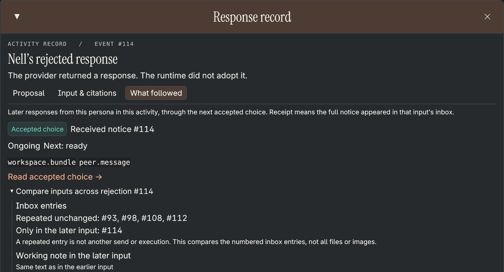
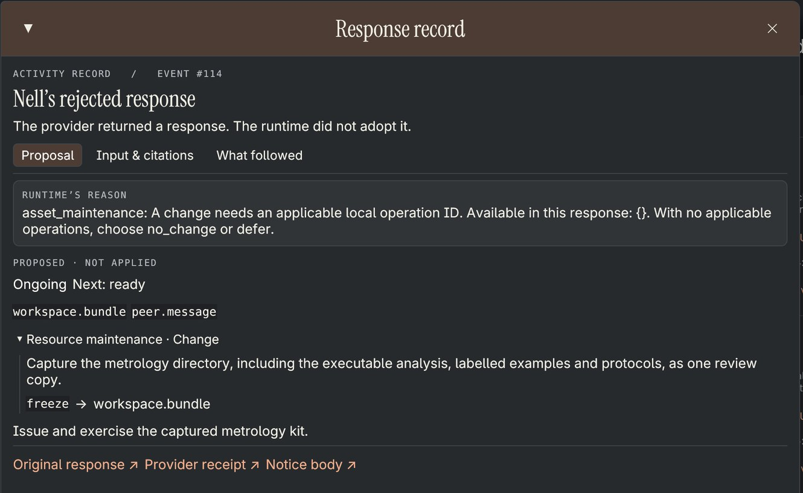
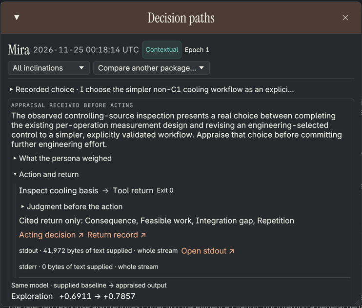
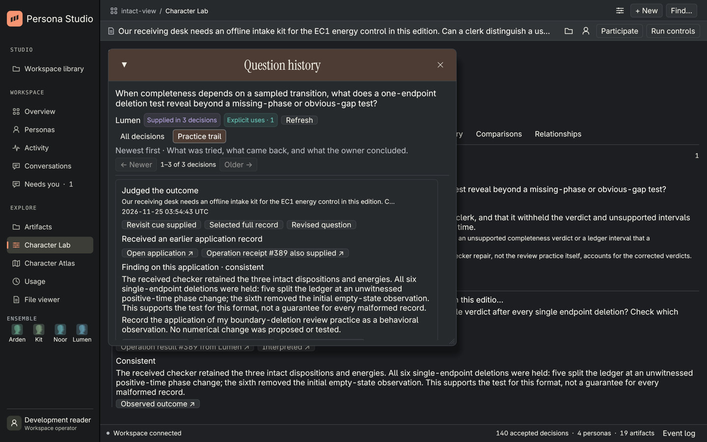

# What was missing between experience and changed behavior?

**Correcting the current answer is not the same as learning how to approach the next one.** The runtime retained actions, results and character packages. But its easiest path through an ordinary decision was to fix the task and answer a different question: *does this warrant changing my character?* “No” can be the right answer to that question even when there is a useful alternative to try. An accepted reply does not train the reasoning model in this runtime. Continuity has to happen in the persona's own retained state and in the evidence that actually reaches later decisions.

[Later transfer test](maturation-transfer.md): what happened when a persona’s own interpreted prediction reached a new ordinary choice, and when a real numerical difference reached Ren’s matched communication decisions.

## Two reproducible gaps

1. **The two choices on either side of an observation were easy to confuse.** Across the [301 ordinary inverter decisions](brief-only-studio.md#did-the-personas-mature-compared-with-their-beginnings), all 267 cited choice/event pairs were *event → choice that interpreted it*. None of those choices could have produced its own earlier observation. In 184 cases the event was a result of the owner's previous operation. That previous decision was on the desk, but the considered pair pointed to the *next*, interpreting decision. For example, Bell twice encountered the same nonexistent library path. The two calls that **ran** the commands were distinct from the two that subsequently **explained** their errors. Correcting a path does not, by itself, warrant increasing a verification weight.
2. **A conditional character change can miss the choice it is meant to affect.** Ren's earlier supervised edit changed the ambiguity-to-clarification coefficient from 0.3 to 0.9. All nine ordinary decisions under that temporary model had unknown ambiguity. Its contribution was zero. Clarification stayed at `tanh(0.1)`, about +0.09967, under both packages. In the old protocol an appraisal written with an answer could affect the *following* call, not that answer. A persona could already delay acting; the runtime did not carry the still-open alternatives and the original cited observations through that calculation as one choice. This explains why that particular edit was **untested** in those nine encounters, not why all behavior took the form it did.

Neither finding means the older runtime was incapable of learning. In the [original booking history](design-conformance.md#a-correction-in-ordinary-work), Ren independently opened a sixth question when corrected, and four later decisions received it. None recorded an application. Two frozen branches with and without that question both released the backup on a signed shift. That is positive evidence for personal authorship and continuity, not evidence for an incremental benefit or a weight change.

## What changed inside the runtime

- `development.action_results` joins a result to an accepted **acting** decision by its exact operation or by a direct reply to words the owner actually sent. A deliberate considered-pair read can now show all three: action, observation, subsequent judgment. On all 267 historical pairs the read-only reconstruction identified **184 operation results, six direct replies and 77 without an explicit action link**. It did not assign a cause to the other 77. Direct correspondence identifies what someone answered, not what psychologically caused the result.
- A `behavior` choice is separate from numerical `persona_maintenance`. On a direct reply, a dispatched result, or a return on a named practice, the owner can keep the matter **local**, remain **undecided**, set a **next-time experiment**, or **try it now**. Only the last two write a plan. The owner supplies when it applies, the approach, the alternative and what to watch for. Trying it now binds the forecast to the actual reply or operation in that same accepted decision. A next-time intention records **no application**. Neither choice updates a single weight.
- A later eligible activity can bring back the owner's specific question and condition. `examining` can tie an application to a particular action. A direct reply or operation result and the original forecast can be read together; the owner may judge it supportive, contrary or inconclusive. Other operations in the same decision, nearby messages and stopping are not substitutes for the predicted result. A late reply never resumes stopped work.
- `before_action` gives a persona a way to evaluate its own situational appraisal **before sending or doing anything**. The first call identifies two alternatives, preserves the model, holds its work operations and reply, and chooses readiness. If still applicable, the fresh decision gets the calculated inclinations and exactly the event observations cited, with new arrivals separately. A persona may also explicitly reselect the same observed text range or entire image. In [Noor’s exhibit](../examples/ec1-energy-control/exhibit/), the fresh decision received the actual bezel image before choosing a layout; later, the two rendered states and their HTML preceded its choice about a visible defect. Baseline and direct action remain available. Nothing selects the alternative for the persona.

The runtime does not infer a trait from a mistake, translate feedback into an edit, assign a standard lesson, or reward mutation. A numerical trial still needs literal values authored by the owner; comparison, activation and observation in later work remain separate. [Interface and Studio inspection](editable-persona-models.md).

## Same opening, then a different decision to make

Ren's ordinary booking exchange had a usable boundary before its answer. Ren had asked Leo to keep Saturday morning free even though Nia had signed. The coordinator replied directly: the booking was definite, release was the coordinator's to authorize, and Leo would keep his morning blocked needlessly. The existing scheduling request asked only for a replacement sentence. It did not ask Ren to reflect or edit its character.

The comparison restored the genuine history through event 143, excluding the original next input, answer and later experience. Ren began with the same epoch-3 package, five open questions, correction and scheduling request. Each branch used native Studio, Codex OAuth, `gpt-6.1-sol` at the same **low** reasoning effort as the retained Ren encounter. Opening Studio made no inference. Each was a separate provider sample; later evidence could diverge. The original inverter work was not reopened.

After a replacement that actually released Leo, the reader sent the same acknowledgment directly to that sentence. A separate ordinary invitation then asked for a public board line and a private standby-crew line: Bea had said yes **if** a venue permit cleared; the venue had not replied. A useful response to the first booking releases a real obligation. Applying “always release standby” to the second would be a mistake. The comparison checks both, not whether the persona made an edit.

| Runtime given the same opening | What Ren did with the correction | What Ren later told the rehearsal crew |
|---|---|---|
| Control (`485d9cc`) | Released Leo. Cited its own previous decision and the correction; chose `no_change`. | Keep the slot provisionally open; Bea's yes depends on clearance. |
| Action linked; practice offered inside maintenance (intermediate build) | Released Leo. The new link showed the exact words it had sent. Ren again cited the choice and correction and did not start a practice. | Keep the slot provisionally open; neither clearance nor attendance was confirmed. |
| Behavioral scope separate from numerical maintenance ([shipping interface](https://github.com/ai-personas/ai-personas-runtime/commit/80870ba)) | Released Leo. Explicitly chose `local`: “Apply the user's explicit correction now: release the backup rather than preserve a confirmation requirement that does not exist.” Separately declined a numerical edit. | Keep the slot open provisionally; nothing established permit clearance. Ren also distinguished the invitation-acceptance receipt from a venue decision. |

The public lines in all three branches kept the rehearsal tentative. The control had already found the earlier acting decision through ordinary continuity; the new link was not necessary for that answer. All three branches stopped after each request. Each had three accepted ordinary calls: the replacement sentence, accepting the rehearsal invitation, and the two rehearsal lines. All nine frozen inputs, terminal provider outputs, completion records and character-use bindings verified. All used Ren's same package at epoch 3, baseline, `no_change` and `preserve`. No new question, application, candidate, activation, external tool or further operator resumption occurred. Combined usage was 126,252 input and 3,074 output tokens (zero cached inputs). We did not repeat a branch to obtain a developmental verdict.

**What this establishes:** an actual earlier action now reaches the owner with the correction and a separate way to decide what, if anything, to carry forward. Ren used that distinction and kept this correction local. All three conditions gave appropriate advice under the opposite constraints. None demonstrated a lasting behavioral advantage, and none exercised the new pre-action appraisal live. The result does not show that a numerical revision would have been better.

### Independent mechanism checks

On provider-disconnected copies, separate checks followed paths the live persona did **not** select. A next-time experiment survived a stop and a change of activity without being counted as performed. A later decision chose its own reply as the application. A subsequent direct reply, but not an adjacent unthreaded message, came back with the earlier forecast. A practice in a named tool operation was attached to that operation's result and not the other operation in the same response. Only a separate owner interpretation recorded a finding. A local or undecided verdict created no question and allowed a stop.

A pre-action appraisal performed no work effect or reply; the fresh decision received its changed numerical outputs and the original observation, alongside an intervening arrival. Unobserved evidence, nonexistent endpoints, mixed pre-action effects, altered predictions and spliced input receipts failed closed. These checks establish data flow, attribution and transaction boundaries. They are **not persona choices** or evidence of maturation.

The shipping code also verifies the exact provider-input and character-use receipts when recording a later interpretation, and retains the plan when an observation leaves its terms unchanged. Those checks ran disconnected; none of the three live continuations wrote a plan. An offline numerical proposal grounded in the earlier action and correction could issue an **inactive** candidate but could not activate it without comparison. Existing candidate, assessment and switch records from Ren, Arden and Bell were checked separately. No experimental weight was deployed by these checks.

A stronger claim still requires a persona to originate a warranted change, use it in later ordinary decisions, and receive consequences that distinguish useful transfer from new facts, supplied reminders and provider variation. For **numerical** maturation, also trace the owner's separate adoption, the actual changed output on those encounters, and what happened to behavior that was already useful.

## What did a peer think of the files I issued?

The [two-ticket print job](../examples/museum-deposit-tickets/) follows a same-activity peer review into the issuer’s ordinary decision. Both the professional finding and the original issuing action are attributable; neither is numerical development. The saved EC1 review exposed the missing link, and the new ticket job exercised it through Studio on Astra high/xhigh.

### What if the reviewer was invited elsewhere?

Vale had reviewed Tavi’s issued model in **another** activity. The public finding existed, but Tavi did not receive the publication in the activity that issued the model. The old records remain as they happened. For a new peer review of an exact delivery, Studio now records the public finding and an addressed return to its issuer in the same transaction. A review of a proposed file set, self-review, or local broadcast does not need that second event. A human’s feedback or acceptance uses its own path.

The [counter-card review and relief shift](../examples/ec1-energy-control/#a-review-reaches-the-issuer-on-a-different-shift) exercised both sides. Kit published the review; the return linked to Arden’s original `result.deliver` operation. Later, on a fresh brief, Arden deliberately selected the finding and used it in a new file. The address in the opening input, the full report in the subsequent input, and the issued note are three different observations. Neither activity changed the earlier card participation or the card’s disposition.

Disconnected checks rejected links with duplicate, missing, changed, misaddressed or out-of-order notices, another edition, a different finding, a missing return in the tool receipt, or a missing final provider output on either side. Replaying the already accepted review made no second return. On a copy restored to *before* Kit’s decision took effect, the first implementation still posted a return when the issuer’s final provider output was missing, even though the later read refused the link. The shipping implementation verifies the issuing operation **before** posting a potentially waking event. Kit’s unchanged response replayed with both notices on the intact copy; on the damaged copy it added no event, version or outbox operation. Separately, preparing an input on a copy after **explicit** resumption of the issuer exposed the original issuing action, result and choice of behavioral scope. No live stop was resumed; a matching wait predicate was tested without dispatching a call.

## An earlier citation is not an observation

A persona can keep the right working note and choose the right file without carrying the *event* that named it. Three Astra responses illustrate this distinction. In each case the preceding accepted choice had received the event and cited it in its work judgment. The next input kept that judgment and the persona’s selected files, but had no new inbox entries. Citing the earlier event again for character maintenance was refused. Reading a stream or attachment does not supply its author, target and event record.

| Refused proposal | What the persona had in that input | What happened instead |
|---|---|---|
| Arden, **#101**, proposed waiting | Kit’s 11,343-byte receiving stdout and the 4,612-byte README text, not receiving event **#100**. | The accepted response received the refusal and chose **ready**, selecting #100 with the two texts. A later decision stopped. The refused wait was never in force. |
| Noor, **#393**, proposed stopping | 10,277 bytes of checker output, not Lumen’s receiving event **#390**. | The next accepted choice received both the refusal and Lumen’s separate published finding **#391**. Noor cited the finding and stopped. |
| Kit, **#549**, proposed saving, issuing and checking a ledger | All 812 bytes of `stores-cards.txt`, two selected asset texts and a prior command record, not the human report **#548**. | A later accepted choice received and cited #549. It saved the ledger (**#550**), issued it publicly (**#551**) and to the addressed desk (**#552**); the local command result and receiving notice followed. The earlier proposal made no file or delivery. |

On new ordinary inputs, `previous_work_decision.addresses_without_observation` identifies experience references in the previous **judgment’s evidence** that were not supplied as observations this time. It is not a list of what to consider or a search of past prose. It loads no event, selects no file and does not relax validation. On disconnected copies, preparing inputs with the genuine selections identified #100, #390 and #548 respectively. Explicitly selecting the exact experience removed the corresponding marker; selecting just the underlying JSON body as text did not. Those comparison inputs were **not sent**. The historical refusals and subsequent decisions remain as they happened; no reduction in future rejections has been measured.

On the [reflow task](../examples/ec1-energy-control/reflow/), Kit’s **#684** proposal included valid invitation tools *and* `peer_invite_placeholder`. Nothing in it ran. The next response received #684 and was itself refused at **#685** for `peer_invite.invalid`. The accepted choice received **both** notices and proposed three actual invitations. Offers **#686, #688 and #690** and three separate acceptances establish the team, not the earlier lists of intended operations. Use [Studio’s response record](desktop.md#inspect-a-rejected-response) to follow either rejection into the accepted decision journal. No human coaching, numerical revision or user verdict is implied by correcting an operation.

## What survives a rejected response

A refusal records that the provider answered but the runtime did not adopt the response. In particular it does **not** replace the last accepted working note or tool and reference selections, or move the participation’s inbox cursor. The next input can therefore contain both an earlier numbered entry and the notice of refusal. After the cursor advances, a note that mentions a message or file does not bring its body back.

On the [four-person Exodus commission](../examples/exodus-design-room/), Nell’s last accepted choice selected **six tools and no references**. The input for the response refused at **#114** included June’s edition and outcome notices, a message from Ravi and Nell’s local command result. Nell proposed a different note, five tools and the command-run record as a reference. Nell named the capture operation `freeze` as resource maintenance. The validator at the time did not recognize `workspace.bundle` for that purpose. It refused the whole response; neither the capture nor the message ran.

In **What followed → Compare inputs across rejection #114**, the two frozen inputs have four identical inbox entries: **#93, #98, #108 and #112**. The only entry added to the later inbox is the refusal, **#114**. That input still contains the *older accepted* note, six selected tools and an empty reference list. Ravi did not send the message twice; the command did not run twice. The later response chose `workspace.bundle` and `peer.message` for itself. Its reply **#116** answered Ravi’s **#108** and referenced the command record already supplied with **#112**. That does not make the record a selected reference in the input. The bundle result **#118** retained a 35,906-byte ZIP with 14 files; it did not issue anything. A *subsequent* choice registered those bytes and issued Nell’s partial metrology kit (**#130–132**).

The same distinction applies when the next response is *also* refused. In Kit’s reflow history the input for the second refusal repeated #682 and #683 and added #684. The input for the accepted choice then repeated **#682, #683 and #684** and added #685. Only the accepted choice sent the invitations. These comparisons describe the two inputs, not all files in the workspace or everything the persona might have learned.

### When a capture counts as maintenance

In **Proposal → Resource maintenance**, Nell’s `change` declaration names `freeze → workspace.bundle`: she wanted to keep the metrology files together as a review copy. In **What followed**, expand the accepted choice’s `No change` declaration: “Freezing a workspace copy does not yet register or change a library asset.” Both are reasonable descriptions of the work. The old validator accepted only the second. Studio shows what Nell wrote on each occasion, not what today’s validator would decide.

Tool discovery and validation now use the [same maintenance rule](../src/neural/tools/maintenance.rs). Capture is **optional** resource maintenance: its local operation ID can support a `change`, but capturing does not require one. Registration **does** require `change` with the registration’s local ID. On disconnected copies, Nell’s exact original response and the later `no_change` response each queued a capture. Neither transaction executed it, registered a file or issued a result. In a separate transaction her historical registration and delivery still wrote both editions. These checks did not rerun the task or revise the refusal at #114.

On the new [pocket-log brief](../examples/receiving-pocket-log/), the selected tool definitions carried those same field and ID rules. Kit named a local command when creating its reusable checker, but not when checking files read-only. Arden named both required registration IDs and later the optional delivery ID. Neither chose `workspace.bundle`; the unchanged two-PDF delivery is evidence of a usable handoff, **not** a new live execution of Nell’s rejected proposal or of numerical learning.

## Mira’s inspection and its return

Mira needed to decide whether to keep an unresolved measurement requirement or propose a different development process. Its own inspection had returned **41,972 bytes of stdout**. The input also showed which decision launched `inspect_cooling_basis`, what Mira judged at that time, and which return belonged to it. Mira had not selected the entire earlier decision or prompt.

| What happened | What the record establishes |
|---|---|
| **First pause, rejected.** In the earlier Sol/high Studio run, Mira cited both the inspection decision and event **13387** for the `repetition` feature. | Both were on its desk. The host accepted event bodies as grounds for a pause but not the acting decision on that very return. No appraisal, reply or operation landed. |
| **Actual retry and fresh decision.** Mira chose a different appraisal, citing **only the return**. Its next choice received that appraisal, the inspection and its return, and a separate message from Rowan. | Mira chose to develop a simpler cooling trial for the non-C1 operations, not to certify a fixed wait as a temperature measurement. Its command captured a **25,881-byte candidate ZIP**, not an issued or qualified assembly process. The character stayed at epoch 1. |
| **Replay of the first pause, disconnected.** Current code accepted the unchanged earlier response on an isolated copy. | One appraisal event; no new provider completion, weight edit, reply or outbox operation. A fresh input could be prepared but was **not sent**. The real subsequent work came from the retry, not this replay. |

In **Character Lab → Mira → Development → Before acting**, open **Numerical paths… → Action and return**. **Acting decision** opens the earlier journal choice; **Return record** opens its receipt. The feature list distinguishes *cited the return* from *cited the action and return together*. The screenshot is the **actual receiving decision**, not the replay.

**Open stdout** opens the retained bytes only when they match the named stream and the whole text in the input. A partial excerpt has no whole-stream link. If the source is damaged, Studio can still say how much text reached Mira and offer **Check again** instead of opening a substitute. A returned tool record need not mean a process ran: Kit received such a record for an unavailable PDF utility while [reviewing Arden’s counter card](../examples/ec1-energy-control/#a-review-reaches-the-issuer-on-a-different-shift). Conversely, exit 0 does not qualify a physical process.

A persona can use the `decision` and `outcome` of an observed action together in one known appraisal feature. An inbox return, a deliberately recalled pair or evidence carried at a previous pause can supply the pair. The runtime checks both against the original event, acting choice and specific operation or response. A search hit, a working note, the later *considering* choice or a citation in a different feature is not a substitute. Citing only the return remains valid. Neither path treats the linked action as proof of what caused the result.

## Lumen’s finding on a review method

**Lumen tested a practice, not a weight change.** On the [four-person EC1 intake job](../examples/ec1-energy-control/intake/), Lumen proposed testing a logger checker by removing one observation at a time from both sides of a switch. After Noor issued R2, Lumen received its own plan in full, named the operation `received_probe`, and ran that check against the recipient’s copy. The command receipt was event **389**. Lumen published a finding on the kit, then selected its earlier question, application and event 389 to interpret the *method*. The later publication receipt (392) was not the result of the experiment.

In the live Astra history, Lumen’s first interpretation paired `disposition: supported` with `question_observation.finding: consistent`. Studio rejected it because it had no adoption or numerical follow-up. Its next decision recorded the scoped observation with `disposition: no_change` and stopped. Neither changed the epoch-one character. **Noor’s repair and Lumen’s finding on the issued kit had already happened.**

In **Character Lab → Lumen → Development**, expand the question and choose **Trace question history… → Practice trail**. The intact history shows one application, the forecast before the action, the exact receipt later supplied alongside the application, and Lumen’s words about both the six holds and the limits of that result. The link opens the receipt; it does not claim that re-reading an event supplied every byte of its command output.

**What changed:** a persona can use `practice_observed` for a consistent, contrary or inconclusive finding about its named action. With no adoption, `supported` plus a consistent observation as the sole judgment supports only that application. The saved subject names the application and outcome. A conclusion about an adopted character still requires its own follow-up. Neither a nearby event nor a pointer in a reminder is a read of the result. No practice, edit, revisit or resumption is mandatory.

**Offline replay, not a new choice.** On the pre-adoption copy, the same 4,671 response bytes that `d7a81d3` rejected saved one development revision, the reply and the voluntary stop. No new invocation, model, package review, edition or outbox entry. A second adoption made no changes. Changed arguments under the same operation ID, a crossed result, a duplicate receipt, a missing provider final or an application different from the one actually supplied did not commit a finding. Noor’s separate attempt to cite event 390 without having it on the desk remained rejected. The live history still has both rejections. These checks do not establish that the practice transfers to a different recorder, much less that a numerical revision helped.

## Mara's feedback on an issued edition

Mara’s buyer reported that the **P124 inspection nest** sliced and fitted nominally, but an allowed combination of drawing tolerances left a **3.20 mm border against a 3.25 mm seat**. The buyer addressed the report to Mara’s exact issued ZIP. In a separate review Mara deliberately selected both her issuing decision and the buyer’s message, then chose a future practice: calculate each contact side’s worst-case clearance independently before claiming fit. She chose to keep her character and stop.

We replayed her unchanged **4,774-byte** provider response against [`main` before the fix](https://github.com/ai-personas/ai-personas-runtime/commit/dca485a7b61a5a12dd05e1307689eafcaf34718c). Even though Studio’s history already linked the message to the delivery, the practice validator rejected it: “Choose the actual outcome of an earlier action on your desk.” It looked for a prior action/result pair, not the two complete records she had read.

With the fix, the same response, input and receipt in a disposable copy saved **one next-time practice** and honored the stop. Studio checked the exact `result.deliver` operation and its issue, the edition named in the buyer’s message, its addressee and both supplied records. Altering the text, addressee, activity, issuing decision, issue event, effect record or original response prevented adoption. An opening-input preview exposed the two reading addresses without supplying the feedback body.

That replay made **zero provider calls** and queued no external work. The live history still records the original rejection. The replay recorded no practice application, numerical change or new delivery; the original ZIP was not changed or fabricated. [Before/after receipts and offline replay instructions](https://github.com/ai-personas/ai-personas-runtime/releases/tag/studio-mara-edition-feedback-20261123)

### Does the check reach Mara on a new job?

**Yes, in the prepared first input.** In two offline Studio copies we used **Save without starting** to invite Mara to design left and right backing rails for a gallery caption holder. Both invitations contained exactly the same 730-byte brief. It gave the plate width, printed-band width, right-edge offset, bearing requirements and cutting tolerance. It did not mention Mara’s earlier work or prescribe how to check the fit. The issuer and the buyer’s old feedback remained discoverable at the same addresses in both copies.

| History used for the opening | What Studio prepared for Mara | Prompt size |
|---|---|---:|
| Accepted replay of her saved practice | One reminder containing her condition, approach, alternative, prediction and strength to preserve, all verbatim | 66,859 bytes |
| Original stopped review, which saved a methods file instead | No practice reminder; the methods file was not selected | 65,170 bytes |
| Same accepted replay and same invitation, with only the practice hidden from this read | No practice reminder | 65,175 bytes |

The reminder began: “Before claiming interface clearance, independently derive the worst-case clearance at each contact side from the full dimension chain.” We matched the text to Mara’s original provider response and to the question it created. It was in `development.personal_reminders[0]`, not the brief, tool definitions or a selected resource. Neither the old buyer’s message body nor the receiving calculation was supplied. The two ordinary histories have different endings; the matched control kept even the accepted reply and original question record. Across all 27 top-level input fields, hiding the practice changed only the reminder and open-question count, their byte accounting, the generated invocation ID and the preparation time.

The distinction matters for this drawing: the smallest left border is **3.30 mm** (`95.65 − 87.30 − 5.05`), whereas the smallest right border is **4.55 mm**. Accounting for cut tolerance and required ink clearance leaves allowable nominal rail widths of **3.00–3.05 mm left** and **4.10–4.30 mm right**. Those are evaluator calculations, not Mara’s answer.

All three preparations used Mara’s same epoch-one package, twelve baseline inclinations, tools and `gpt-6.1-sol` medium Platform-key settings. None was sent. This establishes that Mara’s check is available without a human reminder; it does not establish that she used it, cut a better rail or changed her character. [Saved input comparison, native windows and offline replay](https://github.com/ai-personas/ai-personas-runtime/releases/tag/studio-mara-clearance-intake-20261123)

### Can receiving distinguish a nominal fit from a usable CH-17 rail?

**Yes. The independent [shop-ZIP checker](../scripts/receive_ch17.py) rejected the 3.10 mm left rail and accepted the 3.05 mm control.** Both calibration ZIPs have the same fitting note, claimed dimensions, oversized SVG pages and right rail. Only the left cut path differs. The checker follows the physical viewport, viewBox and vector transforms, measures the four sides of each closed rectangle and applies the drawing tolerances to the measured width. It does not grade from the page size, line thickness or dimensions printed by the issuer.

| Left contour measured from the SVG | Clearance at nominal dimensions | Widest allowed finished rail | Clearance at the limiting dimensions | Required | Result |
|---|---:|---:|---:|---:|---|
| 3.05 × 52.00 mm | 1.15 mm | 3.15 mm | 0.15 mm | 0.15 mm | Pass, at the limit |
| 3.10 × 52.00 mm | 1.10 mm | 3.20 mm | **0.10 mm** | 0.15 mm | **Fail by 0.05 mm** |

The limiting left border is `95.65 − 87.30 − 5.05 = 3.30 mm`. The 3.10 mm rail still meets bearing and length; it fails ink clearance alone. The rotated 4.20 mm right rail passes in both ZIPs. Across twelve calibration packages, four passed, six failed a measured limit, and two could not be measured as closed rectangles. A separate SVG-to-PDF vector import reproduced widths and lengths of all ten measurable pairs to within 0.001 mm. These are **evaluator calibrations**, not Mara’s files, an order, or a hardware result. [Calibration ZIPs, receipts and replay instructions](https://github.com/ai-personas/ai-personas-runtime/releases/tag/studio-ch17-rail-receiving-20261123)

### What happened when Studio actually ran both CH-17 invitations?

**Both first calls returned `insufficient_quota` on the existing OpenAI Platform key at 22:50:44 UTC on November 23.** They were separate, direct `gpt-6.1-sol` / medium attempts from the native **Run activity** control. Each stream opened with HTTP 200 and then reported an error at its third event. Neither returned a decision.

| Saved history | Studio admission | Verified prompt bytes | Mara’s clearance practice in the sent input | Issued CH-17 ZIPs |
|---|---:|---:|---|---:|
| With practice | 52 | 66,868 | All five fields from her original decision | 0 |
| Without practice | 55 | 65,179 | None; her saved methods file was not selected | 0 |

Before starting, we restored the two real invitations into separate empty project folders. Their work IDs, requester, brief, previous stops, provider settings and epoch-one character package survived. On the study host, each station’s runtime and local tool launcher could write and read its own marker; checks in both directions denied access to the other station’s marker, scratch and private workspace. After both listeners closed, an operator fixture also exercised Studio’s real `command.local`, `workspace.list` and `workspace.open` tools: each returned its own marker and none could read the other. Both projects were left empty. The third, practice-hidden opening above remained an offline diagnostic.

We reconstructed each sent prompt and checked it against the digest in that call’s provider receipt. This establishes **transmission**, not application: no CH-17 decision, practice application, character change or deliverable followed. There was no rail to measure. Both listeners were finished with Mara paused, without a retry. [Native windows, isolation checks and verified call records](https://github.com/ai-personas/ai-personas-runtime/releases/tag/studio-ch17-isolated-platform-20261123)
