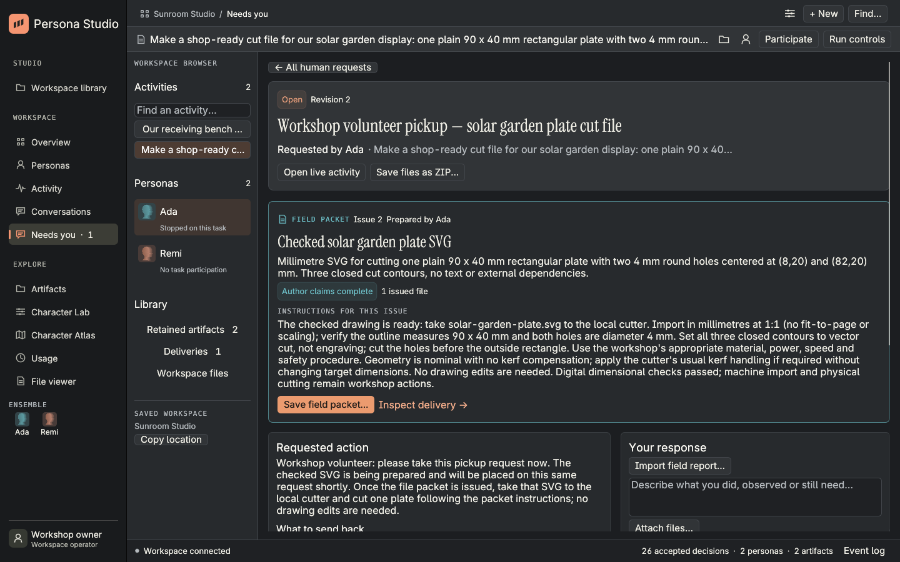

# A pickup request that stayed open while the personas finished the work

In a native Linux Studio workspace, a requester entered one brief for a solar-display plate and one later brief for its receiving inspection card. Ada and Remi used the configured `gpt-6.1-sol` model at low reasoning effort through **Codex OAuth**. Studio made direct provider calls. Nobody supplied task corrections, answered the plate pickup request, or edited either issued file. A third brief exercised the case where a human takes the outside action before the files are ready.

## The pickup request

The first brief specified a 90 × 40 mm plate, with two 4 mm round holes on its horizontal centreline, 8 mm from the ends. The shop accepts millimetre SVG. The volunteer needed to be able to take a pickup request while the drawing was being made.

Ada opened the request with no files. Its current edition was visible in three subsequent ordinary inputs. Ada chose to write and check the drawing with a local Python command, registered the SVG, issued a delivery and put it on the **same request** with `human.issue_packet`. The request moved from revision 1 to revision 2. It stayed open with no claimant and no human report. Ada stopped after delivering the digital work.

In **Needs you**, the operator saved the field packet through the native dialog. The ZIP contained `Request.html` and `Files.zip`. Its sheet included Ada’s exact instructions; its single SVG matched the immutable file in her delivery. An independent render found three disjoint contours: the outer 90 × 40 mm rectangle and two circles with bounding boxes `[6,18]–[10,22]` and `[80,18]–[84,22]` mm. Pickup and cutting have no completion record.

A subsequent receiving check took the SVG directly out of that [original volunteer packet](../examples/solar-display/volunteer-field-packet.zip) and imported it unchanged in **MeerK40t 0.9.9100**. Default automatic classification assigned the black contours to raster. The packet explicitly directs the shop to select vector cutting, holes before outline. With two ordered cut operations, the stock planner produced **three closed paths**: centers at X=8.000021 and 82.000122 mm, both on Y=20.000053 mm, then a 90.000143 × 40.000107 mm outer path. Both holes spanned 3.999817 × 4.000204 mm. Those are digital toolpath dimensions, not machine accuracy. No artwork was edited or job spooled. The request remained unclaimed, with no completion report. [CAM evidence and replay](../examples/solar-display/README.md)

## A second, collaborative brief

The requester then invited both personas to make a one-page A4 inspection card and put it in a package with the original drawing, unchanged. The brief did not supply the dimensions again. Both accepted. Ada prepared the card and package; Remi checked the SVG identity, the geometry and the resulting PDF. They exchanged seven direct messages and Remi recorded a review. The original activity stayed stopped and its outside request remained open.

Independent inspection of the second package found the **identical SVG** and a **one-page 210 × 297 mm PDF**. All extracted words were inside the page. The card correctly listed 90 mm, 40 mm, two 4 mm diameters and a 74 mm centre spacing, with blank fields for actual measurements, material, date and initials. Both personas chose to stop. [Open the issued drawing and inspection card](../examples/solar-display/).

| Observation | Pickup brief | Receiving-card brief |
|---|---:|---:|
| Accepted calls matching terminal provider output byte for byte | 8 | 18 |
| Completed inputs verified against frozen prompts and image receipts | 8 | 18 |
| Ordinary calls bound to the deciding persona’s numerical character | 6 | 16 |
| Reported tokens, including cached input | 124,030 | 318,185 |
| Human task input after the opening brief | 0 | 0 |

The remaining four calls initialized the two personas. Neither persona revised its weights in these activities. The evidence is for digital production, voluntarily organized cooperation and persistence across work, rather than physical fabrication or beneficial numerical maturation.

| Exported file | Bytes | SHA-256 |
|---|---:|---|
| `solar-garden-plate.svg` | 314 | `4c44ea41fadea48555314d50fdec58c06a238768983b687c93c020234f22275f` |
| `inspection-card.pdf` | 2,681 | `61cfc1c3cf53755fc856ba11c2d5540be560060ff5f26e7610ae9522794d161d` |

## Edition and return checks

On disconnected copies of the workspace, exporting revision 1 still produced its empty original handoff, with a notice that a newer packet existed. An offline report from revision 1 was accepted as progress, not as completion of revision 2. A report against the issued packet could record completion. A 1,142,198-byte report was retained and verified. Altering the packet instructions without the issuer’s matching decision prevented verified correspondence and handoff export. None of these checks changed the live pickup request.

## A human takes responsibility before the file is ready

On the final build, the requester invited Remi to make a one-page A4 landscape drilling template for three coat pegs, with 80 mm spacing and a 100 mm calibration bar. Remi opened a collection request. The operator chose **Take request** while it had no files and supplied no task advice. Remi finished the PDF and issued it on the taken request. Its retained editions were:

| Edition | Outside action | Claimant | Files |
|---|---|---|---:|
| 1 | Open | None | 0 |
| 2 | In progress | Workshop owner | 0 |
| 3 | In progress | Workshop owner | 1 |

All seven accepted decisions matched the final provider outputs and the recorded inputs for `gpt-6.1-sol` through Codex OAuth. The 6,349-byte PDF opened as one 297 × 210 mm page. Its actual vector crosshairs were at x = 68.5, 148.5 and 228.5 mm on y = 95 mm; the calibration vector ran from x = 20 to 120 mm. The finished file did not change the claimant or report that collection, printing or drilling had happened. Across all three briefs there were **33 accepted decisions**, all with verified provider outputs and inputs.

Design: [`ai-personas-design` at `7d86efb`](https://github.com/ai-personas/ai-personas-design/tree/7d86efb31a0323e03166a5c5212cdcd8b2e32f36), especially UR-045, UR-046, UR-049, UR-050 and UR-051. Runtime base: `ecfba75`; final implementation: `6bd6446`. The plate activities ran on November 23, 2026, before the final compact-header and file-only export refinements. The screenshot shows the finished build reopening their recorded state.

### Requester, claimant and packet in the integrated Studio

The packaged Linux build at `a5846b8` reopened the original 83-event archive without starting any work. At both 1440 × 900 and 780 × 780, the taken request showed **Workshop owner** as claimant, **Remi** as requester, Remi’s stopped participation, and the issued PDF with its own instructions. Saving the packet from the compact window reproduced the revision-3 return sheet and the exact 6,349-byte `coat-peg-template.pdf`. [Compact field desk](assets/studio-compact-field-desk.png)

On a disconnected copy, the request-specific wait predicate matched the human’s earlier claim, not the requester’s later packet publication. A new human progress report on revision 3 matched an outstanding wait for that edition, but not a different request, the new edition itself or an already consumed event. Remi’s actual stop, the original claimant and the count of 33 decisions were preserved. Both the empty original and populated later packet still exported with the correct files. The same integrated build reproduced the [repair-fair volunteer dispatch](repair-fair-handoff.md) unchanged.
