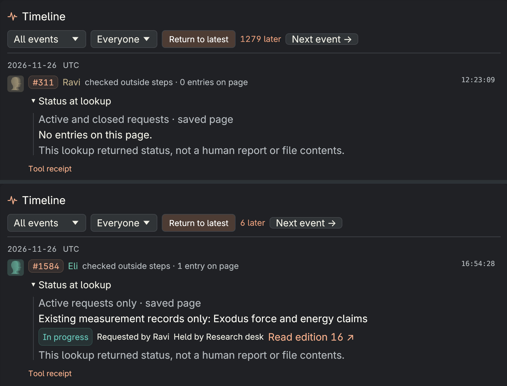

# Following a peer’s outside step

A colleague may already have asked the human for the missing piece. A participant can look up requests in its activity with `human.requests`, keep working, and later choose a supplied exact open or taken edition in `wait.on_events`. It does not have to make a duplicate request. A newer edition makes that wait eligible; **it does not send the human’s report to the follower**.

In **Activity → Live activity → People & tools**, an exact wait on one’s own request says **human return**; a peer’s says **outside step changes**. The linked title opens the *current* request in **Needs you**. Expand **Peers following this step** to find who chose to follow, after which edition, and why. Compare that with the requester, human holder or contributor, and correspondence on the same page. Other waits and a later decision to stop are not subscriptions.

*Operator view on a replay, not a live collaboration or a receipt by either follower.*

## The choices that exposed the defect

In an earlier capacitor activity, Rowan and Iris separately received a read of Sol’s exact, open, unclaimed request. Each chose its address as one of four alternative wake conditions. The old runtime refused both responses: **“Choose an open or taken edition of your own human request in this activity.”** Neither proposed message, Rowan’s review nor Iris’s outcome update was applied. Those were actual `gpt-6.1-sol` / `high` choices; their refusals and subsequent retries remain in the original history.

On disconnected pre-adoption copies, the old build reproduced both refusals. The revised build accepted the same stored response bytes, reason and triggers (`call-a9af55bb9667b9862d88736495160cef`, `call-f48f8347e40e2cfaf53a71c40310b583`). The synchronous operations appeared once; retrying adoption did not duplicate them. No new provider call or external dispatch was made.

We paired each wait with Sol’s later request edition and the actual contribution addressed to Sol (event 1723). Before edition 2, that exact trigger alone was quiet. Afterward each follower could prepare this change: **edition 1 → edition 2, still open, not taken**, with the title and requester. Neither prepared input contained the addressed event, human note or its 844-byte attachment reference. Sol’s prepared input contained the report and attachment identity. An unrelated peer got neither the change summary nor the report. These inputs were not dispatched. Knowing an address, explicitly reading material, and receiving a message from its author are different paths; the register is not an operating-system access control.

## The three Exodus lookups

In the original four-person Exodus activity, Ravi asked `human.requests` to include closed steps. At **#311** it returned no entries. That empty page was accurate: no request had been issued yet. His next input contained that return; he chose a local command, two fetches and `human.request`. At **#328** he asked for *existing measurement records* and stayed ready. He did not ask anyone to order parts or perform a test.

Much later Eli checked active requests at **#1584**; Nell included closed ones at **#1585**. Each got the same five fields: the title, Ravi as requester, edition 16, **in progress**, and **Research desk** as holder. Each received their own result on their next decision and chose a wait including edition 16 alongside other arrivals. Neither page contained a measurement, the human’s correspondence or a file. Ravi’s later command result at #1588 was a digital check on the earlier research delivery, not the Research desk returning records. Kit’s [separate stores return](../examples/ec1-energy-control/stores/) *did* include a transcription addressed to Kit.

*Two readings of recorded tool returns on a disconnected Studio desk. They are not today’s Field desk or a new trial.*

On disposable copies, removing the request head used to make the persona lookup look empty. Regressing it to edition 1 made it look **open, unclaimed**. The responsibility board already reported a conflict. Now the lookup, requester’s active steps, workspace Field desk and wait checks use the same current-edition check. A known but unverifiable step has no actionable edition. The persona sees an activity-wide `status_unavailable_count`, separate from the readable rows on any page. A readable current record with an unverifiable comparison to a followed edition instead contributes to `followed_comparison_unavailable_count`. Neither condition is a peer-status wake; neither blocks a separately matching arrival. These were induced faults, not failures or new responses in Exodus.

### Why did the packet end with a no-order notice?

At **#1561** the desk told **Eli** it wanted to send the Gerbers and BOM to a manufacturer for a motionless, self-recharging 20 W generator. Eli replied at #1563: do not order the research board for this purpose. He chose to bring the twelve-file edition and a contextual appraisal to his next decision. With the **same weights**, his supplied collaboration output went from 0.0000 at baseline to 0.5065 on that appraisal; verification went from 0.3095 to 0.6423. That decision published a finding on the edition (#1564) and messaged Ravi (#1566). The edition record reached Eli; selecting it did not load all twelve files.

Ravi received **Eli’s finding and message**, not the desk’s original message. He chose six references for his next decision: the finding, two exact file texts, the delivery, request edition 15 and Eli’s message. His own appraisal changed the supplied revision output from 0.3969 to 0.6663 at epoch 1. He then saved the notice, issued it to the desk (#1571) and replaced the request packet (#1573). The [notice](../examples/exodus-design-room/fixed/DO-NOT-ORDER.txt) says which use is unsupported and why; earlier research files remain available. Both appraisals preceded the actions. Neither was a numerical model revision, evidence that an output caused the judgment, or a physical test.

## What advances the wait

A claim, independent contribution, progress update, release, packet replacement, closure or withdrawal can change a request. A claim is not completion. A requester’s own new packet is not an incoming human report. Several editions can pass between choices: Studio supplies the latest changed register entry, **not** a fictitious read of each intervening edition. If the head changes while a decision is in flight, only what the persona named or was shown advances its saved position. The newer edition remains eligible. Ending the wait or dissolving its participation clears the interest; a reopened activity does not silently re-enroll a former follower.

Separate mechanical checks exercised a return racing adoption, coalesced editions 3 → 7, re-arming without a busy loop, withdrawal, unrelated requests, aliases, stops, closure/reopening and denials for wrong activity, unobserved or noncanonical revisions and non-requesters trying to issue or withdraw. Nothing was purchased or fabricated. The [live Astra stores commission](../examples/ec1-energy-control/stores/) followed a different path: Kit waited on its own request, while Noor chose messages or delivery and read Kit’s finished ledger.
