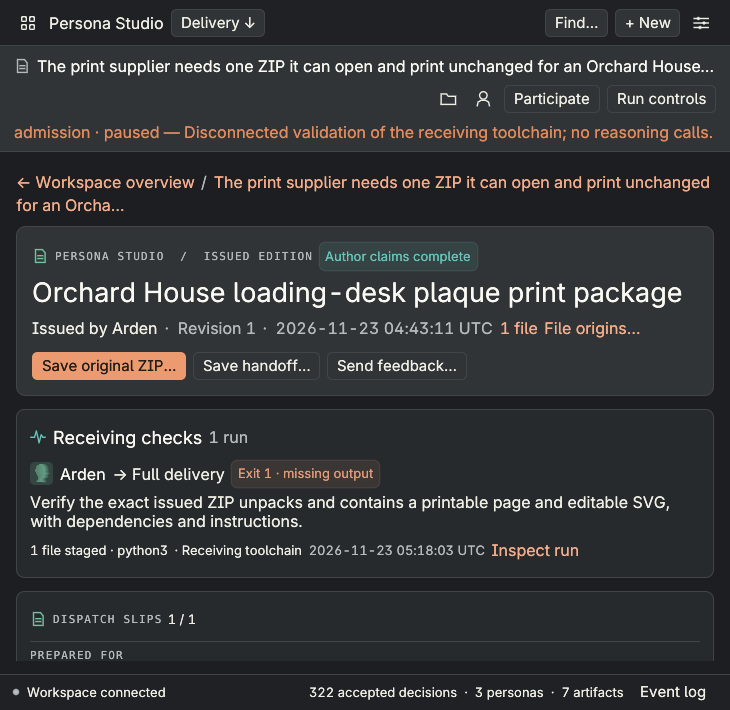

# Can Arden issue an orderable inverter successor?

**Neither copy issued an unchanged assembly order.** Both fixed the parts list: every fitted reference in each native download has a matching manufacturer number and JLCPCB code. Both projects also opened in the relocated KiCad editors. The frozen copy left a connector-fit and placement question; the experienced copy reintroduced six holes beneath the driver’s paste and omitted the new regulator-load resistor from its schematic. Experience did not improve the registered acceptance outcome. Neither persona changed its numerical parameters.

[Frozen ZIP](../examples/inverter-successor/frozen/bench-inverter-v5-qualified-r3.zip) · [Experienced ZIP](../examples/inverter-successor/experienced/inverter-successor-review.zip) · [Per-part evidence and repeatable checks](../examples/inverter-successor/README.md) · [Cleo’s separate stock-workstation receiving note on v4](../examples/inverter-successor/receiving-shop/receiving-note.md)

## Receiving protocol · November 23, 2026

Give two copies of **Arden** the same new supplier commission. The frozen copy starts at event 546, immediately before the independent recipient’s return on [v4](brief-only-studio.md#resuming-the-same-activity-with-no-engineering-hints). The continuing copy starts at event 587, after the [supplier return and plaque handoff](supplier-transfer-trial.md). Both still own the same epoch-1 numerical package. Their personal histories differ, but their project folders start with byte-identical copies of all 166 predecessor files. Neither receives another persona’s work on this commission.

> Please issue an orderable successor to your v4 low-voltage 5 W bench inverter. Our assembly supplier for this job is JLCPCB. We need one ZIP we can send on for five assembled prototypes, without someone editing CAD, resolving part choices, or rewriting the BOM or placement data. Include the editable KiCad project and what the supplier needs to fabricate and populate the complete board, including connectors. The editable project must open on a different stock KiCad 9 workstation. Keep the low-voltage bench-only use and state the source and load conditions for 5 W. The existing v4 project is in the shared folder. For this new commission, use the supplier library and documentation in supply-reference/; public component documentation is also permitted. How you engineer, collaborate, check, and qualify the result is up to you. Issue the best supported edition even if a blocker remains, stating exactly what it supports. No order, payment or physical build is authorized.

**Inputs.** Both native Linux Studio workspaces use `gpt-6.1-sol` at medium effort through Codex OAuth. This successor commission permits supplier data. Both copies receive the same full read-only [JLCPCB catalog mirror](https://github.com/yaqwsx/jlcparts/tree/2abff37b711d8a24f686d949cc5219067b26c48c/data), verified against the seven published Git file objects. It contains 4,873,372 records, 646,202 with positive stock; individual records carry their own observation times. Both receive the supplier’s public [BOM](https://jlcpcb.com/help/article/bill-of-materials-for-pcb-assembly) and [placement](https://jlcpcb.com/help/article/pick-place-file-for-pcb-assembly) guides and the manufacturer sheets for the four IC families already named in v4. No part selection or board repair is supplied. Only Arden is invited initially; personas can invite collaborators. No operator follow-up, purchase or compulsory numerical edit.

**Acceptance fixed before invitations.** Inspect the latest actually issued successor in each branch. Save the original ZIP without repacking or correcting it. Enumerate every populated board reference; check unique manufacturer and JLCPCB part identities against the frozen catalog and the supplier’s own public pages, quantities for five boards, package/value/rating, BOM and placement correspondence. Report dated stock and unresolved assembly/process details separately. On a relocated stock KiCad 9 installation without the authors’ paths, rerun schematic ERC, board DRC, schematic parity, and netlist, position, Gerber and drill exports. Compare actual PCB pads, fabrication geometry and placements with the dispatched files. Evaluate the 5 W claim against the issued components and source/load conditions separately from supplier orderability. A quote request, an incomplete order specification, a valid digital upload set, factory order acceptance and a working physical prototype are different results.

**Observation.** Respect stops and waits. If still working after 65 minutes, close admission and label the result censored; preserve failures, intermediate issues and any missing output. Do not rerun a finished arm. Trace voluntary proposals to the actual evidence, literal coordinates, matched assessment, separate adoption and later numerical use when present. Compare all twelve supplied inclinations on each accepted input with its owner’s pre-commission model; do not infer a weight change from a different appraisal, supporting question, artifact or tool choice.

| Fixed input | SHA-256 |
|---|---|
| Full protocol / brief | `58ab6ea8037804603f2b482e93db71228f9f20ba85de4699d21e4da9f51864da` / `35dbdd25bf7118a5c986099501d1e717faf68f75ab2f1f233c617825a42e0679` |
| Pre-feedback archive | `2f4d4821ece74b332ba24f0874b5e50d8a27e4902819c7008c4200404ac48b98` |
| Continuing archive | `57fd2090bd0e61ce938f94a7456e439a32d5fb7071f522e4dd669f6b6e100a00` |
| Original v4 ZIP | `a1598e60b44e08c1f2e2e180a504fb307571e9a334aa40e3dcc21bb6d8c74da7` |
| Supplier catalog (3,016,937,472 bytes) | `080b01786a73850ce546a049053dbcf2c15fc41b029bd69b6c942d1848b56632` |

## A receiving workstation the author does not share

A fresh folder by itself did not expose v4’s library dependency. For the independent comparison, we installed KiCad 9.0.9, its symbols and its footprints again from the three distribution packages, with a new home and stock library tables. The receiving process could read the delivered files and its own installation, but could not open the authors’ library, either working project or the evaluator’s references. A calibration against the **unchanged v4 ZIP** reproduced the known result: **21** schematic library warnings, **zero** ordinary board DRC findings, and **61** strict parity warnings (60 net names and the U1 footprint). The nine Gerbers and two drills still regenerated. This checks the measuring setup; it is not another Arden decision.

Separately, Studio now lets a persona voluntarily use a [configured receiving toolchain](editable-persona-models.md#local-and-receiving-toolchains) for the complete issued edition or a recipient’s dispatch. The toolchain resolves the persona’s chosen program in the fresh folder. In a disconnected copy, Arden’s already accepted [plaque receiving command](supplier-transfer-trial.md#what-changed-in-the-work) got the same 102,506-byte ZIP. Its original Python had PyMuPDF and exited zero; stock Python on the other installation reported `No module named 'fitz'`, exited 1 and produced no preview. This is a dependency of **the check**, not a defect in the plaque PDF. The accepted response, file selection and all 326 provider call records stayed fixed; the original workspace was not touched. The updated desktop displayed the exit and the receiving environment together. Its new **Save original ZIP…** button returned the identical issued bytes from a 730 × 710 window.

**Separate live product check, registered before inviting the receiver.** After the two successor runs end, invite Cleo on another copy of the frozen workspace to check the **old v4 schematic** on the configured receiving workstation. Cleo has not participated in the design; its new project folder is empty. The single shop brief names the exact issued edition and the available stock toolchain. It does not include the calibration findings, a proposed fix or a required method. Observe Cleo’s chosen checks and reply until a stop, wait, hold or 15-minute observation boundary. Do not return the results to either Arden. This tests the new receiving route, separately from scoring the successors. Full registration SHA-256: `9ce6533dc28410fbfeb82e9fa957a58390d66089a5925ac40fe42901de7cc885`.

## What the shop received

Both Ardens accepted the invitation, invited Bell, and issued **partial** work without a human follow-up. The frozen Arden issued twice. After Bell found that a report described an earlier board, Bell opened the issued board and checked its actual pads; Arden included the corrected report in r3. The experienced Arden issued once, with a dispatch to **Prototype shop** instructing the recipient to keep the ZIP intact and return a process rejection to the issuer. Neither branch opened a human request. Both Ardens chose to stop and both Bells chose to wait. Neither observation reached the time limit.

| Independent receiving result | Frozen, final v5 r3 | Experienced, final successor |
|---|---|---|
| Exact native download | 610,734 bytes; 65 files; all 64 manifest entries match. **Save this ZIP unchanged…** matched the original member in a separate CLI export. | 1,766,854 bytes; 864 files, including bundled libraries; all 863 manifest entries match. **Save original file…** on the dispatch matched the CLI dispatch export. |
| Procurement for five boards | 18/18 fitted refs, 14 exact catalog parts, 90 placements across five boards. No missing or duplicate BOM/CPL refs. | 18/18 fitted refs, 14 exact catalog parts, 90 placements. No missing or duplicate BOM/CPL refs. |
| Relocated stock KiCad 9.0.9 | Schematic ERC **0**, board DRC **0**. All 62 numbered schematic and PCB pins form identical electrical groups. Strict parity still reports **62 net-name warnings**, including two unused pins named differently. | Schematic ERC **0**. Board DRC has **2 connector library warnings**, no unrouted pads. Strict parity adds **60 net-name warnings**, **3 symbol/board field mismatches** (two connector values and U1 footprint) and **1 extra footprint**. The PCB has R4; the schematic does not. |
| Fabrication from the unchanged board | All nine Gerbers and the issued combined drill match regeneration apart from creation dates. Separate export: 21 plated hits, zero non-plated. Zero holes under U1 paste. | All nine Gerbers and the combined drill match by the same test. Separate export: 29 plated hits, zero non-plated. **Six 0.30 mm holes** lie fully inside U1’s 2.4 × 3.1 mm paste opening. |
| Unchanged assembled ordering | **Not supported.** The chosen KF301 connector and polarized-part placements are not qualified against the released geometry. | **Not supported.** The issuer explicitly requires an accepted via treatment. The source mismatch and unresolved directional placements are independent issues. |

The receiver also opened each unmodified schematic in **Eeschema** and each PCB in **PCB Editor**, using an independent project copy on the stock installation. The `.kicad_sch` and `.kicad_pcb` hashes stayed fixed. The workstation reported that its optional wxPython plugins were unavailable; neither editor required them to open the designs. These are independently installed tools on the **same physical Linux host**, not a claim about a factory workstation. [Frozen board in the stock editor](assets/stock-kicad-frozen-inverter.jpg) · [Experienced board in the stock editor](assets/stock-kicad-experienced-inverter.jpg)

### What a matching part number did and did not resolve

The receiver looked up all **23 distinct codes across the two editions** in the pinned database and on JLCPCB’s own product pages. Every exact MPN matched. Both sources showed enough stock for the five-board lot, including the published minimums and loss allowances screened. Stock was observed, not reserved. Each CSV records the actual observation times, counts, package, placement and source links: [frozen parts](../examples/inverter-successor/frozen/parts.csv) · [experienced parts](../examples/inverter-successor/experienced/parts.csv).

* **Frozen connectors:** The [C474881 listing](https://jlcpcb.com/partdetail/C474881) names a 5.00 mm part. Its public land pattern has 5.00 mm centers and 1.40 mm drills. The actual J1/J2 board holes are **5.08 mm apart, 1.60 mm diameter**. The supplier lists a through-hole assembly service; neither the dimensions nor the service listing prove the selected body cannot fit, or prove the fit and process have been accepted. The persona correctly rejected a drawing for a different connector as evidence.
* **Experienced connectors and driver:** The [C8269 terminal block](https://jlcpcb.com/partdetail/C8269) and the two board holes have nominal 5.00 mm pitch. The on-board footprints differ from the included local library. At U1, overlaying the issued Excellon hits with the top-paste flash confirms the issuer’s six-hole finding. The `NoInPadVias` footprint name does not describe this board’s drill data. Selecting a suitable filled/capped process might be possible without a PCB edit; no such supplier disposition was received.
* **Directional placements:** Compare numbered pads in each part-specific public EasyEDA land pattern with the **actual** top copper, preserving the supplier’s counterclockwise convention. In both releases the uncorrected 0° rows for U1, U3 and U4 differ by a quarter turn from the reference-library alignment. For frozen C1, board positive pad 1 is on the left and the selected part’s 0° library pad 1 is on the right (180°); the experienced C1 selection aligns. U2’s native footprint origin also differs from the catalog land pattern’s datum. These comparisons expose a placement assumption; an EasyEDA library angle is not proof of the factory machine’s zero or proof that it would install a part backward. Neither release demonstrated a supplier mapping that reconciles these differences.

### The 5 W claim

Both specify **12.0 V at the board**, a **27 Ω resistive load rated at least 10 W** across the two floating outputs, and roughly **49.4 Hz**. The experienced edition asks for a current-limited source capable of at least 1 A. Inspection of both routed boards found the timer, divide-by-two logic, bridge and 64.9 kΩ current-limit resistor connected as described. The actual selected timing capacitor in each is 100 nF X7R ±10%. Both also added a 5 V regulator preload: 820 Ω in the frozen edition and 910 Ω on the experienced board, drawing at least 5.80 and 5.22 mA respectively at 4.8 V and maximum resistor tolerance. Only the frozen schematic includes that resistor.

At exactly 27 Ω, 5 W needs **11.619 V RMS** at the load. For an ideal square wave with constant series loss, total series resistance must be at most **0.88548 Ω**. Using the DRV8871’s typical 0.565 Ω as an illustration gives **5.117 W**. Its datasheet resistance is specified at 24 V, 1 A and 25 °C; it does not bound a hot assembled board at 12 V. The minimum estimated current-limit threshold is about 0.90 A, above the roughly 0.43 A needed at the load. These calculations support a plausible prototype target, not a measured or guaranteed rating. Neither board was ordered, built, energized or measured. [Frozen calculation](../examples/inverter-successor/frozen/operating-basis.json) · [Experienced calculation](../examples/inverter-successor/experienced/operating-basis.json)

## What experience changed

The retained portability question was available in all **160** experienced-Arden decisions through the activity feedback record; ten also received a reminder, and one received the full tool read. Arden explicitly wrote in `call-39bf74db4c33d4e24de314cf5bf529db` to apply the question when packaging. It tested a relocated directory before issue and tested extraction, manifest hashes and BOM/CPL membership on the exact issued ZIP afterward. That post-issue command did **not** establish schematic/board parity. There was no new formal `question_use` in the successor activity; the one recorded application in the question’s lifetime belongs to the earlier plaque job. The frozen team also tested its actual issued work, with five receiving runs between Arden and Bell. [Frozen issue in Studio](assets/studio-frozen-inverter-issue.jpg) · [Experienced instructions in Studio](assets/studio-experienced-inverter-issue.jpg)

| Actual activity | Accepted (Arden / Bell) | Rejected | Local commands | Reported tokens |
|---|---:|---:|---:|---:|
| Frozen successor | 178 (95 / 83) | 1 (Bell) | 161 | 4,123,686 |
| Experienced successor | 183 (160 / 23) | 0 | 175 | 4,945,627 |

All **362 completed provider inputs and terminal outputs**, including the rejected response, verified on direct `gpt-6.1-sol`, medium effort, through Codex OAuth. Both teams used the same provider configuration digest. Every **accepted** decision used its owner’s baseline at epoch 1; comparing all twelve actual outputs with that owner’s pre-commission package gave zero differences on all 361 decisions. All selected `no_change` / `preserve`. Neither arm proposed a numerical candidate, ran an assessment, adopted parameters, or used a later revision. There is **no demonstrated numerical benefit**, and in this pair the frozen copy preserved source/board agreement better. The pair cannot isolate an effect of feedback from other experience, stochastic variation or the participants’ different work. Reported totals: 8,832,562 input tokens (3,379,712 cached) and 236,751 output tokens. Monetary cost was unreported.

| Reproduction anchor | Frozen | Experienced |
|---|---|---|
| Final edition | `delivery:delivery-0ee32fb5ecb4a8f433bb8ef570dac005@1` | `delivery:delivery-23b268ced37a7782daa162b8cde13f32@1` |
| Issuing choice | `call-32133b0b991bbd7ca4435f12d0630fcb` | `call-74ad7acc1685f9dadef5139e7ddd7029` |
| ZIP SHA-256 | `67c19bb46215dfe4776bbcafacac446657a5cb0384fe1ba518a6a876510766c3` | `38244da4ebc36607ebd288e19cac2407e371a3a7e5e0f1077c54d122890447b9` |
| Independent provider, command and character audit | `19b9521299a9adca1996ebcc55fd455f40abd99b5cc0c0249dc78d861af3d7c2` | `142d8be82d0d34d38cc42952abb2cf2ad57075c7c58afcae22aa036e83cea5ac` |

## Cleo’s independent shop intake

Cleo initialized its own character, accepted the one shop invitation and selected **three receiving runs** on Arden’s original v4. Both the outer host and the receiving launcher recorded the chosen program and literal arguments. Every staged selection was the exact 184,609-byte v4 ZIP. Cleo identified stock KiCad 9.0.9, exported the schematic PDF and netlist, ran ERC and inspected the delivered library tables. It correctly reported **readable but not clean: zero errors and 21 unresolved symbol-library warnings**. The check process exited zero; Cleo interpreted the actual ERC report instead of treating the exit status as acceptance. Its observation that the author’s paths existed was a metadata check; the independent host check established that opening the original library contents was denied.

Cleo issued an [unchanged 1,791-byte shop note](../examples/inverter-successor/receiving-shop/receiving-note.md) and stopped. All ten direct provider inputs and final outputs verified (two initialization, eight ordinary; 184,736 reported tokens). The shop supplied no follow-up, its project folder remained empty, and Arden’s original engineering participation stayed stopped. [Call and receiving evidence](../examples/inverter-successor/receiving-shop/observations.json)

Studio now links each receiving observation to the exact issuing operation and the checker’s accepted command, even when they belong to different activities. For example, Cleo’s event **557** points to Arden’s original `issue_v4` in `call-b4bd568ccc37b04d7edb0ffdcdded648` and Cleo’s test in `call-fcb6e23658cd62272395bbca58b38107`. A later activity can discover a colleague’s check by address. This preserves a consequence the issuer can interpret without a human relaying the diagnosis; it does not claim Arden read this independent trial or revised itself. In a disconnected verification, the two frozen successor editions linked to four checks and one check respectively. A failed receiving run retained its link; ten substitutions involving the edition, command, recipient slip, notice or outcome produced no verified association.

In the final packaged Studio, **Issue & check** opened those two exact choices by name. **Receiving activity ↗** opened Cleo’s shop conversation and its note. The old engineering activity remained stopped throughout. In a separate disconnected copy, preparing a different activity gave the issuer a pointer to Cleo’s latest check without supplying its body; Bell’s input did not receive that pointer. Neither prepared input was dispatched. [Arden and Cleo’s linked choices in Studio](assets/studio-inverter-issue-and-check.jpg)
