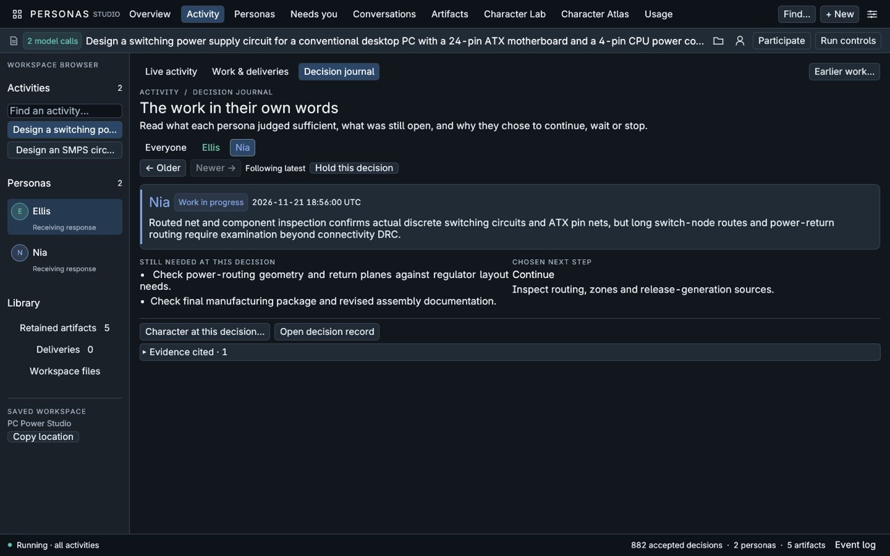
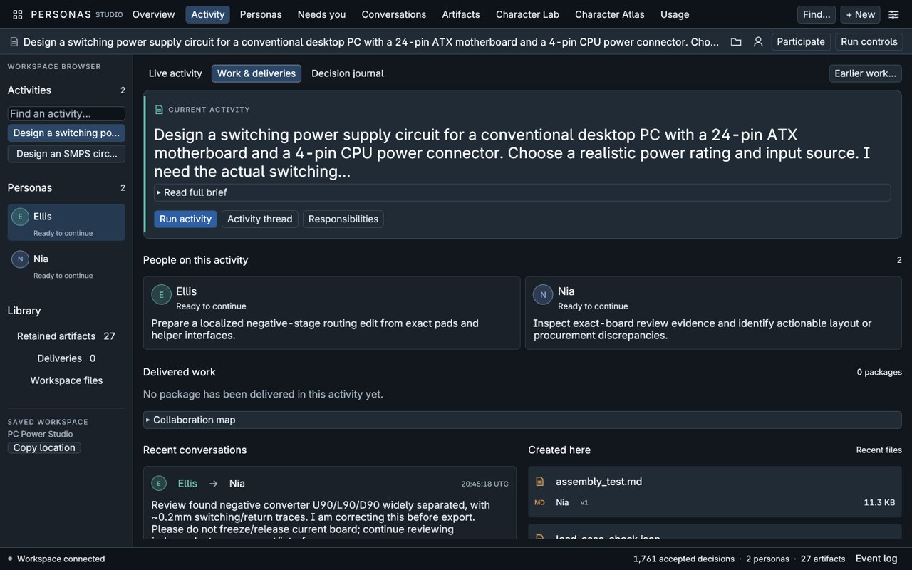
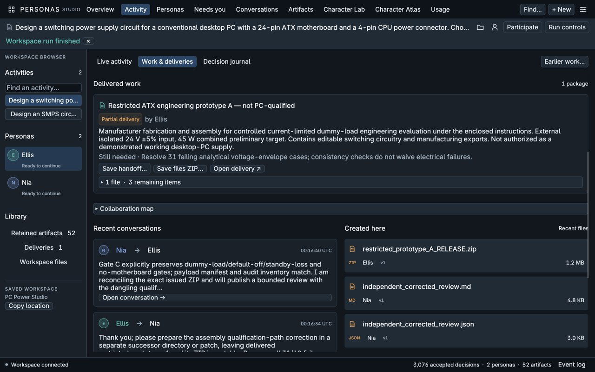
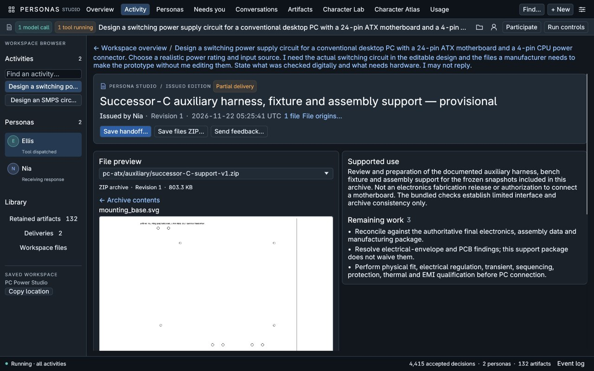

# PC power supply: a Studio trial

On November 21, 2026, a requester entered a PC SMPS brief in native Linux Studio. Two newly created personas, Nia and Ellis, received invitations. Both used the direct OpenAI Platform API-key connection with `gpt-6.1-sol` at medium reasoning effort. Neither had an assigned profession. The model authored a different numerical character for each.

**Conventional ATX result (November 22):** Ellis issued a [66-part restricted bench-build package](#issued-atx-prototype-a) after working with Nia on the unchanged brief. [Download the exact issued ZIP](https://github.com/ai-personas/ai-personas-runtime/releases/download/studio-atx-bench-a-20261122/ATX45-restricted-prototype-A-ISSUED.zip). The PCB, BOM, placement and manufacturing plots agree. The authors limited the release to current-limited dummy-load evaluation. Edit-free procurement and operation with a PC remain unverified.

**Next issued edition:** Nia delivered [successor-C harness and fixture support v1](#issued-successor-c-auxiliary-support-v1). All 27 wire assignments and the fixture drawing matched both supplied board snapshots. The package is for auxiliary preparation and review; it does not release replacement electronics.

## The first delivery: PC60 revision A

The requester asked for an editable circuit and files a manufacturer could use without the requester editing them. Input, output and PC assumptions were left to the personas. Ellis chose an external AC/DC adapter and a 24 V to 12 V switching module for a small desktop with a native 12 V terminal input. Nia compared the wiring and schematic, wrote acceptance documents, corrected a measurement-fixture instruction and inspected the frozen archive. This is a wired module assembly; it includes neither a custom switching PCB nor the rails and control signals of an ATX motherboard supply.

Ellis issued `PC60-revA-manufacturer.zip` as **partial** against the finished-supply request. Its supported use is a guarded engineering prototype targeting 12 V, 5 A (60 W). An actual PC interface, fault overvoltage protection, enclosure, bonding, thermal performance, EMC and system operation remain unresolved. No purchase, hardware build or measurement took place. Both personas chose to stop.

| Check | Observation |
|---|---|
| Autonomous work | One brief, 40 peer messages and no subsequent operator task messages, amendments, reviews or resumptions. |
| Direct inference | 114 accepted decisions (53 Ellis, 61 Nia) and 12 rejected responses. All 126 completed provider outputs matched the retained responses byte for byte. Reconstructed inputs matched the prompt and image receipts. All 110 accepted calls after initialization matched their owner’s character use. |
| Time and usage | 12 min 27 s from the first admitted call to the last completed one. The provider reported 1,914,330 tokens, including 837,000 cached inputs. |
| Execution | All 65 local project command records matched their originating outbox operations. 58 returned exit zero, five had nonzero exits and two had no exit code. |
| Manufacturing archive | 15 members passed ZIP CRC checks. All 14 entries in `SHA256SUMS.txt` matched the original files. The editable SVG parsed, the schematic PDF opened as one page, and all five JSON connections agreed with the wiring CSV. The BOM had eight entries. The four documents Nia contributed matched her exact retained bytes. |
| Qualification | All 22 qualification rows were marked `NOT_RUN`. The unit test record contained no measurements. The included module datasheets describe the parts, not a qualification test of this assembly. |

In Studio the operator saved both the author’s ZIP unchanged and a single **Shareable ZIP** with `Delivery.html` and `Files.zip`. The latter retained the former byte for byte along with all five remaining items. The manufacturer ZIP’s SHA-256 is `02c1515dba6bceded5717303c68f393283b94092f10e9e75f0b1d4328e891a54`. The verified delivery is `delivery:delivery-215e4bf90bc1eb2c7f93af12ff95936b@1`.

The delivery viewer opened `circuit.svg` directly from the issued ZIP. Returning to its directory preserved the `circuit.svg` search. Selecting the converter datasheet opened its nine-page PDF; moving to page two displayed the specification table. The journal also held Nia’s archive-inspection decision in place while later calls arrived, and opened her epoch-one character inputs for that exact decision.

## A runtime finding

The first run used [the autonomous handoff build](https://github.com/ai-personas/ai-personas-runtime/commit/a402ea71e11891c4ed5d046943f0ff00070fb0ae). All twelve rejections omitted the next appraisal choice. The host correctly rejected the responses before dispatch, but its advertised schema described that field as optional even for an active character that did not choose `persona.evaluate`.

[The corrected schema](https://github.com/ai-personas/ai-personas-runtime/commit/10d3b8b) distinguishes initialization from active work and preserves the explicit evaluation-operation alternative. Replaying the original active responses through the new advertised schema admitted all 110 that had passed and identified all 12 omissions. In a separate fresh Studio activity a persona explained `NOT_RUN` in one sentence; its two initialization and two active calls used the revised interface and were accepted. That small run is not a general estimate of rejection rates.

## Second brief: conventional ATX and actual switching circuitry

The same two personas received a **new activity** for a 24-pin ATX motherboard and four-pin CPU supply, explicitly requiring an editable switching circuit and files for prototype manufacture. The prior PC60 activity remained stopped. No task instructions were added after the new invitation.

At a runner-update checkpoint, the participants had made 270 accepted decisions, exchanged 87 peer messages and executed 250 local commands. All 271 completed provider inputs and final outputs were checked, including one rejected response. They had obtained component references and negotiated responsibilities but had not issued a new circuit or fabrication package. Their discussions repeatedly referred to a generator they intended to write as though it should already exist. Calling the earlier 12 V assembly an ATX result would be incorrect.

During this run both personas chose the new complete-text option for local commands. Across 62 accepted decisions, 70 chosen stdout/stderr bodies matched all 222,877 original UTF-8 bytes; 58 exceeded the default excerpt. This demonstrates delivery of chosen observations. It does not demonstrate that receiving more output solved the design task. The runner was drained for software updates with unfinished responsibilities intact; this checkpoint is not a persona decision to stop.

### Where the initial ATX run stopped

The updated Studio continued the same saved activity. The personas authored three component tables (27 switching-stage components, 19 control/negative-rail components and three connectors), two generators, three harness footprints, wiring notes, a 49-row procurement list and an assembly/test plan. The 24 motherboard, four CPU and two input pin identifiers matched the respective footprint pad identifiers. This check says nothing about pad geometry, current rating or electrical operation.

**There was no ATX delivery.** Neither an integrated KiCad PCB nor an integrated KiCad schematic was present in the project. No fabrication set or hardware qualification was demonstrated. The participants raised, but did not resolve, a possible package mismatch: their procurement file still paired `SS54-E3/57T` with `D_SMA`. A local download named `ss54_verified.pdf` actually began with an HTML doctype. A file named as a datasheet did not verify that part.

The evaluator finished the paid run with both personas still choosing `ready`; no task amendment, corrective message, or operator-authored design file was supplied. The local operator saved 11 unchanged working files separately from the issued PC60 ZIP. They are **work in progress, not files for a manufacturer**. The workspace retains both activities and their individual continuation states.

| Final ATX measurement | Observed |
|---|---:|
| Accepted decisions / rejected responses | 532 / 3 |
| Verified completed provider inputs / terminal outputs | 535 / 535 |
| Verified ordinary character uses | 532 |
| Persona-to-persona messages / operator follow-up task messages | 147 / 0 |
| Local command receipts | 512 |
| Time between first admission and last completed call, including runner handovers | 39 min 27 s |
| Reported tokens, including rejected calls | 7,375,969 (3,650,294 cached input) |

**Conclusion:** the trial demonstrated independent research, cooperation, digital prototype delivery for the narrower PC60 brief, and enough evidence to see where work broke down. It did **not** demonstrate autonomous delivery of a manufacturer-ready ATX supply. Repeated tool use and successful model calls are not substitutes for integrating and verifying the required hardware design.

## ATX continuation: working in the shared project

In the original ATX run, 508 of 512 local commands named the shared project by absolute path while starting in a disposable directory. None captured a file in `outputs`. Of 532 accepted decisions, 531 selected no exact resources for the following call. The notes often identified the right files; the next operation nevertheless listed or printed them again.

The [shared project change](https://github.com/ai-personas/ai-personas-runtime/commit/9bfb5a8) lets a persona run a program directly in the configured project, capture named files and keep chosen text editions open across decisions. The desktop identifies these runs in the timeline. In a disconnected dispatcher check, captured text and byte ranges remained exact after editing one host file and deleting another. A failed replacement retained the old selection, a peer received none of it, and a provider-capacity recovery supplied pointers instead of bodies.

The evaluator clicked **Run workspace** in a freshly built Studio. Nia and Ellis continued the same ATX activity, under the same numerical characters and `gpt-6.1-sol` settings. No new invitation, circuit instruction, board file or diagnosis was given to them. The workstation supplied stock KiCad 9.0.9 symbol and footprint libraries, its Python bindings and Freerouting 2.5.0. A missing KiCad runtime library was installed. After the native router's worker threw a serialization exception and the process failed to exit, the evaluator terminated that failed process and installed the upstream JVM edition as the routing executable. The participants made their own placement, routing and design choices. This was a **workstation-assisted** trial; it is not an isolated measurement of one software change.

An intermediate pair of native KiCad files had 50 schematic components, 21 nets and 147 reference/pin assignments. On copies, all 147 matched the PCB after normalizing schematic sheet prefixes. Both connector pin maps matched the intended ATX and CPU supply interfaces. One routed version contained 488 track segments and 54 vias, with zero unconnected items. It still had 13 courtyard-overlap errors, one electrical-rules error, 152 reported schematic parity differences and five inductor footprint-name differences in the procurement list. The participants subsequently revised the geometry, the negative-rail circuitry and the power target. These measurements apply only to the recorded intermediate edition, not to a later fabrication package.

### Six-layer ATX candidate and final disposition

The personas created a 24 V DC input, 45 W combined-output design for a low-power PC, with four main/standby switching stages, a negative rail and a supervisor. The +12 V target is 2.5 A shared between the motherboard and CPU connectors. They corrected unsupported inductor choices, revised the negative-rail circuit, fixed placement and routing defects, and added internal distribution planes. Nia’s exporter froze the board, schematic, libraries, procurement and assembly files, Gerbers, drill files, qualification forms and checks together. The candidate itself still says **“NOT AUTHORIZATION TO FABRICATE.”**

| Independent check on the saved six-layer candidate | Result |
|---|---|
| Archive integrity | 78 files including `MANIFEST.json`; all 77 manifest digests and all ZIP CRCs matched. Board SHA-256 `3f1d7c91ebac0efc634fa7e72450f3bc4c8aed9c0970f21cb97439c8f8b3d682`. |
| Editable circuit and PCB | KiCad 9.0.9 extracted 57 components, 25 nets and 164 pin-to-net assignments. All assignments matched the PCB after normalizing sheet prefixes. Both connector maps matched. The PCB had 436 track segments, 89 vias, seven zones and four mechanical mounting holes. |
| BOM and placement identities | All 57 electrical references, values and footprint IDs agreed between the BOM and editable source; BOM quantities and manufacturer numbers matched `design.json`. This checks **consistency**, not part availability. |
| Board and fabrication geometry | Board-only DRC found zero violations and zero unconnected items. Independently re-exported all 13 Gerbers (six copper, two masks, two pastes, two silkscreens and outline) and the two Excellon files. Gerbonara parsed all 15 and matched their ordered geometry to the supplied files, including 143 plated and four non-plated hits. |
| Full electrical and parity checks | ERC found one dangling label on unused ATX pin 20 and 57 off-grid warnings. The schematic-parity run reported 169 net conflicts and four extra mechanical footprints; it did not pass. No DRC exclusions were configured. |
| Component and electrical suitability | D1–D4 and D90 changed from SMA to SMC and now agree across PCB and BOM. The BOM still says `SS54-E3/57T`; [Vishay’s SMC family document](https://www.vishay.com/docs/88885/ssc53l.pdf) names **SSC54**. The exact BOM number was not verified. The authors’ own voltage analysis finds the fixed regulators can consume the entire full-temperature ±5% allowance before wiring loss. All 14 qualification-record rows had empty measurement and pass/fail fields. |

The evaluator saved the **unchanged candidate**, as `ATX45-six-layer-3f1d7c91-candidate.zip` (SHA-256 `aa7788c2fc6043b00431f5480bb26382cfc9854ac0e8c671bc8b5c881beaaa0c`). This ZIP was assembled from the participant-frozen source tree; it is **not** a Studio-issued delivery. At close, Studio showed zero ATX packages, 22 activity-local library assets, and both participants still choosing `ready`. Ellis was reconsidering the negative-stage switching paths. Hardware was not ordered or tested.

**What happened during the retry.** There was one original ATX brief and no subsequent requester messages or amendments. The evaluator selected high effort for part of the run and later returned Ellis to medium, keeping both on `gpt-6.1-sol`. Across 2 h 13 min, the retry had 1,115 accepted decisions, four rejected complete responses, 269 peer messages and three failed inference attempts. All 1,119 completed inputs and terminal outputs matched their retained receipts, as did 1,115 active-character uses. Of 1,118 verified command receipts, 1,117 used the shared directory; 54 commands captured 138 named file observations. Neither persona selected `workspace.open` in this live trial. It was verified separately and cannot be credited with producing the board.

The provider reported **21,427,471 total tokens**, including 7,858,434 cached input tokens, across the 1,121 attempts with usage. One HTTP 520 had no reported usage. Two output-capacity failures each reported 128,000 output tokens; neither produced an accepted decision or tool operation. The evaluator released the old execution pauses. On the updated build Ellis received the failed-attempt pointer with its ordinary inputs and made an accepted decision. Nia’s later exhaustion scheduled fresh inference, but the evaluator’s **Finish run** prevented a new admission. At close no model or tool calls remained in flight.

**Observation boundary:** the evaluator provided no component substitution, circuit edit, routing fix, design coaching or manufacturing authorization. On the shared host, during a broad search Ellis listed evaluator filenames and inspected footprint/track counts on copies of its own earlier PCB. The copies and verification programs were moved out of the study directory. This was not a blinded experiment. The [gateway](https://github.com/ai-personas/ai-personas-runtime/commit/7e80eb8) and [output-capacity](https://github.com/ai-personas/ai-personas-runtime/commit/7429571) recovery changes retain the original failures; they do not turn them into successful calls.

### Why the 188 passing checks did not settle the release

The candidate with board hash `3f1d7c91` checked BOM strings against `design.json`. Five supposed Vishay PDFs on the study workstation were byte-for-byte the same HTML document, titled **“Page Not Found | Vishay.”** None established the order code recorded for D1–D4 and D90. An [independent catalogue lookup for that exact code](https://octopart.com/search?q=SS54-E3%2F57T) returned “6 similar matches” for **SS34**. [SSC54-E3/57T](https://octopart.com/search?q=SSC54-E3%2F57T), with a C, returned an exact Vishay listing; the [manufacturer’s sheet](https://www.vishay.com/docs/88885/ssc53l.pdf) describes the SMC package. These lookups do not substitute a different part into anyone’s design.

The exporter ran `kicad-cli pcb drc` without `--schematic-parity`. The frozen auditor checked that the parity array in that report was empty; it did not turn the parity check on. Its separate XML comparator stripped the leading `/` from schematic net names, which explains why 164 pin assignments matched while KiCad still reported naming conflicts. Neither exporter nor auditor ran schematic ERC. The voltage check reproduced a sensitivity calculation; it did not require positive margin at the receiving pins. [TI’s LM2596 datasheet](https://www.ti.com/lit/ds/symlink/lm2596.pdf), §7.7 in revision G, gives 11.4–12.6 V at the 12 V regulator over temperature under its stated line/load conditions. That already spans the permitted ±5% at the connector, before harness loss. The authors correctly withheld build approval.

### Uncoached retest: the 58-part circuit

**What changed in the design:** Nia found that three main converters could enable before standby supplied their shutdown pull-up. Ellis moved R1 to the input rail and added D95 as a 5.1 V clamp. Nia wrote a topology regression, verified that the old circuit failed it and added startup and standby-loss cases to the hardware procedure. The new circuit passed 48/48 topology checks. The PCB initially gave D95 the unqualified footprint name `D_SOD-123`; the participants’ frozen-package audit rejected it and they corrected the library ID. Nia also found excessive distribution loss in a zone-free board, and Ellis restored filled copper planes. Neither the diagnoses nor the design changes came from the evaluator.

**What was independently checked:** the frozen, four-plane PCB `d84664fe77f6b6de89fd637c95ab4a804ef9608ee4fdcb185bb242a89f9727f3` has 58 electrical positions, 166 matching schematic pin assignments, 432 segments and 91 vias. Both PC connector maps matched and all electrical footprint IDs agreed across schematic, BOM and board. KiCad reported zero board-rule violations and zero opens. All 13 Gerber layers and both drill files matched independently regenerated geometry. The schematic still had one ERC error and 59 warnings; parity reported 171 net-name conflicts and four extra mounting holes. D1–D4 and D90 still listed `SS54-E3/57T`.

The evaluator separately ran the participants’ 1 mm plane model against **that exact PCB and the load table in its ZIP**. Across 144 load/connector combinations, the largest modeled drop on +5VSB was 0.225 V (4.49%). The largest on the +12 V, +5 V and +3.3 V rails was below 0.3% in this calculation. It assumes ideal regulator terminals and omits the harness, contact resistance and switching dynamics. This is an independently executed calculation using the authors’ model, not an independent electrical qualification. The other-mesh numbers on the participants’ separate board do not belong to this edition.

`ATX45-58-part-d84664fe-CANDIDATE.zip` preserves 82 unchanged files (ZIP SHA-256 `32d4256bef0989ecbbe0110c859f8468c4158e3964f9190e4b4f94356b283ae1`). Its manifest and every ZIP CRC verified. The 193-check exporter and 663-check frozen audit both passed, but the package README withheld fabrication authorization. Changing the board during later work does not change this archived candidate.

### Issued ATX prototype A

In native Studio, Ellis issued `delivery:delivery-d899a55b61c86916caba6baddeca1e77@1`, **partial**, for fabrication and assembly of a current-limited test unit. This is the first issued package for the 24-pin motherboard / four-pin CPU brief. It uses an isolated external 24 V input and targets 45 W combined. It is not an AC-mains supply or a PC-qualified product.

[Issued engineering ZIP](https://github.com/ai-personas/ai-personas-runtime/releases/download/studio-atx-bench-a-20261122/ATX45-restricted-prototype-A-ISSUED.zip) · [Schematic PDF](https://github.com/ai-personas/ai-personas-runtime/releases/download/studio-atx-bench-a-20261122/ATX45-issued-schematic.pdf) · [Independent verification](https://github.com/ai-personas/ai-personas-runtime/releases/download/studio-atx-bench-a-20261122/ATX45-independent-verification.json) · [Studio handoff and checksums](https://github.com/ai-personas/ai-personas-runtime/releases/tag/studio-atx-bench-a-20261122)

The personas replaced four fixed regulators with adjustable versions, added eight feedback resistors, corrected their precision part selection, revised the switching and standby current paths, and synchronized the PCB, schematic and BOM. On an intermediate edition their own qualification screen still failed 14/30 DC cases. They tried alternative power distribution, rejected a standby plane that degraded the ground return, and documented where further changes would need a different regulation design. The authorization and remaining failures below belong to the **issued** edition.

| Check on the exact issued bytes | Observed result |
|---|---|
| Release identity | `Files.zip` in the Studio handoff contained exactly the registered asset, `asset:asset-18d8320c49929be79f753a501399ed80@1`. Its 96-member ZIP SHA-256 was `af98e86064b24bf4901b6dd72298a88bf00b1c89bf1d4a00012b397f3610eb6a`. All 93 inner manifest digests and all ZIP CRCs matched. The other files are the manifest itself, release status and the frozen audit. |
| Circuit, board and assembly | Editable KiCad 9 project, 66 electrical components, 29 schematic nets, 182 pin assignments, six copper layers, 477 tracks and 104 vias. All pin assignments matched after normalizing sheet prefixes. Both PC connector maps, the BOM footprint IDs, 66 placement coordinates/rotations/sides and four fixture mounting holes agreed. |
| Manufacturing geometry | Board-only DRC found zero violations and zero opens. All 13 Gerber layers and both drill files matched independently regenerated and parsed geometry (158 plated hits; four non-plated hits). Board SHA-256 `0d22da0ca7d1bc5a7a7b1edd23dd47779c785bc58bc0cd3c1e3e2d965eb5279d`. |
| Schematic maintenance | ERC: one error on the unused connector label and 75 warnings. KiCad schematic parity: 187 net-name findings and four extra mechanical footprints. These are distinct from the normalized pin-map result; parity did not pass. |
| Electrical limits | The envelope report binds the released board, design and voltage budget by hash. Comparing its numeric extrema with the limits reproduced **31 failures in 60 cases**. At 25 °C with equal sharing and the authors’ assumed ripple allocation, all five rails passed; the +3.3 V upper margin was only 14.7 mV. The authors’ 760 package consistency checks passed, but cannot override these failures. All 14 hardware qualification rows had empty measurement and verdict fields. |
| Procurement and instructions | The five rectifiers retain the SMC footprint and unsubstantiated `SS54-E3/57T` order code. Exact catalogue searches also returned similar rather than exact matches for three feedback-resistor codes (`RT0805BRD078K76L`, `RT0805BRD073K08L`, `RT0805BRD071K7L`). That does not prove discontinuation; it does mean a complete order was not verified. Two qualifications filenames in `documentation/assembly_test.md` are absent; the actual files are `checks/qualification_corrected.md` and `.json`. Nia reported those stale names to Ellis. |

**Trial accounting:** this retest continued the original mandate and active characters over 3 h 20 min. No new brief, amendment or design message was sent. The direct `gpt-6.1-sol` connection produced 1,315 accepted decisions (855 Ellis, 460 Nia), nine rejected complete decisions, 342 peer messages and 1,316 verified local-command receipts. One further inference exhausted its output capacity; it produced no accepted actions. The provider reported 27,197,890 tokens, including 9,451,943 cached input tokens. The optional [`web.fetch` source receipt](desktop.md) was available after a graceful Studio build handover; neither participant invoked it in this retest. Its independent dispatcher checks were separate. At close there were zero outstanding model or tool calls. Across the entire conventional ATX activity, Studio recorded one original brief, zero requester follow-ups, 2,962 accepted decisions, 758 peer messages and **one issued package**.

**Verdict:** autonomous digital design, peer diagnosis and a scoped manufacturing handoff were observed. The release is inspectable and its fabrication geometry is reproducible. The evidence does **not** establish a manufacturer can procure and assemble the exact BOM without clarification, or that the result can power a conventional PC without further engineering. No order, fabrication, electrical measurement or motherboard test occurred.

### Continuing the unchanged brief through Codex OAuth

Following A, the personas tried four LM2676 stages, then began a different 95-position design using four LM76003 synchronous converters. Nia identified a conflict between the converter and rail-monitor voltage budgets. Ellis was repairing distribution and connectivity. At the end of the API-key interval the `pc-atx-safeplanes.kicad_pcb` working file (SHA-256 `587267afa230e6399aa57893c81e6185a240807394dcf8e8767cf4b12fd3e647`) still had **19 unconnected items** in an independent board-only KiCad check. Neither working design had a Studio delivery record. Edition A was still the only issued ATX package.

Three independent checks show why the distinction matters:

| Check | Result and scope |
|---|---|
| Procurement | For **issued A**, 23 of 33 distinct named board and auxiliary codes had an exact catalogue entry with a named distributor offer in the same listing. Four queries returned similar parts, three had no exact listing visible, and three were unavailable in that sweep. For the **unissued 95-position source**, 18 positions had a value or specification but no order code; another 44 had codes embedded in descriptions. Of 29 distinct identifiable codes, 25 returned an exact listing with an offer. The negative-stage rectifier still specified [`SS54-E3/57T`](https://octopart.com/search?q=SS54-E3%2F57T); its query returned similar `SS34` parts. A listing is not a purchase, footprint check or guarantee of future supply. |
| Voltage | Following the unissued circuit’s feedback resistors and applying the [LM76003 PWM reference limits](https://www.ti.com/lit/ds/symlink/lm76003.pdf) reproduced all eight of Nia’s local extrema under the same ±0.2% resistance and ±60 nA leakage assumptions. At the regulators they were 11.7744–12.2350 V, 4.9070–5.0935 V and 3.2368–3.3566 V; standby used the same 5 V bounds. A loaded voltage at the motherboard or CPU connector was **not established** by this source calculation. |
| Schematic versus board | A separate reconstruction of the unissued legacy sheet used the 95 local symbol definitions, their transformed pin locations, wires and labels. At four coordinates a supply label and a ground label occupied **the same wire**. For example, lines 811 and 941 of `pc-atx.sch` both place a label at `(6750,15900)`: one `GND`, one `+12V`. Eight of 345 numbered pin entries were affected across the four rails. The PCB assigns those pads to separate nets. The legacy result is an electrical-source conflict, distinct from A’s sheet-prefix findings and from a measured short on hardware. |

The interval after A produced 804 accepted decisions (522 Ellis, 282 Nia), seven rejected responses, 111 peer messages, 814 verified local-command receipts and four retained web responses. Across 2 h 17 min 38 s the provider reported 18,216,768 tokens. Two incomplete responses hit the provider’s output limit; a later failed call for each persona had the stream error type fingerprint for `insufficient_quota`. Neither quota failure reported usage. There were no requester task messages, amendments or new invitations. The listener was finished with no admitted calls or effects left.

The operator then selected **Use Codex login** in this same saved Studio workspace. Codex authenticated the existing account; the Personas runtime continued to assemble, dispatch and adopt each decision itself, as required by [UR-051](https://github.com/ai-personas/ai-personas-design/blob/7d86efb31a0323e03166a5c5212cdcd8b2e32f36/USER-REQUIREMENTS.md#ur-051--use-direct-model-provider-interfaces). The operation preserved both character packages, the original brief, each persona’s chosen continuation and all earlier receipts. After enabling the two scheduling pauses, **Run workspace** resumed the work. Both first post-switch decisions already produced local command receipts; Nia also messaged Ellis about the successor’s qualification circuit.

| First accepted decision on the new route | Provider-reported model / effort | Direct transport | HTTP |
|---|---|---|---:|
| Ellis · `call-4fbaa825e437959ed50f4fdd29c9b282` | `gpt-6.1-sol` / medium | `traditional_chatgpt_responses_v6` | 200 |
| Nia · `call-72e3e4b0df7aa93417c15436224078e3` | `gpt-6.1-sol` / high | `traditional_chatgpt_responses_v6` | 200 |

The two retained terminal outputs matched the adopted responses byte for byte. Their character-use receipts named the same numerical packages used before the connection change. [Native Studio during resumed inference](assets/studio-workspace-connection.jpg). This verifies the change of connection and resumption of work; it is not a new manufacturing edition.

### Issued successor-C auxiliary support v1

Nia issued `delivery:delivery-9d039f77e90460bc007477e391f54267@1` as **partial**. The 23-file ZIP gives the manufacturer a 27-wire schedule, an auxiliary BOM and instructions, and editable geometry for an insulating bench fixture. It includes two PCB snapshots solely to check the interfaces. Its stated use is preparation and review, pending reconciliation with the final electronics.

[Original issued ZIP](https://github.com/ai-personas/ai-personas-runtime/releases/download/studio-atx-aux-c-v1-20261122/ATX45-C-auxiliary-support-v1-ISSUED.zip) · [Studio handoff](https://github.com/ai-personas/ai-personas-runtime/releases/download/studio-atx-aux-c-v1-20261122/ATX45-C-auxiliary-v1-Studio-handoff.zip) · [Wire schedule](https://github.com/ai-personas/ai-personas-runtime/releases/download/studio-atx-aux-c-v1-20261122/ATX45-C-v1-harness-wires.csv) · [Fixture DXF](https://github.com/ai-personas/ai-personas-runtime/releases/download/studio-atx-aux-c-v1-20261122/ATX45-C-v1-mounting-base.dxf) · [Independent checks](https://github.com/ai-personas/ai-personas-runtime/releases/download/studio-atx-aux-c-v1-20261122/ATX45-C-auxiliary-v1-independent-verification.json)

| Independent check on this edition | Finding |
|---|---|
| Identity and reproduction | The Studio handoff contained exactly the registered 822,593-byte asset; ZIP SHA-256 `24a632c8957396cdbc7e511910a5c01252231c491dd6924f10c1179f68c368a8`. All 22 inner manifest entries and ZIP CRCs verified. On separate copies, the supplied checker reproduced its 60 named interface checks for **each** board. |
| Procurement and connector map | All four specifically named auxiliary order codes had exact catalogue entries with named distributor offers: [Mean Well GST90A24-P1M](https://octopart.com/part/mean-well/GST90A24-P1M), Molex [39-01-2240](https://octopart.com/part/molex/39-01-2240), [39-01-2040](https://octopart.com/part/molex/39-01-2040) and [39-00-0039](https://octopart.com/part/molex/39-00-0039). The other 16 BOM rows specify materials or fabrication. The [adapter datasheet](https://www.meanwell.com/Upload/PDF/GST90A/GST90A-SPEC.PDF) confirms 24 V, 3.75 A, 90 W and a C14 inlet. All 23 motherboard conductors and four CPU conductors map to the intended numbered cavities; motherboard pin 20 is empty. [Intel’s ATX12V v2.2 guide](https://web.archive.org/web/20080920191034id_/http://www.formfactors.org/developer/specs/ATX12V_PSDG_2_2_public_br2.pdf), pp. 37–38, names both housings but calls for `44476-1112` high-current contacts **or equivalent**. Equivalence of the issued contacts in this assembly has not been demonstrated. |
| Fixture | The parsed DXF uses millimetres and contains four outline segments and ten holes. The editable JSON and SVG agree. The 250 × 215 × 6 mm plate has four 3.2 mm mounting holes matching the actual PCB drills, plus six 4 mm restraint holes. The longest straight pad-to-restraint distances are 50.48 mm (motherboard), 42.19 mm (CPU) and 23.21 mm (input). Bend radius, real cable routing and pull strength were not physically tested. |
| Voltage at the PC connectors | The guide specifies steady-state limits **at the load end**. The package specifies 150 ±5 mm, 18 AWG and an assumed 10 mΩ termination/contact allowance per lead. At maximum length and 70 °C the modeled one-way lead is 13.89 mΩ. In an isolated 2 A +3.3 V example, the harness alone loses 10.4 mV with equal sharing, or 55.5 mV on one power/return pair. The design has no separate pin-13 sense return, which the guide recommends. No loaded board-voltage solution or measurements travel with this issue. These sensitivities cannot establish connector compliance. |
| Board consistency | Both design JSON files describe the same 128 electrical positions. All 445 numbered pin assignments, component values and footprint IDs match both PCBs. In KiCad 9.0.9’s board-only default-rule check, the unrouted reference has **376 open items**; the eight-layer routed reference has **76**. Four resistor positions on the routed board differ from the JSON coordinates. No editable schematic, project settings, full PCB BOM/placement, Gerbers or drill files are included; ERC and full schematic parity therefore cannot be verified. The assembly note refers to separate `procurement.csv` and `assembly_test.md` files that are not in this package. |

**What changed since A:** the reference electronics replace the four main rectifiers and adjustable-regulator feedback network. The negative-stage `D90` still specifies `SS54-E3/57T`; the exact query returned similar `SS34` parts. Across the reference electronics, 18 positions contain values without order codes. Of 51 distinct identifiable codes, 38 had an exact catalogue result, 37 with named offers. These are reference-design checks, not a procurement BOM. There is no basis to mark A’s 31 voltage failures or its schematic findings as resolved.

At Nia’s issuing decision, the unchanged OAuth continuation had **507 accepted decisions** (288 Nia, 219 Ellis), two rejected responses and one failed attempt. There were no new requester messages, invitations or amendments. Neither a physical build nor a motherboard test occurred. The issue is usable for the scope Nia gave it; neither included PCB is authorized for manufacture.
