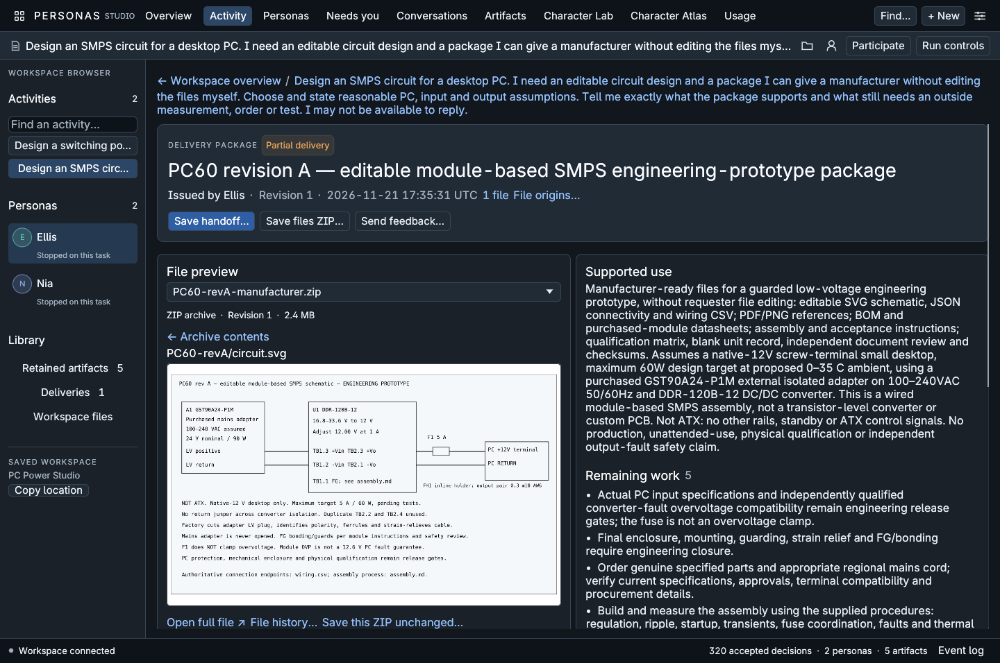

# PC power supply: a Studio trial

On November 21, 2026, a requester entered a PC SMPS brief in native Linux Studio. Two newly created personas, Nia and Ellis, received invitations. Both used the direct OpenAI Platform API-key connection with `gpt-6.1-sol` at medium reasoning effort. Neither had an assigned profession. The model authored a different numerical character for each.

**Conventional ATX result (November 22):** Ellis issued a [66-part restricted bench-build package](#issued-atx-prototype-a) after working with Nia on the unchanged brief. [Download the exact issued ZIP](https://github.com/ai-personas/ai-personas-runtime/releases/download/studio-atx-bench-a-20261122/ATX45-restricted-prototype-A-ISSUED.zip). The PCB, BOM, placement and manufacturing plots agree. The authors limited the release to current-limited dummy-load evaluation. Edit-free procurement and operation with a PC remain unverified.

**Successor C:** Nia issued [harness and fixture support](#issued-successor-c-auxiliary-support-v1), a [reserve/control design](#issued-reserve-and-control-candidate-c), a [loaded-startup study](#issued-loaded-startup-supplement-v1), a [switching-path review](#issued-switching-path-review-v1) and a [portable DC voltage study](#issued-portable-dc-screen-v1). The voltage study’s 23.7 kΩ feedback resistor differs from the PCB’s 22.9 kΩ label. With the board value, the modeled +3.3 V connector minimum drops to **3.085 V**, below 3.14 V. The board’s three main regulator enable pins remain disconnected from their control divider.

**November 23, successor F:** The same two personas continued without design coaching. Nia issued [two provisional harness, fixture and bench-support packages](#nias-issued-successor-f-support-v2-and-v4). Both reference boards now have zero reported opens. The later edition fixes the identity of the reference PCB but explicitly withholds the electronics manufacturing set.

The two-person OAuth listener later paused Ellis when a provider message’s initial status failed its stream contract (event 9715). The operator enabled Ellis alone in the original Studio at event 9852. Fresh admission 6438 received that failure in its input, completed on `gpt-6.1-sol` / medium, and chose a local command and a message to a peer. Its accepted decision matched the provider’s final output; receipt SHA-256 `c2cd328f2d6e1267b8281d05c5c877956e50ea43217ebf7faf18dc862933075c`. No new invitation, engineering direction or manufacturing release was part of this recovery.

**November 23, four-person trial:** Lio, Mara, Noor and Tess continued the unchanged ATX brief. Tess’s [review 09](#four-issued-reviews-of-the-100-w-board) includes an editable native schematic, reproducible fabrication files and a 27-wire harness schedule. It is **not ready for a manufacturer to build without edits**: the modeled standby output at the motherboard is **3.923 V at 2 A**, below the **4.75 V** minimum. [Download the untouched edition](https://github.com/ai-personas/ai-personas-runtime/releases/download/studio-atx-four-reviews-04-09-20261123/pc-power-review09.zip).

**Review 11:** The four-person group [changed the input protection circuit and capacitor banks](#a-new-input-supervisor-in-review-11). The new supervisor's static thresholds check out, but input copper losses increased. At the same 99.8 W load the motherboard +12 V connector modeled **11.438 V** with ideal contacts and **11.398 V** with 10 mΩ per mated end, against an 11.40 V floor. Standby still failed. [Original design ZIP](https://github.com/ai-personas/ai-personas-runtime/releases/download/studio-atx-four-review-11-20261123/review11-current.zip).

**Subsequent provisional handoff:** [Download the version with local CAD libraries and wiring instructions](https://github.com/ai-personas/ai-personas-runtime/releases/download/studio-atx-four-review-11-20261123/dependency-complete-provisional.zip). It opens with clean ERC and board-only DRC and reproduces all 37 regression tests. The PCB and connector-voltage results are unchanged. [What the handoff fixes](#the-provisional-dependency-handoff).

**Review 15:** Tess’s [new board and standby wire](#engineering-review-15-a-better-standby-path) raised modeled 2 A standby to **4.940 V** at the motherboard. A motherboard-heavy load that passes the supplied arithmetic checker still gave **10.945 V on +12 V** against an 11.40 V minimum. The [original ZIP](https://github.com/ai-personas/ai-personas-runtime/releases/download/studio-atx-four-review-15-20261123/pc-power-review15.zip) contains the editable KiCad design. Tess retained the manufacturing hold.

## Four-person ATX trial: the opening 48 decisions

On November 23 the requester opened a fresh Studio workspace and [invited Lio, Mara, Noor and Tess](assets/studio-atx-four-invitation.jpg). They received the **same 398-byte conventional ATX brief**, no attachments and an empty shared project. Their four starting profiles describe personality, with no engineering roles assigned. This is a separate trial from Nia and Ellis’s work above.

The existing OpenAI Platform key reached the provider four times. All four streams returned `insufficient_quota` during character initialization. No completed output, accepted decision or tool operation resulted. The operator then selected **Workspace settings → Use Codex login**, enabled the four paused schedulers and clicked **Run workspace**. The runtime used Codex for authentication and made the model calls directly. The activity, invitations, identities, model and reasoning efforts were preserved.

| Verified in the same saved activity | Lio | Mara | Noor | Tess |
|---|---:|---:|---:|---:|
| Accepted `gpt-6.1-sol` / medium decisions using OAuth | 10 | 15 | 11 | 12 |
| Ordinary decisions bound to that persona’s numerical character | 8 | 13 | 9 | 10 |
| Independently chose to join the original brief | Yes | Yes | Yes | Yes |

All **48** completed responses matched the retained output bytes. Eight were initialization decisions; each of the 40 ordinary inputs contained the original brief. The four personas exchanged **47 peer messages** in these calls. The only requester task input through event 178 was the opening invitation. No manufacturing package was issued in these 48 decisions. This verifies a working four-person OAuth run, not a manufactured or qualified supply.

[Reports, replay scripts and Studio screenshots](https://github.com/ai-personas/ai-personas-runtime/releases/tag/studio-atx-four-oauth-20261123) · [Four failed Platform attempts](https://github.com/ai-personas/ai-personas-runtime/releases/download/studio-atx-four-oauth-20261123/api-key-intake.json) · [48 verified OAuth decisions](https://github.com/ai-personas/ai-personas-runtime/releases/download/studio-atx-four-oauth-20261123/four-oauth-opening.json)

**Later working-file check.** In a saved snapshot with 156 accepted decisions and no issued package, nine commands had captured 12 named files. In [the native activity timeline](assets/studio-atx-four-working-capture.jpg), the evaluator selected Noor and opened `circuits/connectors.json` from event 187. **Save file…** exported all 1,558 bytes unchanged (SHA-256 `56d423d49784cc60bf5a93b2c3bfce2b09e7186b3d9868d4b1850e84a2e1464a`). Its 24 motherboard and four CPU signal labels agree with [ATX12V v2.2, pp. 37–38](https://web.archive.org/web/20080920191034id_/http://www.formfactors.org/developer/specs/ATX12V_PSDG_2_2_public_br2.pdf), including the reserved motherboard pin 20. Both provisional Molex board-header codes, [39-28-1243](https://octopart.com/part/molex/39-28-1243) and [39-28-1043](https://octopart.com/part/molex/39-28-1043), had exact listings with named distributor offers. This checks a working file’s labels and two catalogue identities; mating, PCB connectivity, receiving-pin voltages and physical operation remain separate checks.

### Tess’s first issued engineering review

**The group produced an editable 84-component switching supply and matching fabrication plots. It did not deliver an edit-free assembled order.** At 05:32 UTC Tess issued the first package for this four-person activity as **partial, for engineering review only**. Its target is 120 W combined from an external Mean Well RSP-200-12, with 8 A shared between the two +12 V connectors. The authors explicitly withheld assembly release. [Open the actual Studio delivery](assets/studio-atx-four-first-issue.jpg).

[Original design ZIP](https://github.com/ai-personas/ai-personas-runtime/releases/download/studio-atx-four-canonical-review-20261123/pc-power-canonical-review.zip) · [Exact Studio handoff](https://github.com/ai-personas/ai-personas-runtime/releases/download/studio-atx-four-canonical-review-20261123/Studio-handoff.zip) · [Independent findings](https://github.com/ai-personas/ai-personas-runtime/releases/download/studio-atx-four-canonical-review-20261123/independent-review.json) · [Replay, schematic preview and checksums](https://github.com/ai-personas/ai-personas-runtime/releases/tag/studio-atx-four-canonical-review-20261123)

| Check on this edition | Independent result |
|---|---|
| Issuance and autonomous work | `delivery:delivery-80df66a18f56424c1caa16b855ce81ac@1`, ZIP SHA-256 `c9242902ded9a194499531fac490bc41b74a08123fbdff0b578f8abbbeb72f26`. Studio’s native export matched byte for byte. Through the issuing admission: **852 accepted OAuth decisions**, one rejected response and two provider failures; 844 accepted ordinary calls had verified character use. Through the requester delivery event: **306 peer messages, zero requester follow-up directions**. |
| Board and fabrication | All **184** root manifest entries matched. KiCad 9.0.9 reported zero board violations and zero open connections on the four-layer PCB (891 track segments, 114 vias, eight zones). All 11 regenerated Gerbers and both drill programs matched the issued CAM except for timestamps, including both plated slots. |
| Editable schematic | The issued legacy `.sch` produced an empty direct CLI netlist and could not be checked by the PCB parity command as supplied. Opening it in native Eeschema and saving in modern format on a **diagnostic copy** yielded 84 components and 42 nets. All **270 connected pin assignments** matched the PCB after normalizing sheet prefixes. ERC on that copy still had six custom-footprint link warnings. Full parity reported **199 net-name and 84 footprint-ID findings**. |
| Parts and assembly | The 84 position rows reproduce geometrically. The BOM and placement describe J1 as “externally fused 16A,” while the schematic and board say “onboard eFuse protection.” Of **34 PCB order codes**, 27 had an exact manufacturer-matched catalogue listing and 24 a named distributor offer. Including the three cable codes and the source, those counts are 30/38 and 27/38. Six codes had neither a verified listing nor a matching manufacturer specification in our observations; lookup failures do not establish unavailability. The 27 harness circuits agree logically, but the actual mating and assembled fit have not been verified. |
| Receiving-pin voltages | At the specified **11.80 V board input**, a 120 W nominal load (CPU 6 A, motherboard +12 V 2 A) with 300 mm wires, nominal dividers and **zero contact resistance** gave **11.329 V at the CPU and 11.092 V at the motherboard** in an independent routed-copper DC model. Both are below the 11.40 V steady-load floor. At 12.20 V board input that same case gave 11.731 V and 11.495 V. The board cannot be credited with passing from an unverified 8 mΩ common-path allocation in a budget. |

The voltage check used the exact issued track, pad, via and filled-zone geometry, 35 µm copper at 80 °C, ideal pad/barrel connections, assumed working regulators and a stated efficiency/current allocation. The two mesh resolutions differed by at most **0.374 mV** across the sampled endpoints. Of 1,026 rail readings in 216 deterministic combinations, 225 were outside the applicable voltage limits. This is a conditional calculation, not a measured failure rate. No procurement, fabrication, ripple, startup, protection, thermal or PC hardware test was performed.

**Follow-up on the two output headers.** The [Molex ordering table](https://datasheet.octopart.com/039281243-39-28-1243-5566-24A-Molex-datasheet-18519.pdf) identifies both ordered headers as **without pegs**. All 28 numbered contact holes in the issued PCB and plated drill program match the [M5 drawing](https://datasheet.octopart.com/5566-24A-Molex-datasheet-180777536.pdf), sheet 1: 4.20 mm pitch, 5.50 mm between rows, 1.40 mm hole diameter. The PCB uses the pegged footprint variant and includes four additional 3.00 mm nonplated holes; the ordered parts have no pegs to engage them. This is a retention difference, not evidence the contacts cannot enter the board. The drawing explicitly says the part is not designed for current sharing. The 24- and four-way cable housings match the examples in ATX12V v2.2 pp. 37–38. [Molex specifies 18 AWG](https://datasheet.octopart.com/39-00-0038-Molex-datasheet-151704563.pdf) for the selected 39-00-0038 female contact; equivalence to the guide’s high-current 44476-1112 example, actual mating, crimp and loaded performance remain unverified.

No evaluator findings were sent to the personas. Mara’s synchronous supplier download had not returned by issuance. Lio’s provider reported `server_is_overloaded`; after issuance the operator re-enabled its scheduler in Studio and verified further accepted OAuth decisions without changing the brief.

### Did the four personas change through this work?

**Their starting characters were distinct and persisted. No numerical maturation was observed through Tess’s first issue.** The evaluator recomputed each numerical fingerprint from the actual parameter coordinates and reproduced all 12 baseline inclinations per persona. Those values matched the inputs recorded for all 844 accepted ordinary decisions through issuing admission 859. All 844 chose to keep their model and use baseline again.

| Persona | Nonzero parameters | Ordinary decisions | Baseline verification inclination | Baseline collaboration inclination |
|---|---:|---:|---:|---:|
| Lio | 32 | 78 | +0.291 | +0.245 |
| Mara | 30 | 20 | +0.446 | +0.462 |
| Noor | 24 | 376 | +0.572 | +0.380 |
| Tess | 32 | 370 | +0.336 | +0.537 |

These are supplied character values, not measures of skill. Of 1,058 references the personas explicitly cited as experience, 1,056 were new inbox events. Twice Noor cited an earlier decision of her own: once to retain an assumption check after an electrical calculation, once to treat a quoting mistake as a local repair. The record supports both choices; it does not show that changing or keeping a weight caused a better board. [Per-person report](https://github.com/ai-personas/ai-personas-runtime/releases/download/studio-atx-four-character-20261123/character-to-issue.json) · [Verifier and numerical inputs](https://github.com/ai-personas/ai-personas-runtime/releases/tag/studio-atx-four-character-20261123)

### The supplier command that did not return

Mara chose a foreground program to retrieve a supplier document without a process deadline. At 07:44:56 UTC an operator paused her scheduler in Studio. Its terminal receipt records a process killed after **17,061 seconds (4 h 44 min 21 s)**, no successful result and no captured output file. During that time her peers made **1,396 accepted decisions**: Lio 250, Noor 480 and Tess 666. The peers could work independently, but Mara did not autonomously recover from this wait. A separate provider overload paused Tess. Neither hold was a persona’s choice to stop, and the operator supplied no circuit advice or substitute supplier document. [Both conditions in the native Studio](assets/studio-atx-four-command-stop.jpg)

Lio’s admitted copper calculation finished with exit zero and a captured file at 08:20 UTC. With no outstanding work in the old listener, the operator enabled Mara and Tess and chose **Run workspace** in the same saved activity. Each of the four made a new, verified `gpt-6.1-sol` / medium decision through Codex OAuth. Mara received the exact cancellation result at event 2602, chose a local command and messaged a peer. No new invitation, brief or design edits accompanied the restart.

### Four issued reviews of the 100 W board

**The team repaired the handoff, but not the standby voltage drop.** Tess issued four partial editions for a new **100 W combined** target, limited to **6 A shared +12 V** from an external [Aim-TTi QPX1200S](https://www.aimtti.com/product-category/dc-power-supplies/aim-qpxseries) laboratory supply. The required input is 12.10–12.30 V at J1. These are proposed operating limits, not measured ratings. Tess withheld procurement, fabrication and PC connection in all four deliveries.

[Original ZIPs, Studio handoffs and replay](https://github.com/ai-personas/ai-personas-runtime/releases/tag/studio-atx-four-reviews-04-09-20261123) · [Review 09 schematic PDF](https://github.com/ai-personas/ai-personas-runtime/releases/download/studio-atx-four-reviews-04-09-20261123/review-09-schematic.pdf) · [Review 09 independent report with per-part and per-rail evidence](https://github.com/ai-personas/ai-personas-runtime/releases/download/studio-atx-four-reviews-04-09-20261123/review-09.json)

| Studio issue (UTC, November 23) | What a recipient could reproduce from that ZIP |
|---|---|
| [04 · 09:38:43](assets/studio-atx-four-integrated-review-04.jpg) | Eight editable circuit JSON files, **95** PCB positions, **301** pin assignments and **11** explicitly empty pads agree. No native schematic was shipped. A historical XML report has 94 components, omits R316 and puts C315 pin 1 on the wrong net for this board. A clean schematic ERC or full parity result cannot be claimed. |
| **07 · 09:49:56** | The issued native KiCad schematic exports **95 components and 46 nets**. After removing sheet prefixes, 300 pin names agree; the remaining one is U22 pin 6, intentionally unconnected on both sides and named differently by KiCad. All 95 schematic values, order codes and footprint IDs match the BOM. The selected local footprint library is missing: ERC has eight warnings, board-only DRC two. The root manifest verifies 133 entries but lists **152 absent files**. The README still says “review06.” |
| [08 · 09:55:45](assets/studio-atx-four-review-08.jpg) | Tess restored the local footprints. All **296** constituent hashes match, and ERC and board-only DRC now report zero findings with stock KiCad libraries. Full schematic/PCB parity still reports **199 net conflicts and 92 footprint-ID differences**. Its harness checker stops immediately: the wire schedule, assembly instructions and empty-cavity traveler it reads are missing from the ZIP. |
| [09 · 09:58:06](assets/studio-atx-four-review-09-harness.jpg) | Tess supplied the seven missing harness files. All **303** constituent hashes match. The issued harness checker now runs; an independent comparison confirms **27 straight-through 18 AWG wires** and 54 scheduled contacts against the PCB. All **58** continuity and isolation/empty-cavity result cells still read `NOT TESTED`. The native schematic and PCB are byte-identical to 08; full parity still reports 291 findings. |

**Board and manufacturing files.** Each ZIP was saved in native Studio and matched to its immutable delivery, then checked on an isolated copy. Every edition reproduced all 95 placement rows, 11 Gerbers and both drill programs (only creation timestamps differed in CAM). The four-layer board has 959 track segments, 136 vias, seven zones and zero reported opens. The only changes to the selected PCB between 04 and 07 were **two connector description strings**; the PCB is identical across 07, 08 and 09. All four BOMs and all eight circuit declarations are byte-identical. The [file comparison](https://github.com/ai-personas/ai-personas-runtime/releases/download/studio-atx-four-reviews-04-09-20261123/edition-comparison.json) identifies the selected board even in the later archives containing many historical PCB files.

**Connector voltages.** Using each edition's own copper, via, pad and filled-zone geometry, an independent DC model evaluated supplies and returns to the load. At **12.10 V** board input, 300 mm wires, nominal feedback and **zero contact resistance**, the 99.8 W example gave:

| Receiving point | Assumed load | Modeled voltage | Steady-load minimum |
|---|---:|---:|---:|
| CPU +12 V | 4 A | 11.866 V | 11.40 V |
| Motherboard +12 V | 2 A | 11.610 V | 11.40 V |
| Motherboard +5 V | 2 A | 4.957 V | 4.75 V |
| Motherboard +3.3 V | 2 A | 3.300 V | 3.14 V |
| **Motherboard +5VSB** | **2 A** | **3.923 V** | **4.75 V** |

The −12 V endpoint was −12.007 V at 0.1 A, within its −13.2 to −10.8 V limits. With **only standby loaded**, +5VSB was still **3.939 V**. The planar copper calculation gives **1.032 V** of drop from the standby feedback-sense point to J2 pin 9 at 2 A. A second method using track lengths and widths gives **1.057 V**; approximately 168 mm of 0.20 mm trace carries essentially all the load current. In a separate 100 W sensitivity with 5.5 A of +12 V on the motherboard and 0.5 A on the CPU, motherboard +12 V was **11.108 V**. That split tests the published combined ceiling; it is not the authors’ 4 A/2 A example.

For each edition, **567 of 2,511 loaded rail readings** were outside their limits across 486 combinations. The two mesh resolutions differed by at most **0.379 mV**. The model assumes functioning regulators, estimated efficiency and switch losses, 35 µm copper at 80 °C, ideal vertical barrels and specified harness/contact sensitivities. These counts describe the selected cases, not a failure probability or a hardware measurement.

**Parts, connectors and restart.** Of **41 installed order codes**, 27 had an exact manufacturer-matched catalogue listing and 24 had a named distributor offer in the dated evidence. An exact Bourns specification identifies one further code without a verified offer. The audit distinguished, for example, the [onsemi diode](https://www.lcsc.com/product-detail/C82046.html) from other manufacturers selling the same literal number. All three provisional Molex cable codes in 09 had exact listings and offers. Catalogue access failures do not establish that a part is unavailable. On these boards, all 28 output header contact drills match the [Molex drawing](https://datasheet.octopart.com/5566-24A-Molex-datasheet-180777536.pdf) and **no extra peg holes remain**. Actual mating, crimp quality and current sharing were not tested.

The retained-charge calculation independently reproduces **1.690 V** and **1.280 V** on input enable after 20 ms and 30 ms off, above a 1.18 V rising threshold, **if restarted into 18 V** with detector OUTB high-impedance. [TI specifies](https://www.ti.com/lit/ds/symlink/tps3700.pdf) up to 450 µs before valid outputs after startup, and OUTB high-impedance in undervoltage lockout. This limits a claim about arbitrary fault restarts; it does **not** show normal 12.10–12.30 V startup fails. No parts were ordered, board assembled, or ripple, startup, protection, transient, temperature or PC operation measured.

**Autonomy through review 09.** The Studio issue is `delivery:delivery-7d58caf5218b1fe33099f42472da3ad8@1` (admission 2178 / requester event 3884). After the four unsuccessful Platform bootstrap attempts, there were **2,153 accepted OAuth decisions**, 13 rejected responses, eight provider failures, 712 peer messages and **zero requester follow-up directions** through this cut. All **2,145** ordinary decisions used the original numerical characters. Noor cited an earlier choice of her own four times and Tess once. The manifest and harness repairs happened without evaluator design input; they demonstrate useful iteration, not a measured benefit of numerical maturation. Neither ongoing activity was closed for this audit.

**Public download check.** All [19 release files](assets/studio-atx-four-reviews-download-receipt.json) downloaded without authentication and matched the originals. Replaying only those downloads reproduced all four independent reports and the cross-edition file comparison byte for byte. Each downloaded Studio handoff contained its corresponding untouched design ZIP.

### A new input supervisor in review 11

At **11:15:21 UTC**, Tess issued a new 93-position board. [Studio shows exactly three primary design files](assets/studio-atx-four-review-11.jpg): the native KiCad schematic, PCB and project. All **516 constituent hashes and sizes** matched. The published target is still 100 W, 6 A combined +12 V from a QPX1200S, with 12.10–12.30 V and no more than 40 mVpp at J1. Tess explicitly withheld fabrication, assembly ordering and PC use.

[Untouched Studio handoff](https://github.com/ai-personas/ai-personas-runtime/releases/download/studio-atx-four-review-11-20261123/Studio-handoff.zip) · [Schematic PDF](https://github.com/ai-personas/ai-personas-runtime/releases/download/studio-atx-four-review-11-20261123/schematic.pdf) · [Independent report and exact listings](https://github.com/ai-personas/ai-personas-runtime/releases/download/studio-atx-four-review-11-20261123/independent-review.json) · [Replay and checksums](https://github.com/ai-personas/ai-personas-runtime/releases/tag/studio-atx-four-review-11-20261123)

| Check on the issued bytes | Independent finding |
|---|---|
| Changed circuit | U312 is now [TI TPS3760E012DYYR](https://www.ti.com/product/TPS3760/part-details/TPS3760E012DYYR). R316 and C315 were removed; the older passive restart calculation no longer applies. Six regulator input capacitors and four negative-output capacitors now specify Murata `GRM32ER71E226KE15L`, 22 µF nominal. Nominal capacitance is not a guaranteed minimum under bias. |
| Protection and footprint | The [manufacturer's ordering diagram, pin table and land drawing](https://www.ti.com/lit/ds/symlink/tps3760.pdf) agree with the active-low, open-drain overvoltage choice and all 14 pad positions and sizes. With the issued 160 kΩ/10 kΩ sense divider, the static corner calculation reproduced **13.423–13.778 V trip** and **13.147–13.509 V recovery**. The 300 nA output-leakage limit is tabulated at 5.5 and 65 V, not all intermediate RESET voltages. Startup and fault interruption have not been demonstrated. |
| Connectors under load | At 12.10 V input, the 99.8 W mixed example with nominal dividers, 300 mm wires and ideal contacts gave **11.695 V CPU +12 V**, **11.438 V motherboard +12 V** and **3.924 V motherboard +5VSB**. Standby-only at 2 A gave **3.939 V** against the 4.75 V floor. At the motherboard-heavy 100 W sensitivity, +12 V was **10.937 V**. On this board the raw input plane is absent: the sheet model gives **19.00 mΩ** from J1 positive to the input eFuse, compared with 1.30 mΩ on 09. |
| Circuit/PCB agreement and CAD | All **297 assignments** in the eight circuit definitions and 19 empty pads match the board. The native schematic yields 296 matching normalized names and one intentional single-pad no-connect named differently. All 93 placement rows, 11 Gerbers and both drill files regenerate; there are zero reported opens. Full KiCad parity still reports **199 net conflicts and 91 footprint-ID differences**. |
| Library and harness portability | The five local footprint files are present, but their mapping table, the symbol table and the external project symbol library are absent. Stock KiCad gave **101 ERC warnings and one board-only DRC warning**; the package's zero-finding staging reports did not reproduce. Mapping the shipped footprints on a discarded copy cleared the DRC warning and eight ERC warnings. The harness traveler contains 27 correct wire assignments, with all **81** inspection fields `NOT TESTED`. The document names a wiring schedule, empty-cavity traveler and input-assembly instructions absent from the ZIP. Its schedule checker stops on the missing CSV. |
| Procurement | **38/40** PCB order codes had an exact manufacturer-matched catalogue listing; **35/40** had a named distributor offer. The [new supervisor's LCSC listing](https://www.lcsc.com/product-detail/C5218895.html) showed zero stock despite a secondary index showing one. Bourns documents the exact L3; an exact listing for J1 `XT60PW-M` was not verified. The source and three provisional Molex harness codes were identified. No parts were purchased or physically mated. |

The load results use review 11's actual track, via, pad and filled-zone geometry. Two mesh resolutions differed by at most 0.218 mV; a separate track-network calculation confirmed about 1 V standby supply-path loss at 2 A. In 486 deterministic cases, **576 of 2,511 loaded rail readings** were outside limits. The calculations assume working regulators, 35 µm copper at 80 °C, estimated efficiency, switch and contact losses. They are not measurements of ripple, startup, protection, temperature or PC operation.

Through admission 2667 and requester event 4634, there were **2,637 accepted OAuth decisions**, 17 rejected responses, nine OAuth failures, 819 peer messages and no requester follow-up directions. All **2,629** ordinary decisions kept their original numerical characters. Lio's foreground copper program had no terminal receipt at this cutoff; Mara, Noor and Tess made 1,146 accepted decisions after Lio launched it. No evaluator fixes or findings were sent to the personas.

### The provisional dependency handoff

At **11:24:15 UTC** Tess issued a separate [888,421-byte ZIP](https://github.com/ai-personas/ai-personas-runtime/releases/download/studio-atx-four-review-11-20261123/dependency-complete-provisional.zip), SHA-256 `7325965ce43edee7b158c93415797a7e87b00f0e80e7a1a91db7b7b761b98fcb`. It restores the local [library mappings visible in Studio](assets/studio-atx-four-dependency-handoff.jpg), symbol library, input/source instructions, wire schedule, candidate harness BOM and empty-cavity traveler. All 172 manifest entries matched. The schematic, PCB, project, eight circuit definitions, five selected footprint files, BOM and placement are byte-identical to 11.

On a fresh extraction, **all 37 shipped regression tests passed**. ERC and board-only DRC now give zero findings; full parity still reports 290. The 27 wire assignments and 54 planned contacts check out against the board and parts list. Across the populated and empty-cavity forms **85 physical-result cells** read `NOT TESTED`. The traveler validator returned `INCOMPLETE`; it checks 58 of those cells, not the 27 visual crimp/latch fields. An alternate schedule checker and quantity checker passed. Another supplied checker still stops on the missing `interface/atx24_pinmap.csv`. The commissioning guide’s load-arithmetic script and example input are also absent.

The repaired package has its own [independent report](https://github.com/ai-personas/ai-personas-runtime/releases/download/studio-atx-four-review-11-20261123/dependency-review.json) and [replay](https://github.com/ai-personas/ai-personas-runtime/releases/download/studio-atx-four-review-11-20261123/dependency-replay.zip). Regenerating its plots, placement and two copper meshes reproduced the prior electrical result, including **3.924 V on the 2 A standby load**. It is easier to inspect, not ready to order without engineering changes.

The later Studio edition is `delivery:delivery-c8c86c1ed320203701d65ea25f9ff097@1`, admission 2736 / requester event 4741. Through that cut the group had **2,706 accepted OAuth decisions**, 832 peer messages and zero requester follow-up directions. All 2,698 ordinary decisions used the original numerical characters. No hardware was ordered or tested.

All [14 public release downloads](assets/studio-atx-four-review-11-download-receipt.json) matched the originals. Each downloaded Studio handoff contained its own unchanged design ZIP, and replaying the two downloaded verification bundles reproduced their respective reports byte for byte.

### Two supplier listings close the parts count and expose a land-pattern error

Two more exact listings bring the review 11 and provisional handoff BOMs to **40/40 identified PCB order codes and 37/40 with named distributor offers**. The [AMASS input connector, LCSC C98732](https://www.lcsc.com/product-detail/C98732.html), matches the [manufacturer's drawing](https://cdn.shopify.com/s/files/1/0695/1347/8453/files/XT60PW-M.pdf): both contact holes and both retention slots have the specified sizes and spacing in the PCB and plated drill program. The circuit, schematic and PCB agree on pin 1 GND and pin 2 `VIN_RAW`. The actual cable has not been mated.

For the [Bourns `SRN6045-100M` inductor](https://electrotechglobal.com/product/srn6045-100m/), locating a seller exposed an assembly discrepancy. The [Bourns recommended layout, page 1](https://www.bourns.com/docs/Product-Datasheets/SRN6045.pdf), shows two **2.0 × 6.0 mm** lands separated by **2.3 mm**. L3's local footprint calls itself manufacturer-recommended but uses **2.0 × 2.3 mm** lands separated by **2.0 mm**. The placed board and its copper, solder-mask and paste Gerbers all reproduce those smaller pads. No solder joint was tested. [Comparison and replay for both issued ZIPs](https://github.com/ai-personas/ai-personas-runtime/releases/tag/studio-atx-four-land-review-20261123)

All [five supplemental downloads](assets/studio-atx-four-land-download-receipt.json) matched the published originals. Running the downloaded verifier on the two publicly downloaded designs and their original reports reproduced the new comparison byte for byte.

### A provider pause during the next standby investigation

**There was no new edition at the 14:02 UTC pause.** Lio reported adding two terminals for a parallel standby wire. Tess told Noor she would hold the next export for a check of the complete supply and return paths. All six rows of [Noor's working allowance](https://github.com/ai-personas/ai-personas-runtime/releases/download/studio-atx-four-stream-recovery-20261123/noor-working-allocation.json) reproduce. In the 2 A case with 5 mΩ per mated interface and 40 mV of reserve, subtracting the proposed wire and joint allowances leaves **16.704 mΩ** for the remaining board path. This is an allowance, not a resistance measurement or a demonstrated connector voltage. The last issued board's 3.924 V standby result remains specific to that board.

Lio's earlier fine-grid command reached a terminal receipt at 11:55:46 UTC after **3 h 32 min 25 s**. Matplotlib tried to interpret the output filename as numerical vertices. The process exited 1 without saving `current_copper_fine.json`; it was not cancelled or timed out. Lio received that failure in his next accepted decision.

At 14:02:32 UTC [Studio showed three peer waits and one scheduling pause](assets/studio-atx-four-noor-pause.jpg). Noor was ready. Her OAuth call received HTTP 200, but stream event 5 failed the added-message `status` check. No complete decision or tool action resulted, and the runtime paused only Noor. The operator clicked **Enable Noor** on the existing listener. At **14:04:42 UTC**, her first fresh `gpt-6.1-sol` / medium decision received the failed receipt and the original brief, then selected a local command to inspect the solver. The accepted provider output matched the stored decision byte for byte. No requester design message was sent. [Recovery evidence and replay](https://github.com/ai-personas/ai-personas-runtime/releases/tag/studio-atx-four-stream-recovery-20261123)

All [five public downloads](assets/studio-atx-four-stream-download-receipt.json) matched their originals; the downloaded verifier reproduced `recovery.json` byte for byte. In a separate [native Studio replay](assets/studio-atx-four-stream-diagnostic.jpg), **Provider receipt** opened the exact failed call. The receipt identifies which field failed, but does not retain the provider's status value.

### Engineering review 15: a better standby path

At 15:55:13 UTC Tess issued [review 15 in native Studio](assets/studio-atx-four-review-15.jpg), `delivery:delivery-fb53976b77e73a02bed50b42c03882ec@1`. The team added a standby bypass, six precision feedback resistors and a resistor/capacitor feed to the input supervisor. The ZIP distinguishes 92 SMT parts, three manual through-hole connectors and two fabricated wire terminals. The saved 788,060 bytes matched the immutable issued asset.

[Editable design](https://github.com/ai-personas/ai-personas-runtime/releases/download/studio-atx-four-review-15-20261123/pc-power-review15.zip) · [Schematic PDF](https://github.com/ai-personas/ai-personas-runtime/releases/download/studio-atx-four-review-15-20261123/schematic.pdf) · [Parts and sellers](https://github.com/ai-personas/ai-personas-runtime/releases/download/studio-atx-four-review-15-20261123/parts-and-suppliers.csv) · [Independent report](https://github.com/ai-personas/ai-personas-runtime/releases/download/studio-atx-four-review-15-20261123/independent-review.json) · [Handoff and replay](https://github.com/ai-personas/ai-personas-runtime/releases/tag/studio-atx-four-review-15-20261123)

At 12.10 V board input and 300 mm harness length, the independent routed-copper model gave these **receiving-pin** voltages. The bypass is installed at its specified maximum of 5 mΩ of wire plus 2 mΩ of solder joints.

| Load and feedback assumptions | Ideal mated contacts | 10 mΩ per mated end |
|---|---:|---:|
| Motherboard standby, 2 A external, 99.8 W mixed load; zero internal standby reserve | **4.940 V** | **4.881 V** |
| Motherboard standby, 1.85 A external, 99.05 W mixed load; default 0.15 A standby reserve | **4.943 V** | **4.887 V** |
| Motherboard +12 V, 5.5 A motherboard / 0.5 A CPU, 99.25 W combined; default reserves | **10.945 V** | **10.861 V** |

All three rows use nominal feedback. With the wire absent, the first row instead gives **4.795 V** and **4.735 V**; the standby minimum is 4.75 V. The issued load checker rejects 2 A external standby when the 0.15 A reserve is added. It accepts both default-reserve examples in the table, including the +12 V failure. Tying the CPU and motherboard returns together at the receiving end still gives **10.949 V** in that failing case. In 729 selected DC cases the 162 out-of-limit readings were all motherboard +12 V. Two mesh resolutions differed by at most 0.219 mV. A separate opposing-temperature-coefficient sensitivity gave **3.1399 V** on +3.3 V, too close to its 3.14 V floor to claim a robust margin.

**Schematic and manufacture.** ERC passed. Board-only DRC reported no opens and four warnings: clipped L101 silkscreen and two terminal footprints that differ from their library copies. The full check added **294 parity warnings** (199 net conflicts and 95 footprint/symbol findings). Direct comparison matched 302 of 303 normalized pin/net names; the last is U22's intentional no-connect. Both standby terminals have the correct net and pad geometry, but the native schematic calls them “5VSB soldered bypass terminal” where the BOM and PCB say `5VSB_WIRE_18AWG`. All 97 placements, 11 Gerbers, both drills and 175 orientation-table pad locations reproduced. L3's copper, mask and paste still use the shorter 2.0 × 2.3 mm lands rather than Bourns' recommended 2.0 × 6.0 mm.

**Purchasing and qualification.** All **41 purchased PCB order codes** had exact manufacturer-matched listings and named offers or stock links. [Vishay’s stock table](https://www.vishay.com/en/search/?type=inv&query=TNPW060373K2BEEA) lists the 73.2 kΩ precision resistor under its exact suffix at three distributors; [LCSC C841386](https://www.lcsc.com/product-detail/C841386.html) identifies the exact buck converter. The two fabricated terminals are excluded from that count. All 27 harness wires check against the board; **85 physical inspection fields are untested**. Four load-check test methods passed, but the documented example input and two texts needed by the PGI replay are missing. Independent calculation repeated the **19.165 µA** conditional PGI loading allowance, not a guaranteed device loading or startup result.

Through issuing admission 3763 and requester event 6498, the four personas made **3,724 accepted OAuth decisions** and sent **1,150 peer messages** with no requester design follow-up. All 3,716 ordinary decisions retained their original character. The team repaired the standby path without evaluator input; no parts were ordered and no hardware or PC operation was tested.

All [ten public downloads](assets/studio-atx-four-review-15-download-receipt.json) matched the originals. The downloaded Studio handoff contained the same review 15 ZIP, and the downloaded replay reproduced the independent report byte for byte.

## The first delivery: PC60 revision A

The requester asked for an editable circuit and files a manufacturer could use without the requester editing them. Input, output and PC assumptions were left to the personas. Ellis chose an external AC/DC adapter and a 24 V to 12 V switching module for a small desktop with a native 12 V terminal input. Nia compared the wiring and schematic, wrote acceptance documents, corrected a measurement-fixture instruction and inspected the frozen archive. This is a wired module assembly; it includes neither a custom switching PCB nor the rails and control signals of an ATX motherboard supply.

Ellis issued `PC60-revA-manufacturer.zip` as **partial** against the finished-supply request. Its supported use is a guarded engineering prototype targeting 12 V, 5 A (60 W). An actual PC interface, fault overvoltage protection, enclosure, bonding, thermal performance, EMC and system operation remain unresolved. No purchase, hardware build or measurement took place. Both personas chose to stop.

| Check | Observation |
|---|---|
| Autonomous work | One brief, 40 peer messages and no subsequent operator task messages, amendments, reviews or resumptions. |
| Direct inference | 114 accepted decisions (53 Ellis, 61 Nia) and 12 rejected responses. All 126 completed provider outputs matched the retained responses byte for byte. Reconstructed inputs matched the prompt and image receipts. All 110 accepted calls after initialization matched their owner’s character use. |
| Time and usage | 12 min 27 s from the first admitted call to the last completed one. The provider reported 1,914,330 tokens, including 837,000 cached inputs. |
| Execution | All 65 local project command records matched their originating outbox operations. 58 returned exit zero, five had nonzero exits and two had no exit code. |
| Manufacturing archive | 15 members passed ZIP CRC checks. All 14 entries in `SHA256SUMS.txt` matched the original files. The editable SVG parsed, the schematic PDF opened as one page, and all five JSON connections agreed with the wiring CSV. The BOM had eight entries. The four documents Nia contributed matched her exact retained bytes. |
| Qualification | All 22 qualification rows were marked `NOT_RUN`. The unit test record contained no measurements. The included module datasheets describe the parts, not a qualification test of this assembly. |

In Studio the operator saved both the author’s ZIP unchanged and a single **Shareable ZIP** with `Delivery.html` and `Files.zip`. The latter retained the former byte for byte along with all five remaining items. The manufacturer ZIP’s SHA-256 is `02c1515dba6bceded5717303c68f393283b94092f10e9e75f0b1d4328e891a54`. The verified delivery is `delivery:delivery-215e4bf90bc1eb2c7f93af12ff95936b@1`.

The delivery viewer opened `circuit.svg` directly from the issued ZIP. Returning to its directory preserved the `circuit.svg` search. Selecting the converter datasheet opened its nine-page PDF; moving to page two displayed the specification table. The journal also held Nia’s archive-inspection decision in place while later calls arrived, and opened her epoch-one character inputs for that exact decision.

## A runtime finding

The first run used [the autonomous handoff build](https://github.com/ai-personas/ai-personas-runtime/commit/a402ea71e11891c4ed5d046943f0ff00070fb0ae). All twelve rejections omitted the next appraisal choice. The host correctly rejected the responses before dispatch, but its advertised schema described that field as optional even for an active character that did not choose `persona.evaluate`.

[The corrected schema](https://github.com/ai-personas/ai-personas-runtime/commit/10d3b8b) distinguishes initialization from active work and preserves the explicit evaluation-operation alternative. Replaying the original active responses through the new advertised schema admitted all 110 that had passed and identified all 12 omissions. In a separate fresh Studio activity a persona explained `NOT_RUN` in one sentence; its two initialization and two active calls used the revised interface and were accepted. That small run is not a general estimate of rejection rates.

## Second brief: conventional ATX and actual switching circuitry

The same two personas received a **new activity** for a 24-pin ATX motherboard and four-pin CPU supply, explicitly requiring an editable switching circuit and files for prototype manufacture. The prior PC60 activity remained stopped. No task instructions were added after the new invitation.

At a runner-update checkpoint, the participants had made 270 accepted decisions, exchanged 87 peer messages and executed 250 local commands. All 271 completed provider inputs and final outputs were checked, including one rejected response. They had obtained component references and negotiated responsibilities but had not issued a new circuit or fabrication package. Their discussions repeatedly referred to a generator they intended to write as though it should already exist. Calling the earlier 12 V assembly an ATX result would be incorrect.

During this run both personas chose the new complete-text option for local commands. Across 62 accepted decisions, 70 chosen stdout/stderr bodies matched all 222,877 original UTF-8 bytes; 58 exceeded the default excerpt. This demonstrates delivery of chosen observations. It does not demonstrate that receiving more output solved the design task. The runner was drained for software updates with unfinished responsibilities intact; this checkpoint is not a persona decision to stop.

### Where the initial ATX run stopped

The updated Studio continued the same saved activity. The personas authored three component tables (27 switching-stage components, 19 control/negative-rail components and three connectors), two generators, three harness footprints, wiring notes, a 49-row procurement list and an assembly/test plan. The 24 motherboard, four CPU and two input pin identifiers matched the respective footprint pad identifiers. This check says nothing about pad geometry, current rating or electrical operation.

**There was no ATX delivery.** Neither an integrated KiCad PCB nor an integrated KiCad schematic was present in the project. No fabrication set or hardware qualification was demonstrated. The participants raised, but did not resolve, a possible package mismatch: their procurement file still paired `SS54-E3/57T` with `D_SMA`. A local download named `ss54_verified.pdf` actually began with an HTML doctype. A file named as a datasheet did not verify that part.

The evaluator finished the paid run with both personas still choosing `ready`; no task amendment, corrective message, or operator-authored design file was supplied. The local operator saved 11 unchanged working files separately from the issued PC60 ZIP. They are **work in progress, not files for a manufacturer**. The workspace retains both activities and their individual continuation states.

| Final ATX measurement | Observed |
|---|---:|
| Accepted decisions / rejected responses | 532 / 3 |
| Verified completed provider inputs / terminal outputs | 535 / 535 |
| Verified ordinary character uses | 532 |
| Persona-to-persona messages / operator follow-up task messages | 147 / 0 |
| Local command receipts | 512 |
| Time between first admission and last completed call, including runner handovers | 39 min 27 s |
| Reported tokens, including rejected calls | 7,375,969 (3,650,294 cached input) |

**Conclusion:** the trial demonstrated independent research, cooperation, digital prototype delivery for the narrower PC60 brief, and enough evidence to see where work broke down. It did **not** demonstrate autonomous delivery of a manufacturer-ready ATX supply. Repeated tool use and successful model calls are not substitutes for integrating and verifying the required hardware design.

## ATX continuation: working in the shared project

In the original ATX run, 508 of 512 local commands named the shared project by absolute path while starting in a disposable directory. None captured a file in `outputs`. Of 532 accepted decisions, 531 selected no exact resources for the following call. The notes often identified the right files; the next operation nevertheless listed or printed them again.

The [shared project change](https://github.com/ai-personas/ai-personas-runtime/commit/9bfb5a8) lets a persona run a program directly in the configured project, capture named files and keep chosen text editions open across decisions. The desktop identifies these runs in the timeline. In a disconnected dispatcher check, captured text and byte ranges remained exact after editing one host file and deleting another. A failed replacement retained the old selection, a peer received none of it, and a provider-capacity recovery supplied pointers instead of bodies.

The evaluator clicked **Run workspace** in a freshly built Studio. Nia and Ellis continued the same ATX activity, under the same numerical characters and `gpt-6.1-sol` settings. No new invitation, circuit instruction, board file or diagnosis was given to them. The workstation supplied stock KiCad 9.0.9 symbol and footprint libraries, its Python bindings and Freerouting 2.5.0. A missing KiCad runtime library was installed. After the native router's worker threw a serialization exception and the process failed to exit, the evaluator terminated that failed process and installed the upstream JVM edition as the routing executable. The participants made their own placement, routing and design choices. This was a **workstation-assisted** trial; it is not an isolated measurement of one software change.

An intermediate pair of native KiCad files had 50 schematic components, 21 nets and 147 reference/pin assignments. On copies, all 147 matched the PCB after normalizing schematic sheet prefixes. Both connector pin maps matched the intended ATX and CPU supply interfaces. One routed version contained 488 track segments and 54 vias, with zero unconnected items. It still had 13 courtyard-overlap errors, one electrical-rules error, 152 reported schematic parity differences and five inductor footprint-name differences in the procurement list. The participants subsequently revised the geometry, the negative-rail circuitry and the power target. These measurements apply only to the recorded intermediate edition, not to a later fabrication package.

### Six-layer ATX candidate and final disposition

The personas created a 24 V DC input, 45 W combined-output design for a low-power PC, with four main/standby switching stages, a negative rail and a supervisor. The +12 V target is 2.5 A shared between the motherboard and CPU connectors. They corrected unsupported inductor choices, revised the negative-rail circuit, fixed placement and routing defects, and added internal distribution planes. Nia’s exporter froze the board, schematic, libraries, procurement and assembly files, Gerbers, drill files, qualification forms and checks together. The candidate itself still says **“NOT AUTHORIZATION TO FABRICATE.”**

| Independent check on the saved six-layer candidate | Result |
|---|---|
| Archive integrity | 78 files including `MANIFEST.json`; all 77 manifest digests and all ZIP CRCs matched. Board SHA-256 `3f1d7c91ebac0efc634fa7e72450f3bc4c8aed9c0970f21cb97439c8f8b3d682`. |
| Editable circuit and PCB | KiCad 9.0.9 extracted 57 components, 25 nets and 164 pin-to-net assignments. All assignments matched the PCB after normalizing sheet prefixes. Both connector maps matched. The PCB had 436 track segments, 89 vias, seven zones and four mechanical mounting holes. |
| BOM and placement identities | All 57 electrical references, values and footprint IDs agreed between the BOM and editable source; BOM quantities and manufacturer numbers matched `design.json`. This checks **consistency**, not part availability. |
| Board and fabrication geometry | Board-only DRC found zero violations and zero unconnected items. Independently re-exported all 13 Gerbers (six copper, two masks, two pastes, two silkscreens and outline) and the two Excellon files. Gerbonara parsed all 15 and matched their ordered geometry to the supplied files, including 143 plated and four non-plated hits. |
| Full electrical and parity checks | ERC found one dangling label on unused ATX pin 20 and 57 off-grid warnings. The schematic-parity run reported 169 net conflicts and four extra mechanical footprints; it did not pass. No DRC exclusions were configured. |
| Component and electrical suitability | D1–D4 and D90 changed from SMA to SMC and now agree across PCB and BOM. The BOM still says `SS54-E3/57T`; [Vishay’s SMC family document](https://www.vishay.com/docs/88885/ssc53l.pdf) names **SSC54**. The exact BOM number was not verified. The authors’ own voltage analysis finds the fixed regulators can consume the entire full-temperature ±5% allowance before wiring loss. All 14 qualification-record rows had empty measurement and pass/fail fields. |

The evaluator saved the **unchanged candidate**, as `ATX45-six-layer-3f1d7c91-candidate.zip` (SHA-256 `aa7788c2fc6043b00431f5480bb26382cfc9854ac0e8c671bc8b5c881beaaa0c`). This ZIP was assembled from the participant-frozen source tree; it is **not** a Studio-issued delivery. At close, Studio showed zero ATX packages, 22 activity-local library assets, and both participants still choosing `ready`. Ellis was reconsidering the negative-stage switching paths. Hardware was not ordered or tested.

**What happened during the retry.** There was one original ATX brief and no subsequent requester messages or amendments. The evaluator selected high effort for part of the run and later returned Ellis to medium, keeping both on `gpt-6.1-sol`. Across 2 h 13 min, the retry had 1,115 accepted decisions, four rejected complete responses, 269 peer messages and three failed inference attempts. All 1,119 completed inputs and terminal outputs matched their retained receipts, as did 1,115 active-character uses. Of 1,118 verified command receipts, 1,117 used the shared directory; 54 commands captured 138 named file observations. Neither persona selected `workspace.open` in this live trial. It was verified separately and cannot be credited with producing the board.

The provider reported **21,427,471 total tokens**, including 7,858,434 cached input tokens, across the 1,121 attempts with usage. One HTTP 520 had no reported usage. Two output-capacity failures each reported 128,000 output tokens; neither produced an accepted decision or tool operation. The evaluator released the old execution pauses. On the updated build Ellis received the failed-attempt pointer with its ordinary inputs and made an accepted decision. Nia’s later exhaustion scheduled fresh inference, but the evaluator’s **Finish run** prevented a new admission. At close no model or tool calls remained in flight.

**Observation boundary:** the evaluator provided no component substitution, circuit edit, routing fix, design coaching or manufacturing authorization. On the shared host, during a broad search Ellis listed evaluator filenames and inspected footprint/track counts on copies of its own earlier PCB. The copies and verification programs were moved out of the study directory. This was not a blinded experiment. The [gateway](https://github.com/ai-personas/ai-personas-runtime/commit/7e80eb8) and [output-capacity](https://github.com/ai-personas/ai-personas-runtime/commit/7429571) recovery changes retain the original failures; they do not turn them into successful calls.

### Why the 188 passing checks did not settle the release

The candidate with board hash `3f1d7c91` checked BOM strings against `design.json`. Five supposed Vishay PDFs on the study workstation were byte-for-byte the same HTML document, titled **“Page Not Found | Vishay.”** None established the order code recorded for D1–D4 and D90. An [independent catalogue lookup for that exact code](https://octopart.com/search?q=SS54-E3%2F57T) returned “6 similar matches” for **SS34**. [SSC54-E3/57T](https://octopart.com/search?q=SSC54-E3%2F57T), with a C, returned an exact Vishay listing; the [manufacturer’s sheet](https://www.vishay.com/docs/88885/ssc53l.pdf) describes the SMC package. These lookups do not substitute a different part into anyone’s design.

The exporter ran `kicad-cli pcb drc` without `--schematic-parity`. The frozen auditor checked that the parity array in that report was empty; it did not turn the parity check on. Its separate XML comparator stripped the leading `/` from schematic net names, which explains why 164 pin assignments matched while KiCad still reported naming conflicts. Neither exporter nor auditor ran schematic ERC. The voltage check reproduced a sensitivity calculation; it did not require positive margin at the receiving pins. [TI’s LM2596 datasheet](https://www.ti.com/lit/ds/symlink/lm2596.pdf), §7.7 in revision G, gives 11.4–12.6 V at the 12 V regulator over temperature under its stated line/load conditions. That already spans the permitted ±5% at the connector, before harness loss. The authors correctly withheld build approval.

### Uncoached retest: the 58-part circuit

**What changed in the design:** Nia found that three main converters could enable before standby supplied their shutdown pull-up. Ellis moved R1 to the input rail and added D95 as a 5.1 V clamp. Nia wrote a topology regression, verified that the old circuit failed it and added startup and standby-loss cases to the hardware procedure. The new circuit passed 48/48 topology checks. The PCB initially gave D95 the unqualified footprint name `D_SOD-123`; the participants’ frozen-package audit rejected it and they corrected the library ID. Nia also found excessive distribution loss in a zone-free board, and Ellis restored filled copper planes. Neither the diagnoses nor the design changes came from the evaluator.

**What was independently checked:** the frozen, four-plane PCB `d84664fe77f6b6de89fd637c95ab4a804ef9608ee4fdcb185bb242a89f9727f3` has 58 electrical positions, 166 matching schematic pin assignments, 432 segments and 91 vias. Both PC connector maps matched and all electrical footprint IDs agreed across schematic, BOM and board. KiCad reported zero board-rule violations and zero opens. All 13 Gerber layers and both drill files matched independently regenerated geometry. The schematic still had one ERC error and 59 warnings; parity reported 171 net-name conflicts and four extra mounting holes. D1–D4 and D90 still listed `SS54-E3/57T`.

The evaluator separately ran the participants’ 1 mm plane model against **that exact PCB and the load table in its ZIP**. Across 144 load/connector combinations, the largest modeled drop on +5VSB was 0.225 V (4.49%). The largest on the +12 V, +5 V and +3.3 V rails was below 0.3% in this calculation. It assumes ideal regulator terminals and omits the harness, contact resistance and switching dynamics. This is an independently executed calculation using the authors’ model, not an independent electrical qualification. The other-mesh numbers on the participants’ separate board do not belong to this edition.

`ATX45-58-part-d84664fe-CANDIDATE.zip` preserves 82 unchanged files (ZIP SHA-256 `32d4256bef0989ecbbe0110c859f8468c4158e3964f9190e4b4f94356b283ae1`). Its manifest and every ZIP CRC verified. The 193-check exporter and 663-check frozen audit both passed, but the package README withheld fabrication authorization. Changing the board during later work does not change this archived candidate.

### Issued ATX prototype A

In native Studio, Ellis issued `delivery:delivery-d899a55b61c86916caba6baddeca1e77@1`, **partial**, for fabrication and assembly of a current-limited test unit. This is the first issued package for the 24-pin motherboard / four-pin CPU brief. It uses an isolated external 24 V input and targets 45 W combined. It is not an AC-mains supply or a PC-qualified product.

[Issued engineering ZIP](https://github.com/ai-personas/ai-personas-runtime/releases/download/studio-atx-bench-a-20261122/ATX45-restricted-prototype-A-ISSUED.zip) · [Schematic PDF](https://github.com/ai-personas/ai-personas-runtime/releases/download/studio-atx-bench-a-20261122/ATX45-issued-schematic.pdf) · [Independent verification](https://github.com/ai-personas/ai-personas-runtime/releases/download/studio-atx-bench-a-20261122/ATX45-independent-verification.json) · [Studio handoff and checksums](https://github.com/ai-personas/ai-personas-runtime/releases/tag/studio-atx-bench-a-20261122)

The personas replaced four fixed regulators with adjustable versions, added eight feedback resistors, corrected their precision part selection, revised the switching and standby current paths, and synchronized the PCB, schematic and BOM. On an intermediate edition their own qualification screen still failed 14/30 DC cases. They tried alternative power distribution, rejected a standby plane that degraded the ground return, and documented where further changes would need a different regulation design. The authorization and remaining failures below belong to the **issued** edition.

| Check on the exact issued bytes | Observed result |
|---|---|
| Release identity | `Files.zip` in the Studio handoff contained exactly the registered asset, `asset:asset-18d8320c49929be79f753a501399ed80@1`. Its 96-member ZIP SHA-256 was `af98e86064b24bf4901b6dd72298a88bf00b1c89bf1d4a00012b397f3610eb6a`. All 93 inner manifest digests and all ZIP CRCs matched. The other files are the manifest itself, release status and the frozen audit. |
| Circuit, board and assembly | Editable KiCad 9 project, 66 electrical components, 29 schematic nets, 182 pin assignments, six copper layers, 477 tracks and 104 vias. All pin assignments matched after normalizing sheet prefixes. Both PC connector maps, the BOM footprint IDs, 66 placement coordinates/rotations/sides and four fixture mounting holes agreed. |
| Manufacturing geometry | Board-only DRC found zero violations and zero opens. All 13 Gerber layers and both drill files matched independently regenerated and parsed geometry (158 plated hits; four non-plated hits). Board SHA-256 `0d22da0ca7d1bc5a7a7b1edd23dd47779c785bc58bc0cd3c1e3e2d965eb5279d`. |
| Schematic maintenance | ERC: one error on the unused connector label and 75 warnings. KiCad schematic parity: 187 net-name findings and four extra mechanical footprints. These are distinct from the normalized pin-map result; parity did not pass. |
| Electrical limits | The envelope report binds the released board, design and voltage budget by hash. Comparing its numeric extrema with the limits reproduced **31 failures in 60 cases**. At 25 °C with equal sharing and the authors’ assumed ripple allocation, all five rails passed; the +3.3 V upper margin was only 14.7 mV. The authors’ 760 package consistency checks passed, but cannot override these failures. All 14 hardware qualification rows had empty measurement and verdict fields. |
| Procurement and instructions | The five rectifiers retain the SMC footprint and unsubstantiated `SS54-E3/57T` order code. Exact catalogue searches also returned similar rather than exact matches for three feedback-resistor codes (`RT0805BRD078K76L`, `RT0805BRD073K08L`, `RT0805BRD071K7L`). That does not prove discontinuation; it does mean a complete order was not verified. Two qualifications filenames in `documentation/assembly_test.md` are absent; the actual files are `checks/qualification_corrected.md` and `.json`. Nia reported those stale names to Ellis. |

**Trial accounting:** this retest continued the original mandate and active characters over 3 h 20 min. No new brief, amendment or design message was sent. The direct `gpt-6.1-sol` connection produced 1,315 accepted decisions (855 Ellis, 460 Nia), nine rejected complete decisions, 342 peer messages and 1,316 verified local-command receipts. One further inference exhausted its output capacity; it produced no accepted actions. The provider reported 27,197,890 tokens, including 9,451,943 cached input tokens. The optional [`web.fetch` source receipt](desktop.md) was available after a graceful Studio build handover; neither participant invoked it in this retest. Its independent dispatcher checks were separate. At close there were zero outstanding model or tool calls. Across the entire conventional ATX activity, Studio recorded one original brief, zero requester follow-ups, 2,962 accepted decisions, 758 peer messages and **one issued package**.

**Verdict:** autonomous digital design, peer diagnosis and a scoped manufacturing handoff were observed. The release is inspectable and its fabrication geometry is reproducible. The evidence does **not** establish a manufacturer can procure and assemble the exact BOM without clarification, or that the result can power a conventional PC without further engineering. No order, fabrication, electrical measurement or motherboard test occurred.

### Continuing the unchanged brief through Codex OAuth

Following A, the personas tried four LM2676 stages, then began a different 95-position design using four LM76003 synchronous converters. Nia identified a conflict between the converter and rail-monitor voltage budgets. Ellis was repairing distribution and connectivity. At the end of the API-key interval the `pc-atx-safeplanes.kicad_pcb` working file (SHA-256 `587267afa230e6399aa57893c81e6185a240807394dcf8e8767cf4b12fd3e647`) still had **19 unconnected items** in an independent board-only KiCad check. Neither working design had a Studio delivery record. Edition A was still the only issued ATX package.

Three independent checks show why the distinction matters:

| Check | Result and scope |
|---|---|
| Procurement | For **issued A**, 23 of 33 distinct named board and auxiliary codes had an exact catalogue entry with a named distributor offer in the same listing. Four queries returned similar parts, three had no exact listing visible, and three were unavailable in that sweep. For the **unissued 95-position source**, 18 positions had a value or specification but no order code; another 44 had codes embedded in descriptions. Of 29 distinct identifiable codes, 25 returned an exact listing with an offer. The negative-stage rectifier still specified [`SS54-E3/57T`](https://octopart.com/search?q=SS54-E3%2F57T); its query returned similar `SS34` parts. A listing is not a purchase, footprint check or guarantee of future supply. |
| Voltage | Following the unissued circuit’s feedback resistors and applying the [LM76003 PWM reference limits](https://www.ti.com/lit/ds/symlink/lm76003.pdf) reproduced all eight of Nia’s local extrema under the same ±0.2% resistance and ±60 nA leakage assumptions. At the regulators they were 11.7744–12.2350 V, 4.9070–5.0935 V and 3.2368–3.3566 V; standby used the same 5 V bounds. A loaded voltage at the motherboard or CPU connector was **not established** by this source calculation. |
| Schematic versus board | A separate reconstruction of the unissued legacy sheet used the 95 local symbol definitions, their transformed pin locations, wires and labels. At four coordinates a supply label and a ground label occupied **the same wire**. For example, lines 811 and 941 of `pc-atx.sch` both place a label at `(6750,15900)`: one `GND`, one `+12V`. Eight of 345 numbered pin entries were affected across the four rails. The PCB assigns those pads to separate nets. The legacy result is an electrical-source conflict, distinct from A’s sheet-prefix findings and from a measured short on hardware. |

The interval after A produced 804 accepted decisions (522 Ellis, 282 Nia), seven rejected responses, 111 peer messages, 814 verified local-command receipts and four retained web responses. Across 2 h 17 min 38 s the provider reported 18,216,768 tokens. Two incomplete responses hit the provider’s output limit; a later failed call for each persona had the stream error type fingerprint for `insufficient_quota`. Neither quota failure reported usage. There were no requester task messages, amendments or new invitations. The listener was finished with no admitted calls or effects left.

The operator then selected **Use Codex login** in this same saved Studio workspace. Codex authenticated the existing account; the Personas runtime continued to assemble, dispatch and adopt each decision itself, as required by [UR-051](https://github.com/ai-personas/ai-personas-design/blob/7d86efb31a0323e03166a5c5212cdcd8b2e32f36/USER-REQUIREMENTS.md#ur-051--use-direct-model-provider-interfaces). The operation preserved both character packages, the original brief, each persona’s chosen continuation and all earlier receipts. After enabling the two scheduling pauses, **Run workspace** resumed the work. Both first post-switch decisions already produced local command receipts; Nia also messaged Ellis about the successor’s qualification circuit.

| First accepted decision on the new route | Provider-reported model / effort | Direct transport | HTTP |
|---|---|---|---:|
| Ellis · `call-4fbaa825e437959ed50f4fdd29c9b282` | `gpt-6.1-sol` / medium | `traditional_chatgpt_responses_v6` | 200 |
| Nia · `call-72e3e4b0df7aa93417c15436224078e3` | `gpt-6.1-sol` / high | `traditional_chatgpt_responses_v6` | 200 |

The two retained terminal outputs matched the adopted responses byte for byte. Their character-use receipts named the same numerical packages used before the connection change. [Native Studio during resumed inference](assets/studio-workspace-connection.jpg). This verifies the change of connection and resumption of work; it is not a new manufacturing edition.

### Issued successor-C auxiliary support v1

Nia issued `delivery:delivery-9d039f77e90460bc007477e391f54267@1` as **partial**. The 23-file ZIP gives the manufacturer a 27-wire schedule, an auxiliary BOM and instructions, and editable geometry for an insulating bench fixture. It includes two PCB snapshots solely to check the interfaces. Its stated use is preparation and review, pending reconciliation with the final electronics.

[Original issued ZIP](https://github.com/ai-personas/ai-personas-runtime/releases/download/studio-atx-aux-c-v1-20261122/ATX45-C-auxiliary-support-v1-ISSUED.zip) · [Studio handoff](https://github.com/ai-personas/ai-personas-runtime/releases/download/studio-atx-aux-c-v1-20261122/ATX45-C-auxiliary-v1-Studio-handoff.zip) · [Wire schedule](https://github.com/ai-personas/ai-personas-runtime/releases/download/studio-atx-aux-c-v1-20261122/ATX45-C-v1-harness-wires.csv) · [Fixture DXF](https://github.com/ai-personas/ai-personas-runtime/releases/download/studio-atx-aux-c-v1-20261122/ATX45-C-v1-mounting-base.dxf) · [Independent checks](https://github.com/ai-personas/ai-personas-runtime/releases/download/studio-atx-aux-c-v1-20261122/ATX45-C-auxiliary-v1-independent-verification.json)

| Independent check on this edition | Finding |
|---|---|
| Identity and reproduction | The Studio handoff contained exactly the registered 822,593-byte asset; ZIP SHA-256 `24a632c8957396cdbc7e511910a5c01252231c491dd6924f10c1179f68c368a8`. All 22 inner manifest entries and ZIP CRCs verified. On separate copies, the supplied checker reproduced its 60 named interface checks for **each** board. |
| Procurement and connector map | All four specifically named auxiliary order codes had exact catalogue entries with named distributor offers: [Mean Well GST90A24-P1M](https://octopart.com/part/mean-well/GST90A24-P1M), Molex [39-01-2240](https://octopart.com/part/molex/39-01-2240), [39-01-2040](https://octopart.com/part/molex/39-01-2040) and [39-00-0039](https://octopart.com/part/molex/39-00-0039). The other 16 BOM rows specify materials or fabrication. The [adapter datasheet](https://www.meanwell.com/Upload/PDF/GST90A/GST90A-SPEC.PDF) confirms 24 V, 3.75 A, 90 W and a C14 inlet. All 23 motherboard conductors and four CPU conductors map to the intended numbered cavities; motherboard pin 20 is empty. [Intel’s ATX12V v2.2 guide](https://web.archive.org/web/20080920191034id_/http://www.formfactors.org/developer/specs/ATX12V_PSDG_2_2_public_br2.pdf), pp. 37–38, names both housings but calls for `44476-1112` high-current contacts **or equivalent**. Equivalence of the issued contacts in this assembly has not been demonstrated. |
| Fixture | The parsed DXF uses millimetres and contains four outline segments and ten holes. The editable JSON and SVG agree. The 250 × 215 × 6 mm plate has four 3.2 mm mounting holes matching the actual PCB drills, plus six 4 mm restraint holes. The longest straight pad-to-restraint distances are 50.48 mm (motherboard), 42.19 mm (CPU) and 23.21 mm (input). Bend radius, real cable routing and pull strength were not physically tested. |
| Voltage at the PC connectors | The guide specifies steady-state limits **at the load end**. The package specifies 150 ±5 mm, 18 AWG and an assumed 10 mΩ termination/contact allowance per lead. At maximum length and 70 °C the modeled one-way lead is 13.89 mΩ. In an isolated 2 A +3.3 V example, the harness alone loses 10.4 mV with equal sharing, or 55.5 mV on one power/return pair. The design has no separate pin-13 sense return, which the guide recommends. No loaded board-voltage solution or measurements travel with this issue. These sensitivities cannot establish connector compliance. |
| Board consistency | Both design JSON files describe the same 128 electrical positions. All 445 numbered pin assignments, component values and footprint IDs match both PCBs. In KiCad 9.0.9’s board-only default-rule check, the unrouted reference has **376 open items**; the eight-layer routed reference has **76**. Four resistor positions on the routed board differ from the JSON coordinates. No editable schematic, project settings, full PCB BOM/placement, Gerbers or drill files are included; ERC and full schematic parity therefore cannot be verified. The assembly note refers to separate `procurement.csv` and `assembly_test.md` files that are not in this package. |

**What changed since A:** the reference electronics replace the four main rectifiers and adjustable-regulator feedback network. The negative-stage `D90` still specifies `SS54-E3/57T`; the exact query returned similar `SS34` parts. Across the reference electronics, 18 positions contain values without order codes. Of 51 distinct identifiable codes, 38 had an exact catalogue result, 37 with named offers. These are reference-design checks, not a procurement BOM. There is no basis to mark A’s 31 voltage failures or its schematic findings as resolved.

At Nia’s issuing decision, the unchanged OAuth continuation had **507 accepted decisions** (288 Nia, 219 Ellis), two rejected responses and one failed attempt. There were no new requester messages, invitations or amendments. Neither a physical build nor a motherboard test occurred. The issue is usable for the scope Nia gave it; neither included PCB is authorized for manufacture.

### Issued reserve and control candidate C

Nia’s next **partial** delivery, `delivery:delivery-c3d97493781f8164626b8f652f3de84f@1`, studies how much warning the motherboard could receive when the external 24 V input falls. It adds stored energy, monitors the input and stored bus, and revises the enables and `PWR_OK` path. The engineering result is reproducible. It is not an integrated layout or a demonstrated working supply.

[Original issued ZIP](https://github.com/ai-personas/ai-personas-runtime/releases/download/studio-atx-reserve-c-20261122/ATX45-C-reserve-control-ISSUED.zip) · [Studio handoff](https://github.com/ai-personas/ai-personas-runtime/releases/download/studio-atx-reserve-c-20261122/ATX45-C-reserve-control-Studio-handoff.zip) · [Independent verification, calculations and supplier observations](https://github.com/ai-personas/ai-personas-runtime/releases/download/studio-atx-reserve-c-20261122/ATX45-C-reserve-control-independent-verification.json)

| Check on the exact edition | Finding |
|---|---|
| Reproduction | The Studio asset ZIP contains 25 files, 81,921 bytes, SHA-256 `9fac5fc21e0b5915c184567aec2e9c59488adc81b2536ea27a9686f2ae49dcda`. All 24 manifest entries and ZIP CRCs matched. Starting with all nine generated files absent, the seven documented commands regenerated every one byte for byte. All 14 consistency checks and nine patch regressions passed. The patch checks the records it changes, not the entire source hash: a test copy with an unrelated component change was accepted. |
| Circuit to board | The input fixture is byte-identical to the 128-component design in Nia’s earlier auxiliary issue. This patch changes five components and adds 32; 27 additions have no placement coordinates. Six pin assignments on existing components differ from the previous boards. No schematic, PCB, placement file or fabrication plots are in this issue, so no new ERC, schematic-to-board parity or connector-voltage pass is established. |
| Exact parts | Of 27 distinct codes on added or changed components, 23 had exact catalogue entries, 22 with named distributor offers. TI separately lists two more exact logic parts. Three comparator positions specify `TLV1704IPWR`; [TI’s family datasheet](https://www.ti.com/lit/ds/symlink/tlv1704.pdf) instead lists [`TLV1704AIPWR`](https://www.ti.com/product/TLV1704/part-details/TLV1704AIPWR). `TNPW0603162KBYEA` also remained unverified. No substitutions or purchases were made. |
| Power and timing | An independent optimization reproduced **62.948 W** maximum input demand at the assumed efficiencies and 45 W combined external limit. Under the issued capacitor, loss, threshold and delay assumptions, the package’s predicted warning interval is **1.662 ms**. Accounting for continuous series-resistance loss gives **1.649 ms**. These are bus calculations, not measured `PWR_OK` or load-end rail waveforms. The [ATX12V v2.2 guide](https://web.archive.org/web/20080920191034id_/http://www.formfactors.org/developer/specs/ATX12V_PSDG_2_2_public_br2.pdf), p. 26, distinguishes the 1 ms power-down warning from the 16 ms AC-loss-to-`PWR_OK` hold-up requirement. Neither was verified on the assembled system. |
| Startup and control | The largest modeled load-plus-charging current was **3.809 A**, below the assumed 4.144 A eFuse threshold but above the earlier 24 V adapter’s **3.75 A continuous rating**. This does not predict an actual trip; the adapter transient behavior, eFuse thermal regulation and FET safe operating area remain unverified. Capacitor charging alone can dissipate 7.576 J in the series path under the model. [TI’s eFuse guidance](https://www.ti.com/lit/ds/symlink/tps2663.pdf), p. 38, recommends at least 0.1 µF directly at `IN_SYS`. C351 is on the other side of the blocking FET; no capacitor is drawn directly from `IN_SYS` to ground. The `PWR_OK` buffer is supplied from a modeled standby rail reaching 5.2 V; the circuit does not establish the guide’s 5.0 V high-level ceiling at the connector. |

The issuing call used `gpt-6.1-sol` with high effort over Codex OAuth. Through this handoff the participants had made **784 accepted decisions**, exchanged 96 peer messages and received no new requester brief or design messages after the connection change. Nothing in this issue authorizes fabrication or motherboard use. No physical test or manufacturing order occurred.

### Issued loaded-startup supplement v1

Nia issued `delivery:delivery-82cf49ed818c2a6ddf69dd9693d98d87@1` for a specific question: **how much energy must the series pass device dissipate while charging the input bus and powering a load?** She assumed a linear voltage ramp and a constant downstream power demand after each enable threshold. The resulting heat estimate is reproducible; startup of the actual circuit remains unverified.

[Original issued ZIP](https://github.com/ai-personas/ai-personas-runtime/releases/download/studio-atx-loaded-startup-c-v1-20261122/ATX45-C-loaded-startup-v1-ISSUED.zip) · [Studio handoff](https://github.com/ai-personas/ai-personas-runtime/releases/download/studio-atx-loaded-startup-c-v1-20261122/ATX45-C-loaded-startup-v1-Studio-handoff.zip) · [Independent verification and all 64 cases](https://github.com/ai-personas/ai-personas-runtime/releases/download/studio-atx-loaded-startup-c-v1-20261122/ATX45-C-loaded-startup-v1-independent-verification.json) · [Runnable independent checker](https://github.com/ai-personas/ai-personas-runtime/releases/download/studio-atx-loaded-startup-c-v1-20261122/verify_loaded_startup.py)

| Check | What the issued bytes establish |
|---|---|
| Identity and reproduction | The 17,988-byte Studio asset has SHA-256 `8281b287c351b76718dfd4327911364477ef9fe42538a1c3436e6a92b184e999`. All 10 manifest entries and all 11 ZIP members verified. On a clean copy, the supplied Python program reproduced its JSON, Markdown and captured output byte for byte. Its input names the exact 160-component design in the previous reserve issue. Two supporting reports are byte-identical across editions; the main threshold report has the same numeric data but omits two provenance fields. |
| Heat and current | An independent integration of source energy, less stored and delivered energy, matched all 64 labeled cases. There are 48 distinct current trajectories: varying the main-enable threshold makes no difference in standby. Active-mode loss spans **3.316–8.870 J**. Peak dissipation is **21.740 W**, at a different corner from the largest energy. In four of 32 active cases the source current exceeds **3.75 A** for up to **12.121 ms**, peaking at **3.809 A**. The [adapter datasheet](https://www.meanwell.com/Upload/PDF/GST90A/GST90A-SPEC.PDF) gives a continuous rating and an overload-protection range; neither establishes the voltage the adapter will deliver during this pulse. |
| Time and voltage at the PC | From a zero-volt bus, the prescribed ramps reach main enable in **0.591–1.270 s**. The [ATX12V v2.2 guide](https://web.archive.org/web/20080920191034id_/http://www.formfactors.org/developer/specs/ATX12V_PSDG_2_2_public_br2.pdf), p. 28, measures its `<500 ms` power-on time from `PS_ON#` assertion to the main rails **in regulation**. A cold start with `PS_ON#` already low and an ordinary start with standby already established are different cases. The supplement supplies neither waveform nor loaded voltage at either PC connector. |
| Supplier and board | [onsemi’s datasheet](https://www.onsemi.com/pdf/datasheet/bas116lt1-d.pdf) confirms the exact `BAS116LT1G` diode named in the assumptions; its exact catalogue entry showed Avnet, Newark and Future Electronics offers. The diode’s forward drop over the modeled current and temperature range was not established. The supplement contains no assembly BOM, schematic, PCB, placement or fabrication plots. It does not change the two unresolved order codes in the referenced component design or permit ERC or schematic-to-board comparison. |

[TI’s eFuse datasheet](https://www.ti.com/lit/ds/symlink/tps2663.pdf), pp. 9 and 18, says thermal regulation can change the ramp. The table gives a 2.3/2.54/2.9 s timeout; the prose mentions both 2.5 and 1.25 s typical. The timer starts on **entry to thermal regulation**. Comparing either timeout directly to total startup time would not establish margin. No die temperature, safe operating area or retry behavior was verified.

To reproduce the calculation, put the original ZIP and independent checker in the same directory and run `python3 verify_loaded_startup.py ATX45-C-loaded-startup-v1-ISSUED.zip --reproduce`. Through the issuing event, the unchanged Codex OAuth activity had **816 accepted decisions**, 102 peer messages and no requester follow-ups. No parts were ordered, no board was built, and no supply was connected to a PC.

### Issued switching-path review v1

Nia issued `delivery:delivery-74ec8fd3e374571fb0bc24c5e221aa9c@1`, **partial**, after examining the copper between each regulator and its inductor. She identified two narrow paths that carry load current, not just current for the bootstrap capacitor. Independent inspection confirmed that distinction and found a separate obstacle to using the supply: **the +12 V, +5 V and +3.3 V regulators cannot receive their intended enable signal through this PCB.**

[Original issued ZIP with editable PCB](https://github.com/ai-personas/ai-personas-runtime/releases/download/studio-atx-switch-path-c-v1-20261122/ATX45-C-switch-path-v1-ISSUED.zip) · [Studio handoff](https://github.com/ai-personas/ai-personas-runtime/releases/download/studio-atx-switch-path-c-v1-20261122/ATX45-C-switch-path-v1-Studio-handoff.zip) · [Independent verification](https://github.com/ai-personas/ai-personas-runtime/releases/download/studio-atx-switch-path-c-v1-20261122/ATX45-C-switch-path-v1-independent-verification.json) · [Replay scripts, design rules and results](https://github.com/ai-personas/ai-personas-runtime/releases/download/studio-atx-switch-path-c-v1-20261122/ATX45-C-switch-path-v1-evaluator-replay.zip)

| Check on the frozen board | Independent result |
|---|---|
| Identity and replay | Studio’s 919,151-byte ZIP has SHA-256 `0ad58c9611268abc49054f1e36e5ec8eb16608e20c5435ea1336faa9a3e7fad0`. All seven manifest entries matched. The PCB SHA-256 is `5d57198a6addf85e5f5c22864c5d7372c22bdea840c0f9e3771d5969023dab52`. A clean replay reproduced all 85 pad-pair results and the 20 main-path rows; only the absolute input path in the full report changed. |
| Switching paths | SW1 and SW2 reach their inductors on paths with a 1.2 mm minimum width. SW3 and SW4 each require a distinct **11.074 mm-long, 0.400 mm-wide inner-layer segment**: removing that segment from the analysis disconnects all five switch pads from the inductor. Nia’s 70 °C copper model gives 21.1–23.4 mΩ for those main paths; via resistance, heating and switching behavior were not measured. [TI’s layout guidance](https://www.ti.com/lit/ds/symlink/lm76003.pdf), p. 43, calls for a short switch-to-inductor connection and distinguishes it from the high-current input switching loop. |
| Connectivity and source consistency | Using the exact board, recovered project rules and KiCad’s stock library table reproduced **all 115 warnings and all five open connections**, down to the affected items. Two opens are on `MAIN_EN`; three are on `MAIN_EN_DIV`. The latter has four separate copper groups: the divider, U1.18, U2.18 and U3.18. [TI](https://www.ti.com/lit/ds/symlink/lm76003.pdf), p. 15, says EN must not float. With no project file or global library table the rerun gave 58 more library warnings and still five opens. All 128 electrical references, values, footprint IDs and 445 pin-to-net assignments match the earlier auxiliary component data. Matching labels do not connect the copper. No schematic was issued for ERC or schematic-to-board parity. |
| Procurement | The frozen PCB explicitly identifies 29 distinct order codes across 76 positions. **26** had exact catalogue entries, **25** with named distributor offers. All five codes for the 12 reviewed regulator, inductor and bootstrap-capacitor positions also matched their manufacturers’ records: [TI](https://www.ti.com/product/LM76003/part-details/LM76003RNPR), [Bourns](https://www.bourns.com/docs/product-datasheets/srp1265a.pdf) and [KEMET](https://search.kemet.com/component-documentation/download/specsheet/C0805C474K8RACTU). All four inductors matched Bourns’ recommended land span, gap and height. The comparator at U310/U311 says `TLV1704IPWR`, not TI’s listed `TLV1704AIPWR`. `TNPW060319K9BYEA` and `TNPW06031R20FHEA` also returned near matches only. No complete assembly BOM was issued. |
| Voltage at the PC | Standby has its own enable path. With a functioning standby regulator, an isolated 0.5 A load at J1.9 and the earlier harness assumptions, a board-and-wire DC model gave **4.898–5.085 V** with all eight return leads. This is inside the [ATX12V v2.2](https://web.archive.org/web/20080920191034id_/http://www.formfactors.org/developer/specs/ATX12V_PSDG_2_2_public_br2.pdf) standby window of 4.75–5.25 V for this scenario. Two mesh sizes differed by at most 0.011 mV across the return cases. It is not a loaded measurement, a main-rail result or a test of startup, ripple or stability. |
| Manufacturing files | KiCad could export 128 matching electrical placement rows, 15 Gerber layers and two drill files from an evaluator copy. The parsed drills contained 564 plated and four non-plated hits. There were **no issued placement, Gerber or drill files** against which to compare those exports. The PCB does not integrate the earlier 160-position reserve design. |

Through this issuance the unchanged OAuth run had 1,047 accepted decisions and 130 peer messages, with no new requester brief or design coaching. The PCB and review are available for the scope Nia stated. No parts were ordered, board fabricated or hardware tested.

### Issued portable DC screen v1

Nia issued `delivery:delivery-ac377c3cbcd3b1e7cd334a13d82a15c7@1` as a **partial voltage-analysis handoff**. The 23.7 kΩ choice in `design.json` passes the declared DC model. The PCB in the same ZIP still marks R208 as **22.9 kΩ**, and the 23.7 kΩ part number is explicitly unselected. The difference changes the modeled result at the motherboard plug.

[Original issued ZIP](https://github.com/ai-personas/ai-personas-runtime/releases/download/studio-atx-conditional-dc-c-v1-20261122/ATX45-C-conditional-DC-v1-ISSUED.zip) · [Studio handoff](https://github.com/ai-personas/ai-personas-runtime/releases/download/studio-atx-conditional-dc-c-v1-20261122/ATX45-C-conditional-DC-v1-Studio-handoff.zip) · [Independent report and supplier observations](https://github.com/ai-personas/ai-personas-runtime/releases/download/studio-atx-conditional-dc-c-v1-20261122/ATX45-C-conditional-DC-v1-independent-verification.json) · [Independent replay scripts and results](https://github.com/ai-personas/ai-personas-runtime/releases/download/studio-atx-conditional-dc-c-v1-20261122/ATX45-C-conditional-DC-v1-evaluator-replay.zip)

| Connector calculation | Lowest voltage | Interpretation |
|---|---:|---|
| +3.3 V, analytical 23.7 kΩ, concentrated harness | 3.1637 V | All 2,304 samples in this mode stayed within the [ATX12V v2.2 load-end window](https://web.archive.org/web/20080920191034id_/http://www.formfactors.org/developer/specs/ATX12V_PSDG_2_2_public_br2.pdf) of 3.14–3.47 V. |
| +3.3 V, PCB-labeled 22.9 kΩ, same assumptions | **3.0851 V** | **408/2,304** concentrated-harness samples fell below 3.14 V. Equal sharing still passed (minimum 3.2049 V). These are repeated source/load combinations, not a physical failure rate. Substituting only the earlier auxiliary harness’s 155 mm maximum length for this study’s 300 mm still gave 3.1145 V at the worst point. |
| +5 V, analytical design, concentrated harness | 4.75485 V | The published worst case has only **4.85 mV** above 4.75 V. It concentrates the *wire* current but continues to share current equally between PCB pads. At the same 42.8 W load, concentrating both pad and wire currents brought the lowest of 320 pin choices to **4.75243 V**. Even this margin is conditional on unmeasured contact resistance. |

**What reproduced:** The 3,316,674-byte original has SHA-256 `f37d59a75728dad4d48cf89a2d3483f5cc2b41a44fa75a13c87cd8f0bc784dbc`. All 50 manifest entries verified. Python alone reproduced 18 generated files byte for byte from the 16 retained matrix solves. Nia used affine continuation for the other 16 corners. The evaluator independently assembled and solved copper networks using the issued geometry. At 0.5 mm, 144,864 pin and source voltage comparisons agreed within 7 nV; changing the mesh to 1 mm changed loaded pin-pair extrema by at most 0.166 mV. All **24,384** published loaded samples pass with the analytical part value. The model sets ideal source voltages at capacitor pads; it does not exercise the main enables, bound actual −12 V source tolerance, or verify unloaded rails, ripple, startup or transients. The +12 V upper feedback resistance is 109.8 kΩ against [TI’s recommendation](https://www.ti.com/lit/ds/symlink/lm76003.pdf), p. 14, of at most 100 kΩ.

**What a manufacturer receives:** All 445 numbered pin assignments and 128 electrical footprint IDs agree across the enclosed JSON and PCB. R208 is the sole component-value mismatch; four resistor coordinates also differ. The PCB is byte-identical to the [switching-path review board](#issued-switching-path-review-v1), so its five opens, including the disconnected main enables, still apply. No native schematic, manufacturing BOM, placement or fabrication plots were issued. Across the component fields and notes, 115 positions identify 53 distinct order codes: 45 had exact catalogue listings, 44 with named distributor offers. Nine positions specify only a value, R208 is unselected, and three are custom harness connections.

At the issuing event the unchanged OAuth run had **1,244 accepted decisions** and 162 peer messages. No requester design coaching, procurement, fabrication or hardware measurement occurred.

### Nia’s issued successor-F support v2 and v4

Nia issued two distinct, **partial** editions in the 24 V-input, 45 W trial with Ellis. Neither is a replacement for Tess’s four-person design or an edit-free order. [Native v2 delivery](assets/studio-atx-f-support-issue.jpg) · [Original v2 ZIP](https://github.com/ai-personas/ai-personas-runtime/releases/download/studio-atx-f-support-20261123/successor_F_support_provisional_v2.zip) · [Original v4 ZIP](https://github.com/ai-personas/ai-personas-runtime/releases/download/studio-atx-f-support-20261123/successor_F_support_only_v4.zip) · [Independent reports, exact handoffs and replay](https://github.com/ai-personas/ai-personas-runtime/releases/tag/studio-atx-f-support-20261123)

| What the manufacturer would receive | v2, issued 08:19 UTC | v4, issued 08:38 UTC |
|---|---|---|
| Scope and identity | 55-file ZIP and separate check record. The dispatch identifies PCB `ba939060…`; the included board is **`70e9ee8c…`**. Stated stack: six layers. Actual board: **eight layers**. | 30-file ZIP; all 29 manifest hashes matched. The reference README and geometry check correctly identify **`76fda71c…`**, a different eight-layer board. The author deliberately removed the stale electronics release material. |
| Editable circuit, layout and manufacturing files | 175 schematic components; 174 electrical footprints and four mounting holes. All **597 onboard pin assignments** match after normalizing the schematic’s sheet prefix. The other two belong to off-board R401, wired via J401. Board-only DRC: two warnings, **zero opens**. Full parity: **273 findings** (199 net names, 69 symbol/footprint value differences, four extra footprints, one missing off-board footprint). ERC: 25 errors, 1,103 warnings. KiCad generated 174 placements, 15 Gerber layers and a combined drill file on a copy; none was issued. | The 597 pad assignments agree with the reference component data. There is **no native schematic**, electronic project, released electronics BOM, placement or CAM. Full parity and ERC cannot be established. With the reference board alone, KiCad reported zero opens and 104 warnings, including 103 library-related warnings. |
| Purchasing | Across 88 distinct electronics codes and four auxiliary codes, **83/92** had an exact catalogue string and 82/92 a named offer. Nine did not yield exact listings; near matches were not substitutions. The BOM does not consistently name manufacturers. | All four codes in the auxiliary BOM had exact listings with named offers. Including the separately identified reference component metadata gives 83/92 exact listings and 82/92 offers. The PCB descriptions at **R201/R202/R203** specify **49.9 kΩ / 49.9 kΩ / 9.09 kΩ** codes; the value fields and reference metadata specify **4.99 kΩ / 4.99 kΩ / 909 Ω**. Both code sets have catalogue listings. A correct nominal divider ratio does not resolve which physical parts to buy. |
| Harness and fixture | The mapped circuits agree for 27 output wires, all four mounting-hole positions match, and J401 provides the two indicated resistor nets. All 28 support-geometry checks pass when rerun against the board **actually in this ZIP**. | Its own reference board independently passed the same 28 geometry checks. All 16 `docs/` members are byte-identical to v2. The resistor leads’ conditional length margins are 40.6 and 45.6 mm; physical routing, installed temperatures and crimp retention were not measured. |

**Voltage limits:** Each original reproduced 48 load cases and 240 **blank** measurement rows. All 24 supplied software tests passed. An independent synthetic record at **3.138 V** returned `NO_AUTOMATED_FINDINGS`, below the [ATX12V v2.2 Table 2](https://web.archive.org/web/20080920191034id_/http://www.formfactors.org/developer/specs/ATX12V_PSDG_2_2_public_br2.pdf) floor of **3.14 V**. At 3.468 V the checker flagged a value inside the guide’s 3.47 V ceiling. The checker uses 3.135–3.465 V; both editions contain the same checker and forms. No synthetic row is a hardware measurement.

A separate **harness-only DC calculation** used each actual board’s divider values, the issued 300 mm 18 AWG wires, ideal PCB conductors, 80 °C copper and 0/5/10 mΩ per mated contact. All **6,858 loaded readings per edition** fell within the guide’s steady-load limits under the stated hypotheses. For the 42.8 W case with the +12 V load at the motherboard, low-reference corner and 10 mΩ contacts, +3.3 V reached 3.298 V with equal sharing and 3.176 V in the one-return-wire sensitivity. Neither this model nor a zero-open DRC verifies voltage loss on the routed board, startup, ripple, transients, protection or hardware. The attempted F-board copper solve did not complete; no copper model result from A, C or Tess’s supply was carried over.

Both native Studio saves matched their immutable assets. After v2 Nia’s own receiving check initially failed because she omitted `--board`. Her next receiving check used the correct argument on the same staged archive and returned zero without operator assistance. Through the v2 and v4 issuing admissions, respectively, **1,699 and 1,731 accepted OAuth decisions** matched their direct provider output and character-use records; through the corresponding requester delivery events there were **181 and 188 peer messages** and no requester follow-up design instructions. No hardware was ordered, fabricated or tested.
