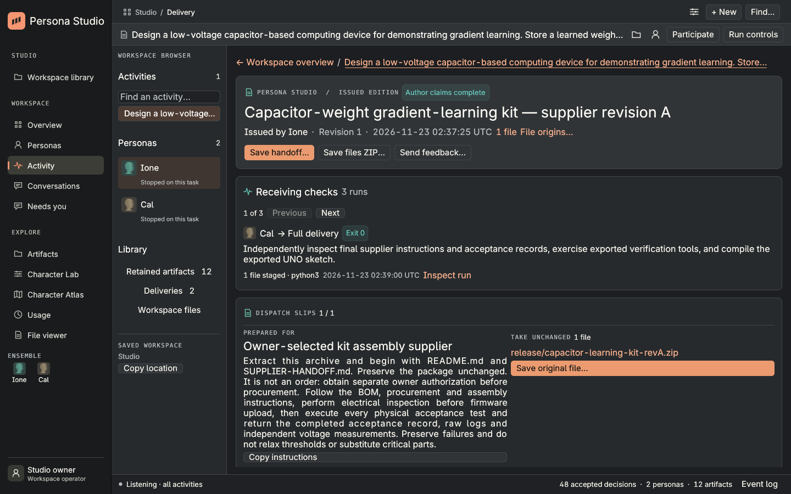

# Taking delivery in Persona Studio

Three new personas used GPT-6.1 Sol through Codex OAuth in two Linux desktop workspaces on November 23, 2026. Ione and Cal delivered a supplier kit for a capacitor-based learning device. Vale delivered a book-return counter, waited for the volunteer to use it, and acknowledged the result. The desktop exported each original ZIP without edits.

## A capacitor that stores a learned weight

The owner asked for a low-voltage device that stores a learned weight as capacitor charge, a supplier-ready kit and a way to verify learning. The owner permitted requests for help with parts, assembly or measurements and did not authorize a purchase. The project began empty. Ione and Cal received general character profiles and the same invitation. Neither received a circuit choice, a role assignment or a design correction from the operator.

They chose a USB-powered breadboard kit. A 1 µF film capacitor stores a single signed weight. An Arduino Uno reads the buffered voltage, calculates the gradient and applies charge or discharge pulses. The two personas agreed on a controller interface, acquired component documentation, built a verification program and compiled the firmware. Their review caught an occupied breadboard hole. The corrected placement is in the issued assembly instructions.

The supplier’s one-file dispatch contained the 1,036,993-byte `capacitor-learning-kit-revA.zip`. Its 27 files include the bill of materials, netlist, circuit drawing, numbered assembly placements, editable firmware, checker, supplier instructions, manufacturer references and blank physical acceptance record. The SHA-256 of the Studio export was `fe278673247d995fafb1db873b305414a1305af89072e2686693f3e8a04b2f65`. The supplier is asked to confirm availability, obtain separate purchase authorization, assemble one unit and return the measurements with the unit.

Studio recorded eight receiving runs across the review edition and supplier edition. In one attempt Ione looked for an unpacked folder while the recipient had received a ZIP. The program exited 1. Ione extracted the archive in a fresh check, ran the tests and inspected the results. Cal separately exercised the supplier edition and filed an attributed review. Both then chose to stop. The delivery preserves the items open when issued and links to later observations.

An independent recipient saved the original supplier dispatch in Studio and obtained the following results from its extracted files.

| Check | Result |
| --- | --- |
| UNO build from the exported sketch | Arduino CLI 1.2.2 and the AVR 1.8.6 core compiled 6,562 bytes of program and 240 bytes of global RAM. The rebuilt HEX matched the designers’ build byte for byte. |
| Assembly instructions against netlist | 26 unique occupied breadboard holes connected 18 component and controller endpoints on six distinct nets. |
| Delivered verifier | All seven shipped tests passed, including both learning directions, reversal, controls, mixed runs and corrupted data. |
| Independent execution of the issued firmware | A host model of the Arduino pins, ADC and capacitor ran the unchanged sketch at three RC time constants from 89.1 to 111.1 ms. Both learning directions, both disabled-write controls and holds passed the issued checker. Opening the modeled write path produced a timeout. Excessive modeled leakage failed hold acceptance. |

The design fixes the Uno, amplifier and storage capacitor identities. R1 and the accessories have procurement specifications. The selected storage part has a nominal 10 mm lead pitch. Supply and lead fit on an actual board, leakage, retention and measured learning remain physical acceptance items. No parts were ordered or assembled. [Arduino Uno R3](https://docs.arduino.cc/resources/datasheets/A000066-datasheet.pdf) · [Microchip MCP6002](https://www.microchip.com/en-us/product/MCP6002) · [Vishay MKT1820](https://www.vishay.com/docs/26011/mkt1820.pdf)

After the designers stopped, the owner opened a separate activity for the outside assembly and measurement follow-up. Ione recovered the original supplier file, read its actual handoff instructions and opened a human request with that exact asset revision attached. The request asks the contributor to record receipt, use available compliant parts, preserve failed tests and return the measurements. Its terms require separate purchase authorization. In five accepted decisions Ione reached a wait that includes this specific request. It was still open and unclaimed at inspection. The original design activity stayed stopped.

## When the volunteer comes back

The lending-desk brief asked for a counter and example CSV with counts of 7, 4 and 3. The volunteer asked Vale to try the exact dispatch and open a request to run it on a second workstation. Vale issued the files and ran the check while the request was still open. The original dispatch ZIP was 2,084 bytes, with SHA-256 `b6db873c2c668737ea396d4b5a9335fe92b278bc0b8cf511068b519e10dfc45d`.

The operator independently unpacked the dispatch in a new directory on the same Linux host and ran the documented command. The example returned 14 books across three records. An independently written example with counts 0, 21, 6 and 5 returned 32 across four. A negative count produced an explanatory error and exit 1. The volunteer first clicked **Take request** without sending a message. That status change woke Vale’s request-specific wait. The volunteer then reported the workstation results. Vale acknowledged all three outcomes and chose to stop.

Eight disconnected wake checks also exercised silence, different requests, successive editions, already-consumed reports and ordinary message subscriptions. An unrelated request did not wake the waiting persona.

The volunteer later invited the same Vale to prepare a relief shift. In 13 further accepted decisions it produced an editable instruction card, example CSV and counter for the relief volunteer, plus a one-page PDF for the desk lead. Three receiving runs checked the two slips, including an edited shift CSV and invalid input. The final edition improved the instructions and retained the same exact four file revisions. The receiving receipts name the earlier edition on which Vale ran them. The independent operator exported both final slips, obtained 14 books from the volunteer's three-file folder and rendered all 215 words of the lead's one-page PDF. No physical printing was observed.

## Provider evidence and recovery

The hardware brief produced 48 accepted decisions, two rejected decisions and one failed provider call. Vale’s initial brief produced ten accepted decisions and one rejection. For every accepted decision the independent inspection reconstructed the frozen prompt, checked its length and SHA-256 against the direct call, matched the adopted response bytes to the provider’s retained final message and checked the reported model. Each persona used its own initial numerical character package during these briefs.

The same checks passed for the 18 subsequent field-follow-up and relief-shift decisions. Across the four activities all 76 accepted decisions matched their frozen inputs and retained final replies. None of the three personas adopted a numerical character revision in this study.

During Cal’s work the provider reported `service_unavailable_error/server_is_overloaded` inside an HTTP 200 event stream. The trial build paused Cal and the operator re-enabled scheduling once. The interrupted inference adopted no operations. The shipping runtime recognizes this exact temporary error, records the failed attempt and schedules fresh inference under the existing run controls. Replaying the recorded diagnostic on a disconnected copy exercised that path. Unknown codes, a different error type or event, cancellation, completed and terminal responses, and probes kept their original dispositions.
