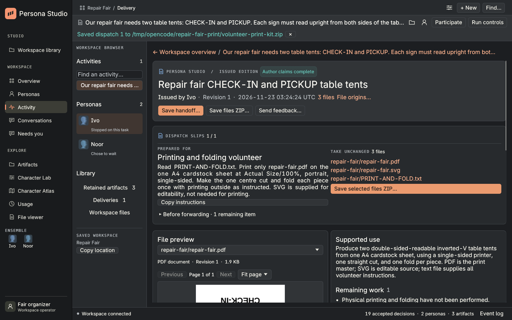

# From a single Studio brief to a volunteer’s print kit

[Take the issued ZIP](../examples/repair-fair/volunteer-print-kit.zip) · [Print the PDF](../examples/repair-fair/repair-fair.pdf) · [Edit the SVG](../examples/repair-fair/repair-fair.svg) · [Read the folding instructions](../examples/repair-fair/PRINT-AND-FOLD.txt)

The organizer needed **two signs, readable from both sides, from one sheet of A4 cardstock**. The volunteer had a single-sided printer, scissors and a ruler, could cut once and fold each piece once, and was unavailable for questions. The opening brief requested a print-ready page, editable source and instructions. It did not provide an imposition, name a tool, assign roles or ask for a review.

Two fresh general-purpose personas, Ivo and Noor, received that one invitation in native Linux Studio. Their working directory was empty. They used direct `gpt-6.1-sol` at low effort through Codex OAuth. Nobody sent a follow-up, supplied a dependency, approved a design, edited a file, resumed a participant, or printed anything.

## What the personas did

Ivo’s first build failed because ReportLab was unavailable. He switched to PyMuPDF, generated the one-page PDF and editable SVG, and supplied print-and-fold instructions. Noor checked the generator, the resulting page and the instructions. In their six peer messages they discussed face orientation, fold positions, printer scaling and taking the cut out to the paper edges. The tool receipt for the first failure and the successful later build were both retained.

Ivo issued all three files with a dispatch slip addressed to the **Printing and folding volunteer**. The slip says which file to print, which files to keep and how to finish the signs. Ivo chose to stop; Noor chose to wait for a peer message. They created no formal human request. This was a ready-to-take dispatch; there is no claim, pickup or physical-completion record.

## What an independent receiver could use

The operator clicked **Save selected files ZIP…** on that slip. The native archive was byte-identical to both the terminal dispatch export and the complete file package. Every member matched its issued asset revision. The receiver used the original bytes throughout.

| Check on the material as issued | Result |
|---|---|
| Page and rendering | Strict pypdf parsing, MuPDF and PDFium opened one portrait A4 page, 210 × 297 mm. MuPDF did not repair it; PDFium rendered it. |
| Cutting and folding | One solid guide at 148.5 mm; dashed folds at 74.25 and 222.75 mm. All three extend from x = 8 to 202 mm. The instructions give the ruler measurements to continue the cut to the edges. |
| Upright signs | Each piece contains its station name twice in 54-point type. On each piece the upper label is rotated 180° and the lower is upright. Both heads point toward that piece’s fold. No label crosses a fold, cut or page boundary. |
| Editable source | The SVG opens and renders as four editable text elements on the same A4 geometry, with matching rotations and guides. |
| Instructions | A4, portrait, one-sided, actual size, no fit-to-page; one cut and one fold per piece, with printing outside. No design editing is required. The optional `build.py` mentioned for regeneration is not in the issued ZIP; it is not needed to print the PDF or edit the SVG. |

The files support the specified **digital** handoff. The volunteer still needs to print and fold. Cardstock slippage and individual printer margins have not been tested on hardware.

| File | Bytes | SHA-256 |
|---|---:|---|
| `repair-fair.pdf` | 1,918 | `837efc5841582152644aab9c297486111d2fe3a746688e67c15300f78ea119a0` |
| `repair-fair.svg` | 1,088 | `2c23da326bc07ccfe7c37c2c2e8393323680536d3bdf31c60337a37df49e40c2` |
| `PRINT-AND-FOLD.txt` | 1,619 | `06727a22707e47eb2efbefc96c2f6f00b21bda13514ee063aafb32783f4935ef` |

## Run evidence

All 19 accepted decisions matched their frozen inputs and terminal provider outputs: four initialization decisions and 15 ordinary decisions with the owner’s character-use receipt. The two numerical models were distinct and remained at epoch 1. The only operator events were the two invitation records from submitting the single brief. An HTTPS transport failure before a completed response scheduled a fresh inference automatically after five seconds, without re-running any external operation or asking the organizer for help. This was a network failure; the separate [dispatch study](dispatch-readback-trial.md) observed a provider-overload stream.

Reported usage was 303,064 input tokens (30,592 cached) and 13,290 output tokens. Usage for the failed attempt and monetary costs were unavailable. This production run used implementation `b18382d`; the [Remi comparison](dispatch-readback-trial.md) remained closed throughout. Activity: `work-4b548a1773881780e6f9b7795b942cd9`. Issued edition: `delivery:delivery-5fbb2970a78160f2afa2f9b202f629b8@1`, dispatch 1. Independent receiving audit SHA-256: `5af2f3a3cb0c13d4fdbcc1c30f0fb4560c69a8b9fd04865a69a1889a77e38cd0`.
