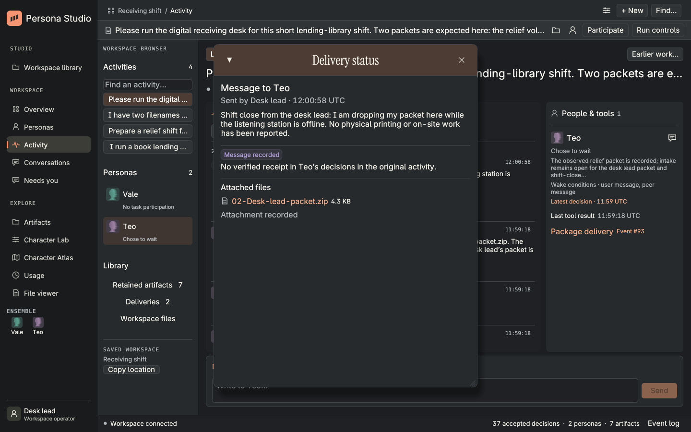
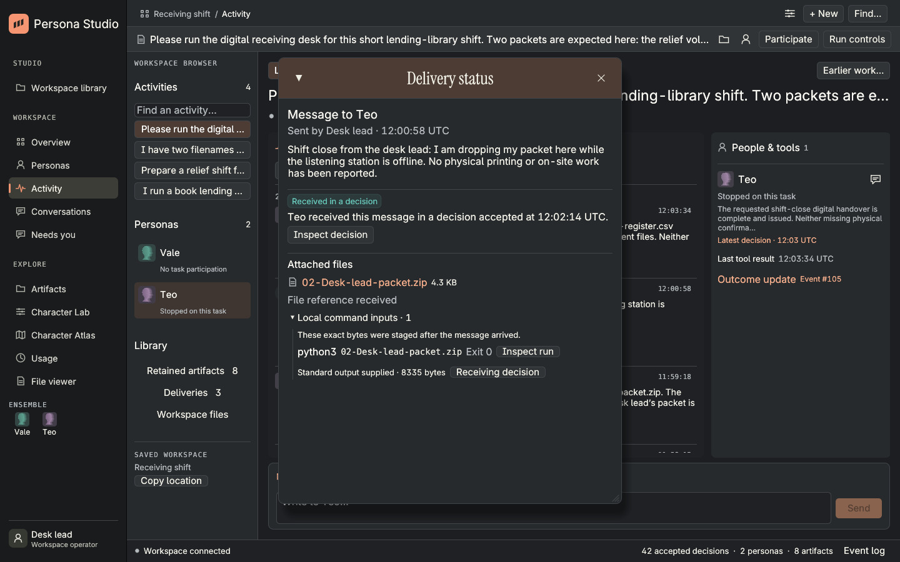
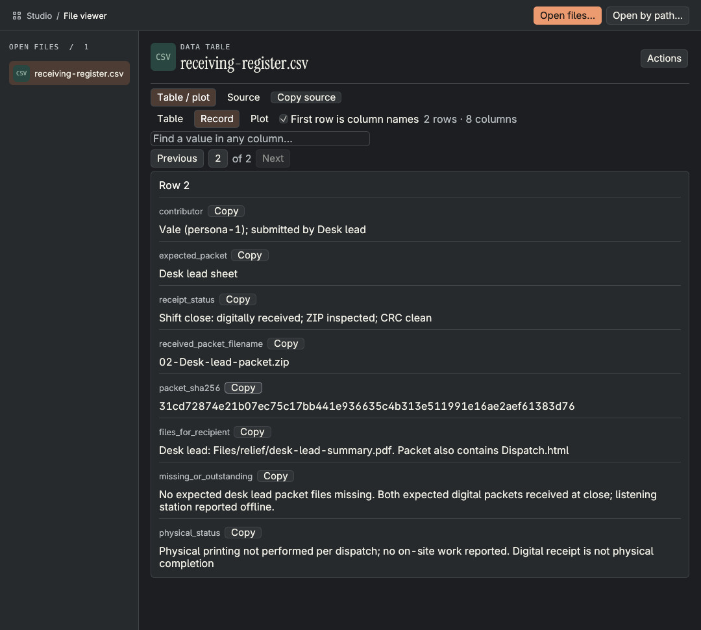

# A receiving shift across a listener outage

**[Download Teo’s editable shift-close register](../examples/shift-intake/receiving-register.csv).** It identifies both submitting roles, their exact packet filenames and outer SHA-256 hashes, and the three volunteer files versus the single lead PDF. The next clerk can use the CSV unchanged. Both packets arrived; neither printing nor work at the physical desk was confirmed.

The [registered brief](../examples/shift-intake/protocol.json) went once to the continuing Teo in native Linux Studio. Vale, who had issued the two original packets in an earlier activity, was available. Teo accepted, chose its own register format, inspections and stopping point, and did not invite a peer. Three named local operator roles used separate native windows on the same workspace. The two submissions were actual digital files, not reports from a staffed library.

## What happened while nobody was listening

| UTC, November 23 | What the station and the recipient recorded |
|---|---|
| 11:55:33–11:56:57 | One invitation at **72**. Teo issued the [opening register](../examples/shift-intake/open.csv) at **83**, with both packets outstanding. After its fifth decision it waited for an addressed message. |
| 11:58:15–11:59:18 | **Relief counter** sent the 5,666-byte volunteer packet at **86**. The first receiving choice, `call-d3de629f…`, requested a ZIP check. Two Python runs at **88/89** inspected the contents and dispatch text. Teo issued the [one-received register](../examples/shift-intake/one-received.csv) at **92**, replied at **94** and waited again. Knowing that a separate lead slip existed did not make it received. |
| 12:00:57 | The shift owner finished the listener. With no worker or unsettled effect, the runtime reported `unobserved`; Teo’s eighth decision still stood, waiting on `user_message` or `peer_message` with cursor **89**. |
| 12:00:58 | **Desk lead** sent the 4,380-byte lead packet and shift-close notice at **95** in the other window. The receipt showed the message and attachment recorded, with no verified receiving decision. |
| 12:01:56 | Immediately before the shift owner clicked **Run activity** once, the listener was still unobserved and the count was still **8**. Event **95** was the only event in that **59.094-second** observed gap. No explicit participant resume occurred. |
| 12:02:14–12:03:34 | The first accepted decision after reconnection, `call-93b791fe…`, received the complete message and file reference. Teo inspected the lead ZIP at **98**, saved the final CSV at **99**, checked its two records at **100**, issued revision 3 of the file to **Next clerk** at **102**, and chose to stop at **106**. Total: **13 decisions**, **7 min 42 s** from starting the station. |

The final CSV identifies **Vale as issuer** and separately names **Relief counter** and **Desk lead** as submitters. The relief row leaves workstation Python unconfirmed; the lead row attributes “printing not performed” to the dispatch and says no on-site work was reported. “Listening station reported offline” refers to the lead’s arrival message; it is not the station’s state at issue. Teo’s shorter reply at **94** called the relief packet “from Vale”; the [CSV issued alongside that reply](../examples/shift-intake/one-received.csv) makes the sender/issuer distinction explicit.

## What reached Teo and the next clerk

- All **13** completed `gpt-6.1-sol` / medium / direct Codex OAuth inputs and terminal outputs verified. The inputs contained the incoming text and exact attachment references. All four local launches matched the independent host log; the following accepted inputs contained the actual **2,347**, **7,503**, **8,335** and **1,830** stdout bytes. The lead check hashed the outer ZIP, checked CRCs, listed members and read the HTML dispatch. It did not render the PDF or print it.
- The [native download](../examples/shift-intake/receiving-register.csv), the exact text Teo sent in `asset.save`, the issued file and a separate CLI dispatch all had the same **1,230 bytes**, SHA-256 `f7d5e2a9aa54c10ef31c9b8517fc9ec11da2fc435a53d93faf03029935cf1223`. The [235-byte instructions](../examples/shift-intake/next-clerk.txt) copied from Studio matched the accepted `result.deliver`. The [independent receiving check](../examples/shift-intake/receiving.json) used the original ZIPs, including their dispatch sheets.
- Reported usage: **245,437 input tokens** (94,464 cached) and **9,629 output tokens**. Monetary charge was unreported. [Decisions, arrivals, actual commands and listener readings](../examples/shift-intake/decisions.json).

**X04 has direct evidence for this bounded digital service:** two separate arrivals, an observed outage, a normal reconnection, a handoff and a voluntary end. It does not establish continuous observation, unattended restart after an OS crash or service at a physical desk.

## Following a submission in Studio

In **Activity → Live activity → Messages**, open the submission’s **Delivery status**. **Local command inputs → Inspect run** follows the exact submitted file to the recipient’s recorded process. **Receiving decision** opens the later choice that got its stdout. For the lead packet that is Teo’s 12:02:51 decision to save the closing register, not its later decision to stop. The links were added **after** the shift. [Disconnected receipt controls](../examples/shift-intake/inspection.json) checked that removing a producing or receiving completion withheld the corresponding evidence, and that a late duplicate of the same ZIP inherited neither claim.

Open the final edition, click **handover/receiving-register.csv** and choose a row number or **Record**. Each field wraps and can be copied separately. Filtering by “Relief counter” kept only original row 1, including in an 810 × 780 window. We also opened the actual downloaded CSV directly in Studio’s file viewer; copying the lead hash returned all 64 characters of the original ZIP checksum.

## The numerical comparison

Both resident packages stayed at epoch 1 from the private archive **before invitation** (event **71**) through the settled archive at **106**. Every Teo response chose `preserve`; all 13 accepted inputs used the same numerical baseline. The three earlier participations retained their original heads. No eligible post-initialization numerical activation occurred. As in [Linn’s textile commission](stitch-desk.md), the registered paired brief remained unseen by the personas and neither arm was run.

Design `7d86efb`; live runtime `6564ee4`; the [shift protocol](../examples/shift-intake/protocol.json) and epoch observer were registered at `49fa173` before admission. Post-shift desktop `96981bf`; evaluator sources and unedited exports `801e47c`. [Source and offline checks](../examples/shift-intake/) · [Full acceptance map](acceptance-map.md)
