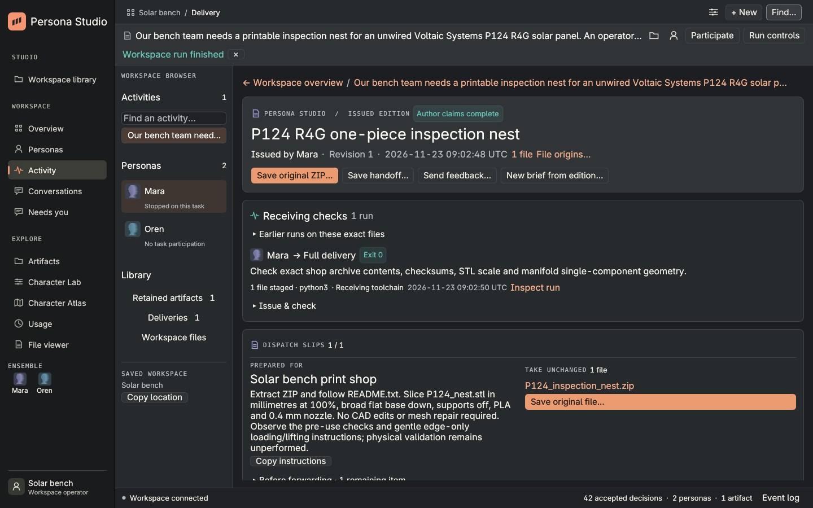

# A solar-panel inspection fixture from one Studio brief

**The shop can slice the [original ZIP](../examples/solar-inspection-nest/P124_inspection_nest.zip) at 100%, without editing CAD or repairing a mesh.** Mara designed an inspection nest for an existing Voltaic P124 R4G module. Stock CuraEngine generated 66 layers with supports off. The nominal manufacturer model fits. The drawing does not establish cell-free seating at every tolerance extreme, so this is a digitally checked first-print package, not a production-qualified fixture.

[View the issued STL in Studio](assets/studio-solar-nest-model.jpg) · [Shop instructions as copied from Studio](../examples/solar-inspection-nest/shop-dispatch.txt) · [Mara’s reply](../examples/solar-inspection-nest/reply.md) · [Replay the receiving checks](../examples/solar-inspection-nest/README.md)

## The brief and the handoff

The bench operator wanted to lower an unwired panel cells-down, reach both rear pads and lift it by the edges. The shop had a 180 mm FDM printer, PLA and a 0.4 mm nozzle. The operator attached the [manufacturer drawing](https://voltaicsystems.com/content/P124_dwg.pdf); the shared project contained that drawing, the [datasheet](https://voltaicsystems.com/content/P124_ds.pdf), the [STEP model](https://voltaicsystems.com/content/P124_3D.stp) and their source locations. The shop supplied no fixture, design method, checker or subsequent task message.

The packaged native desktop invited Mara alone. Oren was available; Mara chose to work independently. Mara read the drawing as images, inspected the manufacturer’s geometry, built a parametric solid with CadQuery, and created a one-file dispatch for the print shop. Mara then unpacked the **issued** ZIP in the receiving toolchain and checked its files, checksums, mesh topology and dimensions. That run exited zero at event **68**. Mara chose to stop at **71**, **13 minutes 36 seconds** after invitation. No peer or human request was opened.

**Save original ZIP…** returned **20,402 bytes**, identical to the separately exported delivery member and recipient dispatch. All five hashes in the six-file archive verified. **Copy instructions** returned the exact 294 bytes on Mara’s slip. The ZIP contains the STL, editable STEP solid, parametric `model.py`, print/use instructions, the issuer’s verification and a checksum file. The issued archive and reply are preserved as sent.

## What the shop can rely on

| Question | Independent result on the download |
|---|---|
| Can the shop print from the supplied STL? | **Digital slicing passes.** The 79.5 × 126.5 × 13.2 mm STL has 96 triangles, one closed connected shell, consistent winding, and no duplicate or zero-area facets. At 0.20 mm layers, four walls, five top/bottom layers and 20% infill, CuraEngine 4.13.0 emitted **21,802 depositing moves over 66 consecutive layers** within the bed. No support paths were generated. Across 65 adjacent model sections, no material extended beyond the preceding section’s 45° support allowance. |
| Is the editable source usable elsewhere? | Running only the issued `model.py` in a new directory with CadQuery 2.6.1 regenerated the **byte-identical STL**. The issued and regenerated STEP files each opened as one valid solid; their geometric symmetric difference had zero volume. |
| Will the panel outline drop into the nest? | The 67.5 × 114.5 mm pocket has **1.0 mm total clearance on each axis** for a 66.5 × 113.5 mm maximum panel. No fixture material projects over the pocket above the seating height. Even the smallest aligned panel has at least 307.75 mm² of support common to all its in-pocket translations. Its possible center positions stay inside the support polygon’s convex hull. |
| Can the operator reach the pads and lift the panel? | The guide stands **1.2 mm** above the seat, at least **1.1 mm below** the back of a flat minimum-thickness panel. Neither pad is covered. Opposed **24 mm** finger bays give **10 mm** of open height above their bottom webs. Grip, sag and loaded probe stability have not been physically tested. |
| Does the nominal manufacturer assembly fit? | The 2023 STEP assembly measures 66 × 113 × 2.9 mm. At the center and eight translated positions through its nominal free play, the module and fixture had **zero intersecting volume**; all ten projected cell solids remained at least **2.0 mm** from the bearing faces. This tests that reference model, not all manufactured panels. |

### The cell-edge qualification

Mara treated the R4G drawing’s **5.1 ± 0.5 mm** width-side cell setback as applying to both edges. With that assumption its XY calculations are correct: even at the stop, the active field clears the seat by at least **1.35 mm across** and **1.20 mm along** the panel.

Sheet 1 calls out the setback on the **right**. It does not explicitly repeat it on the left or specify centering of the array. With the drawing’s general ±0.3 mm tolerance, a 65.5 mm panel, two 27.8 mm cells, a 1.1 mm gap and a 5.6 mm right setback leave **3.20 mm** on the left. The emitted seat extends **3.25 mm** inward from the stop. In that combination the projection of one cell overlaps the actual bearing face by **0.05 mm**, or 1.009 mm² along a 20.18 mm cell. This is a possible load on the encapsulant over a cell, not observed damage or proof that Voltaic produces that combination.

The August 2026 datasheet’s mechanical illustration also gives **4.75 ± 0.5 mm** on one side, with different cell and gap dimensions. It does not supply a bilateral guarantee. The detailed R4G drawing is the stated design basis; the older nominal STEP cannot decide a tolerance question. Before using this as a production fixture for arbitrary R4G stock, establish the minimum cell-free margin on **both** long edges and check the printed seat. No print, probe test, supplier acceptance or purchase occurred.

## What changed in Studio

The desktop already measured standalone STLs, but a shop often receives the model **inside** the persona’s ZIP. Select the STL in **File preview → Inside this archive → Measure mesh…**. The window now shows its X/Y/Z envelope and can measure a line directly in the original member. The receipt binds the archive revision, member path and mesh bytes. The optional persona tools `geometry.inspect_stl` and `geometry.profile_stl` accept the same member selection.

On the stopped history, the native window and CLI both found **6 mm of material, a 67.5 mm opening, and 6 mm of material** along X at Y=30.37, Z=12.6. A line through the finger bays had zero crossings. A separate ray-intersection implementation agreed. Missing paths, duplicate names, bad CRCs and altered retained bytes were not accepted. This feature was built after the trial; it is not credited to Mara. [Native measurement](assets/studio-solar-nest-measure.jpg) · [Exact receipts](../examples/solar-inspection-nest/mesh-receipts.json)

The [registered protocol](../examples/solar-inspection-nest/protocol.json) used direct `gpt-6.1-sol` / medium through Codex OAuth. All **42 accepted choices** matched their completed inputs and terminal provider outputs; two additional provider attempts were incomplete. Two accepted choices initialized Mara’s model and 40 ordinary decisions used epoch-1 baseline inclinations. This demonstrates an autonomous digital handoff, not beneficial numerical maturation. The external observer initially treated an empty event table’s starting sequence as null; reading it as zero recovered the existing stop. No participant was restarted or reinvited. [Decision and tool record](../examples/solar-inspection-nest/decisions-and-runs.json)
