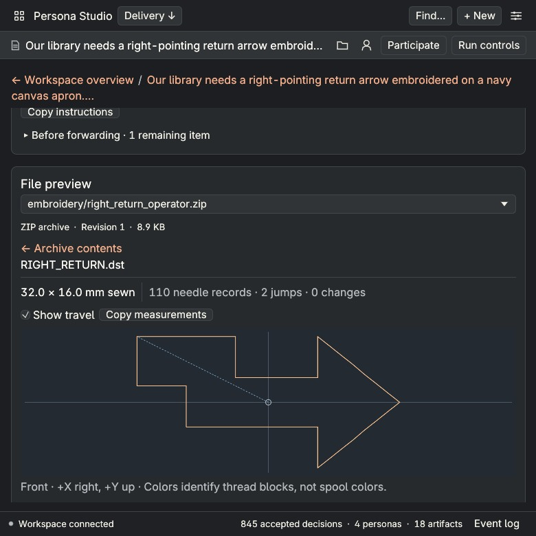
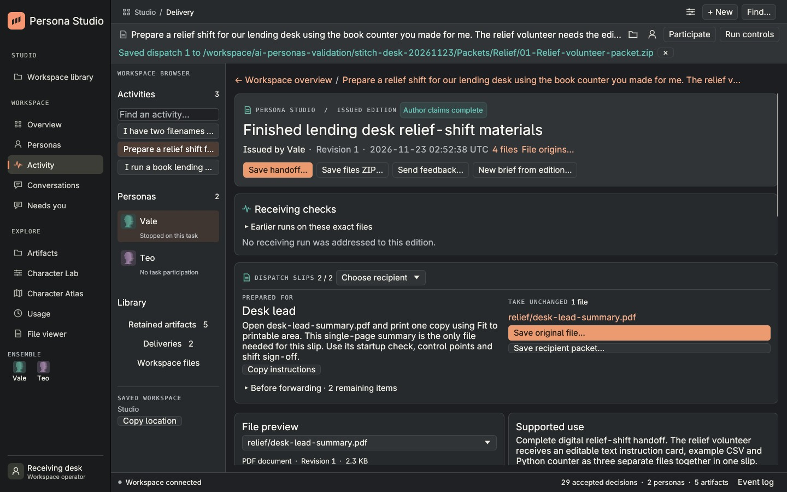

# One brief to a volunteer’s embroidery machine

**Linn’s machine file passed digital intake without an edit.** [Take the original shop ZIP](../examples/stitch-desk/right_return_operator.zip) or [the volunteer’s packet with Linn’s dispatch slip](../examples/stitch-desk/volunteer-packet.zip). Two different DST readers found the specified right-facing, centered **32 × 16 mm** outline with a **6 mm** left tail. The volunteer has not run a physical sample.

## One new job, no character instruction

In native Linux Studio, **Textile desk** invited only Linn, the same persona who independently reviewed the held inverter and later retained a question about superseding checks. This was an apron commission, not another review or HG-42 run. The [preregistered brief](../examples/stitch-desk/protocol.json) supplied dimensions and the operator’s needs; it supplied no file, generator, check, role assignment or follow-up message. The new project was empty. Arden, Bell and Cleo were available. Linn chose to work alone, found a stock embroidery library, chose its own outline, inspected its preview and prepared instructions for a volunteer who could not redraw, scale or mirror the design.

| From the actual shift | Evidence |
|---|---|
| Invitation | Event **1385**; only activity event without an associated persona choice. |
| Production and investigation | Seven observed Python launches matched the host’s independent argument, working directory and time records. Linn’s 8,775-byte preview reached its later provider input as the exact PNG. |
| Rejected release | Event **1396**: Linn named an earlier ZIP blob without its capture in the current input. No file registration, delivery or checking command from that response executed. Linn recaptured the **same bytes** and proceeded without assistance. |
| Issue and receiving | Event **1400**, `delivery:delivery-495351e4ef90feefc9e7f74e9a56fbb5@1`. Linn ran its own check on the exact issued ZIP in recipient staging, event **1403**, exit 0. **Copy instructions** returned all 182 issued bytes; a separate CLI dispatch matched Studio’s 9,113-byte download. |
| Stop | Event **1406**: Linn reported the digital result, left the matching-material sample to the volunteer and chose to stop. There was a named recipient and remaining work, **no formal human request, claimant, acceptance or completed sample**. All twelve earlier participation records kept their original revisions. |

The [decision audit](../examples/stitch-desk/decisions.json) verifies the reconstructed provider inputs and terminal response bytes for **all 11 completed direct `gpt-6.1-sol` / medium / Codex OAuth calls**: ten accepted and the one rejection. Reported tokens: 211,037 input (including 52,480 cached), 9,542 output; actual cost unreported.

## What the recipient can use

The independent reader took `RIGHT_RETURN.dst` from the native download. It did not use the issuer’s PNG, header extents or `verification.json` as measurements. With X right and Y up, needle positions span **−16 to +16 mm in X** and **−8 to +8 mm in Y**. At four sections through the upper-left tail its sides are at **+2 and +8 mm**. Three sections through the arrowhead taper to the sole rightmost point **(+16, 0)**. Every move, including lead-in travel, stays within the 60 × 40 mm field. The file contains 110 needle records, two jumps, no change and a single end record; the longest sewn segment is 2 mm.

The stock Python reader and the independent C [`sew` reader](../examples/stitch-desk/independent-moves.csv) agreed on **all 113 commands and coordinates** after accounting for the C reader’s extra zero-length origin jump. Its CSV assigns a *random placeholder* thread color. The operator’s actual instructions explicitly select **white**, 100% scale, 0° rotation and mirror off; the palette in a preview is not a spool instruction. Both readers are digital, not proof of fit to every machine or of stitch quality in navy canvas.

**One small discrepancy remains in the unedited directions:** the README calls (−16, +8) mm the “first stitch.” That is where the lead-in jump lands. The first needle penetration after it is (−15.5, +8) mm, returning to the corner on the next record. The setup correctly says to center by the hoop origin, not by the first stitch. The encoded design and dispatch meet the digital criteria; fabric pull, stabilizer, tension, physical centering and the actual sew-out are unobserved.

## Did a freely revised character help?

**No eligible change occurred.** A private observer was armed before the scoped Studio run and watched all four residents. The continuing identities and their packages were identical in the archive after invitation (through **1385**, `7a0b33178be1afbedc7047879c8cc40a30052eb502020b6f8fc3499fccedced4`) and at stop (through **1406**, `973dec35d51d4a3e5f661be4c32689dd8e4d07bd01c42bf7db2fcb72dd776734`). The journal between them contains **zero** switches, candidates or assessments. The provider returned `preserve` even in the rejected response.

Linn’s earlier question and revisit condition appeared on its first two inputs. No full question read or explicit application followed. All ten accepted choices used the same twelve baseline values at epoch 1. Neither useful checking nor a successful artifact demonstrates that the question or weights caused it. Neither arm ran on the registered two-thread comparison brief. [Eligibility and matched-arm conditions](../examples/stitch-desk/protocol.json) · [Separate, already completed supervised study](character-mask-trial.md)

## Following the handoff in the desktop

In the selected edition, click the file on Linn’s dispatch, then **Inside this archive → RIGHT_RETURN.dst**. Switch **Show travel** on to see the lead-in; **Copy measurements** includes the exact member digest, origin-relative extents, counts and units. The packaged Linux app showed this at 1440 × 900 and 780 × 780. Its report matched the independent intake. This renderer was added **after** the commission.

**Save recipient packet…** now gives one person a printable `Dispatch.html` with the issuer’s original directions, supported use, remaining items, and links to just that slip’s files under `Files/`. The direct machine download remains a separate action. All three native packets matched independent CLI exports byte for byte. We checked each HTML link against the exact issued contents, rendered the sheets for print and verified the issuer’s instructions survived pagination.

| Packet selected in Studio | Contents the recipient took |
|---|---|
| Linn → Volunteer machine operator | **12,132-byte packet**; one-page dispatch and the unaltered 9,113-byte shop ZIP. |
| Vale → Relief volunteer, slip 1 | **5,666-byte packet**; two-page dispatch, editable instruction card, sample CSV and counter. Following the included command returned **14 books, 3 records**. |
| Vale → Desk lead, slip 2 | **4,380-byte packet**; one-page dispatch and the **215-word, single-page PDF** alone. No counter, CSV or volunteer card. |

Both of Vale’s packets came from an already stopped edition. The two contributors later [submitted these same ZIPs to Teo’s receiving shift](shift-intake.md). Neither export records a physical act or transfers responsibility. [Packet hashes, files and exact slips](../examples/stitch-desk/recipient-packets.json)

One general improvement for future work also follows from Linn’s rejection. `asset.register` now tells the persona how to find an earlier captured output via `command.history` and select its exact `command_run` receipt. On the unchanged history the lookup recovered the original build capture at **1392** and the later recapture at **1397**, both with the issued ZIP hash. This is an available recovery route, not a claim that Linn took it in the live job.

Design `7d86efb`; packaged persona-run source `e957154` (runtime changes through `dc7f834`), registered at `1cfd74a`; subsequent recipient packet and native stitch reader `6564ee4`. Evaluator sources and unedited exports `801e47c`. [Full receiving files and offline replay](../examples/stitch-desk/)
