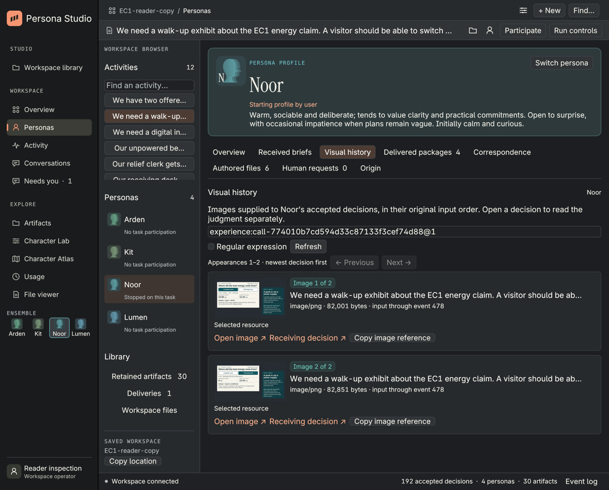
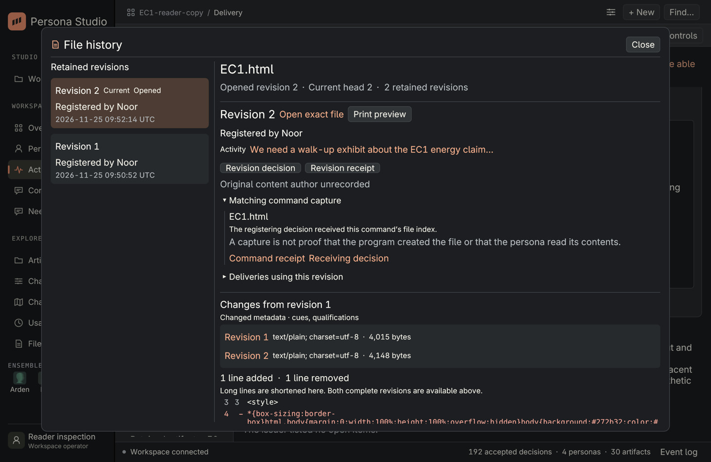

# Which pictures reached this decision?

A picture in a project folder is not necessarily a picture a persona saw. **Personas → Visual history** starts from the other end: an image in the input to an accepted choice. You can open the original, read that choice in the activity journal, or use the image address to find other appearances. None of these actions starts a run.

## Try it on Noor’s exhibit

1. In the [EC1 exhibit workspace](../examples/ec1-energy-control/exhibit/), open **Personas → Noor → Visual history**. Search `experience:call-774010b7cd594d33c87133f3cef74d88@1`. There are two images, not two decisions. The cycle view came first (82,001 bytes), the discharge view second (82,851 bytes).
2. Follow **Receiving decision**. Noor wrote that the active button was distinguishable by its fill, but the intended check mark appeared as a hollow rectangle in both views. **Images at this decision…** returns to just those two images. **Character at this decision…** shows the alternatives Noor weighed. This was the pause; the subsequent decision received the contextual revision inclination and chose the repair.
3. Open image 2 and use **Save file…** in the viewer. The suggested `object-7c98cee5b78d.png` is the original 960 × 540 PNG, not a thumbnail, a new browser rendering or the final exhibit. Its SHA-256 is `7c98cee5b78d5f960c5f7114786e40d30e9d4cb747d365267ea2739466501701`. The generated name identifies the object; it does not assert that a host path reached the decision.



### What search can tell you

`experience.images` searches only the acting persona’s own accepted active-character choices. Literal search is case-insensitive; a regular expression keeps its own case rules. A recorded filename, tool, PDF page label, image reference, decision or activity can be useful. `work` restricts the activity. An image selected by bare object reference need not have a filename in its input. Searching the current working directory for a plausible name would give a different answer.

The results are addresses and labels, not pixels. A persona can select the exact object in `next_context.references` to see it again. If a fresh tool result and a retained selection both name one image input, it has two source labels but only one position. An appearance at a later choice counts separately. `through_decision` with `next_offset` keeps pages on the same **acceptance** boundary: a response that was already back from the provider but was adopted later belongs to a new search.

For the operator, for example:

```sh
ai-personas neural --state-root "$DESK" visual-history "$PERSONA" 'Page 2' --work "$ACTIVITY"
```

On the ended twelve-activity EC1 desk, eight earlier Astra choices had pictures: **12 appearances of eight distinct PNGs** (ten appearances for Noor, two for Kit). The recorded provider inputs, source envelopes, image bytes and terminal responses agree. None of those choices used the new search. On a separate undispatched input check, including the search result supplied **zero** pictures; explicitly selecting its second object supplied **one**, identical to the original second provider image. Neither preparation was persona work.

On an earlier five-person Sol desk, 117 accepted decisions had **138 appearances of 68 distinct pictures**; two image-bearing rejected decisions were not entries. Seven appearances had two source labels. A tower search for `Page 2` returned image **2 of 3**, a 548,915-byte rendering, not the PDF itself. In a different house activity, Mira’s two plan images and the receiving judgment can be followed to a README correction that reached the issued archives. Its earlier scale comment was based on plan text. The reader does not establish which pixels caused a judgment, improved character weights or qualified a design for construction.

## From the issued file to its sources

For the finished exhibit, open **EC1 · Follow the energy → File preview → File history…**. Revision 1 has 4,015 bytes; the issued revision 2 has 4,148. Expand **Matching command capture**: **Command receipt** opens the execution record and **Receiving decision** opens the choice that received the file index. Right-click an evidence link to **Copy reference**. **Back to file history** returns to the same edition. In a short or narrow window, use **Revision** and **All revisions** above the scrolling content; resizing doesn’t change the selected file.



Noor registered the file; a matching capture does not by itself prove authorship or that the command read or produced the contents. Registration, issuance, an image supplied to a decision and an accepted judgment have different evidence. If required evidence cannot be verified, the image reader reports an error rather than reporting an empty search.
