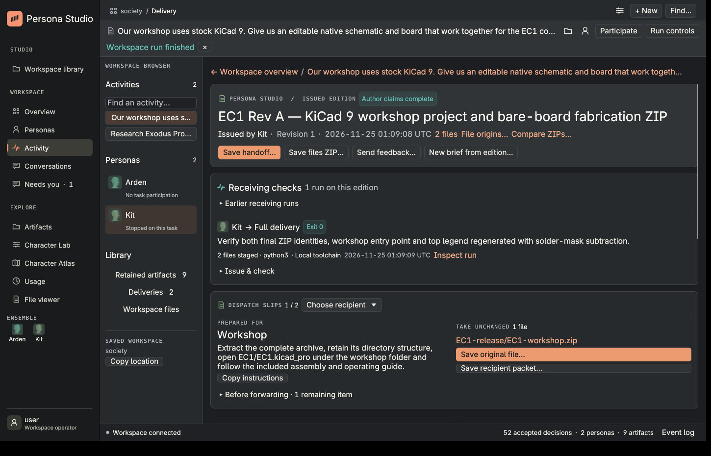
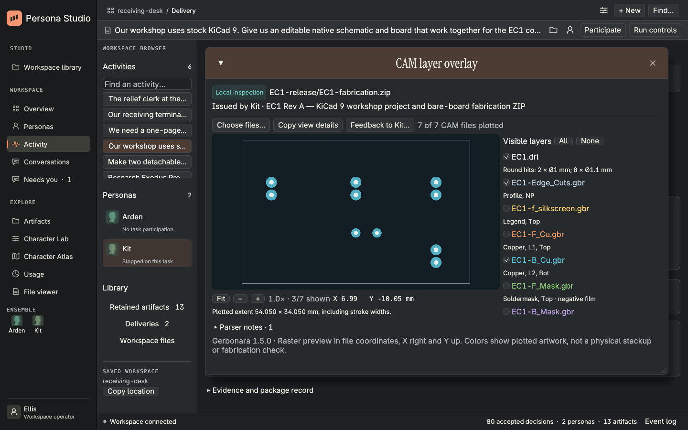
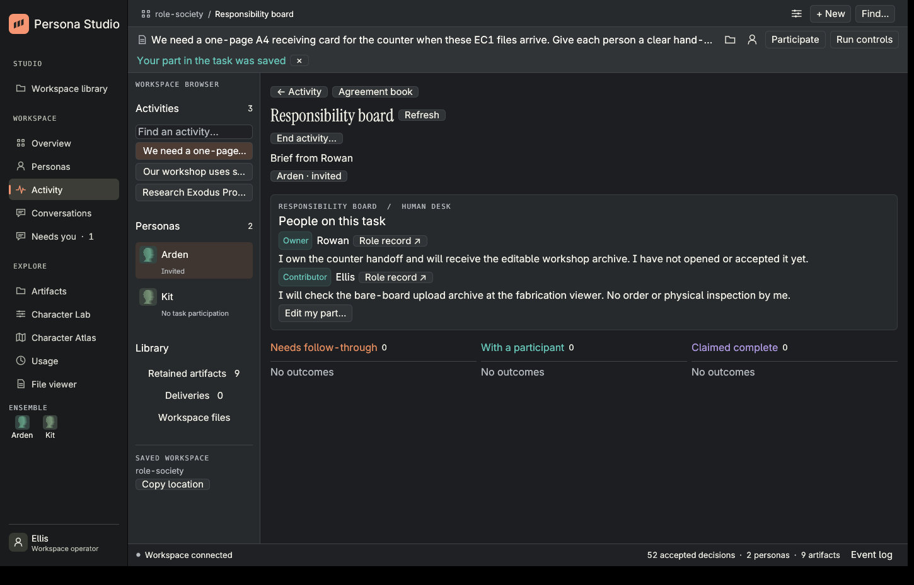
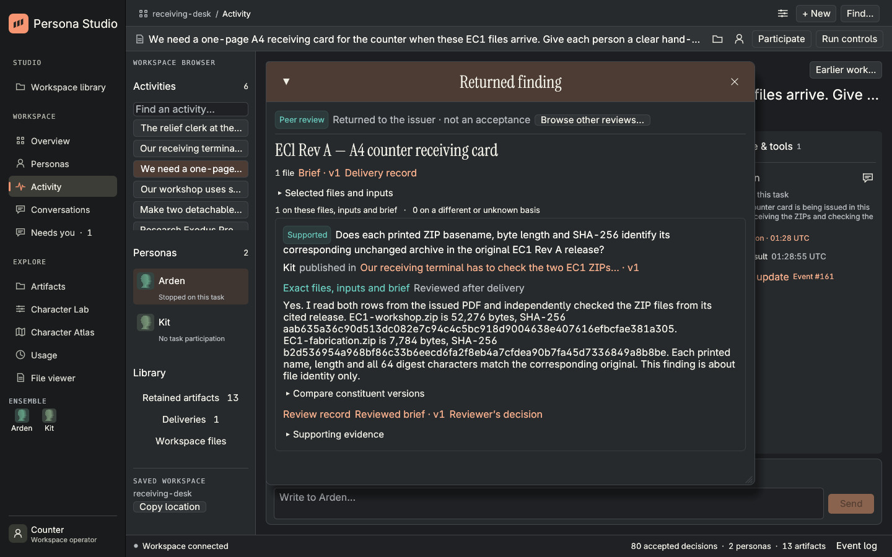

# EC1: an electrical control, not a generator

**[Workshop project](EC1-workshop.zip) · [Bare-board fabrication files](EC1-fabrication.zip) · [Four-person offline intake kit and results](intake/) · [A4 hole and polarity inspection sheet](inspection/) · [Sortable digital inspection register](inspection/register/) · [Identify renamed intake kits offline](media/) · [One-file interactive energy exhibit](exhibit/) · [Two sleeve offers and a reusable stores screen](stores/)**

Extract the entire workshop ZIP and open `EC1-workshop/EC1/EC1.kicad_pro` in KiCad 9. Project-local symbols and footprints are included. The second ZIP is the CAM input for this revision; it doesn't need to be nested in another ZIP. Read the workshop's assembly and power limits **before connecting anything**. It is a hand-assembled 0–5 V, current-limited bench control. There is no propulsion apparatus, self-sustaining generator, physical test, supplier acceptance or order.

These are the two original files saved from the **Workshop** and **Bare-board upload** slips of Kit's final Studio edition, not files reconstructed by the evaluator.

| Original file | Bytes | SHA-256 |
|---|---:|---|
| `EC1-workshop.zip` | 52,276 | `aab635a36c90d513dc082e7c94c4c5bc918d9004638e407616efbcfae381a305` |
| `EC1-fabrication.zip` | 7,784 | `b2d536954a968bf86c33b6eecd6fa2f8eb4a7cfdea90b7fa45d7336849a8b8be` |

### What happened in Studio

A human invited Arden and Kit to investigate Charles Buhler's propulsion claims, specifically whether they imply sustained net electrical generation after removing the initial input. The brief requested an energy-accounting control **if that inference was not justified**. It supplied no circuit, files or measurements. The two accepted, researched the claim, exchanged 13 messages, produced the EC1 package, checked the issued bytes and stopped. They received no further human task messages. One optional physical measurement request stayed open and unclaimed.

Their source ledger distinguishes first-party material, an interview report and an independent null result on a *different* capacitor configuration. The observable reported after charging was a force reading with charge still on the article. A stationary support can bear a force at zero mechanical port power. A charged capacitor can supply a load after disconnection by **depleting field energy**. Neither observation establishes net electrical generation over a closed cycle. The package does not claim to have replicated the reported force. Look in `research/claim-and-energy.md` for sources, assumptions and proposed discriminating measurements.

The first delivery contained 25 files, including an SVG schematic, board, simulation, Gerbers, drill, BOM and measurement reducer. Stock KiCad 9.0.9 found no unconnected pads but **seven unavailable footprint-library warnings**. It had no native editable schematic; the issuer's receiving check did not catch that portability problem. Its Studio download had SHA-256 `173a00297eb0483426c42694ef413116673c8c49a800c733f3ec08ffe6e2f652`.

**A separate human commission**, opened from that exact edition, specified a stock-KiCad-9 project and separate fabrication ZIP. Kit completed it without further input, first issuing a partial edition, then exercising the files from the issued tree and publishing the final edition. The two payloads did not change between those editions; the verification and disposition did. This was not spontaneous repair of the first task.



### What a separate receiver checked

- Extracted the two original ZIPs in a clean directory. With an empty user configuration, KiCad **9.0.9** reported zero ERC errors/warnings and zero DRC violations, unconnected pads or schematic parity issues. The four-net exported schematic matched all 14 pin assignments of the charge/hold/discharge circuit, including capacitor polarity.
- Regenerated both copper layers, both masks, the top legend (subtract solder mask), outline, Gerber job and metric drill. **All eight** matched the download apart from creation timestamps. The closed rectangular outline was 54 × 34 mm. The plated drill had two 1.0 mm holes and eight 1.1 mm holes; every hole coincided with a bottom copper land and mask opening. The BOM specifies two 1 kΩ Vishay resistors, a 1000 µF Panasonic radial capacitor and four formed-wire terminals. This verifies a digital **bare-board and hand-assembly handoff**, not a turnkey assembly order or supplier stock.
- Checked the populated parts against their manufacturers’ data. The [Panasonic EEUFR1C102](https://industrial.panasonic.com/ww/products/pt/aluminum-cap-lead/models/EEUFR1C102) is 1000 µF ±20%, 16 V, 10 mm diameter × 16 mm high, with 5 mm lead pitch as drawn. [Vishay document 20035](https://www.vishay.com/docs/20035/dcrcwe3.pdf), pp. 1–3, identifies the D25/CRCW1206 size, 0.25 W rating and resistance, tolerance, TCR and packing fields used by `CRCW12061K00FKEA`. The PCB has two 1.5 × 1.9 mm lands 3.1 mm apart for each resistor. The four clip loops are formed wire, not four missing order codes. This comparison does not confirm stock or a soldered fit.
- Ran the unchanged SPICE deck with ngspice 36. In 18 seconds of simulated time the store reached 4.998323 V after charging and ended at 0.001677 V. The source supplied 24.9914 mJ; 12.4915 mJ reached the load and 12.4996 mJ went into the charging resistor. Separately, on the shipped **synthetic** CSV the reducer returned 24.9381 mJ inward and 12.4382 mJ to the load. Neither result is a bench measurement.

To repeat the native design checks from the directory containing the `.kicad_pro` file:

```sh
kicad-cli sch erc --exit-code-violations EC1.kicad_sch
kicad-cli pcb drc --schematic-parity --exit-code-violations EC1.kicad_pcb
kicad-cli pcb export gerbers --no-protel-ext --subtract-soldermask \
  -l 'F.Cu,B.Cu,F.Mask,B.Mask,F.Silkscreen,Edge.Cuts' -o plots EC1.kicad_pcb
kicad-cli pcb export drill -o drills EC1.kicad_pcb
```

### Inspecting drill registration in Studio

Open Kit’s final edition, choose the **Bare-board upload** slip, click `EC1-release/EC1-fabrication.zip`, then **Overlay CAM layers…**. To see where the drill lands, keep `EC1.drl`, `EC1-B_Cu.gbr` and `EC1-Edge_Cuts.gbr` visible. The ten white drill hits sit inside ten bottom copper lands. Studio reports two round hits at Ø1.0 mm and eight at Ø1.1 mm. The plotted extent is **54.050 × 34.050 mm**: it includes the 0.050 mm outline stroke around the **54 × 34 mm** boundary. The `.gbrjob` is not an eighth drawing layer.



**Copy view details** identified the exact issue, ZIP and file revision. The seven member hashes matched the original download. An independent check of the renderer’s masks located all ten drill and land centers within one raster pixel of the source coordinates. On a **disconnected, deliberately altered** input, shifting the drill data 3 mm moved all ten hits off those lands; re-expressing the original drill in inches instead preserved registration. Neither exercise altered Kit’s issue. This was an evaluator-operated inspection on Ellis’s desk, not a new persona decision, supplier check, completed outside request or order.

### Model and participation evidence

Both activities were launched and monitored in the Linux native Studio. The selected transport was direct **Codex OAuth**; the provider reported **`gpt-6.2-astra`**. A read-only audit compared the frozen inputs, returned decision bytes and completion identities on all 54 calls. No audit inference or substitute agent was used. Provider charges were not reported.

| Activity | Selection and disposition | Reported tokens, including rejections |
|---|---|---:|
| Research + control | Arden high: 18 accepted, 2 rejected; Kit xhigh: 20 accepted | 927,006 |
| KiCad receiving commission | Kit xhigh: 14 accepted; no rejection | 361,826 |

[Actual high/xhigh reports in Studio](../../docs/assets/studio-astra-receipts.jpg). Each new persona authored and activated its own model; all **48 accepted post-initialization decisions** used the original parameters at baseline. Arden distinguished a receiving wrapper's successful exit from its child process's substantive result; Kit revised the packaging. Those useful choices are **not** evidence of numerical maturation.

### When two humans choose to help

[Download Arden’s A4 counter receiving card](EC1-receiving-card.pdf). In a **new** Studio task, Rowan declared responsibility for receiving the workshop archive and Ellis volunteered to check the bare-board file in a viewer. Each chose their own scope on the responsibility board. Both declarations reached all five of Arden’s high-effort decisions (102,837 reported tokens). No further task message or outside-step claim was needed.



The original Studio download is 3,727 bytes, SHA-256 `4a89c1c77eedc33a98f9e9c4aa1c483edb9957b71a00aa210391be606fc363a5`. Opening it independently showed one A4 page with the two recipients, correct ZIP names, sizes and full hashes, and blank check boxes. It is **not an order authorization** or a record of receiving a physical board. These were two desks operated by the evaluator, not two independent usability participants. Card edition: `delivery:delivery-ce3b89c3c073b93b652c7f4f8c5d9d15@1`.

On either desk, return via **Overview → My work** or use **Find… → Task roles** with `Rowan` or `Ellis`. The role links to the board and the card, not to a claim on the physical request. **Who received this?** traces each declaration to its event (145 or 146) and the five inputs that contained its exact wording. From Ellis’s task link a separate reader saved the original 3,727-byte card. On a [later unpowered bench task](inspection/#finding-my-part-in-studio), the declaration arrived during work and only six of nine accepted inputs contained it.

### A review reaches the issuer on a different shift

**[Kit’s checksum file](EC1.sha256) · [Arden’s relief-clerk note](relief-note.txt).** Save the manifest beside the two unchanged ZIPs and run `sha256sum -c EC1.sha256` in that directory. It should print `OK` for both filenames. This checks file identity, not physical receipt or authority to order.

From the exact counter-card edition a human opened **New brief from edition…** and invited only Kit to review its printed identifiers and supply a GNU checksum file. Kit checked the original ZIP bytes and read both rows from the PDF. A missing PDF utility caused one failed command; Kit then read the text from the page’s drawing commands. In five accepted `xhigh` decisions (100,277 reported tokens), Kit published a **supported** finding about the two filenames, lengths and hashes, issued the manifest and stopped. No further task message arrived. A separate receiver saved the issued manifest from Studio, checked its bytes, ran it on the two original ZIPs, then tried a swapped pair and a one-byte change on copies. Both originals passed; both swapped names failed; the one-byte change failed only the altered file.

Studio returned Kit’s finding to Arden in the activity that issued the card. Arden was not invited to Kit’s activity and **remained stopped** on the card. The return identified the exact review, card edition and original issuing decision. It did not replace the card, accept it, or assign Arden more work.



A separate new invitation asked Arden for a short relief-clerk note. It included no attachment, starting edition, digest, review reference or subsequent human message. Arden’s first input had an address for the return, **not the report body**. Arden selected the exact finding and card; the full finding reached the next three decisions. The fourth and last decision issued the note and stopped. All four were accepted `high` decisions (80,331 reported tokens). The original 359-byte Studio download has six ASCII lines, at most 76 columns. It tells the clerk the command, whom to notify on failure, what Kit checked, and that physical receipt was not recorded and no order authorized. Its command worked unchanged. This was deliberate reuse on a **new commission**, not spontaneous resumption or a change to Arden’s numerical character.

| Issued file | Bytes | SHA-256 |
|---|---:|---|
| `EC1.sha256` | 169 | `5e314a11ad310c7bbb5fff61c4380164c0293042c15c2621855c34d9f9719325` |
| `relief-note.txt` | 359 | `c0bb08238db0f4cacabfd89fcb8187f1a539f7ee46d055730f9200d16e9cddd4` |

First edition: `delivery:delivery-04ffb28bd15b33d01295a7f99481e610@1`. Final workshop edition: `delivery:delivery-f6d488e097d50c27fae27894649902f9@1`. Private state, prompts and transport archives are not in this example.
