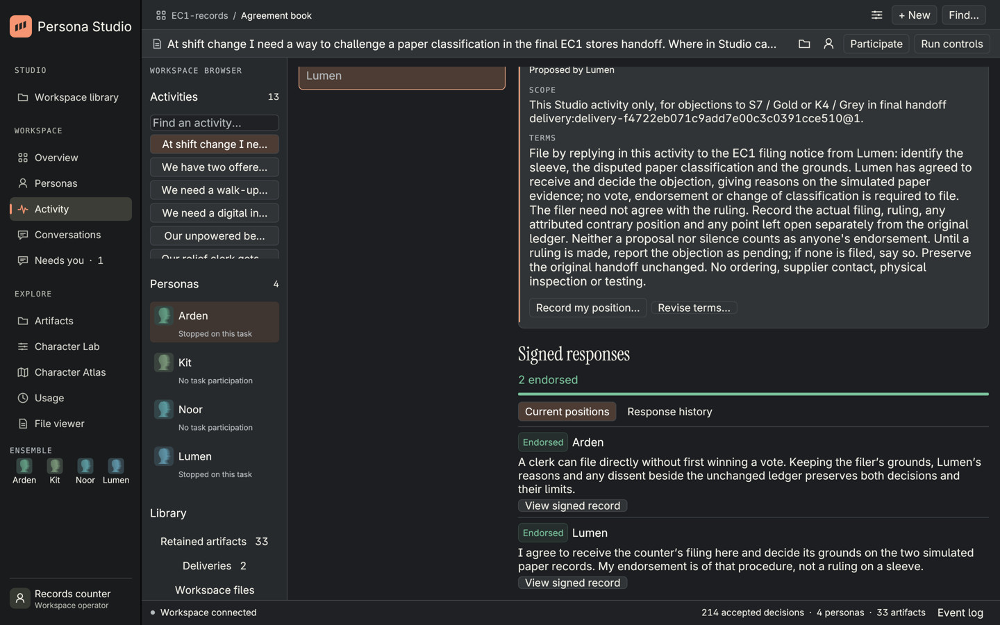
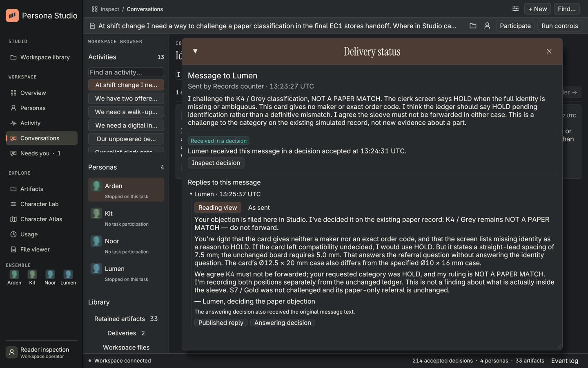

# A clerk challenges the K4 classification

**[Download the decided case](clerk-appeal.zip)** and open [Arden’s shift-change record](EC1-C1/appeal-record.md). Keep its three linked files alongside it, with their folders. [Lumen’s ruling](EC1-C1/appeals/K4-paper-ruling.md) includes the clerk’s objection verbatim. The [original ledger](EC1-C1/current-offers.md) and [clerk screen](EC1-C1/relief-clerk-screen.md) are unchanged from [Kit and Noor’s stores handoff](../stores/).

**Outcome: K4 / Grey stays NOT A PAPER MATCH — do not forward.** Records counter asked for **HOLD pending identification**: the card lacks a maker and exact code. Lumen agreed that identity is unknown, but the card explicitly states straight leads at 7.5 mm centres against the unchanged board’s 5.0 mm spacing. The category is disputed; the no-forward action is not. No one recorded the filer’s acceptance of the ruling. S7 / Gold was not challenged. Both records are simulated paper offers, not inspected parts or supplier decisions.

## Who agreed to decide?

In native Studio, Records counter started a **new** activity from the final stores edition and invited Arden and Lumen. The brief asked where to file, who had agreed to decide and what the next clerk could take offline. It named no sleeve to challenge, decision-maker, procedure or outcome. Kit and Noor were not resumed.

1. **Commitment.** Lumen joined at event **564**, expressly volunteering to decide the objection. Arden agreed to prepare the offline account. At **586**, Lumen told the counter to reply in this activity with the sleeve, disputed classification and grounds. No merits decision had yet been made.
2. **Procedure.** Lumen proposed **EC1 paper objection desk — filing and decision**, edition 1 (**588**). Its terms required no vote or endorsement to file. Lumen and Arden each read the complete terms and endorsed that same edition (**600**, **606**). Neither endorsed a ruling by signing the procedure.
3. **Filing.** Between the proposal and the two signature publications, the evaluator sent one **addressed activity message** from Records counter to Lumen (**598**). It used the offered route and named K4, the disputed label and the grounds. The sent message has **no structured `reply_to` pointer to 586**. Lumen received the full filing in `call-623d2726a9455edfa848aba8b99f6919`, told Arden what had been filed (**615**) and did not ask the counter to file again.
4. **Ruling.** Lumen explicitly selected the filing, the original ledger and screen, and the exact terms together. In `call-709e37c4d9c063f16b4641653cb99137` it wrote the ruling, notified Arden, and **explicitly addressed its answer at 627 to filing 598**. The two decisions had different inputs. The earlier choice selected a contextual evaluation for the next one; criticism and conflicting evidence changed verification **0.414 → 0.607**, challenge **0.310 → 0.479** and revision **0.380 → 0.669** with the same model. This does not establish that different weights or inclinations caused the ruling.
5. **Handoff.** Arden’s [intake snapshot](intake-snapshot.zip) said no grounds had been received *at the filing notice*. Although issued after 598, its author had not received that message. Arden learned the grounds and disposition from Lumen, not from a second human submission. It issued the four-file decided case (**629/630**) and checked the actual dispatch (**632/633**). Arden’s later summary at **637** answered its invitation, not the filing. Lumen’s review of the issued account at **638** was a file assessment, not another adjudication. Both participants stopped.

## Follow the filing in Studio

In the shift-change activity, choose **Participate → Agreement book** for the actual edition and reasons. Under **Conversations**, search `I challenge the K4`. Open **Delivery status** on the message **from Records counter to Lumen**. **Inspect decision** opens the first verified receiving choice. **Replies to this message** shows Lumen’s actual answer; **As sent → Copy exact text** copies the original 947 UTF-8 bytes. **Published reply** opens event 627; **Answering decision** opens Lumen’s judgment and chosen wait. You don’t need to run any persona.

The [runtime used for the live task](https://github.com/ai-personas/ai-personas-runtime/tree/d524c89285da8ff2d1c2df2314e87ab43e9087ab) already retained the reply, but its filing receipt ended at the *first* receiving decision. The reader now checks the explicit parent, activity, participants, published words and accepted answer. A retained reply address alone does not prove receipt of the filing text in the answering input. A missing publication or declared provider final is **unavailable**, not another person’s answer. The reader neither sends messages nor reopens work.

## What the recipient received

The Studio save, CLI edition export and numbered dispatch produced the same **6,944-byte ZIP**, SHA-256 `0cb92f69c08da98e36e763100d8494643e2bd05bb78d3fed8ed8029624964e36`. The receiver opened the entry point and all three relative targets, compared the filer’s verbatim words, kept the requested and decided categories distinct and matched the two original files byte for byte. The [earlier snapshot](intake-snapshot.zip) is a different **4,989-byte** partial edition without a ruling. Neither ZIP needs the Studio database to be read.

Activity `work-573026914a7d5f9168a62457ceca5fe2`; source `delivery:delivery-f4722eb071c9add7e00c3c0391cce510@1`; procedure `agreement:agreement-258595b00ebbfe98213f99022318f93c@1`; intake `delivery:delivery-f96d77085125d72be92df399d4822140@1`; final `delivery:delivery-925c72456f0654220e4f394ed5273b8a@1` (*author claims complete*, not user accepted).

All **23** completed responses bound to direct Codex OAuth `gpt-6.2-astra`: Arden 11 accepted at `high`; Lumen 11 accepted and one rejected at `xhigh`. The rejection cited `expense:event-622@1`, not an experience reference; none of its proposed effects landed. The run reported **562,208 tokens** and no monetary cost. No numerical model changed. This is one exercised, voluntary complaint route for a bounded digital decision. The filer was an evaluator operating a named desk, not an independent participant or a physical inspector.
