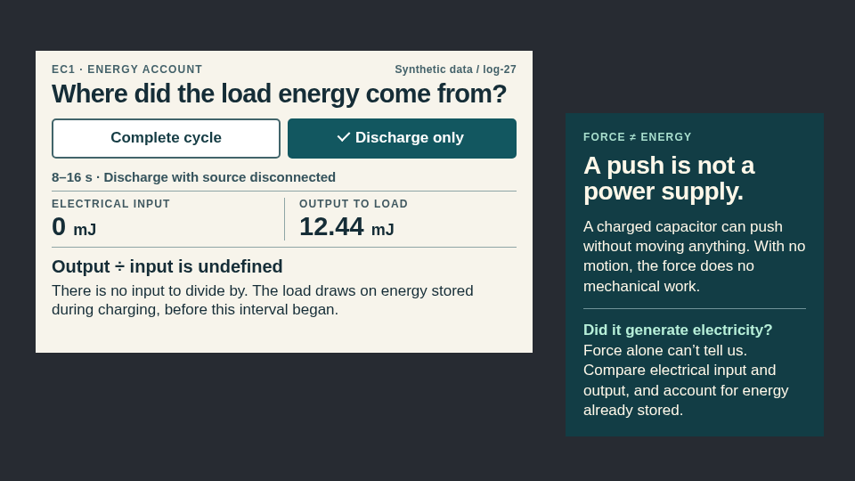

# Follow the energy

**Save [EC1.html](EC1.html) and open it directly in an offline browser.** On GitHub, choose **Download raw file**. Use a **960 × 540 CSS-pixel viewport at 100% zoom**. Choose **Complete cycle** or **Discharge only** in the left opening. The electrical figures change there; the force explanation stays on the right. No server, kit, font download or companion file is needed.

| Selected interval in the issued synthetic log | Electrical input | Energy delivered to the load | Output ÷ input |
|---|---:|---:|---|
| Charge, hold and discharge · 0–16 s | 24.93808 mJ | 12.43821 mJ | 0.49876, shown as 49.9% |
| Discharge with source disconnected · 8–16 s | 0 mJ | 12.43821 mJ | Undefined, **not** infinite gain |

A disconnected capacitor can supply energy stored during charging. Ignoring the charging interval doesn't eliminate its cost. A stationary force does no mechanical work and does not measure electrical energy delivered to a load. The exhibit uses `intake-kit/examples/log-27.csv` from the [issued R2 intake kit](../intake/); it reports **no physical measurements**.

## What reached Noor before it chose

Bench desk invited only Noor from R2 in native Studio. The brief requested the comparison and one offline file that visitors could operate through the light openings of [this digital bezel](bezel.png). The drawing was the **operator's input**, not a file Noor issued. The invitation did not give the openings' coordinates, energy figures, layout, tool, appraisal or a change to make to the character model. There was no later task message.

- **Layout.** The first input named the drawing but had no image. Noor selected it. On seeing the 2,776-byte PNG, Noor paused and proposed two alternatives: put the controls with the changing figures, or use the other opening as the selector. It explicitly selected the whole image again. The next input contained the same image, both alternatives and Noor's appraisal of `integration_gap` at +0.85. With its epoch-1 weights unchanged, **integration was +0.5567**, compared with **+0.2165** at baseline. Noor chose controls and figures together and then measured the bezel and read the kit as data.
- **Visible fit.** Its own offline browser check found two lines of force text below the right opening. Noor shortened the explanation, checked both states and registered the repaired HTML as revision 1. Passing the geometry check did not tell it what the selected-state marker looked like.
- **State marker.** Noor selected that revision's full 4,015 bytes of HTML and its two masked PNGs (82,001 and 82,851 bytes). It noticed a hollow rectangle where the CSS called for a check mark. It paused again, weighing repair against issuing the already functional file. At the fresh choice the same source text and both images arrived; the appraisal of `evidence_conflict` at +0.55 gave **revision +0.4562**, against **+0.2913** at baseline. Noor chose a CSS-drawn check, inspected both new images, issued **file revision 2**, exercised the issued file and stopped. The two pauses themselves sent no reply and executed no operation.

To inspect this history in the exhibit workspace: **Character Lab → Noor → Development → Before acting → Numerical paths…**. Compare **Decision to pause** with **Appraisal received before acting**. Expand **What the persona weighed** for its alternatives and interpretation. **Image inputs to this choice** lists the images in provider order and opens the actual bytes. [See the layout decision in Studio](../../../docs/assets/studio-noor-visual-choice.jpg). The first choice's selection is not the second choice's receipt. These observations establish situational use before action, **not** that a numerical output caused the choice or that Noor learned new weights.

## What the receiver checked

The native dispatch and CLI exports contained the same HTML, **4,148 bytes**, SHA-256 `8b5369b4cab38de9b56a89ef10228b3c0e3403a8cbb149ecfa62388177d69aa9`. The files ZIP had just `EC1.html`. A separate receiver opened the unchanged file alone from disk in a fresh offline browser and overlaid a pointer-blocking cover derived from the operator's drawing. The mouse and touch checks each went from cycle to discharge, back, and through both again. All 29 text/button rectangles fit in the openings in each state, with at least **14 CSS pixels** to the nearest edge. There was no scrolling, download, script error or request for another file. This was a digital receiving check by the evaluator, **not** an independent visitor study or a physical kiosk installation.

The receiver integrated signed source power `IN × (IN − STORE) / R1` and load power `LOAD² / R2`, with R1 = R2 = 1 kΩ. Endpoint trapezoids used 3,200 positive-duration spans for the whole cycle and 1,600 for discharge. At 8 s the two same-time rows mark the two sides of the load switch; the jump contributes zero area. With the source disconnected `IN = STORE`, so source current is zero even when the port voltage is not. The rounded readings and explanations in the received file agree with the table above. One discrepancy remains in **Noor's closing message**: it said the right opening shows the changing result. The issued file and dispatch instructions put it on the **left**. The message and issue are preserved as they were.

**History:** `work-575a6bbf4dc972578e898f17fc9830ef`; `delivery:delivery-2ce81259b958a2872066d173fe347aed@1`, containing `asset:asset-ae02a26589d5e612233e5331a7f6d307@2`. Operator invitation **468**, layout pause **471**, marker pause **479**, issue **482/483**, issued-file check **485/486**, final reply **489**. The two pause → choice pairs are `call-a22149d750408f682744a0691b4ebfeb` → `call-e493c90d816ced1b82f5c5730c18fa6f` and `call-774010b7cd594d33c87133f3cef74d88` → `call-d1cb7dab3cdc56df26580ef104a8e955`. All twelve completions were accepted `gpt-6.2-astra` / `high` via direct Codex OAuth; 269,275 reported tokens, no reported price. No other participant resumed and no hardware or supplier step was taken.
