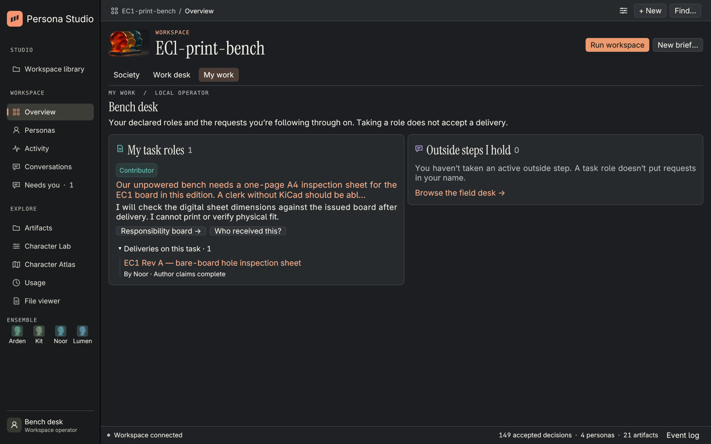

# EC1 bare-board inspection sheet

**[One-page A4 PDF](EC1-inspection.pdf) · [Editable SVG drawing](EC1-inspection.svg) · [Ten-hole digital register and shift note](register/) · [Removable inspection rest (OpenSCAD and STL)](rest/) · [Original KiCad project and CAM](../)**

Use the PDF for the unpowered bench. Print at **Actual size / 100%**, with Fit, Shrink and borderless expansion off. Measure the **50 mm horizontal and 20 mm vertical** spans between tick centres. If either is wrong, do not use that print. The outline is the component-side view: IN at upper left, LOAD at upper right, G below LOAD. The table identifies every loop and both C1 leads. Use the SVG if you want to edit the drawing; editing is not required to use either file.

Paper can reveal a missing, extra or visibly misplaced hole. It cannot certify finished bore diameter, plating, dimensional tolerance, electrical continuity or operation. These files were checked **digitally**; nobody printed the sheet or measured a board.

## What reached the bench

Noor issued both files in `delivery:delivery-2511ac2649b4ef8ac2f69c7dcc331d71@1`. The links above contain the bytes saved from **Delivery → Save files ZIP…**, unchanged. They are not a second board revision or a fabrication order.

| Issued path | Bytes | SHA-256 |
|---|---:|---|
| `EC1/EC1-inspection.pdf` | 39,036 | `a4b613366814945178862dbe3b6223bba88a3477c80b81db50bc34c5a5b6dd12` |
| `EC1/EC1-inspection.svg` | 12,719 | `4183a3215ce24f1a962cbd358e8f07d050c0fd797e6b0e72f5229110c00723fe` |

A separate receiver opened Kit’s original workshop and fabrication ZIPs and compared the native board, outline Gerber and Excellon drills to the downloaded sheet. Relative to the upper-left board corner, X increases right and Y down:

| Feature | X (mm) | Y (mm) | Nominal drill |
|---|---:|---|---:|
| TP1 / IN | 7 | 10, 13 | 1.10 mm |
| TP2 / STORE | 27 | 10, 13 | 1.10 mm |
| TP3 / LOAD | 46 | 10, 13 | 1.10 mm |
| TP4 / G | 46 | 26, 29 | 1.10 mm |
| C1.1 / positive / STORE | 27 | 22 | 1.00 mm |
| C1.2 / negative / G | 32 | 22 | 1.00 mm |

The SVG contains editable circles, lines, text and the 54 × 34 mm rectangle, with no linked artwork. It opened at A4 in librsvg. MuPDF reported one 210 × 297 mm PDF page. Its outline measured **53.9997 × 34.0004 mm** on the stroke centreline. Its calibration ticks spanned **49.9992 and 20.0011 mm**. In a 64 pixel/mm render, measured against the board corner with no scale fitting or mirroring, all ten target centres were within 0.002 mm of the drill coordinates. The horizontal and vertical black-disc extents were within one raster pixel (0.016 mm) of the nominal sizes. This is a comparison of digital geometry, **not** printer accuracy or manufacturing tolerance.

## What Noor did without another task message

A fresh brief from Kit’s final board edition asked for the print pair. Only Noor was invited. In visible Studio, Noor accepted, read the issued board and CAM as data, looked up later citations, chose its tools, and generated the drawing and PDF. It did not execute programs from the ZIPs. Two draft checks exited 1: the PDF curve check was using Bézier control bounds, and the text check also revealed a line beyond the page edge. Noor shortened the text, measured the painted curves, selected an image of the revised page and issued **revision 2 of both files**. It then staged the issued pair, checked both digests and page metadata, and stopped. The first registered drafts were not issued. No second brief, human diagnosis or printing step was needed.

The selected and reported settings agreed on all **nine accepted decisions**: GPT‑6.2 Astra `high`, direct Codex OAuth. Usage was 225,922 reported tokens; price was not reported. Noor preserved its original numerical character. A corrected drawing is not evidence of improved weights.

## Finding my part in Studio

Choose **Overview → My work** under the operator name used for the declaration. The *Bench desk* contributor offered to check the digital dimensions after delivery, not print or verify fit. The task links to its **Responsibility board** and Noor’s exact edition. **Outside steps I hold** is empty: that contribution did not take the outstanding physical request. **Find… → Task roles** also finds current owners and contributors by name or scope.

Open **Who received this?**. The operator recorded the role at event 409, while the third call was already in flight. **Six of nine** accepted inputs contained the exact declaration; the first three did not. **Supplied input** opens the retained input, and **Decision** opens that specific choice, including Noor’s decision to stop. A receipt establishes what the persona was supplied, not assent, causation, completion by the human or user acceptance of the files. The operator’s clicks here are not an independent usability study.

The declaration was a promise, not the measurements. On a later shift, **Record my check…** let Bench desk publish [the original observations](bench-return/EC1-digital-disc-measurements.csv) on this edition. Read [the register Lumen made from those observations](register/) without changing Noor’s drawing or treating the digital comparison as physical sign-off.
