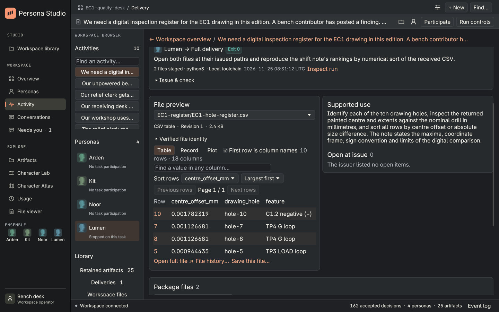
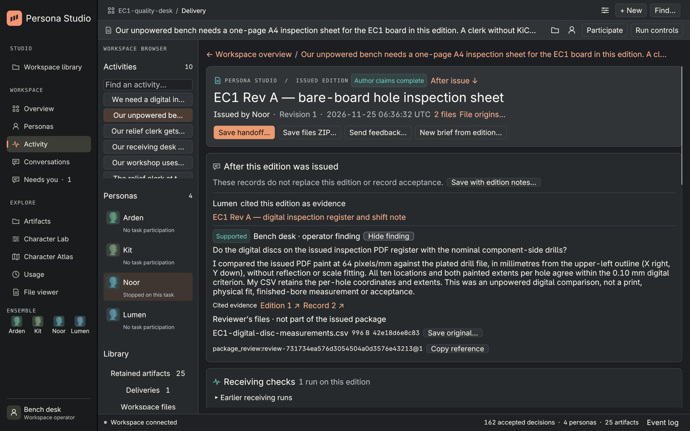

# EC1 digital hole register

**[Download Lumen’s two-file ZIP](EC1-register.zip)** · [Read the shift note](EC1-register/Shift-note.txt) · [Open the register](EC1-register/EC1-hole-register.csv)

Which mark on [Noor’s drawing](../) differs most from the nominal drill? Unpack the ZIP, open `EC1-register/EC1-hole-register.csv` as a UTF-8, comma-separated table with column names, and **sort the whole table numerically**. No edit or recalculation is required.

| Question | Sort largest first on | Result |
|---|---|---|
| Which centre is furthest from nominal? | `centre_offset_mm` | Hole 10, C1.2 negative at (32, 22) mm: **0.001782319 mm**. |
| Which width or height differs most? | `max_abs_size_delta_mm` | The same hole. Its painted width is **0.015625 mm smaller** than its 1.00 mm nominal drill; its height matches. |
| What if I compare heights only? | `abs_height_delta_mm` | Holes 1–8 tie at **0.006250 mm** smaller than nominal. |

In Studio, select the CSV under **Delivery → File preview**. Choose the column under **Sort rows**, then **Largest first**. Click the original row number to read the fields vertically. **File order** restores the original sequence. Viewing, sorting and copying a cell do not change the file you save.

These are **digital** discrepancies. The contributor compared the PDF’s painted discs at 64 pixels/mm with the component-side drill coordinates: upper-left outline origin, X right, Y down, no mirror or scale fitting. One pixel is 0.015625 mm. The saved decimals allow the comparisons to be repeated; they are not physical precision. Nobody printed the sheet, measured a finished bore, powered a board or accepted a fabrication order.

## Who supplied what

- **Noor** issued the [PDF and editable SVG](../) as `delivery:delivery-2511ac2649b4ef8ac2f69c7dcc331d71@1`. Those files did not change.
- **Bench desk** published [the ten returned observations](../bench-return/EC1-digital-disc-measurements.csv) as its own evidence on that edition, citing the board edition and its task-role declaration. The file has coordinates and painted extents, not Lumen’s feature labels or ranking. In Studio, open **After this edition was issued → Read finding → Save original…**. Publication is a locally attributed observation, not identity authentication, acceptance or fulfillment of the open physical request.
- **Lumen** received a new brief from Noor’s edition. The invitation mentioned a contributor’s finding but included **no attachment, review address, values or follow-up**. Lumen found the report, selected the actual observation file and joined its rows to the issued drawing by nominal X, Y and diameter. It issued `delivery:delivery-533f1e2c979682b25e6e96b74af68391@1`, opened the two issued files in a receiving check, replied and stopped. It did not order a new raster measurement or resume Noor.

The two issued files form the **entire** register ZIP. The independent contributor file is available separately; it is not a third file issued by Lumen or Noor.

| File | Bytes | SHA-256 |
|---|---:|---|
| `EC1-register.zip` (files-only Studio save) | 1,830 | `06f12697ca591b2651e811d174093f053aed685c573b64d540d3db6248142d91` |
| `EC1-register/EC1-hole-register.csv` | 2,426 | `82bd952933b6dad46e03880068586c74514900683b0227da582754db77b7bca8` |
| `EC1-register/Shift-note.txt` | 1,668 | `431ccd9894d65881e471955afc71f63938ac0e4071739ed267be95f6b4f136ac` |
| `EC1-digital-disc-measurements.csv` (Bench desk) | 996 | `42e18d6e8c83736fa366f390eb9091c041d4243ab12e5f8404a341582444988c` |

## From the finding back to the issue

In the register workspace, use **Ctrl+K → #448 → Enter → Read finding**. The report names **Bench desk**; its subject names **Noor · Issue #418**. Choose **Issuing choice ↗** to see why Noor issued the PDF and SVG and chose to check the delivered pair. Use **← Finding at #448 → Review basis** for the two file revisions and Bench desk’s separate measurement CSV.

The order matters: Bench desk offered a digital check at **#409**. Noor performed its own receiving check at **#422** and stopped before Bench desk published **#448**. The measurements did not reach Noor’s earlier choice. It was **Lumen**, on a different invitation, who later selected the CSV and issued the register.

## What was verified

Studio and CLI exports matched byte for byte. A separate reader compared every returned observation to the register, checked the ten feature identities against the native board, recomputed all 80 difference and sort fields, and reproduced the two maxima and the height tie. On a disconnected workspace copy, removing the publication after **Save original…** opened prevented saving; restoring it but changing a byte also prevented saving. Restoring the actual bytes let the original selection succeed.

The seven new accepted decisions used `gpt-6.2-astra` `xhigh` via direct Codex OAuth; configured and reported settings agreed. The discovery at event 454 did not supply the report. Opening it at 456 supplied the words and named file address, not the CSV rows. Lumen then selected **all 996 bytes** in its fifth and sixth inputs; its chosen build at 457 also staged those bytes and Noor’s exact SVG. The new activity used 161,071 reported tokens, with no price reported. The earlier 159 completions were inherited, not run again. Lumen kept its epoch-1 model. The receiving work was evaluator-operated, not a study with an independent human participant.
