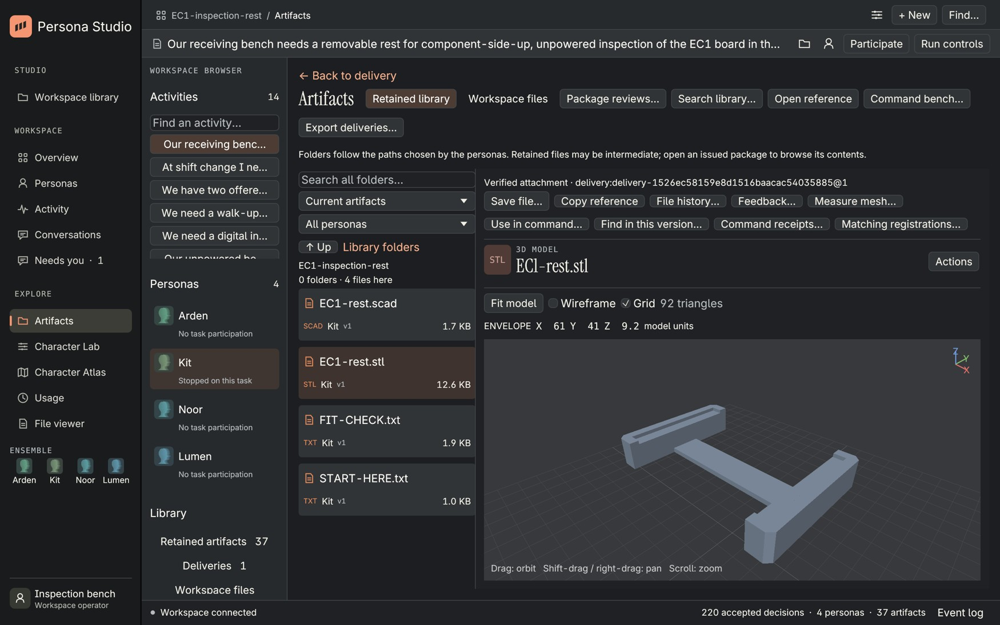

# A removable inspection rest for EC1

**[Download Kit’s four-file handoff](EC1-removable-inspection-rest.zip)** · [Editable OpenSCAD model](EC1-inspection-rest/EC1-rest.scad) · [STL](EC1-inspection-rest/EC1-rest.stl) · [Placement note](EC1-inspection-rest/START-HERE.txt) · [Fit record](EC1-inspection-rest/FIT-CHECK.txt)

The two end ledges carry the short edges of the [EC1 board](../../). The top stays visible and the open long edges let you lift the board out. This is for **unpowered inspection only**, not soldering or live testing. No board or rest was made or physically fitted.

To inspect the print file, import `EC1-rest.stl` **in millimetres at 100%, flat base down**. Expect **61 × 41 × 9.2 mm**. The receiving setup specified a 160 × 160 × 120 mm build space, PLA, a 0.4 mm nozzle and 0.20 mm layers with supports off. To edit, open `EC1-rest.scad` in OpenSCAD; the board dimensions, clearance, ledges and stops are named at the top. It needs no external library. The fit record applies to the unmodified design only.

In Studio, choose `EC1-inspection-rest/EC1-rest.stl` under **Delivery → File preview** to orbit the mesh beside Kit’s supported use and open items. **Open full file ↗** gives it more room. The envelope is in file coordinates; Kit’s placement note supplies the millimetre unit.

## What fits in the digital model

A separate receiver took the actual files saved from Studio and the original [fabrication ZIP](../../EC1-fabrication.zip). The reference rectangle was the **centreline** of the outline Gerber, not its painted stroke. The ten lead positions came from the plated drill file, not from a rendering of the board.

| Receiving check | Result on the issued files |
|---|---|
| Can the board seat and move without falling off a ledge? | The opening is **55 × 35 mm**. With each overall board dimension at 54 ± 0.20 by 34 ± 0.20 mm about the pattern centre, a squarely seated board has **0.8–1.2 mm total travel** per axis (limit 2.0 mm). Both ends retain bearing across that range. **47.2 mm** of each long edge is open for lifting. |
| Is there room for the leads? | At every plated hole the receiver swept a **Ø3.0 mm** envelope through the allowed translation. The closest full-height ledge is **1.5 mm** outside those envelopes. A tip projecting 3 mm below the 8 mm seat has at least **3.4 mm** clearance to rest material below it and **5.0 mm** to the table (requested minimum 0.5 mm). |
| Can a receiver regenerate and slice it unchanged? | OpenSCAD regenerated **byte-identical STL**. The mesh is one closed, consistently wound shell, 92 triangles. CuraEngine 4.13.0 sliced the issued file with supports off: **46 consecutive depositing layers**, Z = 0.2 through 9.2 mm, **5,742 depositing moves**, all within the stated bed. No G-code was sent to a printer. |

The board tolerance, square placement, lead size and flat table are assumptions. The slice establishes that the digital file can be processed, not that a particular printer will hold tolerance. Shrinkage, board warp and assembled fit remain unmeasured.

## What Kit did, and what the receiver did

From the final KiCad edition, Inspection bench opened a new task in native Studio. The brief supplied the intended use, printer envelope, motion limit and clearance assumptions, **not** a particular shape or hole coordinates. Only continuing persona Kit was invited. It accepted, staged the two exact issued ZIPs, inspected the outline and drill, generated the source and mesh, and checked the section geometry. It selected both complete model files before issuing them with the two notes. Its last command staged all four **from the issue** and compared the regenerated solid with the delivered mesh. Kit then replied and stopped. No human follow-up or outside step was needed. Kit’s checks were not the receiver’s later CuraEngine slice.

All six decisions matched the configured and reported `gpt-6.2-astra`, `xhigh`, via direct Codex OAuth. All six were accepted; the provider reported 149,456 tokens and no monetary price. Five later inputs included the previous working note. Kit chose its unchanged numerical character throughout. This was a new use of its circuit files, not evidence of improved weights.

**Source edition:** `delivery:delivery-f6d488e097d50c27fae27894649902f9@1`. **Rest edition:** `delivery:delivery-1526ec58159e8d1516baacac54035885@1`, marked complete by the issuer, not accepted by the user. The download is the unmodified **Delivery → Save files ZIP…** result, identical to the CLI edition export: 4,103 bytes, SHA-256 `e527efea359120695870617fe3cb1be2f1a92e299c55fd44b9a1f896cb945c4b`. The four loose files above are the corresponding ZIP members, not a repaired model.
