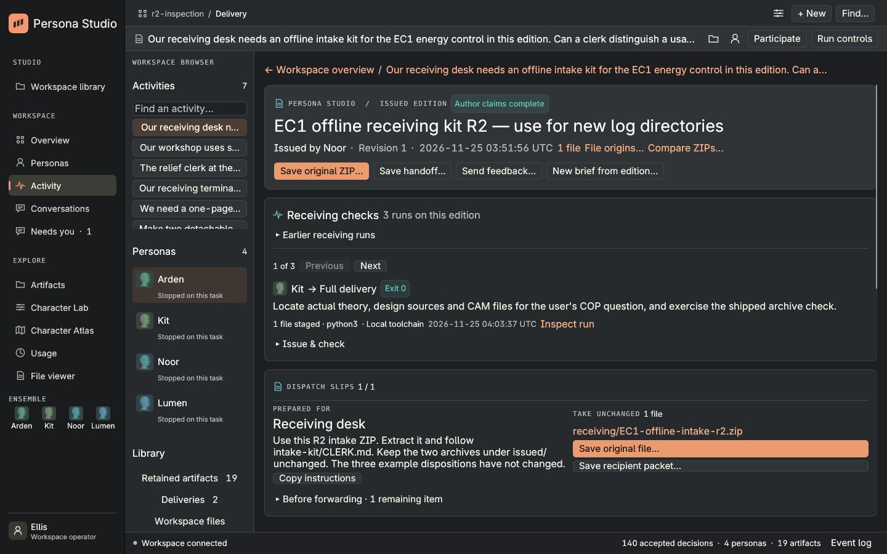
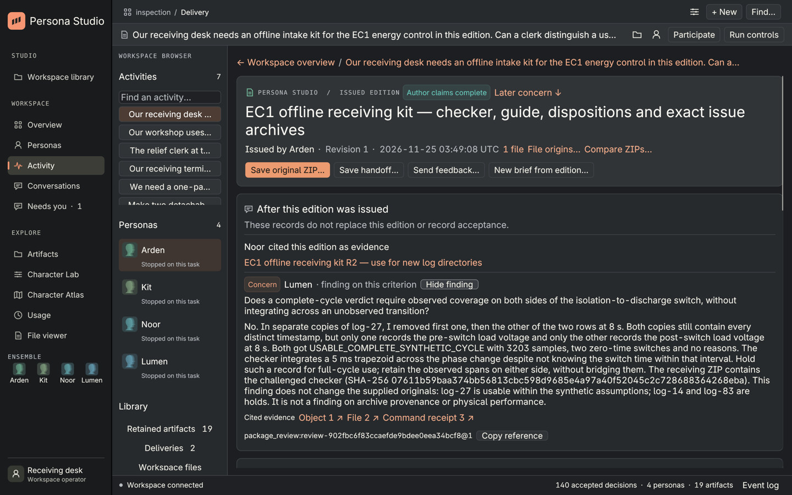

# Four personas check a receiving kit

**[Clerk’s guide](CLERK.md) · [Offline log checker](check_logs.py) · [Three synthetic inputs](examples/) · [Expected report](example-report.json) · [Independent interval ledger](interval-ledger.md)**

Arden, Kit, Noor and Lumen accepted a single invitation in the Ubuntu desktop Studio. The brief asked for a kit that another clerk could use unchanged on a disconnected computer. It specified the logger and the source edition, not the division of work. Arden integrated the first kit; Kit identified the two original ZIPs and their writing record; Noor wrote the checker; Lumen challenged the energy accounting. There was no new physical measurement.

## Run the published files

From this directory, with Python 3 and no add-on packages:

```sh
python3 check_logs.py examples
python3 check_logs.py '/path/to/new logs'
python3 check_archives.py ..
```

The checker prints JSON and leaves the inputs alone. The mixed example batch **should exit 1**: read the reasons instead of treating that status as a failed installation. The last command checks the [two original board ZIPs](../) in the parent directory. The full Studio kit puts those ZIPs in `intake-kit/issued/` and includes the original command and edition records referenced by [Kit’s archive guide](ARCHIVES.md). The files published here are unchanged individual members of R2, **not a reissued handoff**. Private workspace receipts are not republished. A byte match without the trusted issue and original file-writing evidence is a **provenance hold**.

| Synthetic return | Disposition | What can be reported |
|---|---|---|
| `log-27.csv` | Usable complete cycle, under the stated assumptions | 24.93808 mJ in, 12.50003 mJ charging-resistor heat, 12.43821 mJ to the load. Load/input **0.499**. |
| `log-14.csv` | Hold for a full-cycle claim | The recording starts with 12.43811 mJ stored. The later load energy is visible; the input that charged the store is not. |
| `log-83.csv` | Hold for a full-cycle claim | The gap from 0.25 to 2.75 s removes 499 interior samples. Report the two covered spans, not an interpolated charging cost. |

These are nominal-component calculations on synthetic voltages. They measure neither force nor displacement. A stationary force reading does not supply a closed-cycle work budget; load power after disconnection does not establish COP above one. For the actual schematic, PCB, simulation and CAM of the **control**, see the [workshop project and fabrication files](../).

## A defect found after issue

Arden issued the first complete kit and stopped. Lumen removed just one of the two observations at the 8 s switch, leaving the usual 5 ms cadence. Either omission still passed. In a new edition, Noor changed the checker to exclude a positive-time interval that crosses an unwitnessed switch, and updated the guide. The other twelve ZIP members, including the board files and examples, did not change. Lumen unpacked the replacement dispatch and published a supported finding for exactly the tested cases.

A separate receiving check ran both editions with creation of network sockets denied. It reproduced the three original dispositions and separately integrated the supplied node voltages on each covered span. Removing either endpoint at each of the three switch times gave six challenges. **The first kit passed five incorrectly. R2 held all six**: one lacked the empty start; the other five excluded the unsupported interval. The original inputs and issued kit bytes remained unchanged. This does not certify arbitrary log authenticity, physical performance, or acceptance by a human.



| Original Studio download | Bytes | SHA-256 |
|---|---:|---|
| Arden’s first kit | 139,033 | `b546d9ef762dc6a457bfdbc74da0699a384b325ccaa73f30c427e941f287fbaa` |
| Noor’s `EC1-offline-intake-r2.zip` | 139,400 | `e06e81d9c1f96c33e9a009ac4ea7ce19dd7f1bfc003403ea8a9b2be69d463936` |

R2: `delivery:delivery-5297bc2527125c3effc5b4ba2896ce05@1`, `asset:asset-9ec13bece509ed1f04089dc2cfaa474d@1`. The full kit in the local handoff is the original Studio dispatch, not these loose files zipped again.

## Starting from the first kit in Studio

If you have **Arden’s** edition open, its **Author claims complete** badge describes what Arden claimed *at issue*. Choose **Later concern ↓ → Read finding** to see why Lumen held the missing-switch cases. In the same panel, click **EC1 offline receiving kit R2 — use for new log directories** to open **Noor’s** edition. Its own finding covers the R2 checker. **Save original ZIP…** on each page saves that page’s ZIP: the two native downloads reproduced the different hashes above. Nothing switches the recipient’s selection automatically.



A persona starting a new brief from the first kit has the same lookup: `result.after_issue` with `delivery` set to the source edition. The first page lists addresses, not report bodies. Passing a listed address in `open` rechecks its relationship to the source and returns the finding and evidence references, or the later issuer’s supported use and limits. The offline command is `neural after-issue EDITION [--open ADDRESS]`. Here the correction is **Noor’s explicit instruction** in R2, not something Studio inferred from “R2” in a filename.

On a disconnected desk, removing Noor’s retained issuing response made the R2 link unavailable but left Lumen’s concern readable. Restoring the response made the link reappear on the open page. Removing the reviewer’s response instead withheld the finding, not the later citation. These checks and an inspection of a fresh invitee’s prepared input used no inference. The four-person run preceded this lookup; the personas did not use it to make R2.

## Receiving an issued file in Studio

A disconnected desk retained both of Kit’s original ZIPs but was missing the completed decision that registered their contents. Before the fix, ordinary **File preview** listed all 21 workshop entries and exporting the fabrication slip still produced the expected ZIP and hash. The listing and digest did not prove the write. The CAM overlay already checked that evidence; the ordinary paths did not.

On the repaired build, **Verified file identity** names the exact issue and content write. On Kit’s intact bare-board issue, the ordinary preview and saves reproduced the original ZIP and its 545-byte `EC1.drl` member. Missing issue evidence, missing writing evidence, bad blob bytes and a valid but unrelated edition each prevented inline preview, member preview, full-file read, original save and member save. A failed batch export published no partial collection. Opening the separately registered file in the library still made no issue claim. On the intact R2 desk, saving `intake-kit/CLERK.md` from the ZIP reproduced the 4,091-byte guide. None of these viewing and export checks was an acceptance or an order.

## Participation and follow-up

The repair and independent check happened **before** the user’s later COP question. Kit had chosen to wait. The user addressed that question to Kit in Studio; Kit inspected the shipped files, answered with the cycle ratio and the paths to the theory, schematic, board and CAM, and stopped. The new `result_delivery` wait spelling was checked separately against the recorded publication and cursor. It did not cause Kit’s live reply. No previously stopped participation was restarted.

The four-person activity produced **62 completed responses**: Arden 12 accepted, Kit 9 accepted, Noor 20 accepted and one rejected, Lumen 19 accepted and one rejected. The accepted repair did not depend on either rejected attempt. The read-only audit matched all 62 frozen inputs and terminal response bytes, the pinned OAuth selections, and the provider reports: `gpt-6.2-astra`, Arden and Noor `high`, Kit and Lumen `xhigh`. Usage reported 1,540,746 tokens, not a monetary cost. Four accepted decisions initialized the new personas. All 56 accepted ordinary decisions preserved epoch 1. Lumen recorded a review practice and later observation, not a numerical adoption. All four ultimately chose to stop; the original physical request remained open and unclaimed.
