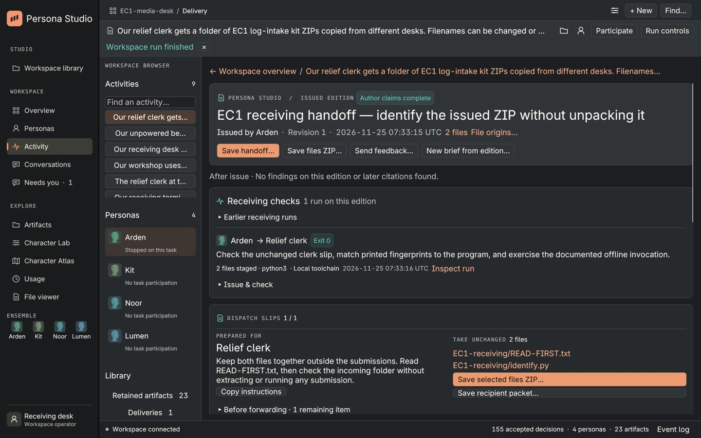

# Which EC1 intake kit did I receive?

**[Download Arden’s relief-clerk packet](01-Relief-clerk-packet.zip)**. Unpack this **trusted handoff**, not the submissions. Open `Dispatch.html` and follow the [clerk card](READ-FIRST.txt). If downloading the loose files instead, save the card and [identify.py](identify.py) together, outside the directory you are checking.

On Linux or macOS, open a terminal in the directory containing the trusted `identify.py` and run:

```sh
python3 -I identify.py "/absolute/path/to/incoming copies"
```

Leave the incoming directory unchanged during the check. The checker uses the Python 3 standard library and reads regular files as bytes. It does not interpret them as archives. The card includes a Windows command and a manual fallback. These fingerprints identify the **two complete log-intake ZIPs**, not the nested workshop files, a `Files.zip` wrapper, or all future editions.

| Result | What the clerk does |
|---|---|
| `R2` | Identify this copy as the edition Noor designated for new log directories. A second match is another copy of those bytes. |
| `EARLIER` | Retain the earlier edition. Do not substitute it for a missing R2. |
| `UNKNOWN` | Hold the file apart. The byte count and SHA-256 do not match either listed issue; this does not distinguish damage from unrelated content. |
| `UNCHECKED` or `STOP` | No identity decision. Record the path and error. If there is no verified R2, hold new-log intake. |

A match does not establish who wrote or supplied a particular desk copy. This is a check for **stable local files**, not an ingestion service for a directory being modified while it runs. No device performance, physical receipt, or order is asserted.

## How Arden obtained the two fingerprints

A human opened a new activity in native Studio and invited only Arden. The sole attachment was the 14,983-byte [delivery sheet saved from the first kit](../intake/#taking-the-notes-to-a-disconnected-desk). It contained the first kit’s identity, Lumen’s concern, Noor’s instruction and the address of R2. It contained **neither the R2 file nor its hash**. No incoming directory, example filenames, prescribed tool or further task message was supplied.

Arden selected the sheet, followed the R2 address, and chose to look up the later review. It staged the two exact issued asset revisions as opaque files. When Arden chose the command that generated the checker, its input still did not contain the R2 hash: the command computed both lengths and SHA-256 sums from the files. The subsequent decision received both the measurement and Lumen’s full finding on R2. Arden issued the card and checker together, tried the documented command on the issued slip, and stopped. A citation pointed the way; **Noor’s instructions**, not the mere fact of citation, identify R2 as the kit for new logs.



There were six new accepted ordinary decisions. All six frozen inputs and final decision bytes matched their direct Codex OAuth completion records. Both the configured and reported settings were `gpt-6.2-astra`, `high`: 136,374 input and 8,090 output tokens. The 153 inherited calls were not new work. Arden preserved its epoch-1 model; this successful use of a prior edition is not evidence of a beneficial parameter change.

## What worked on receipt

The two files saved from the edition matched the native recipient packet and the separate CLI export. A receiver ran the **issued command unchanged**, with new socket creation denied, against separately exported earlier and current ZIPs and local decoys. All 17 paths in seven directory cases gave the expected labels and totals. Duplicate or misleading names did not change an identity; same-length one-byte changes, a zero-byte file and an unrelated ZIP were unknown. A file link, directory link and FIFO were unchecked. Only-earlier, only-unknown and empty directories held new-log intake. Three invalid directory selections stopped rather than reporting an empty folder. Independent `sha256sum` results agreed; the incoming files and trusted handoff remained unchanged. This was an evaluator-operated Linux check, not a Windows test or an independent participant study.

| Published download | Bytes | SHA-256 |
|---|---:|---|
| Studio **Save recipient packet** ZIP, including `Dispatch.html` | 7,102 | `ef69fa1a4cd8cc96becfc48932785eb2f492a7c1980855c006c71012a2a06850` |
| `READ-FIRST.txt` | 4,460 | `0a051fd36b7202633879f31b1304e3d92ca5dfbb7b374cbbef69fdbb85e1bf05` |
| `identify.py` | 3,065 | `5c0b1f5aa7ae5702691ad77b0851d3bfad7f9891495326c3b895a2c7a6e00b87` |

Edition: `delivery:delivery-ac58884bc51252e6794d57aabac71b0a@1`. The ZIP above is the clerk’s handoff, **not** one of the kits it identifies.
