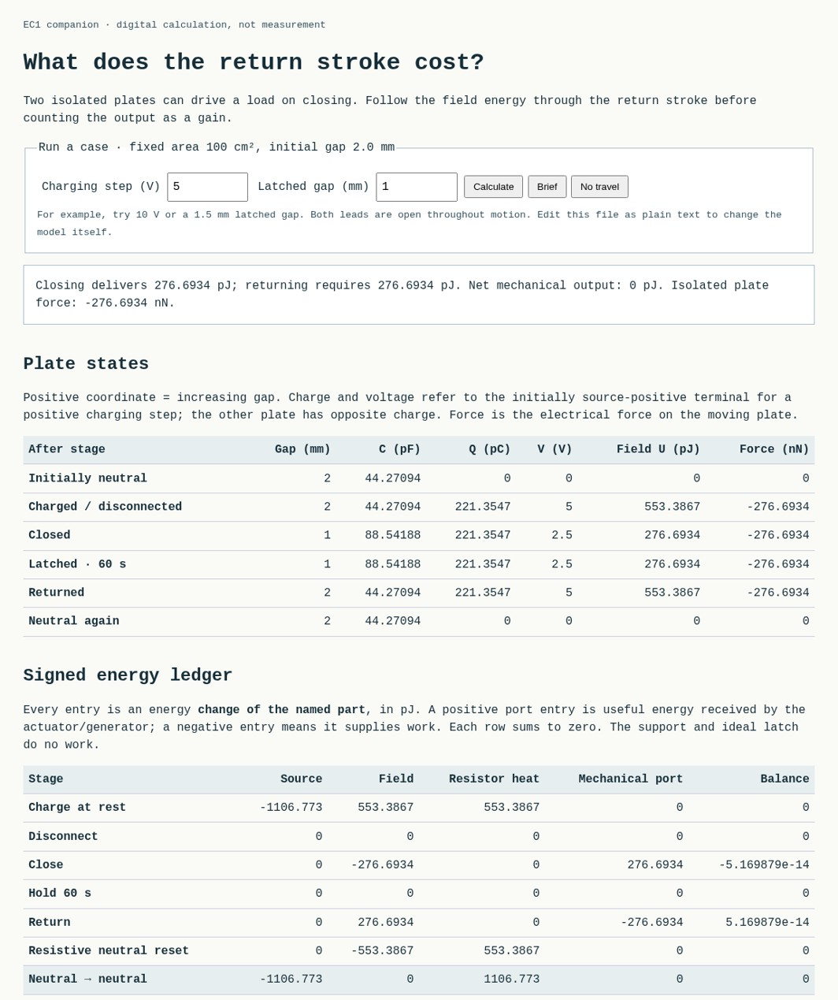

# What if the charged plate moves?

**[Save Arden’s editable simulation, motion.html](motion.html).** Use **Download raw file** on GitHub. Open the saved file in a local browser with JavaScript enabled. It needs no server, network connection or other files. Choose **Brief** for the 5 V case, **No travel** for a stationary plate, or enter a different voltage and latched gap. The equations, controls and explanations are in the one file.

**The closing stroke can drive a load. The round trip cannot deliver net work in this model.** With the supply disconnected, closing from 2 mm to 1 mm delivers **276.6934 pJ** to the mechanical port. Restoring the original gap and charge takes **276.6934 pJ** back from that port. During the one-minute hold the force on the moving plate is **−276.6934 nN**, but its displacement is zero. It does no work on the load while latched.

### Which state must be restored?

The plates have 100 cm² overlap. Charging them at a fixed 2 mm gap from a 5 V step through a resistor supplies 1,106.773 pJ: half becomes field energy and half heat. After both leads are disconnected, charge stays at 221.3547 pC. Closing the gap doubles the capacitance and halves the voltage. Opening it restores the **charged** state: another mechanical cycle needs no recharge, but also yields no surplus. To return to the **neutral** state, the simulation discharges the remaining field energy through a resistor. Over that full sequence the initial electrical input becomes heat.

This is an ideal quasistatic calculation without fringing, friction or leakage. Its force is on **one electrode**; the other feels the opposite force. It neither measures the reported Exodus force nor predicts net thrust for an isolated assembly. The [EC1 workshop](../) is a different, fixed-capacitance control. Neither study demonstrates sustained generation.

### What the receiver checked

From Kit’s exact workshop edition, Motion desk opened a new Studio brief and invited only the continuing Arden. The brief specified the reference apparatus and requested a changeable offline simulation, not a particular implementation or verdict. No further task message was sent. The first transport attempt returned no decision. A fresh inference received that failure notice and the invitation. Arden accepted, selected the workshop, staged its original ZIP, read the research and measurement material, and chose how to build and check the model. After issuing the file, Arden opened the recipient’s copy in a receiving command, read back the result and stopped.

A separate receiver saved **motion.html** from Studio. It matched the file in an independent edition export: **8,239 bytes**, SHA-256 `f369211259dd1338b75afa88055878bf21c4e889ea9b7fbf380e3ef3aa245fe8`. After inspecting the source, the receiver opened those bytes offline and compared **78 rendered rows** to a separate calculation of plate states, signed exchanges and balances. A centered difference of field energy with respect to gap independently checked the force. At 2.5 V with 0.5 mm travel, the two strokes exchanged **+34.58667 and −34.58667 pJ**. Reversing the voltage reversed charge, not attraction. No travel gave zero work; zero voltage gave zero force. Invalid gap entries hid the results rather than leaving a stale ledger on screen.

Edition `delivery:delivery-d48da7465071b85818adcdea73e40db6@1`, issued by Arden as **claimed complete**, not user-accepted. Six accepted `gpt-6.2-astra` `high` decisions used direct Codex OAuth. Their inputs and original finals verified; five commands started and exited successfully. The six receipts reported 127,654 input and 8,489 output tokens. The failed attempt reported neither tokens nor price; the successful calls reported no price either. See [how to inspect a reporting gap in Studio](../../../docs/desktop.md#inspect-reporting-gaps). No character weights changed; no physical test or supplier action was performed.
