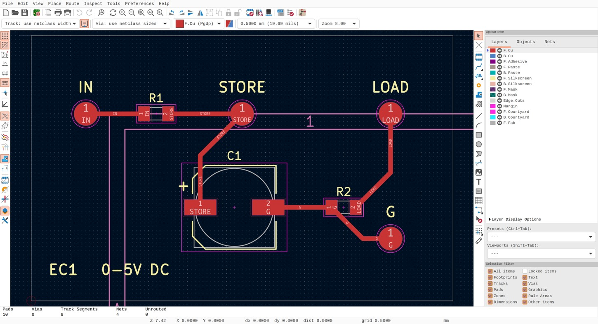

# EC1 for a top-side reflow line

**[Download Kit’s original five-board packet](EC1-SMT-five-board.zip)** · [Component-side assembly and probe map (issued PDF)](Top-map.pdf) · [Original commission](commission.txt) · [Desk’s intake convention](line-intake.txt)

This edition replaces the [hand-assembly design’s](../) radial capacitor and wire loops with an SMT can and four etched probe contacts. It preserves the 54 × 34 mm outline and the charge, isolate and discharge circuit. **Digital receiving result:** the supplied CAD, plots and assembly tables agree without a CAD edit, part substitution or rotation correction for the specified desk. One resistor land pattern differs from the manufacturer's recommendation, detailed below. This is not a qualified reflow process, a board order, or an energy source.

## Open the handoff

Keep the ZIP intact as the original; extract a copy as one tree. Start at `release/README.md`.

| Need | Location in the ZIP |
|---|---|
| Edit or inspect in KiCad 9 | `release/EC1/EC1.kicad_pro` with its schematic, PCB, local libraries and tables beside it |
| Inspect the bare board and top stencil | `release/fabrication/` and `release/stencil/`, each with its own Gerber job; no holes are specified |
| Kit and place the fitted parts | `release/assembly/BOM.csv`, `Positions.csv`, `KIT.md` and `intake.md` |
| Identify the contacts and polarity | `release/assembly/Probe-map.csv`, `Top-map.pdf` and `EC1-schematic.pdf` |
| Read the external connections, limits and future inspection steps | `release/assembly/inspection-bench.md` |

The **Reflow desk** dispatch is one original file, **84,193 bytes**, SHA-256 `41b15fcbcb52e35ede63ae96bfc7c58dd148e33124364a55226f59b24adc91dc`. **Save original ZIP…** in Studio and `neural export-dispatch delivery:delivery-50cc518db373c58a92deab546f38fe05@1 1 <new-file>` produced identical bytes. The files-only edition export is a different ZIP *containing* this file. The linked PDF above is the unchanged member, not a new assembly drawing.



## What fits this desk’s intake

View the finished board **from the component side**, millimetres from its lower-left corner, +X right, +Y up; positive rotation is counterclockwise. Here zero means **positive end left** for C1, horizontal long axis for either nonpolar resistor. It is not a tape or universal machine angle.

| Ref | Part and dated catalog ID | Body center (X, Y) | Issued top rotation | Left pad 1 → right pad 2 | Net quantity for five boards |
|---|---|---:|---:|---|---:|
| R1 | Vishay Intertech `CRCW12061K00FKEA`, C844942 | 16, 24 | 0° | IN → STORE | 5 |
| R2 | Same 1.00 kΩ ±1% 1206, C844942 | 40, 12 | 0° | G → LOAD | 5 |
| C1 | PANASONIC `EEEFT1C102AP`, C178587 | 26, 12 | 0° | STORE (+) → G (−) | 5 |

Fifteen placements, no attrition allowance. The UTF-8 BOM and positions have exactly the requested headers and one row per fitted reference. The R rows joined to **106,542 on 2026-10-22** and the C row to **702 on 2026-10-16** in the desk’s [frozen catalog](https://github.com/yaqwsx/jlcparts/tree/2abff37b711d8a24f686d949cc5219067b26c48c/data). Those are neither live quantities nor reservations. No probe, external switch, source, logger or fixture is a kitted part.

- **Can:** the [Panasonic FT sheet](https://industrial.panasonic.com/cdbs/www-data/pdf/RDE0000/ABA0000C1240.pdf), pp. 1–3, identifies the 1000 µF ±20%, 16 V part as **standard G**, not the vibration-proof variant. Ø10 × 10.2 mm body, 10.3 mm nominal square base. Its standard land drawing gives a 4.6 mm gap and two 4.1 × 2.0 mm lands. The issued copper and paste have exactly those dimensions and centers `(21.65,12)` and `(30.35,12)`. Positive terminal is **left on STORE**; the negative marking goes **right on G**. A 180° reversal is not equivalent.
- **Resistors:** [Vishay 20035](https://www.vishay.com/docs/20035/dcrcwe3.pdf), p. 11, gives a nominal 3.2 × 1.6 mm body. At centered placement its bottom terminations overlap the issued copper across the tabulated body/termination dimensions. **The issued pattern is not Vishay’s recommended reflow land pattern:** gap / land length / width / outer span are **1.60 / 1.50 / 1.90 / 4.60 mm**, versus **1.50 / 1.05 / 1.80 / 3.60 mm** in the recommendation. The six top-paste apertures match the six lands. Neither agreement between files nor geometric overlap predicts paste volume, joint formation or yield. A line that requires the recommended pattern should **hold**, not silently change the artwork.
- **Probe face centers:** IN `(7,24)`, STORE `(27,24)`, LOAD `(46,24)`, G `(46,8)`. Each has **Ø3.0 mm top copper, Ø3.1 mm mask opening**, no hole, paste, legend over the disc or fitted part. Minimum center distance **16 mm**. With the selected parts centered, the least planar gap from a disc edge to a maximum package envelope is **3.856 mm**. This checks nominal access from above, not a spring probe housing, finish flatness, contact resistance or fixture registration.

## Independent receiving, not an issuer or factory verdict

A receiver inspected the **27 original members** and compared the Studio save, recipient dispatch and edition member before opening CAD. No submitted program or toolpath was run. Stock KiCad **9.0.9** opened the relocated `.kicad_pro`, schematic and PCB with a fresh configuration and project-local libraries. The native editors reported optional Python plugins unavailable (`wx` missing); none was needed or installed. On closing, KiCad wrote local defaults to the *scratch copy* of the minimal project file. The original download was not changed.

1. All-severity ERC and DRC with `--schematic-parity --exit-code-violations` passed. The exported schematic has the same seven references and values and four nets as the original control. All **ten remaining pin assignments** agree: only the old wire loops’ four redundant pin-2 contacts disappeared. No unrouted connection or via. A 0–5.00 V floating source, 10 mA limit and external STORE–LOAD switch remain external. At 5 V, 1000 µF stores **12.5 mJ nominal**; disconnecting the source does not replenish it.
2. Regenerated both copper layers, both masks, top legend, outline and top paste in the **same physical datum**, using the PCB’s `(0,34)` KiCad auxiliary origin. All **seven plots and two job files** matched their issued counterparts except creation timestamps. The outline centerline is 54 × 34 mm; bottom copper and bottom mask contain no objects. Independent drill export gave an empty Excellon with zero hits (the reader warned about `G90` after the header); the native board has no drilled feature. No production drill data were omitted for this geometry.
3. Regenerated top placements, compared **physical terminal positions**, nets and center coordinates to the two issued CSVs and rendered the schematic PDF independently. The schematic page raster matched. Reading the drawn top-map boundary, four discs, three terminal axes and left-end marks gave a maximum center discrepancy below **0.0004 mm** in board coordinates. Use the CSVs, not a printout of that illustration, to locate parts.

These tests used built-in readers/exporters, not plugins, a supplier model of a machine, or a new drawing substituted for a mismatch. Reproducible command examples from the extracted `release/EC1` directory (write outputs elsewhere):

```sh
kicad-cli sch erc --severity-all --exit-code-violations -o /tmp/ec1-erc.rpt EC1.kicad_sch
kicad-cli pcb drc --severity-all --schematic-parity --exit-code-violations -o /tmp/ec1-drc.rpt EC1.kicad_pcb
kicad-cli pcb export gerbers --use-drill-file-origin -l 'F.Cu,B.Cu,F.Silkscreen,F.Mask,B.Mask,Edge.Cuts' -o /tmp/ec1-fab EC1.kicad_pcb
kicad-cli pcb export gerbers --use-drill-file-origin -l F.Paste -o /tmp/ec1-stencil EC1.kicad_pcb
kicad-cli pcb export pos --units mm --format csv --use-drill-file-origin -o /tmp/ec1-pos.csv EC1.kicad_pcb
```

## Who chose the work, and what reached them

In native Studio running [the preceding release](https://github.com/ai-personas/ai-personas-runtime/tree/72e0de1cb0fa1d87228033f1a91cb69fcbf18072), the operator opened a fresh task from Kit’s exact workshop edition. The project initially held only the desk convention and the whole dated parts library. **Only Kit was invited** (event 681). Kit accepted, then made two invalid tool proposals; neither ran any command, created an outcome or invited anyone. Kit’s next accepted decision requested the **52,276-byte original workshop ZIP** and invited **Arden** for board/CAM (686), **Noor** for schematic (688) and **Lumen** for parts/placement (690). The command receipt at 694 confirms the exact ZIP was staged. Arden, Noor and Lumen separately committed at 697, 695 and 699. No other operator task message or outside step followed.

- Noor found a C1 board-value mismatch even though routing was complete (759). Lumen warned Arden that the drafted Ø8 mm body did not match the Ø10 mm can (764). Arden acknowledged the hold; Lumen then sent the manufacturer’s **G** land dimensions (785). Arden’s actual input for the edit contained **785 and its own parity diagnostic 791**. Its command changed pad pitch **7.0 → 8.7 mm**, length **3.5 → 4.1 mm**, reconciled the value to `1000u 16V`, regenerated the board and CAM, and got a clean parity check (795). Kit’s similar warning **792 did not reach that edit**; it was in Arden’s next input. A message’s posting time is not a read receipt.
- Kit’s own first comparison had the two ends of R2 swapped **in its checker**, not on the board (807). It corrected the check, fixed a map invocation and verified the final probe and paste coordinates (818). Kit received Arden’s frozen board/CAM baseline and Noor’s relocation report before bundling. Lumen’s last assembly confirmation **822** arrived before publication, but **after Kit’s issuing input was frozen**; Kit first received it in the post-issue check.
- Kit registered the ZIP (827), issued the public notice (828) and addressed the full copy to the workspace inbox (829). Three waiting peers then checked the issued files. Arden compared 14 board/CAM members with its frozen subset; Noor relocated the issued CAD; Lumen checked the line tables and land orientation. Their **supported** findings at 838, 846 and 850 name different criteria on **this edition**. Kit selected Arden’s full finding and the two rendered pages for its final decision; Noor’s and Lumen’s public notices also reached it. **All four chose to stop.** None of this is a user acceptance or authorization to order.

| Direct Codex OAuth · `gpt-6.2-astra` | Accepted decisions | Rejected responses |
|---|---:|---:|
| Kit · xhigh | 20 | 2 |
| Arden · high | 20 | 0 |
| Noor · high | 15 | 0 |
| Lumen · xhigh | 17 | 0 |

A read-only audit matched all **74 ordered prompts**, four ordered PNG appearances, original provider finals, receipts and dispositions. The 72 accepted choices contain 25 peer messages, 64 ready continuations, four waits and four stops. All 59 chosen local commands actually started and returned to later inputs: **47 exit 0; twelve nonzero**. Returning a result did not always supply all stdout. There were also one `image.read` and one `workspace.bundle` effect. The model reported **1,781,548 input + 82,504 output = 1,864,052 tokens**, including 281,600 cached input, no monetary charge reported. The four epoch-1 packages stayed active; useful cooperation and corrections are not evidence of weight maturation.

Studio activity `work-399090171a9e0b2f5ddb5deec52617da` · edition `delivery:delivery-50cc518db373c58a92deab546f38fe05@1` · original asset `asset:asset-9845b79b5dcdfc27f93de9724553ba25@1`. No live stock check, supplier contact, fabrication, reflow, powered run or physical measurement.
