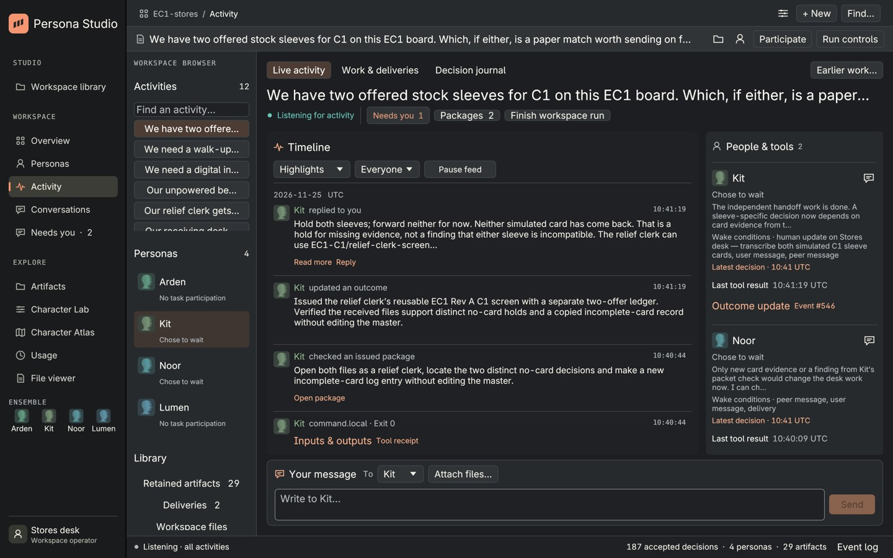

# Two sleeve offers, one stores request

[**Download the final clerk packet**](stores-handoff.zip). Open [Kit’s two decisions](EC1-C1/current-offers.md) and [Noor’s reusable screen](EC1-C1/relief-clerk-screen.md) in a text editor. For the next sleeve, copy the screen’s **Shift-log record** into your own log; do not edit the master. The target is C1 on the [unchanged EC1 Rev A board](../), not an arbitrary 16 V capacitor.

| Simulated offer | What the card establishes | Clerk’s action |
|---|---|---|
| S7 / Gold | Panasonic **EEUFR1C102**, 1000 µF ±20%, 16 V; straight 5.0 mm pitch, 10 mm diameter × 16 mm tall. | **Paper match.** Refer only for consideration of an unpowered inspection. |
| K4 / Grey | Similar electrical rating, but straight leads 7.5 mm apart and a 12.5 × 20 mm can. No exact order code. | **Do not forward.** The stated pitch is incompatible; the missing code does not make this merely an unknown. |
| No card, or insufficient evidence with no decisive mismatch | Identity or a required interface cannot be established. | **Hold.** Record precisely what is absent or conflicting. Do not infer it from a sleeve label. |

The [two transcriptions](operator-input/stores-cards.txt) were evaluator-written fixtures, **not** a third file in the delivery. No part was obtained, fitted or tested; no vendor was contacted. This is not a substitution approval or an order.

## What happened while the cards were missing

Stores desk invited Kit (`xhigh`) and Noor (`high`) from Kit’s issued board in native Studio. Both joined. Each initially proposed writing the reusable screen and asking the other to handle stores. Their messages crossed. They resolved the overlap themselves: Noor issued the clerk master; Kit kept a separate ledger, opened **one** request for both transcriptions, and issued [this interim packet](pending-offers.zip) with two distinct no-card holds. Both exercised the files that a recipient would get. Kit put its packet on the still-open request. No human assigned the two duties.

Stores desk then attached the 812-byte text and reported **the transcription** complete. Kit’s first new choice received the addressed report and attachment identity, not its contents. It selected the text. One response had the whole file but cited the report event as considered experience without the event body in that input; it was rejected, with none of its proposed writes, deliveries or commands applied. Kit’s retry used the card text, changed just its ledger, issued the pair, checked the received files and replied to the report. The earlier packet and Noor’s master remain unchanged.

**Noor was not copied on the report.** It waited on messages or delivery. Kit’s final issue arrived; Noor selected the ledger, master and edition, published a finding about the *quoted* card text and stopped. It did not claim to authenticate the original transcription. Both participants stopped without another task message. Following the public status of a particular peer request is a separate option, checked [on two earlier choices](../../../docs/following-an-outside-step.md); neither Astra participant selected that option here.

## Receiving the files

In **Activity → Work & deliveries**, choose **two screened offers and reusable clerk master → Save files ZIP…**. Do not mistake the partial **two pending offers** edition attached to the field request for this later result. **Needs you → Closed → Stores desk — transcribe both simulated C1 sleeve cards → Correspondence** keeps Kit’s original request, the interim field packet, the human report and Kit’s addressed reply distinct. Choose **Open receipt → Why Kit asked** on report #548. The `cards` action asked at #528; #541 supplied the later packet. **Inspect receiving decision** shows the choice that got the report, not the choice that asked. That input did not include an action card for #548 or the attachment’s text. See [the exact request and receipt](../../../docs/experience-and-action.md#which-decision-asked-for-the-outside-report).

The final native save and CLI package and dispatch exports produced the same **3,516-byte ZIP**, SHA-256 `37693f658036ed2df10c2a51e9bfcaa6f5db802252dda84e449fbdb7b48324e5`. It contains only the two Markdown files, under `EC1-C1/`. The operator compared their actual quotes to the separate fixture. Stock KiCad’s schematic netlist and the native board agreed on pad 1 / STORE and pad 2 / G. The plated drill file put two nominal Ø1.0 mm holes at (27, 22) and (32, 22) mm in board coordinates: **5.0 mm** apart. Neither that file nor a part code measures the finished bore or a lead.

A reader using the unchanged master copied eight shift-log records, including the original offers, swapped labels, missing information, no card, an unambiguous exact code without dimensions, and conflicting suffixes. The decisions followed the stated fields rather than the sleeve colors. Nominal facts inferred from a full maker/code stayed distinct from facts transcribed from a card. This was a human-applied desk procedure on Linux, not an automatic classifier or an independent participant study.

**Provenance.** Standalone master: `delivery:delivery-adb4a24ed9d205b1846cc2217fa712b1@1`. Interim pair: `delivery:delivery-e508ba7e0c9256bf8c5d106ac88e82b3@1`. Final pair: `delivery:delivery-f4722eb071c9add7e00c3c0391cce510@1`. Noor’s master is the same revision in all three. All 19 new completions bound to direct Codex OAuth `gpt-6.2-astra` and the selected efforts; Kit had ten accepted and one rejected, Noor eight accepted. The run reported 469,489 tokens and no price. The 18 accepted choices kept epoch one; neither the coordination nor the improved ledger was a numerical model edit.
