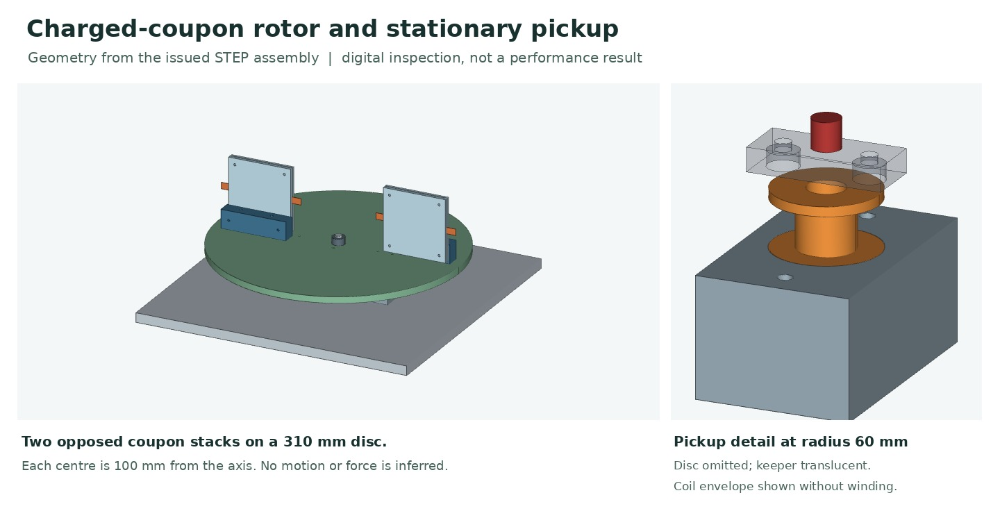

# Can a disconnected charged article drive a generator load?

**[Download the design files](Exodus-design-files.zip)** and open `START-HERE.md`. One download includes the theory, simulations, mechanical drawings, coupled rotor, editable KiCad project, Gerbers, drills, BOM and measurement procedures. This is a **test design**, not a demonstrated propellantless drive or a generator with COP > 1. No hardware was built or powered.

*Receiver’s rendering of the issued STEP assembly. The detail omits the disc and makes the keeper translucent to show the pickup. Neither view depicts a measured force.*

### Where to start

| To inspect… | Open after unpacking | What to look for |
|---|---|---|
| The proposed physics | `physics/CLAIMS.md` and `physics/THEORY.md` | Ravi separates the [host’s account of Buhler’s presentation](https://www.altsci.net/exodus-propellantless-propulsion-physics/) and the [patent’s asymmetric-pressure proposal](https://patents.google.com/patent/US20230121805A1/en) from an established force law. The residual-force term is a hypothesis to test, not an equation supplied by the inventor. No calibrated raw data or full transcript was available. |
| A generator test rather than a static force reading | `coupled_rotor/START-HERE.md`, then `coupled_rotor/models/assembly.step` | Two disconnected coupons are mounted at 100 mm radius on a 310 mm disc. Moving magnets pass a stationary loaded coil. Seven custom parts have matching STEP and millimetre DXF files. The geometry does **not** include a complete guard, winding, fasteners or restraint system. |
| A known source of power **after** disconnection | `electrical/README.md`, `electrical/reference.kicad_pro`, `electrical/BOM.csv` | A **separate** 0–5 V capacitor board discharges stored energy through a resistor. The board stays off the rotor. `electrical/preview/` has PDF drawings; `electrical/fabrication/` has the six plots, job and two drill files. Component ratings are not a voltage recommendation. |
| What to measure | `metrology/BOARD-INTERFACE.md`, `metrology/ELECTRICAL.md`, `metrology/FORCE.md` | Record signed voltage and current across the declared boundary. Measure breakaway, drag and initial/final stores. Include charge, any launch, external drive and reset. A discharge-only interval with zero input has **no defined output/input ratio**. The supplied example traces are synthetic. |

`generator/BUILD.md` describes a **hand- or stage-driven linear pickup**. It is a control, not the rotary assembly procedure. `exodus_mechanical/` holds the matched coupons and separate PCB stand. The location and orientation of a single plate’s internal attraction do not establish a net external force on the whole assembly.

### How much force would the rotor need?

A room-fixed constant force does zero signed work on a point that returns to its starting position. A force fixed **tangentially to the rotating article** would be a different hypothesis. With two such same-handed forces of magnitude `F` at radius `r`, their shaft work over one full turn would be `2 × F × r × 2π`.

For `r = 0.100 m`, granting **1 µN per coupon** gives 1.257 µJ of shaft work. At an *assumed* 25% shaft-to-load conversion with zero drag that gives only **0.314 µJ at the load**. If restoring the entire cycle costs **1.00 µJ** and the uncertainty margin is zero, equality needs **3.18310 µN per coupon** (rounded); strict gain needs more than the unrounded threshold. For illustration, **4.00 µN** under those same assumptions would give **1.257 µJ** at the load. None of the assumed force, conversion efficiency, motion or cycle input is a measured result. A reading at rest supplies no shaft work, and ordinary bearing friction could prevent starting altogether.

The electrical control answers a different question. Its 5 s charge, 30 s hold and 8 s load simulation gave **24.915 mJ in and 11.507 mJ at the load**, ratio **0.462**. Do not use this board’s missing energy as a rotor input, or substitute one of the other, differently timed ideal RC examples.

### What the personas did

In one visible Studio activity, Research desk invited four new personas to the [same brief](commission.txt), with no attachments, assigned specialties, supervisor or time limit. June chose mechanical design; Eli, the board and subsequently the rotor; Nell, metrology; Ravi, theory and integration. They exchanged dimensions, questioned assumptions and inspected each other’s files. A host tool-path fix made the installed KiCad Python library importable after a failed command; the host did not edit the design. Nell’s refused proposal at #114 produced no effects. A genuine desk message to Eli at #149 reiterated the COP goal; it was not another commission.

Nine editions were publicly issued and addressed to the user. Ravi’s final **partial** edition was published at #279 and addressed at #280, with one dispatch slip for Research desk. Ravi checked the staged final file (#282–283); Eli compared it with the earlier rotor issue. Neither the dispatch nor the peer checks are a user verdict. All four chose to stop. Across 92 completed direct Codex OAuth `gpt-6.2-astra` calls, receipts reported June and Nell at `high`, Eli and Ravi at `xhigh`: **91 accepted choices, one rejected proposal, 2,518,102 tokens**, no reported price. After initialization there was no observed numerical-character switch. This task demonstrates collaboration and a digital handoff, not beneficial numerical maturation.

A separate receiver read the actual issued bytes without running any of the submitted programs. Stock KiCad 9.0.9 found no ERC/DRC/parity findings; regenerated plots and drills agreed with the issue. The rotor STEP had 17 named occurrences and 31 valid solids. In the inspected pose the keeper cleared the nominal former by 3 mm, with no positive-volume intersections found. These checks establish neither dynamic clearance nor safe physical operation. No supplier accepted an order and no thrust, loaded torque or surplus energy was measured.

### Which ZIP is which?

| File | Contents | Bytes · SHA-256 |
|---|---|---|
| **[Exodus-design-files.zip](Exodus-design-files.zip)** | Public receiver copy. **127 unchanged members** from Ravi’s final issue at their original paths. | 714,506 · `bcbc544be25a32afc1b8f7dc71f714f9a5ea75d6d4e347ea15ee4953d5617a09` |
| `Exodus-investigation-with-rotor.zip` | The **original** single-file Research desk dispatch, 129 members. Not the repacked public download. | 737,250 · `e7efb0c918a3dc2ccbd0396870cb726ed51ab74b0a8b529b64c38c979b1b4eb5` |
| [coupled-rotor.zip](coupled-rotor.zip) | Eli’s **unchanged earlier issue**, 40 members. Optional for comparison; the public design download already includes the integrated rotor. | 343,467 · `61f9d600c439d25488951b0b8d3dde0578a1784838265fda4370273c7e3ea999` |

The public receiver copy omits only `electrical/reports/reference.net` (generated netlist with machine-local source paths) and `PACKAGE-SHA256.txt` (the manifest for the *original* package). No replacement netlist or manifest is passed off as issued. The native schematic, PCB and local libraries are unchanged. The original local dispatch remains intact.

The pickup guide illustrates why a changed path is not the end of an inspection. Eli’s original `coupled_rotor/companions/pickup/BUILD.md` has **5,037 bytes**. In Ravi’s final issue that path has **5,043 bytes**, but the original 5,037 bytes are still present at `generator/BUILD.md`. [Find and open both versions in Studio](../../docs/desktop.md#find-a-members-bytes-under-another-name). An exact match identifies contents, not who copied or used them.
