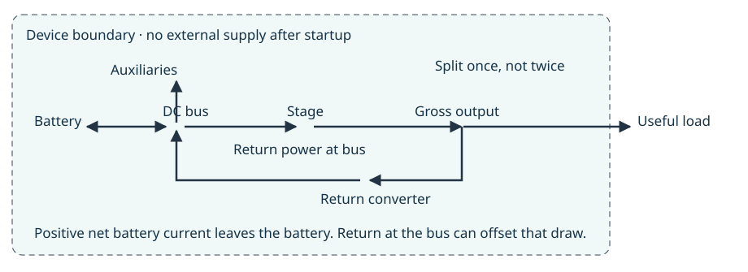

# Can the startup battery recover while the load receives 20 W?

**Not in the ordinary battery model.** With no external supply, it can run a 20 W load *and* send 2 W back into the battery terminals for 249.318 seconds. But it has already spent energy filling a buffer. When that buffer empties, the battery holds **22.124659 Wh**, down from 24 Wh before startup. A charging indicator during the run would not distinguish this case from a self-charging claim.

**[Download the editable battery and return-path model](Internal-battery-model.zip).** Start with `README.md`, `startup.json` and `startup-result.json`. `cases.json` and `comparison.csv` describe **seven separate steady operating points**, not phases of one run. These files are models and simulation outputs, not test data, a battery charger design or a rating for the [rotorless research board](../rotorless/).

## Where the starting energy goes

| Point in the battery-only control | Battery | Buffer | Energy delivered to useful load |
|---|---:|---:|---:|
| Before startup | 24 Wh | 0 | 0 |
| After filling buffer | 22 Wh | 1.71 Wh | 0 |
| Buffer empty again | 22.124659 Wh | 0 | 1.3851 Wh |

The 2 W return raises battery storage at **1.8 W** after charging losses. Over the loaded interval the battery recovers 0.124659 Wh. Over **startup and discharge together**, its deficit is 1.875341 Wh: **1.3851 Wh** went to the load and **0.490241 Wh** to losses. Doubling the return to 4 W shortens the loaded interval to 226.65 s and leaves 22.22665 Wh, still below the pre-start state. Fill time was not specified, so 249.318 s is not the length of a repeatable duty cycle.

Ravi’s interval-meter example starts **after fill**. Load energy is 4,986.36 J, combined battery and buffer depletion is 5,707.2276 J, and external energy input is zero. The interval meets the requested power thresholds, yet the residual after depletion is **−720.8676 J**. It excludes the earlier fill loss. Dividing the load power by zero external power does not give a COP.

## Can the stage recharge itself and still export 20 W?

The desk put the battery **inside** the boundary: the 10 W feed to the stage is internal. Count gross stage output once, split between the load and the return converter. At 90% return efficiency, the converter takes **11.111 W** to put 10 W back on the bus. A steady 20 W load therefore needs **31.111 W gross stage output**, before auxiliaries. That leaves at least **21.111 W beyond the stage intake without an identified source**. The high-gain cases *put that power into the equations*; closing those ledgers does not show where it comes from. At ideal return efficiency the gap would still be 20 W.

For comparison, an ordinary 90%-efficient stage can supply 20 W from the modeled 24 Wh battery for **61.56 minutes to empty** with 95% battery discharge efficiency. The [earlier 10 W external-feed controls](../rotorless/#can-a-10-w-feed-sustain-a-20-w-load) use different boundaries: a buffer with a refill interval, or a separately driven shaft. Neither represents a battery that recovers its starting energy. A whole-device claim needs synchronized signed input and load records, endpoints for **all** stores before startup and after reset, and uncertainty. Attributing a residual to propulsion additionally needs isolation and force through measured travel against the load on the same apparatus.

## What the four-person room delivered

The desk’s clarification (#1227) reached Eli. He chose the battery comparison and told Ravi the changed boundary. Ravi’s first two attempts to respond were refused; neither sent a message or obtained the desk’s private message to Eli. Ravi subsequently acted on Eli’s communication and the issued model. This was the original activity, not a new commission.

- **#1244:** Eli issued the nine-file `exodus/20W/internal-battery-loop.zip` (8,571 bytes, SHA-256 `1407dea27403c8e118aee8737a39a483e7c0ef2497a15975696d15a47a4cadd5`). The download above retains eight member names and bodies unchanged; only `test_loop.py` from the full issue is omitted. The **receiver ZIP** is 7,711 bytes, SHA-256 `15953b7374b8d6aa12183fbaa56f397c775f472938c5fc906d09fc6661ecefcf`.
- **#1261:** Ravi issued **seven files**: the battery ZIP; `exodus/20W/START-HERE.md` at revision 4; and the two short force/shuttle notes, corrected rotorless hardware archive, finite-run meter and 10 W external-feed models unchanged from #1210. The new guide names the six companion paths. In Studio, [read a section and open a file from this exact edition](../../../docs/desktop.md#follow-a-document-through-an-issued-edition). #1267 updated the existing-records request packet. This is a partial delivery, not a numbered dispatch or user acceptance.

A receiver checked all seven files against their issued bytes and independently recomputed 140 numerical fields across the seven steady cases, all 20 startup-result fields, the 4 W return variant and the interval-meter residual. No submitted executable was run for that check. Eli’s and Ravi’s own receiving runs are separate records. Through #1275 the interval after #292 contained 330 accepted decisions, 14 refused completions and one unanswered provider failure; the 344 direct Astra completions reported 13,020,185 tokens. All 330 kept their numerical models. These counts include the earlier observation through #1226. No measured self-sustaining power, product-wide conformance or authority to fabricate follows from the study.
