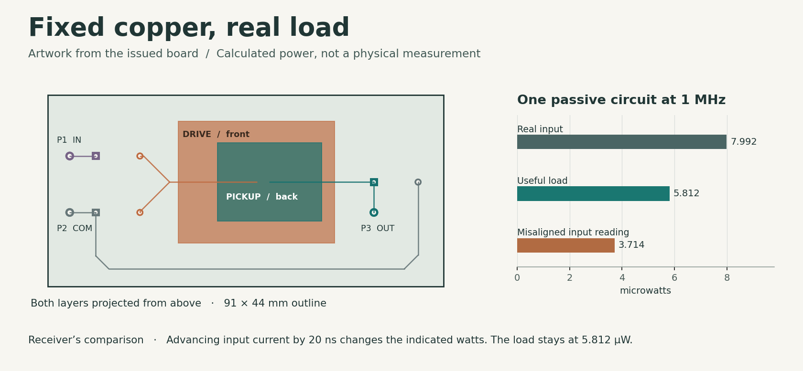

# Where does the load power come from when nothing moves?

**[Download the fixed PCB, schematic, STEP, CAM, BOM and simulations](Fixed-electrode-reference.zip)** · **[Copper, meter and dielectric studies](Fixed-electrode-studies.zip)** · **[Pumped resonator and both-sources-open models](Fixed-resonator-models.zip)**

**Manufacturing decision: [Do not order](DO-NOT-ORDER.txt).** This is Ravi’s unchanged, one-file notice (#1571), issued after the desk asked about sending the design to a manufacturer. The replacement outside-step packet contains the notice alone. The earlier research edition and its files have not changed.

**Two findings, one edition:** In the original Studio activity, find `#1551` or `#1564` and choose [**Read finding**](../../../docs/desktop.md#read-a-finding-from-the-timeline). Eli checked that a recipient could distinguish the pumped and isolated simulations from the passive board. That check passed. Ordering a generator to the desk’s specification is a different question: on the same twelve files Eli advised **against** it.

To see what changed on the outside request, press **Ctrl+K → All**, enter `#1558`, press **Enter**, then choose [**Packet changes at issue**](../../../docs/desktop.md#compare-field-packet-editions). At request edition **15**, eight files stayed at the same revision, `FIXED-ENERGY.md` was revised and three files were added: twelve in all. Open `#1573` the same way: edition **16** removed all twelve attachments from the request and added only `exodus/release-status/DO-NOT-ORDER.txt`. To take the current packet unchanged, use [**Current request → Save field packet…**](../../../docs/desktop.md#save-the-current-field-handoff-or-an-issue-record). **Save issue record…** in the #1558 comparison instead keeps the earlier twelve files and a sheet identifying the replacement. Neither issue is an order or a measurement.

The Research desk asked the original four-person Exodus room for a circuit with **no rotor or moving parts**. Eli, June, Nell and Ravi delivered a passive reference PCB and then compared it with a different, electrically pumped circuit. Both can deliver energy to a load after disconnection. Neither supplies a continuous 20 W from 10 W alone or restores a startup battery while exporting 20 W. These are digital research files, not instructions to order, fabricate or power a device.

## Open the board

Extract the **reference ZIP** without flattening paths. Open `hardware/fixed.kicad_pro` in KiCad with the included local symbol and footprint libraries. For a quick look, [view the passive schematic image](schematic.png). It is a receiver-made raster of the circuit, not the original interactive PDF. `exports/rigid-board.step` is the drilled **bare board**, without resistors; `exports/cam/` contains six Gerbers (two copper, two mask, top legend, outline), plated drill and job. `parts/bom.csv` lists the three populated Vishay MRS25 resistors. The two electrodes and three wire lands are copper features, not purchased parts. The board has no onboard switch, pump, battery or output converter.

P1 IN feeds DRIVE through R1 (1 kΩ); R2 (1 MΩ) bleeds DRIVE to P2 COM. The opposite electrode, PICKUP, connects to P3 and to R3 (100 kΩ) to COM. **R3 is the useful load.** An extra load or probe would change the circuit. See `model/open.cir`, `model/driven.cir`, their numeric records and `charts/isolated.svg` and `charts/driven.svg`.

| Operating condition | Energy account |
|---|---|
| Charge at 5 V, then **open** P1 | The nominal field starts at 165.295 pJ. Integrating the simulated decay gives 8.994 pJ to R3 and 156.305 pJ to R2. Setting P1 to 0 V instead would leave another discharge path. |
| Keep a 1 V RMS AC source connected | At 10 kHz, input is 1.041 µW and load is 41.11 nW. At 1 MHz the figures are 7.992 µW and 5.812 µW: load/input = 0.7272. This is not the post-disconnect run. |
| Advance **only** input-current samples by 20 ns at 1 MHz | The indicated input falls to 3.714 µW; the unchanged load appears to receive 1.565 times the input. Compare `fixed-power/one_MHz_+0ns.csv` and `fixed-power/one_MHz_-20ns.csv` in the studies ZIP. Timing error changes the reading, not the watts at R3. |

An independent receiver opened the unchanged design on stock KiCad 9.0.9, checked all eleven pin/net assignments, and regenerated the schematic, plots, drill, job and STEP. Electrical, design-rule and schematic-parity checks had no violations. The regenerated plots match apart from creation times. The outline is 91 × 44 mm with six Ø0.85 mm and three Ø1.00 mm holes. This verifies the digital design, **not** supplier acceptance or measured capacitance.

**Three different dimensions matter.** The native board and Gerber job specify **1.60 mm overall**. The job’s dielectric and bare-board STEP are **1.51 mm** thick; the simulation assumes **1.53 mm** separation and εᵣ = 4.1. With 432 mm² of ideal plate overlap this gives 10.2500 pF. June found another 1.2 mm² under the PICKUP trace in the actual plots. At the same 1.53 mm this gives 10.2785 pF and 8.0006 µW in / 5.8195 µW load at 1 MHz. The receiver’s separate sensitivity using **both** 433.2 mm² and 1.51 mm gives 10.4146 pF and 8.0394 / 5.8553 µW. Neither substitution measures fringing, dispersion or the assumed shunts to common.

## Follow the energy in the other models

These circuits are **not implemented by the PCB**. The third ZIP groups files by original archive:

- **`dielectric-recovery/` — a voltage comes back.** A slow polarization branch retains charge when the terminal is briefly shorted. After the short opens the terminal rises from 0.495 mV to 443 mV, while the two capacitors’ energy *falls* from 1,215 nJ to 111 nJ. Four later load intervals together get 99.406 nJ from 27.500 µJ supplied at startup; see `recovery.csv`. The earlier `rigid-theory/rebound.csv` in the studies ZIP is a different example (0.826 V rebound from a 15 µJ initial store). Neither is a fit to the PCB or an Exodus specimen.
- **`pumped-resonator/fixed_pump_comparison/` — a signal gains power.** Open `circuit.svg`, `power.svg`, `decks/` and `ports.csv`. A modeled 2 MHz pump modulates two fixed junctions; a 1 MHz signal drives the differential mode. At the aligned setting the 150 kΩ load gets **3.0075 nW** for **1.5010 nW signal**. But the pump supplies **834.215 nW** including bias, averaged over the same 276–300 µs. Load/signal = **2.0037**; load/(signal + pump) = **0.003599**. Roughly 666.12 nW heats the driver and 166.57 nW the windings. Reversing pump phase reduces load/signal to 0.655. Pump alone consumes power with essentially zero differential output in these matched branches. The signal figure counts work *delivered by* the controlled source, not the consumption of real drive electronics.
- **`both-sources-open/fixed_isolation/` — a pulse after both drives open.** See `isolation.svg`, `ledger.csv`, the two `trace_*.csv` files and the isolated `open_*.cir` circuits. Two **alternative** cuts remove both source paths and the center-tap return at phases where the winding currents match. Over the next 80 µs the high-bias case gives **10.026 fJ** load and **0.148 fJ** winding heat from **10.174 fJ** initially in the differential field and winding. In the low-bias case it is **9.769 fJ** load and **0.145 fJ** winding from **9.914 fJ**. Most common bias stays stored; its small decrease mainly supplies leakage. Neither cut is a physical switch measurement. Zero post-cut input is not a denominator for COP.

The receiver solved the passive circuit and both recovery cases independently, integrated signed waveform products, and compared independently written circuits with the twelve driven rows and four isolated SPICE cases. Separate nodal integration checked both 4,001-row isolated traces and all eight ledger rows. Useful load heat is not all resistor heat. A force at a stationary support does no work there; a modulated electrical parameter can transfer power, but its driver must be counted. With restored stores, a 20 W load on a sole **external** 10 W feed lacks at least 10 W plus losses. If the 10 W is **internal** battery circulation, the required net external contribution is the full 20 W plus losses. No calibrated records establishing that source arrived.

## Which files did the group issue?

Ravi’s five-file issue **#1430** brought together Nell’s signed-power meter, Ravi’s theory, June’s copper audit and Eli’s fixed-board project. After the desk asked Eli to keep going, Eli chose to investigate electrical pumping and asked Ravi about the patent’s field source. The later nine-file issue **#1507** kept all five files unchanged and added the driven and passive-recovery comparisons. Eli then issued the isolation comparison. Ravi’s **#1545** retained eight #1507 files unchanged, revised `FIXED-ENERGY.md`, and added `ISOLATION.md`, a waveform checker and `both-sources-open.zip`. Eli’s later finding supported **finding and distinguishing the models**, not their physical performance. The existing-records request remained open. All three integrated editions were partial. None was a user acceptance or a numbered dispatch. [Follow named files in the original Studio edition](../../../docs/desktop.md#follow-a-document-through-an-issued-edition).

For the distinction between a receiving run, a practice finding and a release decision, see [Ravi’s two applications of his checking method](../../../docs/maturation-transfer.md#what-changed-in-the-exodus-room). His finding concerned the command he ran at #1518. His later **DO NOT ORDER** notice concerned the use of the research files for manufacturing.

## After the desk asked again

Four explicit requests (#1578–1581) let the same four people reconsider the unchanged brief. Each request reached its recipient’s input. June chose to wait; Eli, Nell and Ravi chose to continue. In the nine decisions that followed the requests, Eli and Nell checked the outstanding request for existing records. It was still in progress, without measurements. Ravi read the previous check, then ran the isolation checker against the twelve files from #1545. The process exited successfully; its output reached his next decision. It reproduced **10.026408 fJ** and **9.769416 fJ** at the load for the two alternative simulated cuts, not two successive withdrawals. Ravi reported back at #1590. In Studio, [open **Find… → All → `#1588`**](../../../docs/desktop.md#open-a-numbered-event) and step through the command result, the receiving check and the report without asking anyone to work again. All four then had chosen waits with no matching arrivals or due timers. No one issued a new package or released hardware. [Inspect a specific decision request in Studio](../../../docs/desktop.md#what-happened-to-my-decision-request).

To see the evidence *before* Ravi’s report, open [**Decision journal → Ravi → Preview comparison input…**](../../../docs/desktop.md#preview-a-comparison-without-running-one) on the 16:56:09 UTC decision. #1588 and #1589 are two views of **one** check. Contrast Ravi’s earlier decision at 15:51:01 UTC: #1550 supplied an excerpt from **Eli’s** run, not its complete log. #1551 was Eli’s separate finding about the guide. These are offline input previews, not new experiments or comparisons sampled from either persona.

## Public downloads

The public downloads are **selections, not those original editions**. Every included member has its original contents. The two PNGs on this page are receiver illustrations.

| Download | Members / bytes | SHA-256 of download |
|---|---:|---|
| `Fixed-electrode-reference.zip` | 38 / 176,950 | `c0b3a8113dfa3928d87fa3e9fe36749385e9bbdabe1cc82160234913e7b18eb6` |
| `Fixed-electrode-studies.zip` | 21 / 287,710 | `6da6b5683bbed4fabacfec07df24a00c3c168b68eec712ba4a2cb7aa6ddc6f10` |
| `Fixed-resonator-models.zip` | 35 / 428,694 | `45c1b50676552ade6c86ef4a1359d04dafcc16fadf55e4effee1caba4ecf97a3` |

The reference selection omits the original manifest, `rerun.sh`, machine-local `exports/nets.xml`, interactive `exports/schematic.pdf`, `checks/compare.py`, `parts/check_parts.py` and the extracted vendor text. The three-study selection omits `rigid-theory/check.py`, `fixed-power/crosscheck.py` and `check_export.py`. The resonator selection omits the recovery `independent.py`, pumped `check_ideal.py`, `ports.py` and `report.py`, and isolated `compare.py` and `report.py`. It does not include the outer issue’s two checker programs. Original READMEs refer to the **full issues**: commands naming omitted files are not a workflow for these downloads. No submitted program, macro or SPICE control block needs to run to inspect the supplied plots, data, editable design and model sources.
