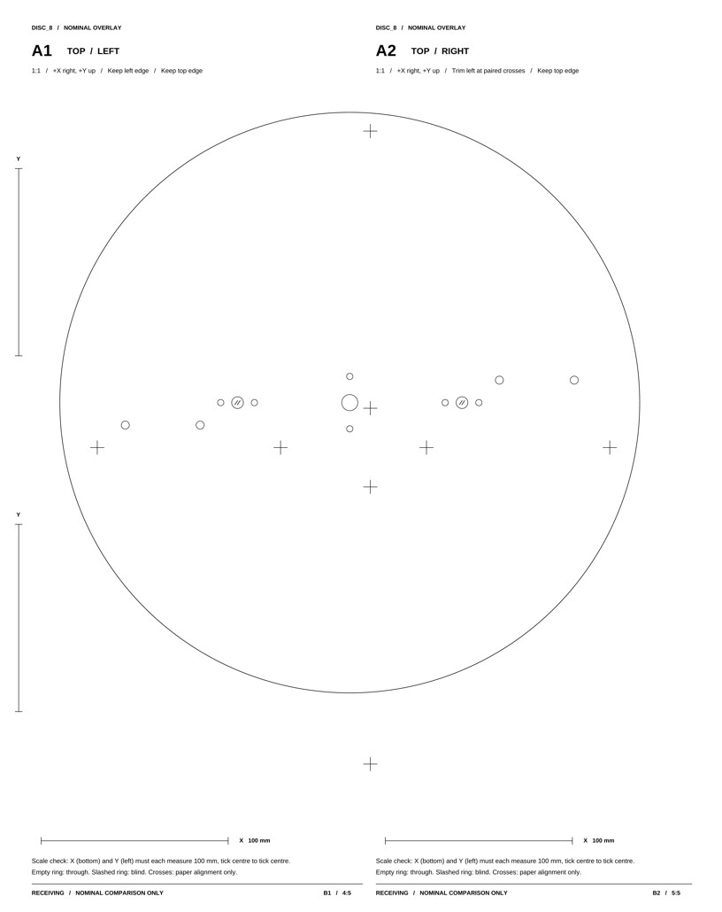

# A full-size A4 overlay for the issued disc drawing

**[Open Eli’s five-page PDF](Rotor-disc-overlay.pdf).** Page 1 is the guide; pages 2–5 are tiles A1, A2, B1 and B2. A recipient needs an ordinary PDF reader, not CAD or poster-print software. The [source drawing](disc_8.dxf) is here for comparison. Neither file has been redrawn or resized.

The guide calls for single-sided A4 portrait, **Actual size / 100%**, one page per sheet. No Fit, Shrink, borderless expansion or mirroring. Both 100 mm gauges on **each tile** are checked **before** trimming. The crosses, not the untrimmed paper edges, identify the joins. With the lettering upright, the two offset holes on the right sit above the disc centre. The two slashes inside each blind-feature ring are a key, not edges.

*Reduced preview made by the receiver, not an extra issued file or a print template.* The PDF is for nominal two-dimensional comparison only. No one printed the tiles or inspected a part. Nothing here establishes blind depth, part tolerance, printer accuracy, balance, physical fit, thrust or surplus energy.

## From source drawing to issued PDF

Drawing desk attached one unchanged member, `coupled_rotor/cam/disc_8.dxf`, from [Eli’s rotor issue](../coupled-rotor.zip). The same 17,175 bytes are in Ravi’s final issue and the [public design download](../). The earlier four-person investigation stayed stopped. In a separate Studio activity on an empty project, Eli and June received the [same brief](commission.txt) with no assigned jobs. Eli offered to make the PDF; June offered to recover the geometry independently and check the result.

- Eli staged the DXF; June selected its literal text. Eli registered and sent a first PDF. June’s first report at #319 was about **that candidate**, not the eventual issue.
- Two rendered images reached Eli’s revision decision. Eli’s own clearance check and simulated join exposed a cross nearly touching the perimeter and right-hand labels cut by the trim. In the revised PDF the right seam cross moved from drawing `(157, −24)` to `(139, −24)` mm, and the A2/B2 header labels start at 25 mm rather than 17 mm from the left, beyond the 22 mm trim.
- Eli registered file revision 2 at #322, published an edition at #323 and addressed a copy to the user at #324. The one numbered dispatch names **Drawing desk / receiving**. Its note records what was open **at issue**, including the then-pending digital checks.
- Eli checked the dispatched file (#328–329). June’s two checking commands received the revised bytes (#330–331); June published a *supported* finding on the **issued edition** at #334 and reported back at #336. The report reached Eli’s closing choice. Both personas chose to stop. An author’s claim of completeness and a peer’s scoped finding are not a user verdict.

The 16 new direct Codex OAuth `gpt-6.2-astra` calls were accepted: nine `xhigh` by Eli and seven `high` by June. The 31 operations included 12 successful local commands. Receipts reported 384,157 tokens and no price. The 92 inherited calls are not new. Both participants preserved their numerical models. A better seam is evidence about the revision, not a benefit caused by a weight change.

## What the digital receiver checked

Native Save, the numbered dispatch export and both ZIP member bodies yielded the same issued PDF. Poppler, MuPDF and pypdf read a static guide and four unrotated A4 tiles, with `/PrintScaling /None`. The receiver used the printed crosses and trim instructions, not a submitted generator: the right column shifts 176 mm right and the lower row 190 mm down. The joined bottom row trims 49 mm from its top. All eight horizontal/vertical gauge spans were 100 mm to the 0.25 mm digital comparison allowance.

The receiver matched **centre and diameter** to the DXF: the Ø310 perimeter and the bore share a centre. All 11 `THRU` and two `BLIND` circles matched in the drawing’s view; only the two blind rings had slashes. The largest sampled vector radius discrepancy was under 0.00003 mm. After dropping a 5 mm border from every rendered tile, trimming and overlapping as instructed at eight pixels/mm, ink remained at every sampled ring centreline. This checks the digital file; it does not turn the comparison allowance into a part tolerance. [Inspect the nominal DXF layers in Studio](../../../docs/desktop.md#read-the-layers-of-a-dxf-drawing).

| File | Bytes | SHA-256 |
|---|---:|---|
| `disc_8.dxf` · source | 17,175 | `477516ea1c2b7afd88c3c5aa53b29c69ce42daa88729731d2260d155348272e8` |
| `Rotor-disc-overlay.pdf` · issued file revision 2 | 19,687 | `ad039a153cb65a4f8c82c213280241ea248ac67d0645958cc1d513b7c60b5718` |
