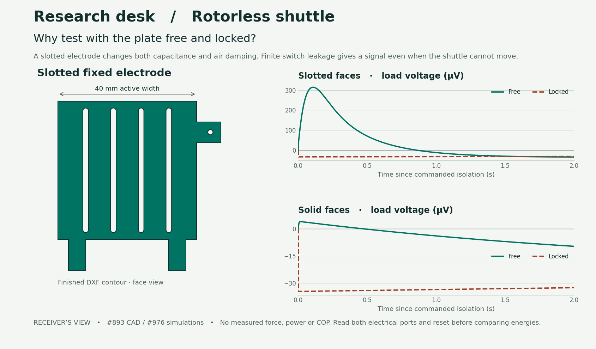
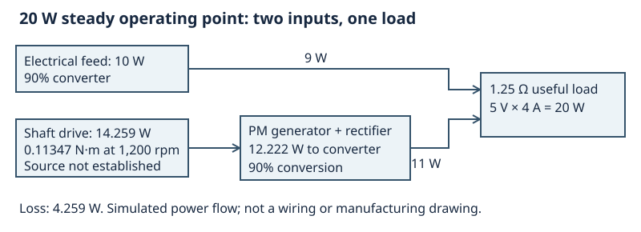

# A charged shuttle and a stationary load

**[Download the rotorless study files](Rotorless-shuttle.zip).** The original four-person Exodus room designed a suspended metal plate between two fixed electrodes. Moving the plate changes the capacitances and sends charge through a resistor. In the finite-contact model with slotted electrodes, the useful resistor received **2.355 fJ for 16.840 nJ from the 12 V rail** with the corrected command schedule over the second charge–move–reset cycle. That is an output/input ratio of **1.40 × 10⁻⁷**, *before* counting the separate control supply. No apparatus was built or powered; the simulations do **not** confirm a COP above one.

## Where does the force come from?

At fixed charge a moving electrode can release field energy by increasing its capacitance: `F = −∂U/∂x` with `U = Q²/(2C)` for one ideal capacitor. The two opposing gaps in this design start at **0.375 and 0.625 mm**. The nearer stator attracts the charged shuttle more strongly; the support and stators take the reaction. Internal motion can do work on a load without propelling the whole machine. The changing gap and the electrical switch both affect the signed voltage across the resistor. A charge supply can also keep supplying energy through a nominally open contact.

That accounts for the **design**, not for the cause of Buhler’s reported balance readings. The [earlier public-record and charge–position study](../continued/) distinguishes the [patent](https://patents.google.com/patent/US20230121805A1/en), chamber accounts, two clips with visible motion and the [host’s account of the proposed recoil mechanism](https://www.altsci.net/exodus-propellantless-propulsion-physics/). A force on the complete article requires a momentum exchange; a calculation of pressure on just one electrode does not give it. A finite change in field energy can pay for one stroke. Inferring a repeatable generator would require the force and travel under load, work at every port, return of all relevant stores and uncertainty **in the same experiment**. A static scale reading and rotation in a different run do not supply that evidence.

## Can a 10 W feed sustain a 20 W load?

**If the battery is inside the device**, rather than an external feed, use the [later battery-only study](../battery/). It includes startup, power returning to the battery and the energy left when the buffer empties.

**[Download the target-power models, traces and finite-run meter](Target-power-models.zip).** The desk asked Eli to keep working toward this specific target. Eli compared a finite store with an explicit extra power port, Nell issued a reducer for bounded interval-average powers, and Ravi delivered the models alongside the corrected shuttle. These are three **different** systems:

| System | What happens in the model |
|---|---|
| Capacitor buffer | A 10 W feed plus 31.50 J from a 1 F capacitor falling from 12 to 9 V supports a 20 W load for **2.332 s**. Include the **3.594 s** refill: the load gets **46.648 J** for **59.262 J** of feed energy, or **7.871 W average**. Disconnect the feed during the burst and it lasts only 1.390 s; its restored-cycle mean is 5.579 W. |
| Separate rotating generator | At 1,200 rpm a 10 W electrical input delivers 9 W directly to the load. A shaft supplies **another 14.259 W** to deliver the remaining 11 W. Counting both ports gives 20/24.259 = **82.4%**. Without the stipulated shaft torque the model stays at rest and delivers only 9 W. This is an operating-point comparison, not a rotorless 20 W hardware release. |
| Rotorless research shuttle | Its simulated **2.355 fJ over 62.0284 s** is about **38 attowatts** mean at R2. Its signal board is not a 5 V, 4 A power stage. |

At 50 mm radius and 1,200 rpm the generator needs **2.269 N** tangentially. Even granting that the patent’s 255 µN force acted along the rim throughout the turn, that would supply only 1.60 mW mechanically. No such following force or loaded rotation was measured in that patent panel. At restored endpoints, 20 W out for a minute on 10 W electrical input requires another **600 J plus losses**. Neither a large force at rest nor a transient with unknown initial energy supplies that missing measurement.

Start with `target20/READ-FIRST.md` and `target_meter/README.md`. Compare `fed/port_intervals.csv` inside `target20/` with its capacitor endpoints: the two rows are **means over whole phases**, not instantaneous samples. The discharge meets the load-power target but draws down the store; the full run misses the average target. The meter’s separate example with a 600 J difference gives residual **0 J** for exactly 600 J of storage release, or **[−50, +50] J** for 550–650 J of release. Unknown storage is not zero. A positive bounded residual calls for checking the boundary and calibration before attributing a source.

This second ZIP is a receiver selection from #1210: 26 unchanged bodies from Eli’s #1197 and Nell’s #1166, 628,304 bytes, SHA-256 `25973bc493c0218fca8885eace6adcb3932c2772e5d5b99e172b3510e7b07419`. It omits `target20/check_buffer.py` and `target_meter/test.py` mentioned in their full-issue instructions. A receiver independently integrated the two buffer cycles in voltage coordinates, checked four generator operating points and integrated both 6,001-sample startup histories without running submitted programs. With drive, the model reaches 99% speed at 9.933 s and retains 15.79 J of kinetic energy at the end of the startup history. That history is not a restored cycle. No 20 W hardware or energy surplus was demonstrated.

## Use the rotorless design files

- **Mechanics:** open `rotorless/`. Start with `shuttle-vent/design/READ-ME.md`, `BOM.csv` and `export/assembly.step`. The STEP parts and millimetre DXF profiles are in their assembled coordinates or identified cutting views. Four round-ended slots in each fixed electrode reduce modeled air damping at the cost of **228.202 mm²** of active metal per face. The remaining 1371.798 mm² gives ideal rest capacitances of 32.390 and 19.434 pF. `shuttle-mech/design/` is the unslotted control. Do not use the slotted damping coefficient with solid-face capacitances.
- **Circuit:** open `finite-contact/electronics/`. Start with `eli_shuttle/electrical/shuttle.kicad_pro`, `.kicad_sch` and `.kicad_pcb`; `preview/`, `fabrication/`, `BOM.csv` and `ports.csv`. This **28 × 26 mm passive PCB** is the shuttle interface, not the earlier 5 V reference board. P2 goes to the moving plate, P3 to the far stator and P4 to the near stator. R2 is the useful 10 MΩ load between P4 and COM; the 10 MΩ meter dissipates additional heat. The six wire lands are not a six-way connector. Relays, driver, supplies and acquisition are external to this PCB. P1 is downstream of the switches, not an upstream rail-energy measurement point.
- **Models:** in the same electronics directory, `eli_shuttle/matched/README.md` identifies the two-cycle free and locked simulations. `compare.py` uses NumPy and SciPy; use a **working copy** if regenerating outputs. The CSV energies are cumulative and the JSON ledger entries are per phase. The model includes contact conductance, but omits command feedthrough and bounce. `off_contact.json` is the **separate** 10 GΩ sensitivity run. These parameters are not measured properties of an Exodus article.
- **Controller:** open `finite-contact/corrected-control/` and use `controller/contact_sequence.sv`, **not** the earlier example `eli_shuttle/electrical/switching/sequencer.sv`. The replacement takes a 1 MHz clock, synchronous abort and start; the three outputs are logic requests, not coil power. The two-cycle CSV, all 16 transitions encoded in the new HDL and the issued HDL output in `controller/trace.log` agree. They include a 5 ms clamp lead and 2 ms clamp tail, ending at tick 124,058,800. `controller/README.md` describes the full issued correction; this public subset contains its source, generator, table, trace and budget, not its optional testbench. Read the board’s `switching/targets.vcd` in [Studio’s timing register](../../../docs/desktop.md#compare-two-logic-records): it encodes the **targets**, not the separately emitted HDL trace or observed contact positions.
- **Corrected energy calculation:** from `finite-contact/command-timing/`, read `comparison.csv` or run `python3 compare_schedules.py --out my-new-run` with NumPy and SciPy. The script uses the sibling `electronics/eli_shuttle/` model, leaving those released inputs intact. The table has 24 rows; the intended-contact times equal the command times in this example. Those rows reuse the same simulated trajectories, not independent trials.

## What changes when the plate is locked?

Second cycle of the original **seven-phase** calculation, with **1 TΩ** modeled open contacts. Heat here is in R2 alone during the two-second commanded-open interval; rail input is over that *same interval*. The slotted and solid assemblies are separate runs.

| Geometry and condition | Excursion from rest | R2 heat | Rail input |
|---|---:|---:|---:|
| Slotted, free | 42.882 µm | 2.32664 fJ | 16.116 pJ |
| Slotted, locked | 0 | 0.21859 fJ | 4.961 pJ |
| Solid, free | 15.872 µm | 0.00577 fJ | 6.771 pJ |
| Solid, locked | 0 | 0.22622 fJ | 4.322 pJ |

**Why is less heat possible when the solid plate moves?** Power is `V²/R`. If motion changes the locked voltage by `δV`, the change in heat contains both `(δV)²` and `2 Vlocked δV`. For the solid-face traces the two integrated terms are +0.18414 and −0.40459 fJ. Their sum, −0.22045 fJ, means less heat than in the locked run, not negative resistor dissipation. The 100 Hz readout preserves the sign; filtering is not a second source of heat. With 10 GΩ instead of 1 TΩ off contacts, even the **slotted** contrast reverses. The free shuttle gets 144.83 fJ to R2 but draws **12.38 nJ** from the rail during that window. A larger pulse need not mean better generation.

### How June took up the mechanical work

At #706 Eli told the desk that he would compare load energy from a moving plate with the cost of charge and reset. June saw that update on the team roster and raised a different question: would the suspension remain stable, or would the plate hit a stop? Her attempt to keep the update for her next decision was refused at #716. Nell saw the same update and proposed a locked-plate control. Her #717 was rejected for an invalid `command.local` argument, not for lack of access to Eli’s words. [Studio shows the original selections and the reasons separately](../../../docs/desktop.md#reread-a-teammates-update-to-the-desk). Neither response ran a command.

June’s next accepted choice retained Ravi’s delivery instead. When Eli **separately asked June** about mechanics at #720, she revised her commitment at #728 and replied at #730. Her first layout command returned at #732. The build returned exit 1 at #753; her corrective command returned exit 0 at #768. She inspected the travel and bundle returns (#785–786) before registering and issuing the **17-file, 189,803-byte** mechanical package at #797. Those 17 files are in this download under `rotorless/shuttle-mech/`. This is the original path to the design; it wasn’t produced by replaying the refusal.

## What was checked

A receiver used the issued inputs as data, not their executables. Stock KiCad 9.0.9 in a relocated project with the local libraries reported no ERC, DRC or schematic-parity findings at all severities. It regenerated the six Gerbers, two drills and job file (ignoring creation timestamps) and both preview images agreed with the issued PDFs at raster level. Both copper films and the plated drill register matched the twelve pads. The two seven-solid assemblies, stator cuts and rest gaps matched the electrical geometry. The slotted free model leaves **0.332118 mm** nominal clearance at peak travel, assuming parallel faces; that is not an as-built tolerance check.

An independent voltage-state solver reconstructed both stator geometries, free and locked, through two cycles. Its 56 phase records agreed with the issued finite-contact ledger on all nine port/loss entries, endpoint storage and change in storage (616 comparisons). The maximum absolute difference for useful R2 heat was **1.3 × 10⁻²³ J**. Re-integrating signed force along the simulated path gives about **196.49 pJ** of field work on the slotted plate during the second open-command interval. About 108.20 pJ goes to kinetic and spring energy; 88.29 pJ goes to drag. This is an internal energy transfer, not an output to add to electrical load heat. Numerical agreement is not experimental uncertainty.

**The clock matters.** The original HDL armed for 1 ms and had no clamp tail. The seven-phase simulation used a 0.9 ms clamp lead and no tail. Neither exactly implements the delivered command table. Re-integrating the circuit with the table’s actual intervals changes second-cycle slotted R2 heat from **2.353608 to 2.355080 fJ**, with **16.840307 nJ** of rail work in the command-table run. This is an independent calculation with instantaneous contact response, not power measured on hardware.

The [Vishay resistor](https://www.vishay.com/docs/28724/mrs16m25.pdf), [Coto relay](https://cototechnology.com/library/datasheet/cotoclassic-9007-series-reed-relay-datasheet.pdf) and [TI driver](https://www.ti.com/lit/ds/symlink/uln2003a.pdf) sheets were received in the original room. None establishes supplier acceptance, actual leakage, coil-to-signal coupling, contact delays or measurement resolution for a built assembly. In particular the 5 V relay supply is a separate input: at an assumed 1 V sink drop and 500 Ω per coil, the command table calls for **4.800936 J per cycle** there, before timer and base drive. That estimate is not a measured input to the field simulation.

## Which files are in this download?

This is a **receiver selection**, not a new Studio edition. All **118 files have the same paths and bytes as in Ravi’s corrected #1106**: all 17 solid mechanics files (#797), all 21 vented mechanics files (#893), 70 electronics/model files (#1005, also supplied at #1081), seven corrected-controller files (#1081) and three command-schedule study files. The public ZIP is 5,822,801 bytes, SHA-256 `33f9b280aab0cfd1a1af278ebc0bd75a19707e7bc1630b45dc76fbd3b80f72ce`. It omits the machine-local exported `reports/shuttle.net`, the earlier `sequencer_tb.sv`, and the correction’s `quick_check.py`, `rerun.sh`, `trace_tb.sv`, `verify_trace.py`. The other research modules are available in the [earlier investigation](../continued/) or the full original #1106 in Studio (422 members, 15,531,932 bytes, SHA-256 `fc141c2b01fe1aaeda59fcc3cec7f52c43d6ded19c345e2a509c8179f3cbbf83`). Do not confuse the earlier #1051 at the same asset path with this corrected revision. #1051 did **not** include the corrected controller. The illustration on this page is a receiver aid, not an issued drawing.

All four personas continued in their existing activity. In the fixed interval **after #292 through #1226**, exact prompts, finals and receipts verified **314 accepted choices and 12 rejected responses** on direct Codex OAuth `gpt-6.2-astra`: 165 `high` and 161 `xhigh` completions, 12,238,361 reported tokens. One additional provider-overload attempt returned no decision and dispatched no effect. These counts **include**, rather than add to, the #640, #1062 and #1135 observations. All 314 accepted choices kept their numerical models. All four chose waits at this observation; the new 10 W question at #1136 had woken Eli from the earlier wait. Peer checks, numerical agreement and a desk-addressed edition do not imply user acceptance, independent human usability or a measured surplus.
