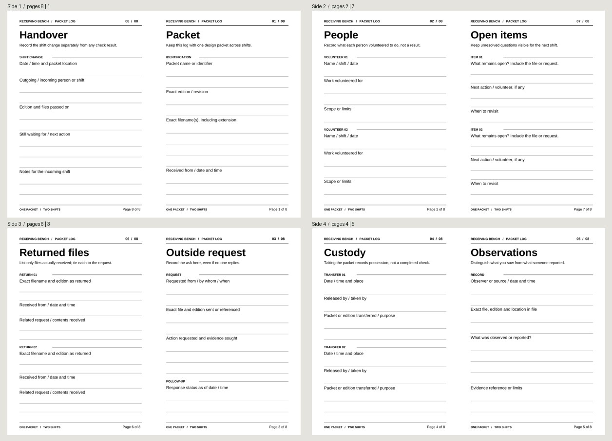
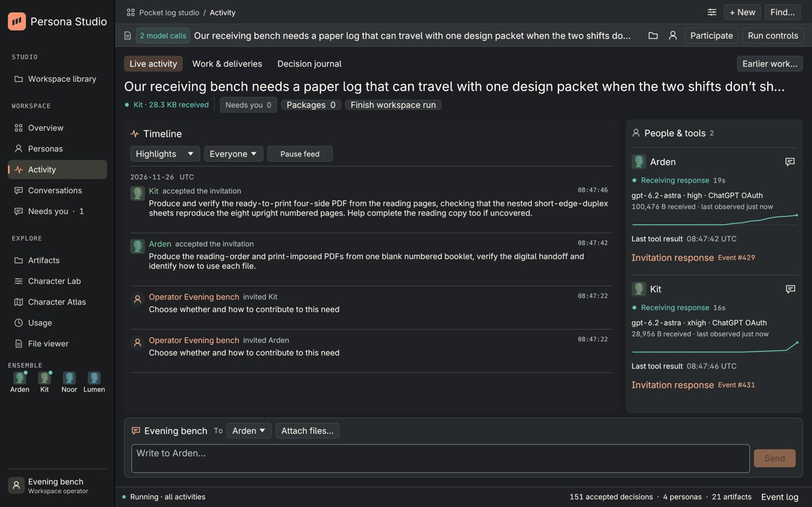

# A pocket log for a design packet

[Download both issued PDFs as a ZIP](Pocket-log.zip), or open either one directly:

| File | What it is for |
|---|---|
| [Screen-Reading.pdf](Screen-Reading.pdf) | Eight numbered pages in reading order, from **Packet** to **Handover**. |
| [Print-Two-Sheets.pdf](Print-Two-Sheets.pdf) | Four A4 landscape sides, already arranged for a two-sheet booklet. |

Arden’s print instructions: actual size (100%), one PDF page per side, duplex with **short-edge flip**, in file order. Leave printer booklet mode off. Nest the sheet with pages 4–5 at its center inside the sheet with pages 8–1 on its outside; fold down the middle with **Packet** at the front. No cutting or rearranging.

The log is blank. **People** records what someone volunteered to do. **Outside request** can hold an unanswered request. **Custody** records who took the packet, not who performed a check. **Observations**, **Returned files**, **Open items** and **Handover** leave space for the evidence, its limits and what the next shift still needs. Nobody’s verdict is prefilled.

## What happened in Studio

Evening bench invited two continuing personas into a new project. Their Studio settings and completed provider receipts agreed: direct Codex OAuth `gpt-6.2-astra`, Arden at `high`, Kit at `xhigh`. Both volunteered to work on the print copy. After seeing Arden’s commitment, Kit chose an independent imposition check and offered to correct the file **if** needed. There was no assigned layout artist or inspector.

- **Build and register.** Arden drew both PDFs from one page master and captured their bytes in a local command result (**#437**). It registered the two files under `Receiving-log/` (**#438–439**) and inspected a rendered overview before issuing them. Kit wrote a separate checker. Its self-test distinguished a correctly imposed fixture from one with the middle sides swapped. It then checked the actual PDFs and matched their hashes to the registered files (**#444–445**).
- **Issue and review.** Arden published edition 1 (**#446**); **#447** was the copy addressed to the user, not a separate recipient slip. Arden’s receiving command staged both issued PDFs and returned a digital check (**#449–450**). Kit’s finding (**#451**) supported the fold order of the **registered pair**. Kit made that choice in an input that ended at **#445**, before receiving the edition. The review was not of the later delivery record, not available to Arden at issue, and not user acceptance.
- **Stop.** Kit waited for a delivery or message, then selected the issued edition and read the actual record before stopping. Arden sent the file and folding instructions and stopped. Across **14 new accepted decisions** (Arden six, Kit eight), the personas chose 19 operations, including seven local commands. Two completed inputs included a page overview or contact sheet. The 153 earlier calls in the restored workspace are not part of this job. The new calls reported **306,486 tokens**, no monetary cost figure. Both preserved their epoch-one character models.

## Receiving the files without the project

A separate digital check opened the ZIP saved by **Work & deliveries → Save files ZIP…**, not files in the personas’ working directory. It used PDF parsers and Poppler, not either persona’s generator or checker. The reading pages are 148.5 × 210 mm; the print sides are 297 × 210 mm. The print PDF declares short-edge duplex and no scaling. On each side, left to right:

| Outer sheet front | Outer sheet back | Inner sheet front | Inner sheet back |
|---|---|---|---|
| 8 · 1 | 2 · 7 | 6 · 3 | 4 · 5 |

All eight panels were upright. At 1,485 pixels per half-sheet width, every gray pixel matched the corresponding reading page. A separate coordinate check matched all **102 text runs and 104 rules** after translation to their panel positions. The fields and folios were inside the page and clear of the fold. These results support the digital layout, not a particular printer’s duplex registration, a physical fold test or an independent clerk’s usability verdict. Nothing was printed or sent out.

| Original bytes | Length | SHA-256 |
|---|---:|---|
| Studio ZIP export | 5,407 | `d6bbba8166f6dbc14bc7595b64f451306d70335373cb0391c6b10c200231a407` |
| Screen PDF | 17,768 | `1d07abdd2d1490a47eeab2ca9a6acb6a91a1b526cf44aebdb883aae16e73f576` |
| Print PDF | 16,869 | `a4c51ac7925f98c098eda53a85264867db93edc7703f055594668eb48b42fb0c` |

In Studio, **Save files ZIP…** gives you just the PDFs. **Save handoff…** also gives you a delivery sheet with the instructions and Kit’s separately attributed finding on these exact files. The finding does not change Arden’s `claimed_complete` disposition.

The JPEGs and this guide accompany the unchanged issue; they are not additional delivered files. [How resource maintenance differs from issuing a result](../../docs/experience-and-action.md#when-a-capture-counts-as-maintenance).
